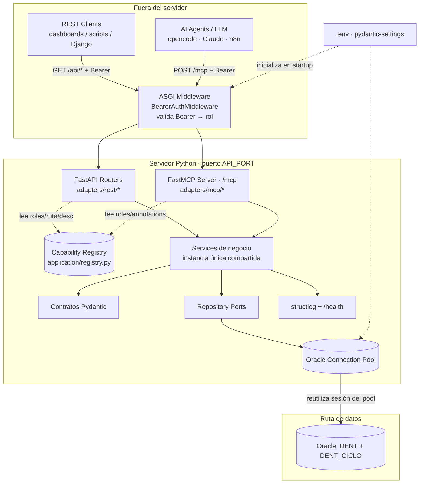
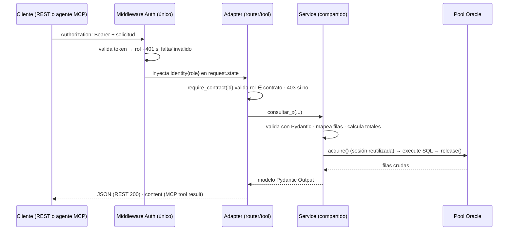

# Enablement Layer — Control Contable + Pacientes

Servidor Python (**FastAPI + FastMCP**) sobre **Oracle** que reproduce, con paridad
exacta, las tablas del correo legacy **"Resumen Control (Contable)"** y expone además
el censo de pacientes por ciudad de `docs/go/encuentros.md`.

Un solo proceso expone **dos protocolos** sobre los **mismos servicios**:

- **REST** (HTTP/JSON) para dashboards, scripts y aplicaciones.
- **MCP** (Model Context Protocol, transporte *streamable-http*) para agentes LLM.

Este README es la guía operativa y de arquitectura. Sirve para:

1. Instalar y levantar el servidor (local y eventualmente Debian).
2. Entender la arquitectura de capas, los contratos y las reglas de diseño.
3. Operarlo (config, auth, salud, errores, tests, troubleshooting).
4. **Servir de guía a un desarrollador o a un LLM** para agregar una nueva capacidad.

> Documentos de diseño complementarios (fuera de este directorio):
> `../docs/refactorizacion/arquitectura.md`,
> `../docs/refactorizacion/000_MiEstrategiaV2.md`,
> `../docs/refactorizacion/capacidades/CATALOGO.md`,
> `../docs/refactorizacion/capacidades/PLANTILLA_CAPACIDAD.md`.

---

## Tabla de contenidos

- [1. Quickstart](#1-quickstart)
- [2. ¿Qué es la Enablement Layer?](#2-qué-es-la-enablement-layer)
- [3. Arquitectura](#3-arquitectura)
- [4. Servicios y capacidades](#4-servicios-y-capacidades)
- [5. Transportes](#5-transportes)
- [6. Modalidades de uso](#6-modalidades-de-uso)
- [7. Instalación](#7-instalación)
- [8. Dependencias: `requirements.txt` y paquetes](#8-dependencias-requirementstxt-y-paquetes)
- [9. Manejo de Pydantic](#9-manejo-de-pydantic)
- [10. Contratos (Capability Registry)](#10-contratos-capability-registry)
- [11. Acceso a datos: Oracle, pool y SQL](#11-acceso-a-datos-oracle-pool-y-sql)
- [12. Seguridad: Bearer, roles y secretos](#12-seguridad-bearer-roles-y-secretos)
- [13. Configuración (`.env`)](#13-configuración-env)
- [14. Observabilidad y salud](#14-observabilidad-y-salud)
- [15. Tests](#15-tests)
- [16. Operación y despliegue](#16-operación-y-despliegue)
- [17. Troubleshooting](#17-troubleshooting)
- [18. Guía para nuevos programadores y LLMs](#18-guía-para-nuevos-programadores-y-llms)
- [19. Cómo generar una nueva capacidad (paso a paso)](#19-cómo-generar-una-nueva-capacidad-paso-a-paso)
- [20. Glosario](#20-glosario)

---

## 1. Quickstart

```bash
cd enablement-layer

# 1) Ambiente virtual
python3 -m venv .venv
source .venv/bin/activate            # macOS / Linux  (Windows: .venv\Scripts\activate)

# 2) Dependencias
pip install -r requirements.txt

# 3) Configuración (copiar plantilla y rellenar Oracle + tokens)
cp .env.example .env

# 4) Levantar el servidor (REST + MCP en el mismo puerto)
python -m uvicorn app:app --host 127.0.0.1 --port 8090
```

Una vez arriba:

| Recurso | URL |
| --- | --- |
| Health (público, sin auth) | `http://127.0.0.1:8090/health` |
| OpenAPI / Swagger (público) | `http://127.0.0.1:8090/docs` · `/openapi.json` |
| API REST (protegida) | `http://127.0.0.1:8090/api/...` |
| MCP streamable-http (protegido) | `http://127.0.0.1:8090/mcp/` (usar **slash final**) |

Toda llamada protegida requiere `Authorization: Bearer <token>` (ver `.env`).

```bash
TOKEN=$(grep '^AUTH_TOKEN_GERENTE_FINANZAS=' .env | cut -d= -f2)

curl -H "Authorization: Bearer $TOKEN" \
  "http://127.0.0.1:8090/api/contabilidad/ingresos-por-tipo-pago?fecha=2026-10-01"

curl -H "Authorization: Bearer $TOKEN" \
  "http://127.0.0.1:8090/api/pacientes/pacientes-por-ciudad-chile"
```

---

## 2. ¿Qué es la Enablement Layer?

Es una **capa de habilitación**: no reemplaza al legacy Java/Payara, lo *reproduce*
sobre Oracle con contratos estables y gobernables para que un LLM (o cualquier
consumidor) pueda consultarlo de forma segura. La filosofía central:

- **Paridad, no innovación.** Las queries se copian del legacy *tal cual*, incluidas
  decisiones que parecen bugs (banda horaria vs. igualdad exacta, estados, etc.). Un
  filtro "de más" ya es otra capacidad.
- **Un solo proceso, dos protocolos.** REST y MCP comparten la **misma instancia** de
  service (composition root). No hay lógica duplicada que pueda divergir.
- **El contrato es la frontera.** Nombre, descripción, roles, ruta y anotaciones viven
  en un *registry* declarativo; el agente no debe inferir el alcance leyendo el código.
- **`NO_DATA` ≠ `UNAVAILABLE`.** Tabla vacía con query exitosa es un resultado válido
  (`404`); Oracle caído es un fallo de infraestructura (`503`). Nunca se disfrazan.
- **Autorización antes de ejecutar**, en un único *enforcement point* (middleware ASGI).

---

## 3. Arquitectura

### 3.1 Principios de diseño

1. **Un solo proceso, dos protocolos.** FastAPI (REST) y FastMCP (MCP) apuntan a los
   mismos services. El enforcement de auth es único y cubre ambos.
2. **Levantar una vez, disponer de las conexiones.** El pool Oracle se crea en el
   *lifespan* y se reutiliza; no se abre/cierra conexión por request.
3. **Toda la configuración por `.env`** (vía `pydantic-settings`). No hay credenciales
   hardcodeadas en el código ni versionadas en el repo.
4. **Simple primero, desplegable después.** macOS local hoy; exportable a Linux Debian
   vía `systemd` sin cambiar código.
5. **SQL directo, sin ORM.** Se usa `python-oracledb` con pool propio para controlar el
   1:1 con el SQL legacy.

### 3.2 Diagrama del servidor



### 3.3 Estructura de directorios

```text
enablement-layer/
├── app.py                     # FastAPI + montaje del sub-app MCP + lifespan + handlers de error
├── composition.py             # COMPOSITION ROOT: única instanciación de repos y services
├── config.py                  # Settings (pydantic-settings) leído de .env
├── database.py                # Pool Oracle (oracledb) + init Instant Client
├── security.py                # BearerAuthMiddleware + require_contract / authorize_contract
├── observability.py           # structlog (JSON)
│
├── application/               # CAPA DE APLICACIÓN (negocio + contratos), sin infraestructura
│   ├── registry.py            # Fuente única de contratos, roles y annotations (Capability Registry)
│   ├── errors.py              # DomainError y jerarquía + mapa a HTTP
│   ├── contabilidad/          # dominio Control Contable
│   │   ├── models.py          #   modelos Pydantic (Input / Item / Output)
│   │   ├── ports.py           #   puerto (ABC) + NamedTuples de fila cruda
│   │   └── service.py         #   lógica de negocio (mapeos, totales, orden, errores)
│   └── pacientes/             # dominio Pacientes (misma estructura)
│       ├── models.py
│       ├── ports.py
│       └── service.py
│
├── adapters/                  # CAPA DE ENTRADA (protocolos), sin lógica de negocio
│   ├── rest/
│   │   ├── contabilidad.py    #   router FastAPI del bloque contable
│   │   └── pacientes.py       #   router FastAPI del bloque pacientes
│   └── mcp/
│       ├── server.py          #   instancia FastMCP compartida + helpers (_tool/_run/_json/args)
│       ├── contabilidad.py    #   tools MCP del bloque contable
│       └── pacientes.py       #   tools MCP del bloque pacientes
│
├── infrastructure/
│   └── oracle/                # CAPA DE SALIDA (persistencia)
│       ├── contabilidad_repository.py   # SQL Q1..Q11 + binds + owner explícito
│       └── pacientes_repository.py      # SQL ENC.PACIENTES_POR_CIUDAD
│
├── tests/                     # suite (registry, service, SQL, contratos, paridad Oracle)
├── requirements.txt
├── .env.example               # plantilla de configuración (SÍ se versiona)
└── .env                       # configuración real con secretos (NUNCA se versiona)
```

### 3.4 Flujo de una llamada (REST o MCP)



### 3.5 Composition root: una sola instancia compartida

`composition.py` es el **único** lugar donde se instancian los adapters concretos.

```python
# composition.py
contabilidad_repository = ContabilidadRepository()
contabilidad_service = ContabilidadService(contabilidad_repository)

pacientes_repository = PacientesRepository()
pacientes_service = PacientesService(pacientes_repository)
```

REST y MCP **resuelven el mismo objeto** (`from composition import ...`). Nunca se
construye un service dentro de un router o de una tool:

| Si cada adapter construyera su instancia | Efecto | Por qué se evita |
| --- | --- | --- |
| Dos services | La lógica (totales, mapeos, orden) divergiría sin que nada lo detecte | Un solo lugar verificado por tests |
| Dos repositories | Dos pools/sesiones inconsistentes sobre la misma base | El pool es un recurso compartido y acotado |

`tests/test_paridad_oracle.py::test_shared_service_es_la_misma_instancia` fija esta
invariante para los dos dominios.

---

## 4. Servicios y capacidades

### 4.1 Services (capa de aplicación)

| Service | Dominio | Responsabilidad | Puerto |
| --- | --- | --- | --- |
| `ContabilidadService` | Control Contable | Mapear filas a items, aplicar orden canónico, calcular totales, traducir errores | `ContabilidadPort` |
| `PacientesService` | Pacientes | Mapear censo por ciudad, preservar orden del SQL, totales y `base` | `PacientesPort` |

Un **puerto** es una `ABC` (`application/<dominio>/ports.py`) que define un método por
consulta y devuelve `NamedTuple`s de fila cruda. Esto permite testear el service con un
`FakeRepo` sin tocar Oracle.

### 4.2 Capacidades publicadas (7, todas `READ`)

| # | Capability ID | Tool MCP / path REST | SQL | Roles | Perfil |
| --- | --- | --- | --- | --- | --- |
| 1 | `contabilidad.ingresos_por_tipo_pago` | `consultar_ingresos_por_tipo_pago` · `/api/contabilidad/ingresos-por-tipo-pago` | Q1 | todos | financial |
| 2 | `contabilidad.resumen_deuda` | `consultar_resumen_deuda` · `/api/contabilidad/resumen-deuda` | Q3 | todos | financial |
| 3 | `contabilidad.ingresos_por_tipo_tarjeta` | `consultar_ingresos_por_tipo_tarjeta` · `/api/contabilidad/ingresos-por-tipo-tarjeta` | Q10 | todos | financial |
| 4 | `contabilidad.ingresos_por_tipo_prevision` | `consultar_ingresos_por_tipo_prevision` · `/api/contabilidad/ingresos-por-tipo-prevision` | Q11 | todos | financial |
| 5 | `contabilidad.boletas_emitidas_por_usuario` | `consultar_boletas_emitidas_por_usuario` · `/api/contabilidad/boletas-emitidas-por-usuario` | Q8 | todos | financial_pii |
| 6 | `contabilidad.boletas_anuladas_por_usuario` | `consultar_boletas_anuladas_por_usuario` · `/api/contabilidad/boletas-anuladas-por-usuario` | Q9 | todos | financial_pii |
| 7 | `pacientes.pacientes_por_ciudad_chile` | `consultar_pacientes_por_ciudad_chile` · `/api/pacientes/pacientes-por-ciudad-chile` | `ENC.PACIENTES_POR_CIUDAD` | sin `contador` | operational |

Donde "todos" = `contador`, `analista_financiero`, `gerente_finanzas`, `ai_agent`.

**Advertencias de interpretación** (resumen; el detalle vive en `CATALOGO.md`):

- **El filtro de fecha no es uniforme.** #1, #2, #4, #5 usan banda `00:00:00–23:59:59`;
  #3 (canal CAJA) y #6 usan **igualdad exacta** (solo boletas a medianoche). Es
  comportamiento del legacy, replicado a propósito.
- **#3: los canales no son comparables entre sí por filtro.** Un canal CAJA vacío puede
  deberse al filtro por igualdad, no a ausencia de datos.
- **#2 `deuda` es un promedio diario** (`round(avg(bat_deuda),0)`), no el saldo de
  cierre. Los meses sin filas se **omiten** (pueden venir menos de 4).
- **#7 no cuenta pacientes activos.** Cuenta pacientes con **dirección vigente**
  (incluye altas, inactivos y temporales). El payload lo declara con
  `base: "pacientes_con_direccion_vigente"`.

---

## 5. Transportes

### 5.1 REST (FastAPI + Uvicorn)

- HTTP/JSON. Routers en `adapters/rest/<dominio>.py`, prefijo `/api/<dominio>`.
- `response_model` Pydantic → OpenAPI automático en `/openapi.json` y Swagger en `/docs`.
- Autenticación por `Authorization: Bearer`.
- Errores normalizados a JSON `{ "error_code", "message" }` (ver §10.5).

### 5.2 MCP (FastMCP, *streamable-http*)

- Un **único** servidor `FastMCP("control-contable", streamable_http_path="/")` en
  `adapters/mcp/server.py`, montado en `settings.MCP_PATH` (`/mcp`).
- Las tools se registran decorando con `@mcp.tool(**_tool(id, title))`; el nombre, la
  descripción y las **annotations** salen del registry.
- El **schema de entrada** sale de la firma de la función (no del modelo Pydantic); por
  eso se usan tipos `Annotated` (`FechaArg`, `OrigenArg`) con `Field(description=...)`.
- La respuesta de cada tool es un **string JSON** (`_json(...)` con `default=str`, así
  los `Decimal` salen como string).
- Errores de dominio se traducen a `RuntimeError("[CODE] mensaje")`, que FastMCP
  publica como `isError: true` (sin traceback).

> **URL con slash final (`/mcp/`).** `POST /mcp` responde `307` hacia `/mcp/`; algunos
> clientes (Claude Desktop) no siguen redirects. Usá siempre `/mcp/`.

---

## 6. Modalidades de uso

### 6.1 API REST

```bash
TOKEN=$(grep '^AUTH_TOKEN_GERENTE_FINANZAS=' .env | cut -d= -f2)
BASE=http://127.0.0.1:8090

# #1 Ingresos del día por tipo de pago
curl -s -H "Authorization: Bearer $TOKEN" \
  "$BASE/api/contabilidad/ingresos-por-tipo-pago?fecha=2026-10-01" | python -m json.tool

# #3 Por tipo de tarjeta (y canal específico)
curl -s -H "Authorization: Bearer $TOKEN" \
  "$BASE/api/contabilidad/ingresos-por-tipo-tarjeta?fecha=2025-05-12&origen=CAJA"

# #7 Pacientes por ciudad (sin parámetros)
curl -s -H "Authorization: Bearer $TOKEN" \
  "$BASE/api/pacientes/pacientes-por-ciudad-chile"
```

Ejemplos de respuesta (REST):

```jsonc
// #1
{
  "fecha": "2026-10-01",
  "items": [
    {"tipo_pago": "EFE", "etiqueta": "CAJA - EFECTIVO", "monto": "1240000.00"},
    {"tipo_pago": "TRJ", "etiqueta": "CAJA - TARJETA",  "monto": "980000.00"}
  ],
  "total": "2220000.00"
}

// #7
{
  "items": [{"ciudad": "SANTIAGO", "cantidad_pacientes": 2307}],
  "total_pacientes": 2307,
  "cantidad_ciudades": 1,
  "base": "pacientes_con_direccion_vigente"
}
```

### 6.2 MCP desde un cliente (opencode / Claude Desktop)

El cliente **no arranca** el servidor: solo se conecta. Levantá el servidor y verificalo
antes.

```bash
# El servidor debe estar arriba
curl -s http://127.0.0.1:8090/health

# Prueba directa del endpoint MCP (200 con token, 401 sin token)
curl -s -o /dev/null -w '%{http_code}\n' \
  -H "Authorization: Bearer $AUTH_TOKEN_AI_AGENT" \
  -H 'Accept: application/json, text/event-stream' \
  http://127.0.0.1:8090/mcp/
```

**opencode** (`~/.config/opencode/opencode.json`, dentro de `"mcp"`):

```json
"control-contable": {
  "type": "remote",
  "enabled": true,
  "url": "http://127.0.0.1:8090/mcp/",
  "oauth": false,
  "headers": { "Authorization": "Bearer <AUTH_TOKEN_AI_AGENT>" }
}
```

- `oauth` debe ser `false`: el server usa Bearer estático; si no, opencode intenta OAuth
  y reporta *"needs auth"* / *"SSE error: Non-200 (401)"*.
- El token va **literal** (opencode no lee el `.env` del proyecto). Protegé el archivo:
  `chmod 600 ~/.config/opencode/opencode.json`.
- Reiniciá opencode por completo tras editar la config.
- Verificación: `opencode mcp list` → `control-contable connected`.

**Claude Desktop** (`~/Library/Application Support/Claude/claude_desktop_config.json`):

```json
{
  "mcpServers": {
    "control-contable": {
      "type": "http",
      "url": "http://127.0.0.1:8090/mcp/",
      "headers": { "Authorization": "Bearer <AUTH_TOKEN_AI_AGENT>" }
    }
  }
}
```

- Claude Desktop **no** expande `${VAR}`: el token va literal.
- Alternativa con `mcp-remote` (Node 18+) si la opción nativa no conecta:
  `npx -y mcp-remote http://127.0.0.1:8090/mcp/ --allow-http --header "Authorization: Bearer <TOKEN>"`.
- Guardá y **reiniciá** Claude Desktop por completo. El ícono 🔨 debe listar las 7 tools
  `control-contable_*`.

### 6.3 Cliente Python (MCP)

```python
import asyncio, json
from mcp import ClientSession
from mcp.client.streamable_http import streamablehttp_client

TOKEN = "..."  # AUTH_TOKEN_AI_AGENT

async def main():
    async with streamablehttp_client(
        "http://127.0.0.1:8090/mcp/",
        headers={"Authorization": f"Bearer {TOKEN}"},
    ) as (read, write, _):
        async with ClientSession(read, write) as session:
            await session.initialize()
            tools = await session.list_tools()
            print([t.name for t in tools.tools])
            res = await session.call_tool(
                "consultar_ingresos_por_tipo_pago", {"fecha": "2026-09-29"}
            )
            print(json.loads(res.content[0].text))

asyncio.run(main())
```

Scripts de referencia en la raíz del proyecto (uso **manual**, no son tests):

| Script | Qué hace |
| --- | --- |
| `test_mcp.py` | Lista tools y llama una tool por MCP (sin LLM). |
| `test_ollama_manual.py` | Patrón manual: tu código llama MCP, el LLM solo redacta la respuesta. |
| `test_ollama_mcp.py` | MCP + `ollama` con *function calling* (qwen2.5-coder). |
| `test_ollama_http.py` | Loop agéntico acotado: descubre tools de varios MCP, decide con *structured outputs*, pide confirmación humana y responde. |

> ⚠ **Seguridad:** estos scripts contienen tokens hardcodeados. No los compartas ni los
> publiques; migrá el token a variable de entorno. Ver §12.4.

---

## 7. Instalación

### 7.1 Requisitos

- **Python 3.12+** (probado con 3.12.6).
- **Oracle Instant Client** (el runtime usa `oracledb` en modo *thick*, ver §11.1).
  Ruta configurable con `ORACLE_INSTANT_CLIENT_DIR` en `.env`.
- Acceso de red a la base Oracle (VPN corporativa) si vas a ejecutar la paridad.
- Opcional: **Node.js 18+** solo si usás `mcp-remote` con Claude Desktop.

### 7.2 Crear el ambiente virtual

```bash
cd enablement-layer
python3 -m venv .venv
```

### 7.3 Activar el ambiente virtual

| Shell / SO | Comando |
| --- | --- |
| macOS / Linux (zsh, bash) | `source .venv/bin/activate` |
| Windows PowerShell | `.venv\Scripts\Activate.ps1` |
| Windows CMD | `.venv\Scripts\activate.bat` |

Verificación y desactivación:

```bash
which python      # → .../enablement-layer/.venv/bin/python
python --version  # → Python 3.12.x
deactivate        # salir del venv
```

> Sin activar el venv podés ejecutar todo con el prefijo `.venv/bin/python -m ...`.

### 7.4 Instalar dependencias

```bash
source .venv/bin/activate
pip install --upgrade pip
pip install -r requirements.txt
```

### 7.5 Configurar `.env`

```bash
cp .env.example .env
# Editar .env: ORACLE_DSN, ORACLE_USER, ORACLE_PASSWORD, ORACLE_INSTANT_CLIENT_DIR,
# y los cuatro AUTH_TOKEN_*. Ver §13 para el detalle de cada variable.
```

### 7.6 Levantar el servidor

```bash
# Forma recomendada (usa .env sólo vía config.py; host/puerto pueden override)
python -m uvicorn app:app --host 127.0.0.1 --port 8090

# Alternativa: uvicorn del venv
.venv/bin/python -m uvicorn app:app --host 127.0.0.1 --port 8090
```

Si `ORACLE_DSN`/`ORACLE_USER` están vacíos, el server **igual arranca** (para `/health`
y para la suite sin BD); las consultas responderán `503 UNAVAILABLE`.

### 7.7 Verificar la instalación

```bash
curl -s http://127.0.0.1:8090/health
# {"status":"ok","uptime_seconds":...,"pool":{"status":"ok"|"not_configured",...},"mcp":"/mcp"}

TOKEN=$(grep '^AUTH_TOKEN_GERENTE_FINANZAS=' .env | cut -d= -f2)
curl -s -H "Authorization: Bearer $TOKEN" \
  "http://127.0.0.1:8090/api/contabilidad/ingresos-por-tipo-pago?fecha=2026-10-01"
```

---

## 8. Dependencias: `requirements.txt` y paquetes

### 8.1 Contenido de `requirements.txt`

```text
fastapi>=0.141
uvicorn[standard]>=0.54
mcp<2
fastmcp>=2.14,<3
oracledb>=26
pydantic>=2.13
pydantic-settings>=2.15
structlog>=26

# dev / test
pytest>=9
httpx>=0.28
```

### 8.2 Lista de paquetes (versiones instaladas de referencia)

| Paquete | Versión de referencia | Rol |
| --- | --- | --- |
| `fastapi` | 0.141.1 | Framework REST + OpenAPI |
| `uvicorn` (`[standard]`) | 0.54.0 | Servidor ASGI |
| `starlette` | 1.7.0 | Base de FastAPI (transitiva) |
| `mcp` | 1.30.0 | SDK MCP: `mcp.server.fastmcp` (import usado por el código) |
| `fastmcp` | 2.14.7 | Paquete standalone (**no usado en imports**; ver §8.3) |
| `oracledb` | 26.0.1 | Driver Oracle + pool |
| `pydantic` | 2.13.5 | Contratos / validación |
| `pydantic-settings` | 2.15.0 | Config por `.env` |
| `structlog` | 26.1.0 | Logging estructurado (JSON) |
| `sse-starlette` | 3.4.11 | Streaming SSE (transitiva de MCP) |
| `anyio` | 4.15.1 | Async (transitiva) |
| `pytest` | 9.1.1 | Suite de tests (dev) |
| `httpx` | 0.28.1 | Cliente HTTP / TestClient (dev) |
| `ollama` | 0.6.3 | Solo para los scripts `test_ollama_*.py` (opcional) |

### 8.3 Nota sobre `fastmcp` (contradicción conocida)

- El **código importa** `from mcp.server.fastmcp import Context, FastMCP`, es decir la
  implementación **incluida en `mcp`**, no el paquete standalone `fastmcp`.
- Sin embargo `requirements.txt` **sí lista** `fastmcp>=2.14,<3`, y la documentación de
  diseño (`arquitectura.md` §10.1) recomienda **no instalar** el paquete standalone por
  incompatibilidades con `mcp` 1.30 en ejecución standalone.
- **Conclusión práctica:** no agregues `from fastmcp import ...` en código nuevo; usá
  siempre `mcp.server.fastmcp`. El pin en `requirements.txt` es un vestigio a resolver
  (idealmente quitarlo cuando se confirme que nada lo necesita).

---

## 9. Manejo de Pydantic

Pydantic v2 es la **base única de contratos** para REST y MCP. Cada dominio define tres
tipos de modelo en `application/<dominio>/models.py`:

| Modelo | Sufijo | Rol |
| --- | --- | --- |
| Entrada | `Consultar...Input` | Valida y normaliza parámetros (p. ej. `fecha: date`) |
| Fila | `...Item` | Una fila del resultado, con `description` en cada campo |
| Salida | `Consultar...Output` | Envoltorio: `fecha`, `items`, totales |

### 9.1 Tipos y convenciones

| Dato | Tipo | Por qué |
| --- | --- | --- |
| Montos | `Decimal` | `float` introduce error de redondeo en plata. En MCP salen como `str(...)` |
| Fechas | `date` | Pydantic valida el formato y serializa a ISO |
| Conteos | `int` | — |
| Categorías del maestro | `str` crudo | Literales de `TIPO_PREVISION`, etc.: no consolidar ni interpretar |
| Semántica que se lee mal | `Literal[...]` | Ej.: `base: Literal["pacientes_con_direccion_vigente"]` |
| Entrada sin parámetros | `ConfigDict(extra="forbid")` | Cualquier argumento futuro es un error explícito, no un ignorado |

**Toda descripción de campo es obligatoria**: son lo que lee el agente.

### 9.2 Validación y traducción de errores

El service valida con Pydantic y **traduce** `PydanticValidationError` a un
`ValidationError` de dominio (`error_code = INVALID_ARGUMENT`), que el handler de
FastAPI convierte en `400`. Patrón en `ContabilidadService`:

```python
from pydantic import ValidationError as PydanticValidationError
from application.errors import ValidationError

def _dec(modelo, campo, mensaje, **kwargs):
    try:
        return modelo(**kwargs)
    except PydanticValidationError as exc:
        raise ValidationError(mensaje) from exc
```

> **R18 (mensaje accionable):** el mensaje debe **nombrar el campo que falló**. El
> handler global de FastAPI (`app.py`) ya deriva los campos del error, pero un mensaje
> armado a mano en el service que incluya varios campos puede pedir corregir uno que no
> falló. Ver hallazgo H1 en `PLANTILLA_CAPACIDAD.md`.

### 9.3 Modelos vs. schema MCP

El **schema MCP sale de la firma de la tool**, no del modelo Pydantic. Por eso los
parámetros se anotan con `Annotated[str, Field(description="...")]` (`FechaArg`,
`OrigenArg` en `adapters/mcp/server.py`). El modelo `Input` se usa igual, para fijar el
contrato de validación de la capa.

---

## 10. Contratos (Capability Registry)

`application/registry.py` es la **fuente única** del contrato de cada capacidad.
`CapabilityContract` es un `dataclass(frozen=True)` con:

| Campo | Significado |
| --- | --- |
| `id` | ID interno `<dominio>.<nombre_snake>` |
| `name` | Nombre del **tool MCP** (sin versión, R10) |
| `title` | Título corto (annotation y `summary` REST) |
| `mode` | `READ` / `ANALYZE` / `ACT` → de acá se **derivan** las annotations |
| `description` | Qué hace y cuándo usarla (la ve el agente) |
| `usage_notes` | **Cuándo NO usarla** (remite a vecinas) |
| `rest_method`, `rest_path` | Endpoint REST |
| `roles` | Roles autorizados (⊆ `KNOWN_ROLES`) |
| `oracle_sql_id` | `Q<n>` o `ENC.<NOMBRE>` |
| `legacy_method`, `legacy_lines` | Trazabilidad a la fuente normativa |
| `data_profile` | `operational` / `financial` / `financial_pii` / `clinical` |
| `examples` | Ejemplos de invocación (no vacío) |
| `version` | Versión del contrato (`CONTRACT_VERSION = 1`) |

### 10.1 Invariantes que `_validate()` garantiza al importar

- `id` coincide con la key del dict.
- `name` **no** lleva sufijo de versión (`_vN`).
- `description` y `usage_notes` no vacíos; `examples` no vacío.
- nombre MCP único y ruta `(method, path)` única.
- `roles` no vacío y ⊆ `KNOWN_ROLES`.
- `id` inexistente → `UnknownCapabilityError` (no es `NO_DATA`).

### 10.2 Derivación de annotations (R17)

Las 4 annotations MCP **nunca** se escriben a mano; se derivan de `mode`:

| `mode` | `readOnlyHint` | `destructiveHint` | `idempotentHint` | `openWorldHint` |
| --- | --- | --- | --- | --- |
| `READ` | `true` | `false` | `true` | `false` |
| `ANALYZE` | `true` | `false` | `true` | `true` |
| `ACT` | `false` | `true` | `false` | `true` |

Hoy las 7 capacidades son `READ` (`test_todas_las_capabilities_son_read`).

### 10.3 Roles

`KNOWN_ROLES = {contador, analista_financiero, gerente_finanzas, ai_agent}`.

- **Control Contable:** los cuatro roles.
- **Pacientes:** `analista_financiero`, `gerente_finanzas`, `ai_agent` (**sin
  `contador`**, por decisión de dueño: la distribución geográfica de la cartera no es
  trabajo contable).

Un test contrasta `KNOWN_ROLES` contra los tokens reales de `.env`: un token nuevo para
un rol no declarado (o al revés) falla en la suite.

### 10.4 La descripción que ve el agente

`contract.mcp_description` = `description` + `"\n\nCuándo NO usarla: "` + `usage_notes`.
El agente no debe inferir el alcance leyendo la implementación; por eso `usage_notes` es
obligatorio y un test prohíbe que el texto exponga nombres internos (`Q1_SQL`,
`dent_ciclo`, columnas, etc.).

### 10.5 Catálogo de errores

`application/errors.py` define la jerarquía de dominio y su mapa a HTTP:

| Excepción | `error_code` | HTTP | Cuándo |
| --- | --- | --- | --- |
| `ValidationError` | `INVALID_ARGUMENT` | 400 | Argumento inválido/ausente |
| `NotFoundError` | `NO_DATA` | 404 | Query exitosa sin filas (resultado válido) |
| `AuthorizationError` | `FORBIDDEN` | 403 | Rol no autorizado para la capability |
| `InfrastructureError` | `UNAVAILABLE` | 503 | Falla Oracle/pool (no confundir con `NO_DATA`) |
| (middleware) | `UNAUTHORIZED` | 401 | Token ausente o inválido |
| `DomainError` (base) | `DOMAIN_ERROR` | 500 | Fallback |

En MCP, los `DomainError` se publican como `RuntimeError("[CODE] mensaje")` →
`isError: true`.

---

## 11. Acceso a datos: Oracle, pool y SQL

### 11.1 Pool de conexiones (`database.py`)

- Se crea **una vez** en el *lifespan* de FastAPI (`database.create_pool()`) y se cierra
  al apagar (`close_pool()`).
- **Modo thick:** si `ORACLE_INSTANT_CLIENT_DIR` está definido, se llama
  `oracledb.init_oracle_client(lib_dir=...)`. (La doc de diseño menciona *thin*, pero el
  código actual inicializa **thick** con Instant Client.)
- Si `ORACLE_DSN`/`ORACLE_USER` están vacíos, el pool **no** se crea; el server arranca y
  las consultas devuelven `UNAVAILABLE`.
- Se **calientan** `DB_POOL_MIN` sesiones al arrancar.
- Parámetros: `min`, `max`, `increment`, `timeout`, `getmode=WAIT`.

| Variable | Default | Significado |
| --- | --- | --- |
| `DB_POOL_MIN` | 2 | Sesiones mínimas calentadas |
| `DB_POOL_MAX` | 5 | Tope de sesiones |
| `DB_POOL_INCREMENT` | 1 | Sesiones creadas al agotarse |
| `DB_POOL_TIMEOUT` | 30 | Segundos de espera si `max` agotado → `UNAVAILABLE` |

### 11.2 Reglas del SQL (repository)

- **Bind parameters siempre** (`:fecha`, `:periodo`); nunca concatenación.
- **Owner explícito**: `DENT.boleta`, `DENT_CICLO.boleta`, `DENT.fichas`, etc.
- **Nunca** seleccionar `USURUT`, `USULOGIN` ni `password` (PII/llaves de join).
- **`group by` por la columna real**, no por el alias del `select` (`ORA-00904`).
- **Banda horaria vs. igualdad exacta** según el legacy; no "normalizar" a `trunc()`.
- **`union all` con `DENT_CICLO`** se conserva por fidelidad (hoy 0 filas).
- Solo `select`: ninguna cláusula de escritura.
- `count(distinct ...)` si un join puede duplicar filas.
- `_fetchall` traduce **cualquier** fallo a `InfrastructureError` (`503`), para que una
  caída de Oracle jamás se lea como "tabla vacía".

`tests/test_repository_sql.py` es una guarda de fidelidad: verifica estos puntos sobre el
texto del SQL sin tocar la base.

### 11.3 Consultas por capacidad

| SQL | Capability | Detalle replicado |
| --- | --- | --- |
| `Q1` | Ingresos por tipo de pago | 8 bloques (`DENT`+`DENT_CICLO`), `IBM%`/`WPTN`/`BESTA`/`TOT%`, banda horaria |
| `Q3` | Resumen de deuda | `round(avg(bat_deuda),0)`; el service hace el loop de 4 meses |
| `Q10` | Ingresos por tipo de tarjeta | 3 SQL por canal; CAJA igualdad exacta + `IBM%`; TOTEM/WEBPAY `trunc` + `decode` |
| `Q11` | Ingresos por previsión | Joins `fichas`/`dominio`, `order by DOMIDESCRI` |
| `Q8` | Boletas emitidas | Banda horaria, `ACT`, `group by USUAPEP, USUNOMC` (sin `order by`) |
| `Q9` | Boletas anuladas | Igualdad exacta (sin `trunc`), estados `ANU/DEV/NCI` |
| `ENC.PACIENTES_POR_CIUDAD` | Pacientes por ciudad | `count(distinct PAC_CODIGO)`, `group by NOM_CIU`, sin filtro de estado |

---

## 12. Seguridad: Bearer, roles y secretos

### 12.1 Modelo

- Cada request protegido presenta `Authorization: Bearer <token>`.
- El token se mapea a un **rol** (`contador`, `analista_financiero`, `gerente_finanzas`,
  `ai_agent`) definido en `.env`.
- Cada capability declara en el registry qué roles la pueden invocar.

### 12.2 Enforcement point único (REST + MCP)

`BearerAuthMiddleware` (ASGI) intercepta `/api/*` y `/mcp*`:

1. Extrae el Bearer del header.
2. Compara en **tiempo constante** (`secrets.compare_digest`) contra el mapa de tokens.
3. Inyecta `identity = {"role": role}` en `scope["state"]`.
4. Si falta o es inválido → `401 UNAUTHORIZED`.
5. La **autorización por rol** la aplica el adapter: `require_contract(id)` (REST,
   dependency) o `authorize_contract(id, identity)` (MCP). Si el rol no está → `403
   FORBIDDEN`, sin revelar la regla que falló.

`/health`, `/docs` y `/openapi.json` quedan **públicos**.

### 12.3 Reglas

- No se loguea el token ni el contenido de `Authorization`.
- `AuthorizationError` nunca informa qué regla falló.
- Los tokens se rotan cambiando `.env` y reiniciando el servicio.

### 12.4 Secretos

- `.env` **nunca** se versiona (`.gitignore` lo excluye). Solo `.env.example`.
- Los tokens de `AUTH_TOKEN_*` **no** se escriben en la documentación ni en código.
- ⚠ Los scripts `test_mcp.py` y `test_ollama_*.py` de la raíz contienen tokens
  hardcodeados: tratalos como material sensible y migrá ese valor a variable de entorno.

---

## 13. Configuración (`.env`)

Todas las variables se leen con `pydantic-settings` (`config.py`). Plantilla en
`.env.example`.

| Variable | Ejemplo | Descripción |
| --- | --- | --- |
| `APP_ENV` | `local` | `local` / `debian` |
| `API_HOST` | `127.0.0.1` | Bind del servidor |
| `API_PORT` | `8090` | Puerto único REST + MCP |
| `MCP_PATH` | `/mcp` | Ruta del endpoint streamable-http |
| `LOG_LEVEL` | `INFO` | Nivel de logging |
| `ORACLE_DSN` | `host:1521/SERVICIO` | DSN (easy connect) |
| `ORACLE_USER` | `usuario_lectura` | Usuario Oracle |
| `ORACLE_PASSWORD` | `********` | Password (nunca en git) |
| `ORACLE_INSTANT_CLIENT_DIR` | `/ruta/instantclient_23_26` | Directorio del Instant Client (modo thick) |
| `DB_POOL_MIN` | `2` | Sesiones mínimas |
| `DB_POOL_MAX` | `5` | Tope de sesiones |
| `DB_POOL_INCREMENT` | `1` | Crecimiento |
| `DB_POOL_TIMEOUT` | `30` | Espera si el pool está agotado |
| `AUTH_TOKEN_CONTADOR` | `tok_contador_...` | Bearer → rol `contador` |
| `AUTH_TOKEN_ANALISTA_FINANCIERO` | `tok_analista_...` | Bearer → rol `analista_financiero` |
| `AUTH_TOKEN_GERENTE_FINANZAS` | `tok_gerente_...` | Bearer → rol `gerente_finanzas` |
| `AUTH_TOKEN_AI_AGENT` | `tok_ai_...` | Bearer → rol `ai_agent` |

> `token_roles` (propiedad de `Settings`) construye el mapa token→rol ignorando los
> tokens vacíos: si un `AUTH_TOKEN_*` está vacío, ese rol no es alcanzable.

---

## 14. Observabilidad y salud

- `observability.py` configura `structlog` con render **JSON** y nivel de `LOG_LEVEL`.
- `/health` (público, fuera de OpenAPI) devuelve estado del proceso, uptime, stats del
  pool y la ruta MCP:

```json
{
  "status": "ok",
  "uptime_seconds": 123,
  "pool": {"status": "ok", "opened": 2, "busy": 0, "max": 5, "min": 2},
  "mcp": "/mcp"
}
```

`pool.status` puede ser `ok` (pool creado) o `not_configured` (sin DSN).

---

## 15. Tests

```bash
source .venv/bin/activate
pytest -q
```

- Suite actual: **240 tests** (172 no-Paridad + 68 de paridad Oracle).
- **Sin DSN configurado:** los tests de paridad **se saltan** solos; la suite queda verde
  sin base de datos.
- **Con DSN alcanzable:** los tests de paridad exigen conexión real y comparan contra
  números/consultas verificadas.
- ⚠ **Con DSN configurado pero inalcanzable:** `database.create_pool()` falla en el
  *lifespan* con `ORA-12514`/`ORA-12154`, la app no arranca y **todo el bloque de
  paridad da ERROR (no skip)**. Es un follow-up conocido: el arranque no traduce el fallo
  a `UNAVAILABLE`. Para correr la suite sin Oracle, dejá `ORACLE_DSN`/`ORACLE_USER`
  vacíos.

Archivos de test:

| Suite | Cubre |
| --- | --- |
| `tests/test_registry.py` | Invariantes del registry, derivación de annotations, tools MCP, schema vacío, roles vs. `.env` |
| `tests/test_service.py` | Lógica de negocio contable (#1–#6), errores, totales, orden |
| `tests/test_service_pacientes.py` | Lógica de #7: mapeo, orden, `NO_DATA`, contrato sin argumentos |
| `tests/test_repository_sql.py` | Guardas de fidelidad SQL (binds, owner, filtros, estados) |
| `tests/test_contracts.py` | Auth (401/403), OpenAPI, códigos de error REST, Oracle caído → 503 |
| `tests/test_paridad_oracle.py` | Paridad Nivel 0 contra Oracle real (se salta sin BD) |

Notas de la suite:

- `tests/conftest.py` **asigna** (no `setdefault`) los `AUTH_TOKEN_*` de prueba, para que
  la suite sea hermética aunque el shell tenga tokens reales exportados.
- El fixture `client` es **session-scoped**: el session manager de MCP admite un solo
  lifespan por proceso.
- Los scripts `test_ollama_*.py` de la raíz **se importan** al colectar: `import ollama`
  debe funcionar (por eso `ollama` está en el entorno de desarrollo).

---

## 16. Operación y despliegue

### 16.1 Local (hoy, macOS)

```bash
source .venv/bin/activate
python -m uvicorn app:app --host 127.0.0.1 --port 8090
```

### 16.2 Debian (después)

- Mismo código, mismo `.env` (`.env.debian`); diferencias solo operativas:
  - `API_HOST=0.0.0.0` (o IP interna) y puerto fijo `8090`.
  - `systemd` con `Restart=always` y `EnvironmentFile=.env`, usuario de sistema dedicado.
  - Bind a la red interna; `nginx` como reverse proxy **opcional** si se quiere TLS.
- Docker queda como opción futura explícita.

### 16.3 Reinicios

**Reiniciá el servidor después de cambiar código**; si `uvicorn` quedó corriendo desde
antes, los clientes MCP seguirán viendo la lista de tools vieja.

---

## 17. Troubleshooting

| Síntoma | Causa probable | Solución |
| --- | --- | --- |
| `401 UNAUTHORIZED` | Token ausente/incorrecto o `oauth` activo en opencode | Revisá `Authorization: Bearer`, `oauth: false` |
| `403 FORBIDDEN` | Rol sin permiso (p. ej. `contador` en pacientes) | Usá un token de rol autorizado |
| `404 NO_DATA` | Query OK sin filas | Es resultado válido, no un error de la capa |
| `503 UNAVAILABLE` | Oracle/pool caído o sin configurar | Revisá DSN, VPN, `ORACLE_INSTANT_CLIENT_DIR` |
| `ORA-12514` al arrancar | DSN configurado pero inalcanzable | Corregí DSN/VPN o vaciá `ORACLE_DSN` para correr sin BD |
| `ORA-12154` | Alias del DSN no resuelto (`tnsnames.ora`) | Verificá el Instant Client/DSN |
| El cliente MCP no ve tools | Server abajo, URL sin slash, o server no reiniciado | Usá `/mcp/`, levantá/reiniciá el server |
| `SSE error: Non-200 (401)` en opencode | Faltó `oauth: false` o token inválido | Corregí config y reiniciá opencode |
| `StreamableHTTPSessionManager .run() can only be called once` | Fixture de test no *session-scoped* | Mantené `client` con `scope="session"` |
| `ORA-00904` | `group by` por alias del `select` | Agrupá por la columna real |
| Un `None` sale como `"None"` en el payload | Columna nullable sin defensa | `"" if r[0] is None else str(r[0])` |

---

## 18. Guía para nuevos programadores y LLMs

### 18.1 Reglas de diseño que no se negocian

| # | Regla | Por qué |
| --- | --- | --- |
| R1 | Identidad canónica; el nombre MCP no lleva versión (`consultar_x`, no `consultar_x_v1`) | R10 |
| R2 | Nada de `getXxx()`; el nombre expresa intención de negocio | R3 |
| R3 | `mode` es el único dato de entrada; las annotations se **derivan** | R17 |
| R4 | La descripción es contrato: qué hace y **cuándo NO** usarla | R6, R17b |
| R5 | El adapter no tiene lógica; REST y MCP llaman al **mismo service** | R5, R6 |
| R6 | El SQL vive **solo** en el repository | R7, R15 |
| R7 | La autorización ocurre **antes** de ejecutar, en un único punto | R8 |
| R8 | `NO_DATA` ≠ `UNAVAILABLE` | R18 |
| R9 | El total lo calcula la capa, nunca el LLM | §8.4 |
| R10 | No inventás filtros; replicás la fuente normativa tal cual | §0.1 |

### 18.2 Mapa mental de archivos

| Necesitás… | Editá… |
| --- | --- |
| Declarar/ajustar el contrato de una capacidad | `application/registry.py` |
| Cambiar tipos/descripciones de entrada/salida | `application/<dominio>/models.py` |
| Cambiar la forma de las filas del puerto | `application/<dominio>/ports.py` |
| Cambiar la lógica de negocio | `application/<dominio>/service.py` |
| Cambiar el SQL / mapeo de filas | `infrastructure/oracle/<dominio>_repository.py` |
| Cambiar el endpoint REST | `adapters/rest/<dominio>.py` |
| Cambiar la tool MCP o su schema | `adapters/mcp/<dominio>.py` y `adapters/mcp/server.py` |
| Instanciar repos/services | `composition.py` |
| Montar routers/dominios | `app.py` |
| Cambiar auth/roles | `security.py` (+ `.env`, `config.py`) |
| Agregar config | `config.py` + `.env.example` + `.env` |

### 18.3 Dónde está la verdad

- **Contratos y roles:** `application/registry.py` (fuente única).
- **Errores:** `application/errors.py`.
- **SQL:** `infrastructure/oracle/*_repository.py` (con comentarios de decisiones).
- **Fichas de capacidad (16 secciones):** `../docs/refactorizacion/capacidades/*.md`.
- **Estrategia y reglas R1–R20:** `../docs/refactorizacion/000_MiEstrategiaV2.md`.
- **Recetario para agregar una capacidad:** `../docs/refactorizacion/capacidades/PLANTILLA_CAPACIDAD.md`.

---

## 19. Cómo generar una nueva capacidad (paso a paso)

> Base autoritativa y detallada: `../docs/refactorizacion/capacidades/PLANTILLA_CAPACIDAD.md`
> (12 pasos, hallazgos conocidos y esqueleto copiable en `_plantilla/`). Acá va el resumen
> operativo y accionable.

### 19.0 Antes de tocar código: el encargo

Respondé estas preguntas antes de escribir nada:

1. ¿Cuál es la **fuente normativa** de la query? (archivo Java `:líneas`, JSP, o sección
   de `docs/go/encuentros.md`).
2. ¿Qué **decisiones del legacy** se replican aunque parezcan bugs? (banda horaria vs.
   igualdad exacta, estados, umbral, agrupación).
3. ¿Qué **roles** aplican? ¿Es un dominio nuevo (probablemente **sin** `contador`)?
4. ¿La consulta acepta `fecha` y/u **otros filtros**? ¿Expone **PII**?
5. ¿Es un **corte del día** (golden file) o un **censo variable** (paridad por
   comparación)?
6. Si expone PII, ¿quién es el destinatario autorizado y cómo se mitiga?

### 19.1 Los 12 pasos

| Paso | Archivo | Qué hacés |
| --- | --- | --- |
| **1** | `application/registry.py` | Agregás la entrada `CapabilityContract` (contrato). `_validate()` corre al importar: si está mal, falla ya. |
| **2** | `application/<dominio>/models.py` | Tres modelos Pydantic: `Input`, `Item`, `Output`. Todas las descripciones de campo. Si no hay parámetros: `extra="forbid"`. |
| **3** | `application/<dominio>/ports.py` | Un `NamedTuple` por forma de fila + un método abstracto por consulta en la `ABC`. |
| **4** | `infrastructure/oracle/<dominio>_repository.py` | La constante SQL (con comentario de decisiones) + el método que la ejecuta con `_fetchall` y binds. Owner explícito. |
| **5** | `application/<dominio>/service.py` | Valida con Pydantic, llama al repo, mapea a `Item`, calcula totales, lanza `NotFoundError`/`ValidationError`. |
| **6** | `adapters/rest/<dominio>.py` | Endpoint `@router.get(..., response_model=...)` con `Depends(require_contract("<id>"))`. |
| **6b** | `composition.py` + `app.py` | **Solo si el dominio es nuevo:** instanciar repo+service en `composition.py`; en `app.py` `include_router(...)` + `from adapters.mcp import <dominio>`. |
| **7** | `adapters/mcp/<dominio>.py` | Tool `@mcp.tool(**_tool(T, title))` que llama `_run(T, ctx, service.metodo, ...)` y serializa con `_json`. Filtros nuevos → agregá el `Annotated` en `adapters/mcp/server.py`. |
| **8** | `tests/*` | Declará el id en `CON_FECHA`/`SIN_ARGUMENTOS` (`test_registry.py`); agregá `(ruta, params)` a `ENDPOINTS` y prefijo a `REPO_POR_PATH` (`test_contracts.py`); guardas SQL (`test_repository_sql.py`); suite de service. |
| **9** | `tests/test_paridad_oracle.py` | Nivel 0: golden file (corte del día) o comparación contra el SQL de la fuente (censo). Se salta sin BD. |
| **10** | `docs/refactorizacion/capacidades/<nombre>.md` | Ficha de 16 secciones. |
| **11** | `docs/refactorizacion/capacidades/CATALOGO.md` | Fila en la tabla + entrada en "Cómo elegir" + advertencia si aplica + conteo de tests. **Un test falla si falta.** |
| **12** | — | Reiniciar server y verificar la tool desde el cliente MCP real. |

### 19.2 Definition of Done

- [ ] `pytest -q` verde (**240 o más**); anotá el número nuevo en `CATALOGO.md`.
- [ ] Paridad viva contra Oracle para la fecha elegida, o por comparación si es censo.
- [ ] Server reiniciado; la tool aparece en `list_tools` del cliente MCP real.
- [ ] Ficha de 16 secciones + `CATALOGO.md` actualizados.
- [ ] Si publica datos sensibles: nota de PII en la ficha **y** en `usage_notes`.
- [ ] Si agregaste dominio/rol: actualizá `arquitectura.md` §10.

### 19.3 Errores que ya pagamos una vez

- **`ORA-00904`:** `group by` por alias del `select`. Agrupá por la columna real.
- **Igualdad vs. `trunc()` vs. banda horaria:** respetá la semántica del legacy por
  capacidad; no normalices.
- **`None` nullable → `"None"`:** defendete en el repository.
- **No instalar/usar el paquete `fastmcp` standalone:** importá de `mcp.server.fastmcp`
  (ver §8.3).
- **`FastMCP(..., streamable_http_path="/")`** + lifespan del sub-app dentro del de
  FastAPI + fixture `client` **session-scoped**.
- **`conftest.py` debe ASIGNAR los tokens de test** (no `setdefault`).
- **El `pool` del repository debe ser lazy** (`self._pool or get_pool()`) para correr sin
  DSN.
- **Reiniciar el server** tras cambiar código.

---

## 20. Glosario

| Término | Significado |
| --- | --- |
| **Capability** | Una consulta de negocio publicada (registry + service + REST + MCP + tests + ficha). |
| **Capability Registry** | `application/registry.py`: fuente única de contratos, roles y annotations. |
| **Composition root** | `composition.py`: único lugar donde se instancian repos y services. |
| **Port** | `ABC` que define la persistencia; el repository la implementa. |
| **Adapter** | Capa de entrada/salida: routers REST, tools MCP, repository Oracle. |
| **Enforcement point** | El middleware ASGI único que valida Bearer para REST y MCP. |
| **Annotations MCP** | Hints (`readOnlyHint`, etc.) derivadas de `mode`. |
| **`NO_DATA`** | Query exitosa sin filas → `404`, resultado válido. |
| **`UNAVAILABLE`** | Falla de infraestructura (Oracle/pool) → `503`. |
| **Paridad** | Igualdad con la fuente legacy (números crudos, no texto formateado). |
| **Streamable-http** | Transporte MCP sobre HTTP usado por el servidor. |
| **Golden file** | Verificación contra números fijos para una fecha histórica. |

---

## Referencias

- `../docs/refactorizacion/arquitectura.md` — arquitectura del servidor, pool, Bearer, `.env`, config de clientes.
- `../docs/refactorizacion/000_MiEstrategiaV2.md` — estrategia autoritativa (reglas R1–R20).
- `../docs/refactorizacion/capacidades/CATALOGO.md` — índice de las 7 capacidades y advertencias de interpretación.
- `../docs/refactorizacion/capacidades/PLANTILLA_CAPACIDAD.md` — cómo agregar una capacidad (12 pasos).
- `../docs/refactorizacion/capacidades/consultar_pacientes_por_ciudad_chile.md` — implementación más reciente (sin `fecha`).
- `../docs/refactorizacion/capacidades/consultar_ingresos_por_tipo_pago.md` — ficha modelo con `fecha`.
- `../docs/go/encuentros.md` — fuente normativa del bloque Pacientes.
