# 000_MiEstrategiaV2 — Capa de Habilitación AI / API / MCP (milla cero: Control Contable)

> **Propósito de este documento:** consolidar la conversación original en un entendimiento único, organizado y accionable, que sirva de base para construir un **servidor Python** que exponga **APIs (FastAPI)** y **MCP tools (FastMCP)** sobre el sistema legacy clínico — con la **milla cero redefinida en torno al correo "Resumen Control (Contable)"** que el legacy ya envía hoy a gerencia.
>
> **V2 vs V1:** esta versión **reemplaza** el golden path `agenda.disponibilidad` (candidato genérico de V1) por las **6 capacidades contables** que producen las **8 tablas** del correo Control Contable. Se incorporan (a) las decisiones del usuario sobre cómo replicar las queries del legacy, (b) el informe de validación de SQL contra el código real, y (c) la generalización de la gobernanza de datos a perfiles `clinical` / `financial`.
>
> Reglas de redacción: no se pierde información del documento fuente; se sintetiza lo repetido; las decisiones de revisión se absorben como decisiones de diseño; los hallazgos de validación se documentan como evidencia, no como narrativa.

---

## 0. Qué cambió respecto de V1

| Tema | V1 | V2 |
| --- | --- | --- |
| Golden path | `agenda.disponibilidad` (ficha genérica) | Bloque **Control Contable** (`TIPO_CONSULTA=2`): 6 capacidades → 8 tablas |
| Catálogo §8 / §10 | examples genéricos (agenda, stock) | Capacidades contables reales + capacidad analítica de deuda |
| R12 (gobernanza de datos) | `clinical_data: true` | Generalizada a **perfiles de datos** `clinical` / `financial` + segundo egreso (correo) |
| §12 Testing | 4 niveles | 5 niveles: **Nivel 0 — Paridad** (diff exacto vs legacy) como puerta de la milla cero |
| §15 Fronteras | cron/despliegue no mencionado | **El cron legacy no se reemplaza**; conviven 2 correos; la paridad aplica solo a las 6 capacidades READ |
| Roles §5 / §9 | `business_analyst` | `contador`, `analista_financiero`, `gerente_finanzas`, `ai_agent` |
| Nueva sección | — | **§19 Hallazgos del legacy (validación de queries)** |

**Decisiones que llegan confirmadas del dueño del sistema (no son propuestas):**

1. **Replicar las queries tal cual están.** No innovar en filtros ni en semántica (`fec_bol`, `id_impresora`, estados). La query que manda es la del código real, no una versión "mejorada".
2. **`dent_ciclo` es un esquema paralelo a `dent`** (replica Postgres del sistema de ciclo). Si la query lo usa, se aplica igual, sin cuestionar su existencia ni su esquema.
3. **Resumen de deuda:** el helper original tiene **otra query** (la versión "optimizada" —una sola ejecución en vez de 4— fue una variante previa de un asistente). **Se replica la query del código real tal cual**: 4 ejecuciones en loop con mes/año decreciente.
4. Las variantes optimizadas —si se llegaran a evaluar— usan el **mismo mapeo `id_impresora`**.
5. **Se decide avanzar** con la implementación de las 6 capacidades. El **envío de correo** (`enviar_correo`) y el **cliente que las ejecuta** (opencode, claude cli, n8n, scripts Python con LLM) se diseñan después, no bloquean la milla cero.

---

## 1. Entendimiento Inicial

### 1.1 Contexto

- La aplicación actual es un **sistema clínico legacy** en **Java / Payara / JSP** con **Oracle** como base de datos.
- El legacy **envía 6 correos diarios a gerencia** (resúmenes de control). Uno de ellos es el **correo "Resumen Control (Contable)"** — `ConsultaControl.java`, `TIPO_CONSULTA=2` — que reporta la situación contable del día.
- Oracle no declara relaciones en la base (no hay FK formales).
- El objetivo de fondo es habilitar al negocio, no reemplazar el sistema de inmediato.

### 1.2 La idea fuerza

> **"Primero voy a crear la capa que permita que la organización pueda utilizar inmediatamente el conocimiento y las capacidades del sistema mediante APIs e IA; esa misma capa será el fundamento arquitectónico sobre el cual posteriormente voy a extraer y refactorizar el legacy."**

- La implementación será **Python**.
- Se crearán **MCP tools** (inclinadas a ser atractivas para interacciones de IA) y **APIs de negocio**.
- La arquitectura debe **crecer en el tiempo** para responder todas las preguntas del CEO mediante IA.
- Debe quedar conocida por el **equipo interno**, de modo que agregar tools o APIs sea un proceso conocido.
- La funcionalidad servirá a los requerimientos de negocio del CEO.

### 1.3 Objetivo de la primera fase

La primera etapa **ya no es "refactorizar"**. Se llama:

> **Construcción de una Business Intelligence & AI Enablement Layer sobre el sistema existente.**

No se intenta reemplazar el sistema: se intenta hacer que el sistema existente **sea consumible por nuevas tecnologías**.

**Redefinición de la milla cero (decisión del negocio):** la capacidad patrón ya no es un candidato genérico de agenda. Es **el correo que la gerencia ya recibe y entiende hoy: "Resumen Control (Contable)"**. Si la capa nueva reproduce **exactamente los mismos números** que ese correo, la confianza está dada y la arquitectura queda validada con datos que el negocio ya sabe leer.

### 1.4 Qué NO es el objetivo de la primera fase

- No "hacer 239 APIs".
- No "migrar Java".
- No "migrar Oracle".
- No "agregar FK".
- **No reemplazar el cron del legacy** que genera los correos (sigue vivo mientras la capa nueva se ajusta y valida).
- Si no: **construir una capa de acceso estructurado al conocimiento operativo de la clínica**, empezando por el conocimiento contable que hoy se despacha por correo.

### 1.5 Dos líneas de evolución paralelas

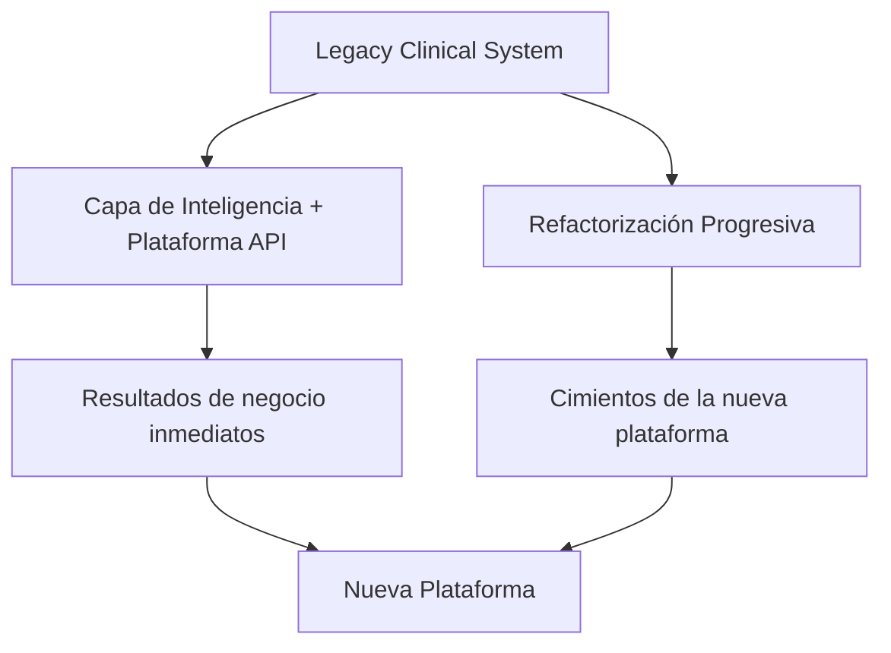

---

## 2. Reglas que dicta el documento

Las reglas **R1–R20** de V1 se mantienen íntegras en V2 salvo **R12**, que se generaliza de gobernanza "clínica" a gobernanza **por perfil de datos**. Se reproducen completas para que V2 sea autocontenido.

### R1 — Identidad canónica de capacidad (regla definitiva)

> **Una capacidad de negocio tiene una identidad canónica independiente del protocolo. REST y MCP son representaciones/adaptadores de esa capacidad y pueden utilizar convenciones de nomenclatura diferentes.**

- Existen **tres nombres distintos para una misma capacidad**: el nombre técnico/interno del servicio, el nombre del endpoint REST y el nombre de la MCP Tool.
- **No hay que intentar que los tres nombres sean iguales.**
- La capa común tiene un **nombre canónico de capacidad de negocio**; cada adaptador lo proyecta con la convención que le corresponde.

### R2 — Regla de nomenclatura por interfaz

| Interfaz     | Regla                         | Ejemplo                                                    |
| ------------ | ----------------------------- | ---------------------------------------------------------- |
| **Service / Capability** | Lenguaje de negocio, orientado a caso de uso | `consultar_ingresos_por_tipo_pago()`        |
| **MCP**      | Nombre semántico orientado a intención (conserva la capability) | `consultar_ingresos_por_tipo_pago` |
| **REST**     | Orientado a recurso + verbo HTTP            | `GET /api/contabilidad/ingresos-por-tipo-pago` |

**Convención de verbos REST:**

- Consultas → `GET`: `GET /api/contabilidad/ingresos-por-tipo-pago`, `GET /api/contabilidad/resumen-deuda`, `GET /api/contabilidad/ingresos-por-tipo-tarjeta?origen=CAJA`
- Cambios de estado → `POST` / `PATCH` (futuro, Action Tools · fuera de la milla cero)

**Convención de MCP (semántica verbal, expresa la intención):**

`consultar_resumen_deuda`, `consultar_ingresos_por_tipo_pago`, `consultar_ingresos_por_tipo_tarjeta`, `consultar_ingresos_por_tipo_prevision`, `consultar_boletas_emitidas_por_usuario`, `consultar_boletas_anuladas_por_usuario`

### R3 — Prohibido `getXxx()` para servicios de negocio

- No usar `getXxx()` en la capa de negocio, salvo que sea realmente una operación de infraestructura.
- `getBoletasPorUsuario()` dice **cómo está implementada la consulta**, no **qué capacidad de negocio entrega**.
- `consultar_boletas_emitidas_por_usuario()` expresa una intención concreta — clave cuando el consumidor es un agente.
- **El nombre legacy no tiene por qué contaminar la nueva arquitectura.** Aunque el legacy tenga `getBoletasPorUsuario()`, la nueva capability puede llamarse `consultar_boletas_emitidas_por_usuario()`.

### R4 — Orden de riesgo: READ → ANALYZE → ACT


- Ser **conservador** con las Action Tools.
- Primero exponer lecturas, después análisis, y recién al final acciones.
- Esto permite demostrar valor rápido con bajo riesgo operacional.
- **Frontera explícita de la milla cero:** las 6 capacidades del Control Contable son **todas READ** (paridad). Las capacidades ANALYZE (KPIs, variación, comparación mensual) son el siguiente bloque. Las Action Tools (incluido `enviar_correo`) **quedan fuera** de la esta etapa — el correo nuevo se despachará por un mecanismo externo, no por una tool MCP todavía.
- **Esta jerarquía de riesgo no puede vivir solo en la capa interna:** se proyecta al protocolo MCP como `annotations` nativas (ver R17).

### R5 — Separar "Tool" de "Service"

- **La Tool no es la lógica.** La Tool es una representación de una capacidad para un agente.
- Un mismo `service` puede ser consumido por una MCP Tool y por un REST Endpoint.
- La Tool (MCP) y el endpoint (REST) son **adaptadores** que llaman a la misma función de servicio.

### R6 — El MCP Adapter no implementa lógica

- El MCP Adapter conoce: `Tool name`, `Description`, `Input schema`, `Output schema`.
- Pero **no implementa la lógica**: delega en el service.
- El nombre MCP no debería ser una copia automática del nombre Python: MCP tiene un **contrato semántico propio**.
- **La `description` es contrato, no documentación.** Es lo único que el LLM lee para decidir *cuándo* usar la tool y con qué argumentos: es tan vinculante como el JSON Schema, solo que en prosa (ver R17).

### R7 — Todo delegate poder de negocio: exponer conocimiento, no tablas

- Las tools no deberían ser `SELECT * FROM ...`.
- No se exponen tablas: se expone **conocimiento operativo** y **capacidades de negocio**.
- **Corolario Control Contable:** el SQL legacy va al **Repository** (adaptador); la capability expone conceptos de negocio (`canal` en vez de `id_impresora`, `tipo_pago` en vez de `NUM_DOCTO`). **No se envuelve el SQL crudo en el MCP tool.**

### R8 — Autorización antes de ejecutar la capability, nunca dentro de la query

- La autorización debe ocurrir **antes de ejecutar la capability**, no dentro de la query Oracle.
- La query no debería decidir justificaciones de acceso:

```python
if user == ...   # esto NO pertenece a la capa de query/repository
```

- Eso pertenece a la capa de **seguridad/autorización**, de forma centralizada (enforcement point único, §5).

### R9 — Calidad de datos por capability (no "limpiar Oracle")

- **No intentar "limpiar Oracle"** como parte de esta fase: podría convertirse en otro proyecto enorme.
- En su lugar, cada capability declara sus **Data Quality Rules** — para las contables, las reglas derivan directamente de los hallazgos §19:

```yaml
data_quality:
  rules:
    - fecha_required            # las queries contables exigen fecha explícita (ver §19 h4)
    - replica_dent_ciclo_present # si la réplica cae, la query falla → UNAVAILABLE, no NO_DATA
    - meses_sin_dato_son_validos # deuda: mes sin registros = fila omitida (resultado válido)
```

- **Ventaja clave:** la capa de negocio comienza a **explicitar reglas que hoy están dispersas en Java/JSP/queries**, lo que alimenta directamente la refactorización.

### R10 — Versionado: propiedad del contrato, no del nombre

- **No empezar con `/api/v1/...` por reflejo**, "solo porque las APIs tienen versiones".
- Una capability **evoluciona mientras mantenga su contrato compatible**. Cambios compatibles no avanzan versión; un cambio que rompe el contrato sí avanza versión.
- La versión es una propiedad del **contrato**, no del nombre lógico de la capability:

```yaml
id: contabilidad.ingresos_por_tipo_pago
version: 1
```

- Durante el Strangler, `consultar_ingresos_por_tipo_pago.v1` y `.v2` **pueden coexistir temporalmente** en REST.
- **Restricción específica de MCP:** MCP expone siempre una sola versión: la vigente del contrato. La coexistencia v1/v2 del Strangler se resuelve en REST (`/api/v1/...`, `/api/v2/...`). La deprecación se comunica por `description` / `usage_notes`, no duplicando tools.

### R11 — Medir antes de optimizar (Measure before optimize)

- **No construir cache ni infraestructura de performance especulativa.**
- **Límite del supuesto:** R11 modela tráfico humano, no tráfico de agente en loop (ver R19).
- Primero observar la operación real (`query duration`, `rows`, `frequency`, `CPU`, `connection pool`).
- **Corolario Control Contable:** las 6 queries contables son pequeñas (fila única por día/mes), de frecuencia diaria. No necesitan cache. Lo que sí exige atención es el **cruce con la réplica `dent_ciclo`** (R9): si cae, la query devuelve vacío — eso es UNAVAILABLE, no una señal de que hace falta cache.

### R12 — Gobernanza de datos por perfil (qué cruza hacia la IA)

La cadena `Oracle → Python → MCP → LLM` exige responder:

> **¿Qué datos pueden cruzar realmente el límite hacia una IA?**

V2 generaliza R12 de "sistema clínico" a **perfiles de datos explícitos**. Cada capability declara su perfil y su regla de exposición:

```yaml
data:
  profile: financial        # clinical | financial | operational | mixed
  classification: confidential
  pii: true                 # el perfil financial del Contable incluye datos personales de empleados
  clinical_data: false
  ai_allowed: restricted
```

El **Control Contable es perfil `financial` con PII de empleados** (punto que V1 no veía):

- Las filas de boletas por usuario exponen `USUAPEP` / `USUNOMC` (apellido y nombre de **quienes emiten las boletas**: personal de la clínica). Son **datos personales**, aunque no sean datos clínicos.
- Los montos de boletas y la deuda agregada (`bat_deuda`) son **información financiera interna** sensible para el negocio.
- **Segundo egreso ya existente:** estos datos **ya salen del perímetro** hoy por correo a gerencia. El correo es un egreso vigente; la capa nueva agrega un segundo egreso controlado (por capability). El `allowed_fields`/`forbidden_fields` se aplica también al **artefacto renderizado** (correo), no solo al JSON.

Al nivel de campos:

```yaml
exposure:
  allowed_fields:
    - mesa            # "09-2026"
    - deuda
    - tipo_pago       # EFE, TRJ, CHQ, WEBPAY, CAJA VECINA BCO.EST., TOTEM
    - canal           # CAJA, TOTEM, WEBPAY (mapeo de id_impresora)
    - tipo_tarjeta    # CREDITO, DEBITO, otros
    - prevision
    - monto
    - cantidad

  forbidden_fields:
    - rut             # USURUT de empleados NO cruza
    - diagnostico
    - ficha_clinica
```

Regla: en las tablas por usuario (`USUAPEP` + `USUNOMC`) el nombre **sí** puede cruzar (es lo que el correo ya muestra y lo que permite identificar el desempeño por cajero), pero el **RUT no** (el legacy lo usa internamente en `usurut`/`cod_asistente`; nunca se expone).

> El `forbidden_fields` de cada capability se aprueba con un dueño (ver §16.3): para el perfil financial, el **dueño natural es gerencia de finanzas / contador**.

### R13 — Oracle congelado (por ahora)

- **No cambiar Oracle de momento.**
- **No agregar las FK** que se creía necesarias.
- Separar los dos problemas: *Problema A* "¿cómo modernizo la arquitectura?" y *Problema B* "¿cómo hago que el negocio utilice sus datos?". **No se necesita resolver A para empezar B.**
- El ORM declarará las relaciones aunque Oracle no las declare formalmente.

### R14 — Si alguna vez se tocan las FK

No agregar FK "solamente porque una base de datos moderna debe tener FK". Primero entender: relaciones reales, cardinalidades, datos históricos inconsistentes, reglas implícitas, procesos que dependen de la ausencia de integridad, performance, procesos batch, integraciones externas.

### R15 — Repositorios / Puertos (PostgreSQL preparada pero no activa)

- Usar patrón `Repository / Port`: el service depende de un puerto de persistencia.
- Adapter actual: **Oracle**.
- Por un buen tiempo no se necesita PostgreSQL; se deja **preparado** para cuando llegue el momento, sin que la aplicación se entere.

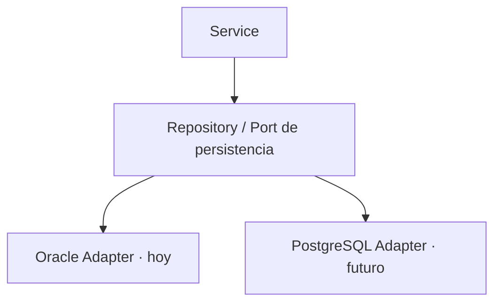

### R16 — Una implementación, múltiples consumidores

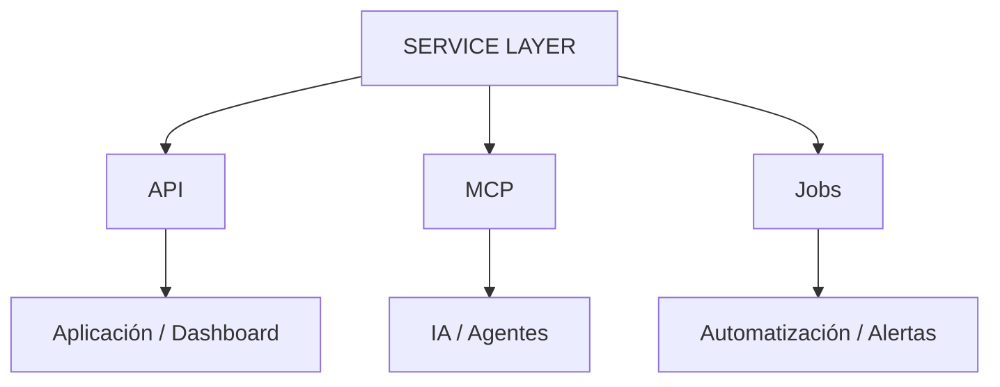

Ejemplo: `consultar_resumen_deuda()` puede ser a la vez la API para un dashboard de finanzas y la MCP Tool que un agente usa para responder "¿cuánto es la deuda del mes?".

### R17 — El contrato MCP es parte del contrato de la capability (protocolo, no solo negocio)

**a) Annotations nativas, derivadas — nunca escritas a mano de `operation.mode`:**

| `operation.mode` | `readOnlyHint` | `destructiveHint` | `idempotentHint` | `openWorldHint` |
| ----------------- | -------------- | ----------------- | ---------------- | --------------- |
| `READ`            | `true`         | `false`           | `true`           | `false`         |
| `ANALYZE`         | `true`         | `false`           | `true`           | `true`          |
| `ACT`             | `false`        | según caso        | a definir        | `true`          |

La derivación es **automática en el registry**; si alguien declara `mode: ACT` y el `readOnlyHint` queda en `true`, el contract test (§12, Nivel 3) falla.

**b) La `description` es el contrato de facto, en prosa:**

Con 6 capacidades contables (o 20-50 del catálogo completo), cada una debe declarar:
- **qué hace** (una línea, sin jerga legacy: "sin `getBoletasPorUsuario`"),
- **cuándo usarla**,
- **cuándo NO usarla** — para diferenciarla de la tool parecida (p. ej. boletas **emitidas** vs **anuladas**),
- **1-2 ejemplos** de input/output correcto.

> Una tool sin `usage_notes` y sin ejemplos es un contrato incompleto aunque el JSON Schema sea perfecto.

### R18 — Todo error se traduce al `content` del tool result

- En MCP el error no debe perderse en la capa de transporte: se devuelve `isError: true` con un mensaje legible en el mismo turno, para que el LLM pueda razonar y reintentar.
- Cada tipo de error declara su serialización: `error_code` estable + mensaje accionable, nunca el traceback.

```yaml
errors:
  ValidationError:
    is_error: true
    error_code: INVALID_ARGUMENT
    message: "Argumentos inválidos: revisa fecha (YYYY-MM-DD) y origen (CAJA|TOTEM|WEBPAY)."
  NotFoundError:
    is_error: true
    error_code: NO_DATA
    message: "No hay boletas para esa fecha. Es un resultado válido, no un fallo."
  InfrastructureError:
    is_error: true
    error_code: UNAVAILABLE
    message: "No pude consultar los datos (probablemente la réplica dent_ciclo está caída). Reintenta; si persiste, escala a TI."
```

- **Contrato clave para el LLM:** `NO_DATA` es un resultado válido; `UNAVAILABLE` es un fallo. Nunca deben verse iguales.
- **Caso real del legacy a imitar correctamente:** el legacy **silencia** los errores (catch → log → tabla vacía). La capa nueva **no** puede replicar ese silencio: un `dent_ciclo` caído debe traducirse a `UNAVAILABLE`, no a una tabla vacía que parezca "cero" (ver §19 y §12 Nivel 0).

### R19 — El tráfico de agente es tráfico real: límites por tool

- Un agente investigando (§8.2) puede **iterar y repetir** llamadas a la misma tool dentro de una sola sesión. Contra Oracle productivo eso es carga, aunque todo sea lectura.
- El contrato declara un límite **informal desde el día 1**:

```yaml
agent_traffic:
  max_calls_per_session: 10   # límite blando, declarado y observable
  expected_cost: low          # las 6 queries contables son livianas → low
```

- El enforcement real (rate limit por sesión/usuario/tool) es **P1**; en la milla cero basta con medir y alertar.

### R20 — El catálogo de tools tiene que escalar

- Con 2-5 tools, un único servidor MCP con lista plana funciona. **Con 20-50 satura el contexto del agente.**
- Criterio de escalado (a decidir antes de llegar a ~15 tools): **namespacing por dominio** (`contabilidad.consultar_resumen_deuda` como nombre real de tool, manteniendo `consultar_resumen_deuda` como nombre canónico de la capability · R1), o **varios servidores MCP por área de negocio**.
- En esta etapa se registra el dominio (`id: contabilidad.*`) y se construye el registry de forma que el namespacing sea un cambio de proyección, no de lógica.

---

## 3. Priorización de decisiones: ahora vs pendiente

| Prioridad | Tema                             | ¿Resolver ahora?        |
| --------- | -------------------------------- | ----------------------- |
| 🔴 P0     | **Control Contable como capability patrón (6 capacidades → 8 tablas)** | Sí                  |
| 🔴 P0     | **Nivel 0 — Test de paridad** (diff exacto de números vs legacy) | Sí                  |
| 🔴 P0     | Seguridad / identidad (con perfil `financial` + PII de empleados) | Sí                  |
| 🔴 P0     | **Transporte MCP** (condiciona auth y enforcement point) | **Sí**          |
| 🔴 P0     | Observabilidad                   | Sí                      |
| 🔴 P0     | Contratos Pydantic / JSON Schema | Sí                      |
| 🔴 P0     | **Proyección al protocolo MCP** (annotations + `description` como contrato) | **Sí** |
| 🔴 P0     | Testing mínimo                   | Sí                      |
| 🔴 P0     | Gobernanza de datos (qué cruza a IA) | Sí, por capability (perfil `financial`) |
| 🟠 P1     | Calidad / confiabilidad de datos | Sí, pero por capability |
| 🟠 P1     | Versionado (REST versioning en Strangler) | Definir convención      |
| 🟠 P1     | Límites de tráfico de agente (rate/concurrencia por tool) | Declarar, medir      |
| 🟠 P1     | **Capacidades ANALYZE del Contable** (KPIs: variación de deuda, aceleración, comparación mensual) | Diseñar · siguiente bloque |
| 🟢 P2     | Action Tools / envío de correo (`enviar_correo`) | Diseñar, no implementar |
| 🟢 P2     | Cache / performance avanzada     | Medir antes             |
| 🟢 P2     | Escalado del catálogo de tools (namespacing / split por dominio) | Diseñar, no implementar |
| 🟢 P2     | PostgreSQL / Strangler           | Mantener como evolución |

> **No se necesita resolver toda la arquitectura futura para comenzar la milla cero.**

---

## 4. Arquitectura

### 4.1 Visión global

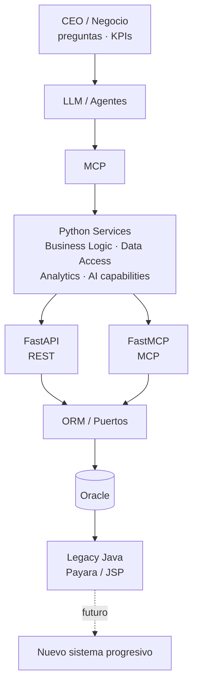

**La flecha clave:** `Oracle → Python Services → MCP → AI`, **sin esperar a que termine la modernización**.

### 4.2 Arquitectura congelada de la "milla cero"

Nota: **no aparecen PostgreSQL, ni Java nuevo, ni migración, ni FK, ni Action Tools** — no son necesarios para demostrar el valor de esta etapa.

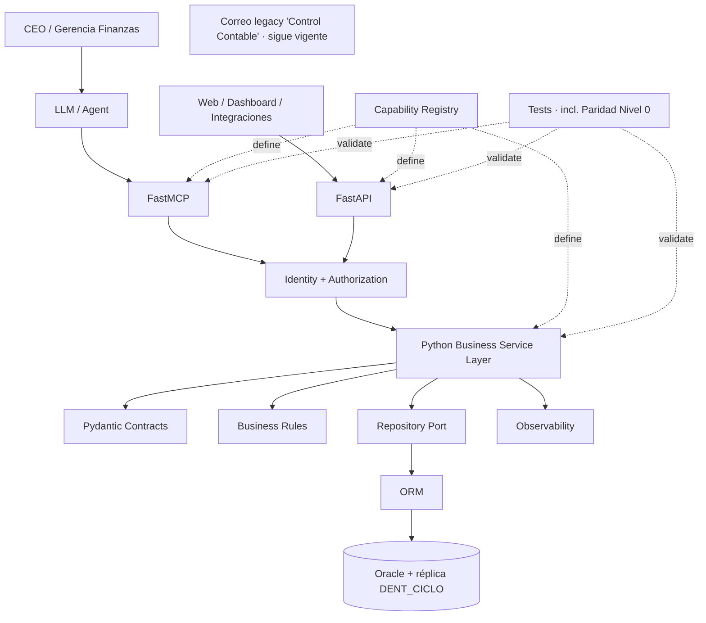

**El correo legacy se mantiene corriendo en paralelo** (mismo contenido, mismo destinatario) mientras la capa nueva valida los mismos números contra un segundo destinatario. Es la fuente de comparación del test de paridad.

### 4.3 La ruta estratégica (flujo de la milla cero)

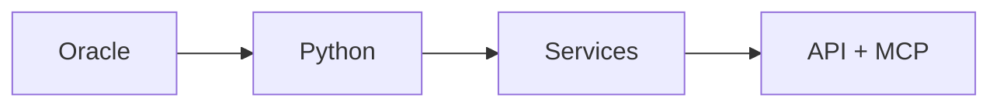

### 4.4 El sistema legacy sigue siendo el de origen

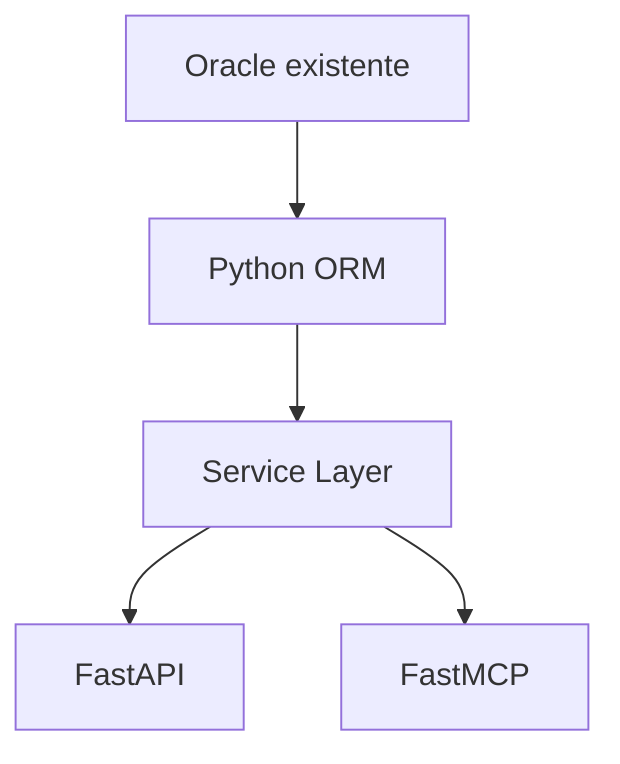

### 4.5 ORM como capa semántica

Aunque Oracle diga "NO FK", el modelo puede declarar las relaciones — incluida la **réplica externa `DENT_CICLO.boleta`**, que se modela como un puerto/proxy de lectura, no como dueño de datos:

```python
class Boleta:
    # DENT.boleta (fuente) + DENT_CICLO.boleta (réplica) unidas en el repository
    num_docto: str       # EFE | TRJ | CHQ | WEBPAY | CAJA VECINA BCO.EST. | TOTEM
    mto_bol: Decimal
    ind_estado: str      # ACT | ANU | DEV | NCI
    id_impresora: str    # canal: IBM% | TOT% | WPTN | BESTA   (no se expone crudo)
    ...
```

Valor: construir una **capa semántica sobre una base de datos legacy**.

### 4.6 Clasificación de las MCP Tools (4 tipos)

| # | Tipo                     | Descripción                                        | Ejemplos (Contable)                                      |
| - | ------------------------ | -------------------------------------------------- | -------------------------------------------------- |
| 1 | **Query Tools**          | Obtienen información.                              | `consultar_resumen_deuda`, `consultar_ingresos_por_tipo_pago`, `consultar_ingresos_por_tipo_tarjeta`, `consultar_ingresos_por_tipo_prevision`, `consultar_boletas_emitidas_por_usuario`, `consultar_boletas_anuladas_por_usuario` |
| 2 | **Analytical Tools**     | Transforman datos en información de negocio.       | `calcular_variacion_deuda`, `calcular_variacion_ingresos`, `detectar_aceleracion_deuda` |
| 3 | **Decision-support Tools** | Ayudan a evaluar situaciones.                    | `identificar_canales_con_caida`, `comparar_mes_contra_mes` |
| 4 | **Action Tools**         | Eventualmente ejecutan acciones (ser conservador). | `enviar_correo_control_contable`, `crear_reserva`, ... |

Orden de habilitación: **READ → ANALYZE → ACT** (ver R4).

---

## 5. Seguridad e identidad

### 5.1 Modelo mínimo (sin sobrediseñar)

```text
Identity
   ↓
Authorization
   ↓
Capability
```

Indicadores por capability (perfil `financial`):

```yaml
security:
  classification: internal
  access: read
  roles:
    - contador
    - analista_financiero
    - gerente_finanzas
    - ai_agent      # con el perfil financial: leer, nunca mutar
```

> Roles V2: en V1 el rol era `business_analyst`. Para el Control Contable los consumidores naturales son finanzas (`contador`, `analista_financiero`, `gerente_finanzas`). `ai_agent` se mantiene como rol de lectura para que la IA responda al CEO.

### 5.2 Flujo REST

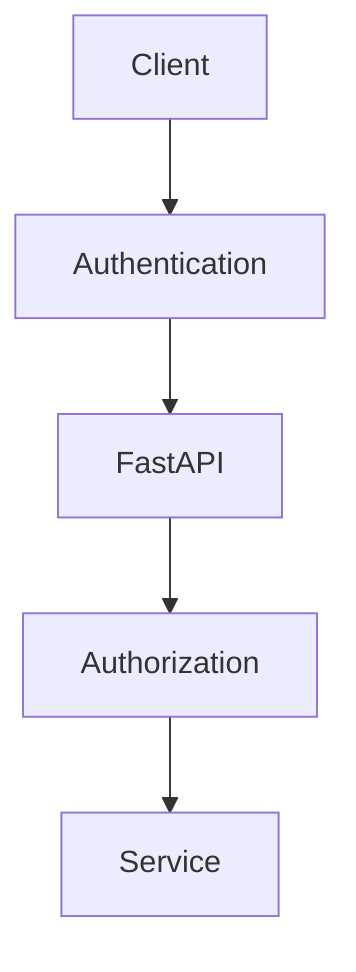

### 5.3 Flujo MCP

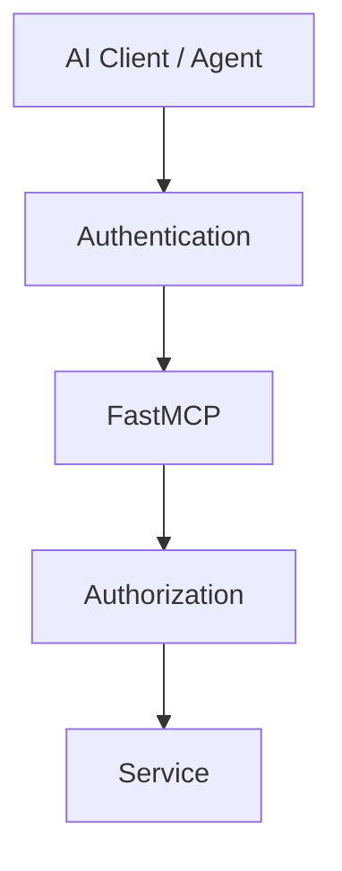

### 5.4 Regla de enforcement

> **La autorización debe ocurrir antes de ejecutar la capability, no dentro de la query Oracle.**

Requiere un **enforcement point único** (middleware/decorator), no lógica dispersa en cada service.

### 5.5 El transporte MCP es decisión P0, no infraestructura diferible

- Si el transporte es **local/in-process** (el agente corre junto al server), no hay identidad de request que evaluar: el modelo de autorización hay que redefinirlo (identidad de proceso/sesión).
- Si el transporte es **remoto** (HTTP / SSE / streamable HTTP), la identidad viaja por request y el enforcement point puede ser middleware único para REST y MCP.

**Criterio de decisión (a cerrar antes de codificar la capability #1):**

| Criterio | Pregunta que decide |
| -------- | ------------------- |
| Autenticación | ¿Cómo viaja la identidad del agente en cada request? (token, API key, mTLS) |
| Enforcement | ¿Puede un único punto de enforcement cubrir REST y MCP? |
| Red | ¿El agente corre en la misma red que Oracle / Payara? |
| Streaming | ¿Se necesita respuesta incremental o basta respuesta por llamada? |
| Framework | FastMCP ya resuelve el transporte; lo que hay que fijar es **cuál** y **con qué auth** |

- **Restricción:** si el transporte elegido no soporta identidad por request, **el enforcement point único de R8 no es implementable tal como está definido** → hay que revisarlo antes de escribir código de seguridad.

---

## 6. Observabilidad (obligatoria desde el día 1)

### 6.1 Por qué

La cadena `CEO → LLM → Agent → Tool → Service → Oracle` es nueva. Si el CEO pregunta "¿cuánto ingresamos por tarjeta este mes?" y la IA responde algo incorrecto, debe poder reconstruirse la investigación completa:

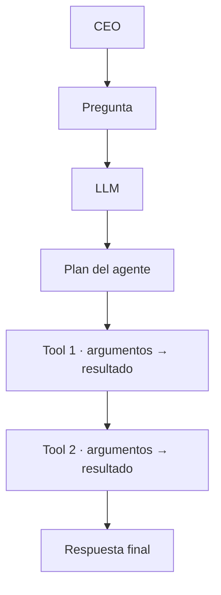

Eso es **trazabilidad de investigación**.

### 6.2 Dos niveles

**A. Observabilidad técnica:** `request_id`, `timestamp`, `duration`, `service`, `endpoint/tool`, `status`, `error`.

**B. Observabilidad AI:** `conversation_id`, `agent_run_id`, `tool_name`, `tool_arguments`, `tool_result_metadata`, `sequence`, `duration`.

### 6.3 Minimización de datos

No es necesario guardar el resultado completo (puede contener datos financieros y nombres de empleados). Registrar metadatos:

```yaml
tool_call:
  tool: consultar_ingresos_por_tipo_pago
  args:
    fecha: 2026-09-25
  result:
    status: success
    records: 6
    duration_ms: 183
```

Esto conecta observabilidad con **privacidad y minimización de datos** (R12, perfil financial).

---

## 7. Contratos formales

### 7.1 De la ficha conceptual a Pydantic

Los contratos de entrada/salida se implementan como modelos Pydantic:

```python
class ConsultarIngresosPorTipoPagoInput(BaseModel):
    fecha: date                           # obligatoria: las queries del legado la exigen
    # sin origin: resumen consolidado de los 6 tipos de pago

class IngresoPorTipoPagoItem(BaseModel):
    tipo_pago: str                        # EFE | TRJ | CHQ | WEBPAY | CAJA VECINA BCO.EST. | TOTEM
    monto: Decimal

class ConsultarIngresosPorTipoPagoOutput(BaseModel):
    fecha: date
    items: list[IngresoPorTipoPagoItem]
```

Esto da base automática para: FastAPI, OpenAPI, validación, documentación, testing, MCP y generación de schemas.

### 7.2 Convergencia de contratos

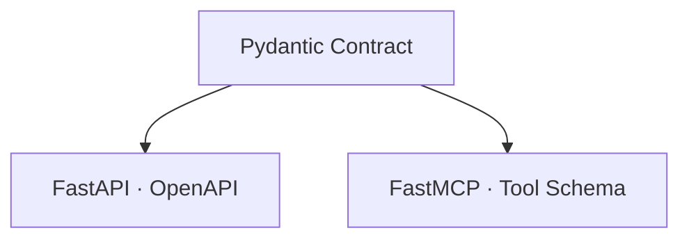

### 7.3 Taxonomía de errores común

```text
DomainError
├── ValidationError
├── NotFoundError
├── BusinessRuleError
├── AuthorizationError
└── InfrastructureError
```

- `ValidationError`: por ejemplo `fecha = "banana"` o `origen = "NOCAJA"`.
- `NotFoundError`: "no existen datos" (resultado válido).
- `InfrastructureError`: `Oracle unavailable`, `réplica dent_ciclo caída`, `timeout`, `connection pool exhausted`.

**Crítico para agentes:** el LLM debe distinguir *"no existen datos"* (resultado válido) de *"no pude consultar los datos"* (fallo de infraestructura).

### 7.4 Cómo ve el LLM cada error (traducción al protocolo)

- **Regla de transporte:** el error **no se propaga como excepción de protocolo**; se devuelve `isError: true` con el mensaje en el resultado, para que el LLM lo lea en el mismo turno y pueda corregir o reintentar.
- **Regla de contenido:** nunca traceback. Un `error_code` estable + un mensaje accionable.

| Error Python         | `error_code` REST/HTTP | Traducción MCP                            | Lectura del agente                |
| -------------------- | --------------------- | ------------------------------------------ | --------------------------------- |
| `ValidationError`    | `400 INVALID_ARGUMENT` | `isError: true` + código + mensaje        | "mis argumentos están mal, corrijo" |
| `NotFoundError`      | `404 NO_DATA`          | `isError: true` + código + mensaje        | "no hay datos" (resultado válido) |
| `BusinessRuleError`  | `422 BUSINESS_RULE`    | `isError: true` + código + regla violada  | "la regla X no se cumple"          |
| `AuthorizationError` | `403 FORBIDDEN`        | `isError: true` + código (sin detalle)    | "no puedo, no reintento"           |
| `InfrastructureError`| `503 UNAVAILABLE`      | `isError: true` + código + "reintenta"     | "falla la fuente, reintento"       |

- El mapeo vive en **un solo lugar** (el translator de errores del adapter MCP), no en cada service.
- `AuthorizationError` **nunca** revela qué regla falló.
- **Desviación consciente del legacy:** el legacy devuelve tabla vacía ante error de BD; la capa nueva traduce a `UNAVAILABLE` (§19).

---

## 8. Catálogo de capacidades de negocio

### 8.1 Capacidades de la milla cero (Control Contable · todas READ)

Las 6 capacidades producen las **8 tablas** del correo (la #3 se invoca 3 veces: CAJA, TOTEM, WEBPAY):

| # | Capacidad | Tabla del correo | Query legacy validada (§19) |
| - | --------- | ---------------- | ----------- |
| 1 | `consultar_resumen_deuda` | Resumen Deuda (4 meses) | Q3 · `setTablaDeuda` |
| 2 | `consultar_ingresos_por_tipo_pago` | Ingresos por tipo pago | Q1 · `setTablaIngresoPago` |
| 3 | `consultar_ingresos_por_tipo_tarjeta` | Ingresos por tarjeta (CAJA · TOTEM · WEBPAY) | Q10 · `getDetIngresPorTipoTarjeta` |
| 4 | `consultar_ingresos_por_tipo_prevision` | Ingresos por previsión | Q11 · `getIngresoPorPrevision` |
| 5 | `consultar_boletas_emitidas_por_usuario` | Boletas emitidas por usuario | Q8 · `getBoletasPorUsuario` |
| 6 | `consultar_boletas_anuladas_por_usuario` | Boletas anuladas por usuario | Q9 · `getBoletasAnuladasPorUsuario` |

**Frontera READ / ANALYZE / ACT en la milla cero:**


### 8.2 Investigación guiada por IA (caso CEO · financiero)

> Pregunta del CEO: *"¿Cómo vamos con la deuda este mes?"*

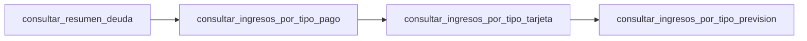

Y en el siguiente bloque ANALYZE: `calcular_variacion_deuda` (del bloque de KPIs §8.4).

### 8.3 La nueva arquitectura crea capacidades nuevas

Una capability puede no tener equivalente directo en el legacy — p. ej. `calcular_variacion_deuda` (el correo muestra deuda, pero **no** calcula la variación mensual ni la aceleración). **No importa**: la nueva arquitectura puede crear capacidades de valor que el correo hoy no entrega — y ese es el argumento de venta hacia ANALYZE.

### 8.4 KPIs candidatos (bloque ANALYZE · siguiente iteración, no bloquea la milla cero)

Con la paridad garantizada en READ, el valor diferencial viene de KPIs **declarados en el contrato** (nunca calculados por el LLM — el LLM hace prosa sobre KPIs precomputados):

| KPI | Definición | Ejemplo (septiembre) |
| --- | --- | --- |
| Saldo de deuda del mes | última fila de `consultar_resumen_deuda` | $ 4.913.240.404 |
| Variación mensual ($) | mes actual − mes anterior | +$ 76.464.426 |
| Variación mensual (%) | Δ / mes anterior | +1,58 % |
| Aceleración de deuda | variación de la variación (Δ²) | +$ 32,44 MM · 0,92% → 1,58% (+0,66 pp) |

> ⚠️ **Nota semántica importante (hallazgo §19 h1):** el "saldo de deuda" que el correo muestra es `round(avg(bat_deuda),0)` del mes — **promedio diario del mes, no saldo de cierre**. Cualquier KPI debe partir de esa semántica o declarar explícitamente que cambia de métrica.

---

## 9. Tool Contract interno

### 9.1 Contrato evolucionado

```yaml
id:
version:

name:                      # nombre canónico de la capability (R1)
description:                # contrato en prosa: qué hace + cuándo usarla
usage_notes:               # cuándo NO usarla / cómo se diferencia de las parecidas
purpose:

operation:
  mode: READ               # READ | ANALYZE | ACT  → fuente de las annotations

mcp:                       # proyección al protocolo MCP
  enabled: true
  tool: <nombre_canónico>
  annotations:             # DERIVADAS de operation.mode, no escritas a mano (R17)
    readOnlyHint: true
    destructiveHint: false
    idempotentHint: true
    openWorldHint: false

input:
  schema:

output:
  schema:

business_rules:

data:
  profile: financial       # clinical | financial | operational | mixed (R12)
  sources:
  classification:
  pii:
  ai_allowed:
  allowed_fields:
  forbidden_fields:

security:
  roles:
  authorization:

errors:                     # cada tipo declara su traducción al content MCP (R18)
  ValidationError:
    error_code: INVALID_ARGUMENT
    message:
  NotFoundError:
    error_code: NO_DATA
    message:
  InfrastructureError:
    error_code: UNAVAILABLE
    message:

observability:

performance:
  expected_duration:
  cacheable:

agent_traffic:              # tráfico de agente, no humano (R19)
  max_calls_per_session: 10
  expected_cost: low

legacy:
  method:                   # ResumenControl.getIngresoPorPrevision
  helper: consultaStock     # helper.md (línea válida en helper.md, ver §19)

repository:
  oracle_sql_id: Q11        # id de la query validada (§19 / resumencontrolRICH.md)

examples:
```

Obligatorios desde la capability #1: `description`, `usage_notes`, `operation.mode`, `mcp.annotations`, `errors`, `examples` — y para las contables, además `data.profile` (R12) y `legacy.method` + `repository.oracle_sql_id` (trazabilidad de paridad, §19).

### 9.2 Ejemplo clásico de contrato (verbo/lectura)

```text
ingresos_por_tipo_pago

Purpose:
Consultar los ingresos del día agrupados por tipo de pago,
reproduciendo exactamente la tabla "Ingresos por tipo pago"
del correo de control contable.

Input:
    fecha: YYYY-MM-DD   (requerida)

Output:
    tipo_pago   -> EFE | TRJ | CHQ | WEBPAY | CAJA VECINA BCO.EST. | TOTEM
    monto

Data:
    BOLETA (DENT + DENT_CICLO)

Operation:
    READ ONLY

AI suitability:
    HIGH
```

### 9.3 Ficha YAML completa (ejemplo: `contabilidad.ingresos_por_tipo_pago`)

```yaml
id: contabilidad.ingresos_por_tipo_pago
version: 1

name: consultar_ingresos_por_tipo_pago

description: >
  Consulta los ingresos del día agrupados por tipo de pago,
  reproduciendo la tabla "Ingresos por tipo pago" del correo
  de control contable. Úsala cuando pregunten cuánto se
  recaudó hoy, por tipo de pago (efectivo, tarjeta, cheque,
  webpay, totem) o cuál es el total del día. Solo lectura.

usage_notes: >
  NO usar para: (1) el detalle por tipo de tarjeta de un
  canal — eso es consultar_ingresos_por_tipo_tarjeta;
  (2) la descomposición por previsión — eso es
  consultar_ingresos_por_tipo_prevision; (3) comparar días
  o calcular variaciones — eso es una tool analítica (ANALYZE).
  La fecha es obligatoria (las queries del legado requieren
  fecha explícita; el default vacío del legado es SQL inválido).

purpose: >
  Permitir a gerencia de finanzas / CEO conocer la recaudación
  diaria por tipo de pago, con los mismos números del correo.

operation:
  mode: READ

service:
  python: contabilidad.services.consultar_ingresos_por_tipo_pago

mcp:
  enabled: true
  tool: consultar_ingresos_por_tipo_pago   # sin sufijo de versión (R10)
  annotations:                             # derivadas de operation.mode (R17)
    readOnlyHint: true
    destructiveHint: false
    idempotentHint: true
    openWorldHint: false

rest:
  enabled: true
  method: GET
  path: /api/contabilidad/ingresos-por-tipo-pago

legacy:
  method: ResumenControl.setTablaIngresoPago
  locales: (Java:132-189) de ResumenControl.java · helper.md setTablaIngresoPago

repository:
  oracle_sql_id: Q1

input:
  schema:
    fecha: date     # requerida (YYYY-MM-DD)

output:
  schema:
    fecha: date
    items:
      - tipo_pago: str        # EFE | TRJ | CHQ | WEBPAY | CAJA VECINA BCO.EST. | TOTEM
        monto: Decimal

business_rules:
  - fecha_obligatoria
  - se_usa_banda_horaria_000000_235959   # igual que el legado (no innovar)
  - unir_dent_y_dent_ciclo               # réplica paralela (decisión §0.2)
  - mapear_canales:                      # id_impresora → canal (no exponer id_impresora)
      - "IBM%": CAJA
      - "TOT%": TOTEM
      - "WPTN": WEBPAY
      - "BESTA": CAJA VECINA BCO.EST.

data:
  profile: financial
  sources:
    oracle:
      - BOLETA (DENT)
      - BOLETA (DENT_CICLO, réplica)
  classification: confidential
  pii: false               # montos agregados, sin personas
  clinical_data: false
  ai_allowed: yes
  allowed_fields:
    - tipo_pago
    - monto
  forbidden_fields:
    - rut
    - diagnostico

security:
  classification: internal
  access: read
  roles:
    - contador
    - analista_financiero
    - gerente_finanzas
    - ai_agent

errors:
  ValidationError:
    is_error: true
    error_code: INVALID_ARGUMENT
    message: "Argumentos inválidos. fecha debe ser YYYY-MM-DD."
  NotFoundError:
    is_error: true
    error_code: NO_DATA
    message: "No hay boletas activas para esa fecha. Resultado válido, no es un fallo."
  InfrastructureError:
    is_error: true
    error_code: UNAVAILABLE
    message: "No pude consultar los datos (¿réplica dent_ciclo caída?). Reintenta; si persiste, escala a TI."

observability:
  level: tech + ai

performance:
  expected_duration: <250ms
  cacheable: false          # consulta diaria pequeña; no cachear (R11)

agent_traffic:
  max_calls_per_session: 20   # high: en una investigación mensual se itera por día
  expected_cost: low

ai_suitability: HIGH

examples:
  - in:  { fecha: 2026-09-25 }
    out: { fecha: 2026-09-25, items: [{ tipo_pago: EFE, monto: 1234567 }, ...] }
```

Esto crea un **catálogo de capacidades**, no simplemente un catálogo de endpoints.

### 9.4 Identity Map de capacidades (jet Set Contable)

| Concepto       | Nombre                       |
| -------------- | ---------------------------- |
| Legacy helper  | `ResumenControl.setTablaIngresoPago()` / `getIngresoPorPrevision()` |
| Capability     | `consultar_ingresos_por_tipo_pago` |
| Python service | `contabilidad.services.consultar_ingresos_por_tipo_pago()` |
| MCP Tool       | `consultar_ingresos_por_tipo_pago` (namespaced: `contabilidad.consultar_...` · R20) |
| Dominio (id)   | `contabilidad`                     |
| REST resource  | `/contabilidad/ingresos-por-tipo-pago` |
| HTTP           | `GET`                        |

El **dominio** (`contabilidad`) no es un cuarto nombre de la capability: es el namespace que usará el nombre real de la tool cuando el catálogo crezca (`contabilidad.consultar_ingresos_por_tipo_pago`, ver R20).

---

## 10. Tool / Service Registry → Catálogo de capacidades empresariales

### 10.1 Estructura inicial (documentación estructurada)

```text
tools/
└── contabilidad/
    ├── resumen_deuda.md
    ├── ingresos_por_tipo_pago.md
    ├── ingresos_por_tipo_tarjeta.md
    ├── ingresos_por_tipo_prevision.md
    ├── boletas_emitidas_por_usuario.md
    └── boletas_anuladas_por_usuario.md
```

### 10.2 De "registro de tools" a catálogo de capacidades

Cada capability del registry sabe: qué hace, qué datos utiliza, qué reglas aplica, quién puede utilizarla, si puede ir a IA, si es read/write, **qué query legacy reemplaza (y con qué id de §19)**, qué API expone, qué MCP expone, cómo se prueba (incluida la paridad), cómo se observa, cuánto puede gastar un agente.

### 10.3 Generación automática posterior

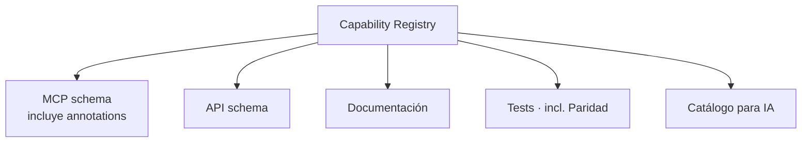

El registry es la **única fuente** de la proyección MCP, y ahora también la **única fuente del mapping SQL legacy** que alimenta el test de paridad (§12 Nivel 0). Un developer no escribe el schema MCP a mano ni el diff de paridad a mano.

---

## 11. Estructura de código

### 11.1 Layout del proyecto

```text
application/
    contabilidad/
        service.py          # consultar_resumen_deuda, consultar_ingresos_por_tipo_pago, ...
        models.py           # Pydantic contracts
        ports.py            # puertos de persistencia (Repository Port)

adapters/
    rest/
        contabilidad.py     # FastAPI router

    mcp/
        contabilidad.py     # FastMCP tools

infrastructure/
    oracle/
        contabilidad_repository.py   # SQL Q1, Q3, Q8-Q11 + mapeos id_impresora
```

### 11.2 Flujo de adaptadores hacia el service

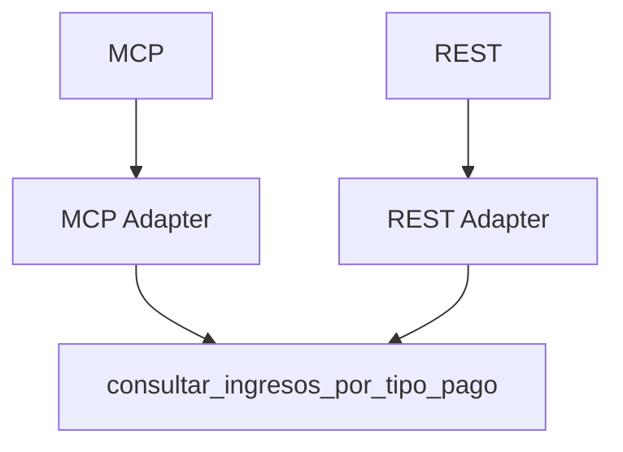

Ambos llaman exactamente al mismo service.

### 11.3 Puente MCP → Service (ejemplo)

El adapter MCP **no inventa el contrato**: lo lee del registry y proyecta el schema MCP. La descripción que ve el modelo **incluye el `usage_notes`** y las annotations derivadas de `operation.mode`:

```python
contrato = registry.get("contabilidad.ingresos_por_tipo_pago")

@mcp.tool(
    name=contrato.mcp.tool,                    # sin versión, sin namespace todavía
    description=contrato.description,           # contrato en prosa, no documentación
    annotations=contrato.mcp.annotations,       # derivadas de operation.mode
)
```

El cuerpo delega, sin lógica:

```python
resultado = contabilidad_service.consultar_ingresos_por_tipo_pago(fecha=fecha)
```

El SQL legacy **no vive aquí**: vive en `contabilidad_repository` (Q1). El service mapea conceptos de negocio (`canal`, `tipo_pago`) y traduce `id_impresora` según el mapping ya validado en §9.3.

Si la capability lanza un error, el adapter lo traduce según §7.4 (ej.: réplica `dent_ciclo` caída → `UNAVAILABLE`), y devuelve `isError: true` con el mensaje en el `content` — nunca propaga la excepción cruda ni devuelve una tabla vacía que parezca "cero".

---

## 12. Testing (cinco niveles)

Desde el primer service se establecen los cinco niveles. Para el Control Contable, el **Nivel 0 — Paridad es la puerta de la milla cero**.

### Nivel 0 — Paridad (nuevo, específico de la milla cero)

```text
Capability (6 capacidades READ)
   ↓
Repository (query SQL idéntica al legado)
   ↓
Oracle test/snapshot + réplica DENT_CICLO
   ⇕ diff exacto
Salida del correo legacy 'Control Contable' (fuente real)
```

**Objetivo:** demostrar que las 6 capacidades **reproducen exactamente** los números del correo que hoy ve la gerencia. Ante una misma fecha:

- `consultar_resumen_deuda` → 4 filas `(mes, deuda)` deben igualar el cuadro Deuda del correo.
- `consultar_ingresos_por_tipo_pago` → 6 filas + TOTAL deben igualar el cuadro del correo.
- `consultar_ingresos_por_tipo_tarjeta` (×3: CAJA, TOTEM, WEBPAY) → igualan los 3 cuadros de tarjeta.
- `consultar_ingresos_por_tipo_prevision` → iguala el cuadro de previsión.
- `consultar_boletas_emitidas_por_usuario` → iguala el cuadro de boletas emitidas.
- `consultar_boletas_anuladas_por_usuario` → iguala el cuadro de boletas anuladas.

**Reglas del diff:**
1. **Comparar los números crudos** (no los formateados con `DecimalFormat` del HTML). El legacy formatea con `round(avg(...),0)` y separador de miles solo en presentación; la paridad es sobre el valor numérico.
2. **Comparar contra el correo real**, no contra la query re-ejecutada: el correo es el artifact que el negocio valida. Si no hay correo guardado para una fecha, re-ejecutar la query legacy original contra la misma base/snapshot.
3. **NO_DATA es válido, UNAVAILABLE no:** un mes sin registros de `bat_deuda` **omite la fila** (comportamiento del legado, §19); eso es un resultado válido, no un caso de fallo. La réplica `dent_ciclo` caída es UNAVAILABLE.
4. **Fecha siempre explícita en el test** (nunca vacía): el default vacío del legado genera SQL inválido en Q1/Q8/Q11 (§19 h4).

**Criterio de aceptación de la milla cero:** las 6 capacidades pasan el diff exacto en al menos 2 fechas: un día hábil con datos y un día sin actividad (deuda sin registros). El **bloque KPI ANALYZE no participa de la paridad** (es información nueva por diseño, §8.4).

### Nivel 1 — Unit

```text
Service
   ↓
Mock Repository
```

Prueba reglas de negocio (mapeo de canales, etiquetado de `tipo_pago`, traducción de errores).

### Nivel 2 — Repository

```text
Repository
   ↓
Oracle test/snapshot + réplica DENT_CICLO
```

Prueba que la consulta funciona y que **el SQL emitido es idéntico al del legado** (misma union all, mismos filtros, mismas bandas horarias).

### Nivel 3 — Contract

```text
FastAPI ──────┐
              ├── Pydantic Contract
FastMCP ──────┘
```

Verifica **tres invariantes del protocolo MCP** (R17, R18):

1. **Annotations coherentes:** el `readOnlyHint` publicado coincide con `operation.mode`; una capability `ACT` no puede publicarse como solo lectura.
2. **Descripción utilizable:** `description` y `usage_notes` no están vacíos, y el nombre de la tool **no lleva versión** (R10).
3. **Errores serializados:** cada tipo de error declarado produce `isError: true` con su `error_code`, y `NO_DATA` ≠ `UNAVAILABLE` en el `content` (R18).

### Nivel 4 — AI / tool

```text
Agent
 ↓
Tool
 ↓
Service
```

No se prueba que el LLM "responda bonito", sino algo más determinista:

> Ante esta intención, ¿el agente tiene disponible la tool correcta y puede ejecutarla con los argumentos correctos?

Casos mínimos derivables de `usage_notes`: una intención que **debe** elegir `consultar_boletas_emitidas_por_usuario` y una parecida que **no debe** (p. ej. una pregunta de boletas **anuladas**).

---

## 13. Roadmap en fases

### Fase 1 — Enablement (Control Contable)

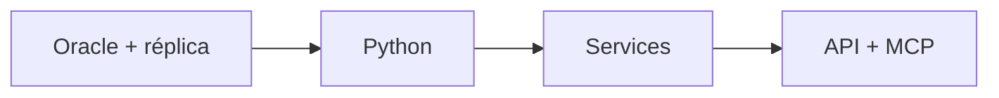

**Se obtiene:** 6 capacidades contables · 8 tablas replicadas con paridad · primeras APIs · primeros casos de IA respondiendo a finanzas/CEO · conocimiento interno · estándares · arquitectura · observabilidad · seguridad · testing.

**Frontera READ / ANALYZE / ACT en Fase 1:**

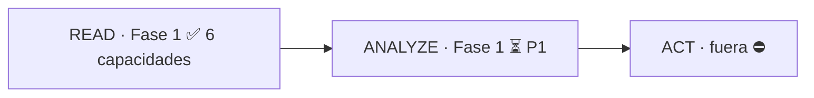

### Fase 2 — Descubrimiento

A medida que se construyen services, se descubre: ¿dónde están realmente las reglas? ¿qué lógica está duplicada? ¿qué queries son críticas? ¿qué programas dependen de qué? ¿qué datos están inconsistentes? Los **hallazgos §19** ya son el primer episodio de este descubrimiento documentado.

### Fase 3 — Strangler Fig

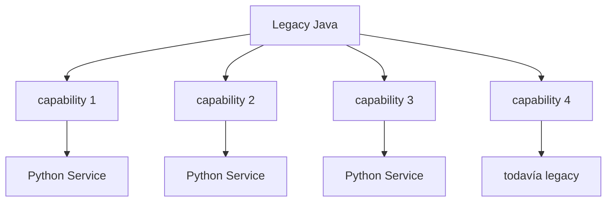

---

## 14. Capability patrón: Control Contable (golden path)

### 14.1 Criterios de selección de la primera capability

No se elige la "más impresionante" sino la que cumpla simultáneamente: valor empresarial evidente, datos disponibles, consulta relativamente acotada, bajo riesgo operacional, resultado **verificable por humanos**, utilidad para IA, capacidad de demostrar REST + MCP + Service + ORM + Oracle, capacidad de servir de plantilla.

### 14.2 Decisión: el correo "Control Contable" es el golden path

El correo Control Contable cumple todos los criterios de forma superior al candidato genérico de V1:

- **Verificable por humanos:** la gerencia **ya** recibe y entiende los números del correo. La paridad (Nivel 0) convierte la validación en algo objetivo: mismos números o no.
- **Sin riesgo operacional:** 6 lecturas pequeñas, una por tabla, contra la misma base.
- **Utilidad para IA inmediata:** "¿cuánto recaudamos el martes?" se responde con datos reales, no con un dataset prearmado.
- **Golden path por volumen de tablas:** 6 queries → 8 tablas ejercita el patrón en su variante más densa, y cada una tiene matices distintos (bandas horarias, igualdad vs rango, `decode`, mapeo de impresora, unión con réplica) que sirven de plantilla para el resto del catálogo.

### 14.3 Primera Business Capability AI-ready

Circuito completo end-to-end:

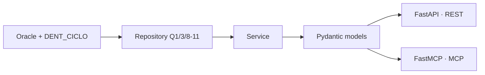

Y alrededor, como envoltura obligatoria: **Security (perfil financial) · Observability · Testing (Paridad) · Registry**.

**Orden de construcción sugerido (las 6 comparten el mismo repository y, por tanto, la #1 es barata):**

1. `consultar_ingresos_por_tipo_pago` (Q1) — arma el repository + el mapping de canales + la unión con la réplica.
2. `consultar_resumen_deuda` (Q3) — ejercita el caso más delicado (loop mensual, `avg`, omisión de meses). **Cuidado con el hallazgo §19 h1: promedio, no saldo de cierre.**
3. `consultar_ingresos_por_tipo_tarjeta` (Q10) — 3 invocaciones (CAJA/TOTEM/WEBPAY), 2 variantes de SQL.
4. `consultar_ingresos_por_tipo_prevision` (Q11).
5. `consultar_boletas_emitidas_por_usuario` (Q8).
6. `consultar_boletas_anuladas_por_usuario` (Q9) — cuidado con el matiz de igualdad `FEC_BOL = to_date(...)` (§19 h2).

### 14.4 Criterio de éxito de la arquitectura

> **No demostrar que puedes construir un MCP. Demostrar que puedes construir la capability #1 y luego replicar el patrón sistemáticamente para la #2... #6.**

Con las 6 capacidades del Control Contable funcionando y cuadrando con el correo, **la siguiente capability (analítica de deuda) debería salir barata**. Ese es el indicador de éxito del Enablement Layer.

---

## 15. Decisiones congeladas / fronteras de la primera etapa

- **Oracle:** intocable por ahora.
- **FK:** no agregar (por ahora).
- **PostgreSQL:** se deja preparada la interfaz (puerto/adapter), pero no activa durante un buen tiempo.
- **Migración tecnológica grande (Java):** congelada.
- **Refactorización en sí:** pospuesta; la primera etapa es **Enablement**.
- **Action Tools:** fuera de la milla cero (diseñar, no implementar).
- **Cache / performance avanzada:** no construir nada especulativo; medir antes de decidir (R11).
- **Versiones en MCP:** MCP expone solo la versión vigente del contrato; el versionado por ruta queda en REST (R10).
- **El cron del legacy NO se reemplaza.** Sigue viviendo mientras la capa nueva se ajusta y se validan los valores.
- **Conviven 2 correos:** el correo legacy "Control Contable" **no sufre variación** (mismo contenido, mismo destinatario) + un **correo nuevo** (el que la capa nueva alimenta) con **otro destinatario**. **Ambos deben cuadrar en los números.**
- **La paridad aplica solo a las 6 capacidades READ.** El bloque KPI (variación, aceleración) es información nueva por diseño; no debe cuadrar con nada porque el correo no la tiene.
- **`dent_ciclo` no se cuestiona:** esquema paralelo; si la query lo usa, se replica igual.
- **Django no es la capa de habilitación.** En una conversación previa (DREAMS) la inclinación era partir con Django + MCP en vez de una API tradicional. **Decisión: el enablement layer es el servidor Python (FastAPI + FastMCP) sobre Oracle.** Django / Vault — si existe — queda como **consumidor**: cliente REST o MCP client, no dueño de la capa. *Pendiente de confirmar con el negocio:* si la intención original era que Django *fuera* el enablement layer, este es un cambio de rumbo que hay que validar explícitamente antes de la maqueta.

---

## 16. Tareas: definidas ahora vs pendientes

### 16.1 Ahora (milla cero / P0)

- **Capability patrón:** construir el bloque Control Contable end-to-end: 6 capacidades, 8 tablas, en el orden sugerido de §14.3 (R14, §4.2).
- **Nivel 0 — Paridad:** implementar el diff exacto vs el correo legacy (o re-ejecución de la query original) en 2 fechas (§12).
- **Seguridad base:** abstracción `Identity → Authorization → Capability` + enforcement point único (R8, §5), con **perfil `financial`** y roles de finanzas (R12).
- **Transporte MCP:** decidir transporte y autenticación **antes** de codificar la capability #1 (§5.5).
- **Proyección al protocolo MCP:** annotations derivadas + `description` + `usage_notes` + errores al `content` (R17, R18).
- **Observabilidad mínima:** request_id/tracing + trazabilidad AI sin guardar datos completos (§6).
- **Contratos formales:** Pydantic/JSON Schema + taxonomía de errores (§7).
- **Testing mínimo:** los 5 niveles aplicados al bloque contable, incluida la paridad (§12).
- **Data Quality Rules:** `fecha_required`, `replica_dent_ciclo_present`, `meses_sin_dato_son_validos` (R9).
- **Gobernanza de datos:** perfil `financial` + `allowed_fields`/`forbidden_fields` en cada capability (R12), con foco en que `USUAPEP`/`USUNOMC` son PII de empleados y el `rut` nunca cruza.

### 16.2 Pendientes (preparados pero no implementados)

- **P1 · Capacidades ANALYZE (KPIs de deuda):** `calcular_variacion_deuda`, `calcular_aceleracion_deuda`, etc. — definir la semántica del "saldo" (promedio vs cierre, §19 h1) en el contrato. El LLM nunca hace la aritmética.
- **P1 · Envío del correo nuevo:** receptores, frecuencia, origen (el correo legacy no se toca). Se define el mecanismo de despacho (job del legacy extendido, orquestador externo, MCP `enviar_correo` en una fase ACT posterior).
- **P1 · Versionado:** definir y documentar la convención; se ejercita en REST (R10).
- **P1 · Calidad de datos ampliada:** reglas complejas a medida que lleguen capabilities analíticas (R9).
- **P1 · Límites de tráfico de agente:** campo `agent_traffic` declarado y medido; enforcement real en P1 cuando haya varias capabilities (R19).
- **P2 · `enviar_correo` como Action Tool / transacciones:** diseñar modelo transaccional e idempotencia; no implementar en esta etapa (R4).
- **P2 · Cache / performance:** esperar métricas reales (R11).
- **P2 · Escalado del catálogo:** namespacing por dominio (anunciado en R20) antes de ~15 tools.
- **P2 · PostgreSQL / Strangler Fig:** evolución futura (R15, Fase 3).
- **P2 · Estrategia de seguridad avanzada:** IAM/SSO, autorización fina por campo.

### 16.3 Decisiones técnicas abiertas (resolver antes de codificar)

- **Transporte MCP + autenticación** (P0, §5.5).
- ORM concreto (SQLAlchemy / SQLModel).
- Proveedor de identidad/autenticación (token, API key, integración existente).
- Despliegue (proceso, contenedor, entorno).
- **Gobernanza de datos:** definir **dueño** del `allowed_fields`/`forbidden_fields` del perfil `financial` (recomendado: gerencia de finanzas / contador) y el proceso de aprobación de cada capability que vaya a IA (R12).
- **Orden de las 6 capacidades** del §14.3 (sugerido pero confirmable con el equipo).
- **Validar con el negocio la premisa de Django** (§15): confirmar que el enablement layer es el servidor Python y que Django / Vault queda como consumidor.

---

## 17. Ventajas estratégicas de este enfoque

- La refactorización **deja de ser un proyecto puramente técnico** que pide meses de inversión antes de mostrar resultados.
- La primera etapa empieza a producir **capacidades visibles** mientras, al mismo tiempo, se construyen los cimientos de la segunda.
- La IA puede **investigar** y responder preguntas del CEO y de finanzas con conocimiento operativo real.
- Al anclar la milla cero en el **correo que gerencia ya lee**, la validación es objetiva (paridad) y el tiempo de adopción interno es corto: no hay que enseñar a leer los datos.
- Las **business rules quedan explicitadas** en la capa de servicios (Data Quality Rules) y los **hallazgos §19** documentan el comportamiento real del legado, convirtiendo la plataforma en fuente de conocimiento arquitectónico para la refactorización.
- El **golden path** (bloque Control Contable, 6 capacidades → 8 tablas) hace que cada capability nueva sea incrementalmente más barata y consistente.

---

## 18. Milla cero (resumen ejecutivo)

> **Python Service Layer → FastAPI + FastMCP → ORM → Oracle (y réplica DENT_CICLO) → Capability Registry → bloque "Control Contable" (6 capacidades READ → 8 tablas) como golden path, con Nivel 0 de paridad contra el correo legacy como criterio de aceptación.**

La estrategia está decidida. El siguiente paso no es seguir discutiendo arquitectura abstracta: es **construir CAPABILITY #001** (`consultar_ingresos_por_tipo_pago`) y hacerla pasar por todo el circuito (Oracle → Repository → Service → Pydantic → FastAPI → FastMCP → Security → Observability → Tests → Registry → Paridad), para luego replicar el patrón en las 5 restantes del bloque.

---

## 19. Hallazgos del legacy — Validación de las queries (Control Contable)

**Fuente de la validación:** documento `resumencontrolRICH.md` (1793 líneas) vs código real `DentWeb12_Java21/src/cl/llm/batch/ResumenControl.java` (852 líneas) vs `helper.md` (líneas 3648-4037). Resultado: **el SQL documentado de las 15 queries (Q1–Q15) es idéntico al fuente**, con los hallazgos que siguen. Estos hallazgos **condicionan la replicación** (paridad) y el diseño de las capabilities.

### h1 · "Resumen deuda" es promedio mensual, no saldo de cierre

`setTablaDeuda` calcula `round(avg(bat_deuda),0)` por mes (**promedio diario del mes**), agrupando por `to_char(bat_fecha,'YYYY-MM')`. No es el saldo de deuda al cierre del mes.

- Consecuencia en la paridad: el correo muestra **promedios**. Cualquier KPI que hable de "saldo de deuda" debe partir de esa semántica o declarar el cambio de métrica (§8.4).
- Consecuencia de loop (Java:283-302): la query se ejecuta **4 veces**, decrementando mes y año al cruzar diciembre. La primera iteración corresponde al mes de la consulta → **la primera fila es el mes del día consultado** (el RICH §7.7 decía "4 meses cerrados previos", lo cual es incorrecto: incluye el mes vigente de la consulta). Confirmado contra el fuente: primero se arma la query con el mes actual, se ejecuta, y después se decrementa.
- Etiqueta de fila: `MM-YYYY` (ej. `09-2026`). Mes sin registros → **la fila se omite silenciosamente** (solo agrega si `rs1.next()`). Eso es comportamiento legacy y, para la paridad, un resultado válido (NO_DATA, no UNAVAILABLE).

> **Replicación:** NO usar la variante "optimizada" (una sola query para los 4 meses). Se replica el loop de 4 ejecuciones tal cual (decisión §0.3).

### h2 · Inconsistencia de filtros de fecha entre queries (NO innovar)

| Query | Filtro de fecha |
| --- | --- |
| Q1 (ingresos pago), Q8 (boletas emitidas), Q11 (previsión) | rango `>= 00:00:00 AND <= 23:59:59` |
| Q9 (boletas anuladas) | **igualdad** `FEC_BOL = to_date(<fecha>)` |
| Q10-CAJA (tarjeta caja) | **igualdad** `FEC_BOL = to_date(<fecha>)` |
| Q10-TOTEM/WEBPAY (tarjeta) | `trunc(FEC_BOL) = to_date(<fecha>)` |

- La tolerancia horaria es **distinta** entre tablas del mismo correo. La paridad exige replicarlo exactamente, no unificarlo.
- **Matiz Q9/Q10-CAJA:** la igualdad sin `trunc` solo matchea filas cuyo `FEC_BOL` es exactamente la medianoche. Si en la práctica `FEC_BOL` guarda hora, filtran menos filas que el rango. Se replica tal cual; si un día el cuadro de anuladas/no cuadra con una re-ejecución "más correcta", el legacy manda.

### h3 · `id_impresora` codifica el canal (mapeo validado)

| `id_impresora` | Canal (etiqueta del correo) |
| --- | --- |
| `like 'IBM%'` | CAJA |
| `like 'TOT%'` | TOTEM |
| `= 'WPTN'` | WEBPAY |
| `= 'BESTA'` | CAJA VECINA BCO.EST. |

- En Q1 el mapeo es por bloques (`union all`): cada bloque filtra por un canal y etiqueta un `NUM_DOCTO` literal (`'WEBPAY'`, `'CAJA VECINA BCO.EST.'`, `'TOTEM'`); los tipos EFE/TRJ/CHQ se etiquetan después en Java (:197-199).
- En Q10 el canal viaja como parámetro `origen` (`CAJA|TOTEM|WEBPAY`) inyectado en `qryOrigen`. **Matiz Q10-CAJA:** la variante CAJA repite el filtro `id_impresora like 'IBM%'` dos veces (`:610` hardcodeado y `:611` vía `qryOrigen`); redundante pero inofensivo — se replica igual.

### h4 · Default de fecha vacío = SQL inválido en Q1/Q8/Q11

En `setTablaIngresoPago`, `getBoletasPorUsuario` y `getIngresoPorPrevision`, si `fechaCns` es `""` se reemplaza por `to_char(sysdate,'YYYY-MM-DD')` **dentro de la cadena** `to_date('<fechaCns> 00:00:00',...)`, generando SQL inválido (comillas anidadas). El catch silencioso lo convierte en tabla vacía.

- En la práctica `ConsultaControl` siempre pasa fecha explícita, así que el defecto no se ve en el correo.
- **Regla para la capa nueva:** `fecha` es **obligatoria** en el contrato de las 6 capabilities (`ValidationError` si viene vacía). Nunca replicar el default roto.

### h5 · Réplica `dent_ciclo` (esquema paralelo, unida con `union all`)

Q1, Q8, Q9, Q10 y Q11 unen `dent.boleta` con `dent_ciclo.boleta` (réplica Postgres del sistema de ciclo). Si la réplica no está disponible, **toda la query falla** (y el legacy lo silencia → tabla vacía).

- Regla R9: `replica_dent_ciclo_present`. En la capa nueva, réplica caída = `UNAVAILABLE`, nunca una tabla vacía que parezca "cero" (R18, §7.4).

### h6 · Esquema por defecto de la sesión (queries sin prefijo)

`getBoletasPorUsuario` (Q8) usa `from boleta bo, usuarios us` sin prefijo en el primer bloque y `from dent_ciclo.boleta bo, usuarios us` (con prefijo) en el segundo. `getIngresoPorPrevision` (Q11) usa `boleta/fichas/dominio` sin prefijo. Dependen del owner por defecto de la sesión (R8 del propio RICH).

- Regla: el repository Oracle debe **fijar explícitamente el owner** en el SQL equivalente, o validar que la sesión lo resuelve igual. Documentado como riesgo de fragilidad, no como cambio de query.

### h7 · Errores silenciados en el legacy (no replicar)

Los 15 métodos atrapan excepción → `logger.error` → devuelven buffer/vacío. El consumidor no distingue "sin datos" de "BD caída" (riesgo R3 del RICH). La capa nueva traduce a la taxonomía §7.4 (NO_DATA vs UNAVAILABLE).

### h8 · Estado de la documentación RICH: 1 error de línea y 1 error de semántica

- **Líneas-cita de helper.md viejas:** el RICH cita `helper.md:102-483`; hoy los 15 métodos ResumenControl viven en `helper.md:3648-4037`. El SQL es el mismo; solo la referencia de línea está desactualizada.
- **RICH y helper declaran "9 union all" en Q1:** el fuente tiene **8 bloques / 7 union all**. Error de descripción heredado (no afecta el SQL).
- **RICH §7.7 describe mal `setTablaDeuda`** (ver h1 arriba): dice "4 meses cerrados previos al mes actual"; el fuente muestra el **mes de la consulta** como primera fila y luego decrementa.

---

## 20. Presentación gerencia (resumen adaptado a V2)

> Resumen ejecutivo de V2 para la reunión con gerencia: qué vamos a hacer, cómo lo abordamos, en cuánto tiempo se ve la primera maqueta funcional y por qué este camino es el más corto y de menor riesgo.

### La estrategia en una frase

> **No vamos a refactorizar el sistema clínico. Vamos a construir una capa de habilitación (BI & AI Enablement Layer) que ponga a Oracle una API moderna y un servidor MCP, empezando por reproducir EXACTAMENTE —y en paralelo, sin tocar nada— los números del correo "Resumen Control (Contable)" que la gerencia ya recibe todos los días.**

```mermaid
graph LR
    O[(Oracle + réplica<br/>sistema legacy)] --> PY[Python Services<br/>Contable]
    PY --> API[FastAPI · REST]
    PY --> MCP[FastMCP · Server MCP]
    API --> DASH[Dashboards / Apps / Integraciones]
    MCP --> IA[IA / Agentes · preguntas del CEO]
    API --> IA
```

### Qué vamos a hacer: habilitantes primero

Construimos **una vez** la infraestructura habilitante (servidor MCP + servidor de APIs), sobre la cual **deployamos las 6 capacidades contables** que hoy están dentro del correo, repitiendo siempre el mismo patrón:

| # | Capacidad | Tabla que reproduce |
| - | --------- | ------------------- |
| 1 | `consultar_resumen_deuda` | Resumen Deuda (4 meses) |
| 2 | `consultar_ingresos_por_tipo_pago` | Ingresos por tipo pago |
| 3 | `consultar_ingresos_por_tipo_tarjeta` (×3) | Ingresos tarjeta CAJA · TOTEM · WEBPAY |
| 4 | `consultar_ingresos_por_tipo_prevision` | Ingresos por previsión |
| 5 | `consultar_boletas_emitidas_por_usuario` | Boletas emitidas por usuario |
| 6 | `consultar_boletas_anuladas_por_usuario` | Boletas anuladas por usuario |

### Cómo lo abordamos: riesgo controlado y paridad

- **El correo legacy sigue saliendo igual.** El cron no se toca. Por un tiempo conviven **2 correos** (el actual + uno nuevo con otro destinatario); **ambos deben cuadrar en los números**.
- Criterio de aceptación objetivo: **diff exacto** entre las 6 capacidades y el correo, en un día hábil y en un día sin actividad.
- Lecturas primero, análisis después (KPIs de variación de deuda), acciones al final (`enviar_correo`). En esta fase **no escribimos en Oracle ni tocamos el sistema productivo**.

### Roadmap y tiempo estimado

Primera maqueta funcional demostrable: **≈ 4–6 semanas** (bloque contable end-to-end + paridad + primeros casos de IA respondiendo a finanzas/CEO).

```mermaid
gantt
    title Roadmap · Enablement Layer (Contable)
    dateFormat YYYY-MM-DD
    axisFormat %b
    section Fundación
    Habilitantes (server MCP + API, seguridad, observabilidad, contratos):s1, 2026-09-28, 14d
    section Capacidades contables
    Q1 ingresos por tipo pago (golden path):s2, after s1, 10d
    Q3 deuda + Q10 tarjeta + Q11 previsión:s3, after s2, 10d
    Q8/Q9 boletas por usuario:s4, after s3, 7d
    section Demostración
    PARIDAD vs correo (2 fechas) + IA respondiendo:s5, after s4, 7d
```

> **Entrega concreta ahora:** bloque **Control Contable** (6 capacidades → 8 tablas) recorriendo `Oracle + DENT_CICLO → Repository → Service → Pydantic → FastAPI → FastMCP → Seguridad → Observabilidad → Tests → Registry → **Paridad**`. Con él queda el golden path replicable: la siguiente capacidad (analítica) costará menos y pasamos de "proyecto técnico" a **capacidades de negocio visibles para la gerencia**.

---

## 21. Continuidad con V1 (referencias cruzadas)

Este documento (V2) **reemplaza** a `000_MiEstrategiaV1.md` en lo relativo al golden path y la milla cero. Las secciones que no cambian de V1 —y que V2 asume íntegras— son:

- **R1–R11, R13–R20:** reglas vigentes sin cambios salvo las que se indican aquí (R12 generalizada, R4 con frontera electrónica al bloque contable).
- **§3–§7:** arquitectura, seguridad, observabilidad y contratos salvo el añadido del perfil `financial` (R12) y el Nivel 0 de testing (§12).
- **Claude Dice / BigPickle Dice (bloques de revisión de V1):** siguen siendo la revisión técnica que fundamenta R17–R20 y §5.5/§7.4; quedan en V1 como historial de la revisión, no se trasladan a V2 para no duplicar narrativa. Donde una recomendación de esa revisión cambia de alcance por el enfoque contable, ya se anotó arriba (p. ej. la brecha de gobernanza de BigPickle se enriquece con el caso PII de empleados en §16.3).

---