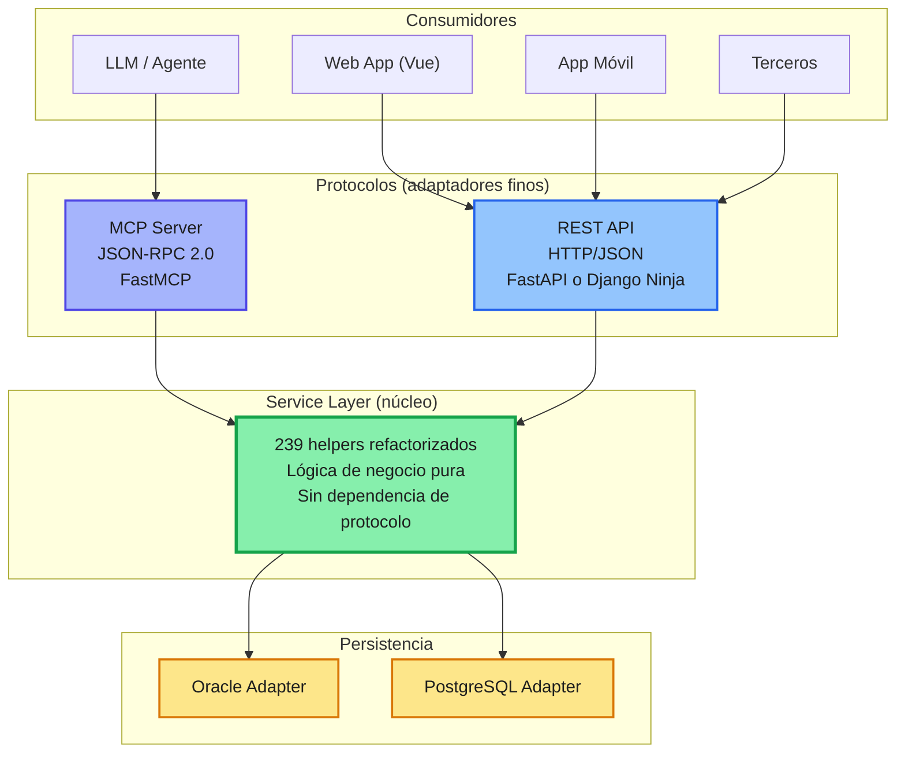

# Refactorización del core clínico: por qué Python (Django) y no Java Spring Boot

## 1. Contexto y diagnóstico

La aplicación actual (Java + JSP, desplegada en Payara, año 2008) no tiene separación de responsabilidades. Los `.java` y `.jsp` mezclan tres capas que deberían estar aisladas:

- Acceso a datos (SQL embebido, helpers ad-hoc)
- Lógica de negocio
- Presentación (los `.java`/`.jsp` literalmente dibujan HTML de salida)

El core tiene ~239 helpers y ~400 programas Java/JSP documentados hasta ahora como parte del trabajo de análisis previo a la refactorización. Cualquier decisión de reescritura tiene que resolver dos problemas a la vez:

1. **Deuda arquitectónica**: separar responsabilidades de una vez por todas.
2. **Visión IA-first**: el sistema debe nacer pensado para ser consumido tanto por humanos (web, móvil) como por agentes/LLMs (vía MCP), no adaptado después.

Reescribir en Java Spring Boot resolvería el problema (1) pero no aporta nada nuevo al problema (2): seguiría siendo la misma familia tecnológica, con el mismo ecosistema y las mismas limitaciones frente a IA que tiene hoy. Es modernizar sin cambiar de paradigma.

## 2. La arquitectura propuesta: Service Layer compartida

El patrón correcto no es "un backend que expone una API", sino una capa de servicio agnóstica al protocolo, consumida por adaptadores finos:

```
239 helpers → Service Layer → { REST Adapter, MCP Adapter }
```

- **Service Layer**: lógica de negocio pura. Sin HTTP, sin JSON-RPC, sin conocimiento de protocolo.
- **REST Adapter**: capa fina que traduce HTTP → llamadas al servicio (para web, móvil, terceros).
- **MCP Adapter**: capa fina que traduce JSON-RPC → llamadas al servicio (para el LLM/agente).
- Ambos adaptadores son **pares**, no uno envuelve al otro. Esto evita que el MCP quede como un "wrapper" de segunda clase sobre el REST, o viceversa.



Esta arquitectura es agnóstica al lenguaje: podría implementarse en Java o en Python. La elección de lenguaje se juega en el punto 3.

## 3. Por qué Python (y no Java Spring Boot)

### 3.1 MCP es un ecosistema nacido en Python, no en Java

El adaptador MCP es, junto con el REST, uno de los dos pares de la arquitectura — y no es un componente secundario: es la razón de ser de la refactorización IA-first.

- El SDK de referencia y el más maduro para servidores MCP es **FastMCP**, en Python. La comunidad, los ejemplos, los patrones de auth, streaming y manejo de sesiones se documentan primero (y a veces solo) ahí.
- El SDK de MCP para Java/Kotlin existe pero llega después, con menos adopción, menos ejemplos de producción y menos terceros integrando sobre él.
- Construir el corazón de un sistema IA-first sobre el SDK "de segunda clase" de un protocolo diseñado para IA es remar contra la corriente exactamente en el componente que justifica todo el proyecto.

### 3.2 El resto del stack de IA ya es Python, y ya es tuyo

No es una elección en el vacío: hoy ya existen, en Python/Django, piezas del mismo ecosistema que este proyecto va a consumir o de las que va a depender:

- El **RAG híbrido** (Grafo + Vector + BM25 + Multi-LLM) sobre la documentación del core clínico está pensado para integrarse a una app Django.
- El **visor de markdown (Vault)**, con botones de análisis IA, tiene plan de refactor a Django.
- La plataforma de datos clínicos (extracción Oracle → PostgreSQL para RAG y analítica) también vive en ese mismo mundo.

Elegir Spring Boot para el core significa mantener dos stacks de producción en paralelo — uno Java para el negocio, otro Python para todo lo relacionado a IA/RAG — con el costo de integración, despliegue y contexto mental que eso implica. Elegir Python para el core significa que **una sola pila de tecnología** cubre negocio + IA + datos, y el Service Layer puede llamar directamente a las piezas de RAG sin cruzar un puente HTTP/gRPC entre lenguajes.

### 3.3 Librerías de datos y ORM flexible para un modelo sin integridad referencial

El modelo de datos actual (177 tablas, sin FKs, relaciones solo en código) necesita un ORM que permita declarar relaciones de forma progresiva y exploratoria, no un modelo "todo o nada" generado desde un esquema ya limpio.

- El ORM de Django (o SQLAlchemy si se prefiere FastAPI puro) permite declarar relaciones en el código de la aplicación sin que existan como FK en la base — exactamente el escenario intermedio que se está evaluando (agregar FK solo a un subconjunto de tablas).
- El ecosistema Python de introspección de esquemas, generación de modelos y scripting de migración (`inspectdb`, SQLAlchemy reflection, pandas para los checks de violación de FK candidatas) es más directo para este tipo de trabajo exploratorio que el stack de JPA/Hibernate, más rígido y pensado para esquemas ya estables.

### 3.4 Menor boilerplate, mayor velocidad de refactorización

Migrar 239 helpers y ~400 programas es, sobre todo, un problema de volumen. Spring Boot exige más ceremonia estructural (anotaciones, beans, configuración XML/Java, capas de DTO/Entity/Repository/Service/Controller explícitas) que Django o FastAPI para llegar al mismo resultado funcional. En un proyecto de esta escala, cada unidad de boilerplate se multiplica por cientos de programas a migrar.

### 3.5 El trabajo de documentación con IA ya está optimizado para este camino

La estrategia de documentación con OpenCode sobre los 400 programas (pasada rápida + pasada profunda, `helper.md` compartido) está generando conocimiento estructurado pensado para alimentar una reescritura asistida por IA. Ese flujo de trabajo ya asume un destino Python/Django: mantener la coherencia entre "cómo se analizó" y "en qué se va a reescribir" reduce fricción y reprocesamiento.

## 4. Lo que Java Spring Boot sí tendría a favor (honestidad técnica)

Para que el documento sea defendible frente a cualquier contraparte que prefiera Java, vale la pena nombrar lo que se sacrifica:

- **Tipado estático más estricto**: Java/Spring detecta en compilación errores que en Python solo aparecen en runtime (mitigable con type hints + mypy/pyright, pero no es gratis).
- **Rendimiento en cómputo puro**: para lógica CPU-bound intensiva, la JVM suele superar a CPython (mitigable: el core clínico es I/O-bound —consultas a Oracle/PostgreSQL—, no CPU-bound).
- **Madurez "enterprise" percibida**: Spring Boot tiene más trayectoria en sistemas bancarios/salud de gran escala y más certificaciones/compliance de referencia en ese mundo.
- **Concurrencia nativa**: los hilos y el modelo de concurrencia de la JVM son más predecibles bajo carga alta que el GIL de Python (mitigable con async/await en FastAPI/Django y arquitectura basada en colas para lo pesado).

Ninguno de estos puntos pesa más que el hecho de que el objetivo central del proyecto — IA-first, MCP como ciudadano de primera clase — está mejor servido hoy por el ecosistema Python.

## 5. Recomendación y siguiente paso

Usar **Django** (o Django + FastAPI/Django Ninja para el adaptador REST) como base del Service Layer, con **FastMCP** como adaptador MCP, manteniendo la separación estricta descrita en la sección 2. Esto:

1. Unifica el stack con el trabajo de RAG/Vault/plataforma de datos ya en curso.
2. Pone el protocolo IA (MCP) sobre su SDK de referencia, no sobre una implementación secundaria.
3. Aprovecha el ORM flexible para el modelo de datos sin FKs que se está migrando desde Oracle.
4. Reduce la ceremonia estructural en una migración de cientos de programas.

**Próximo paso sugerido**: tomar 2–3 helpers representativos (uno simple, uno con queries indirectas vía helper como `ResumenControl`, uno con lógica de negocio compleja) y hacer una prueba de concepto end-to-end: Service Layer + REST Adapter + MCP Adapter, para validar el patrón antes de comprometerse a migrar los 239.
