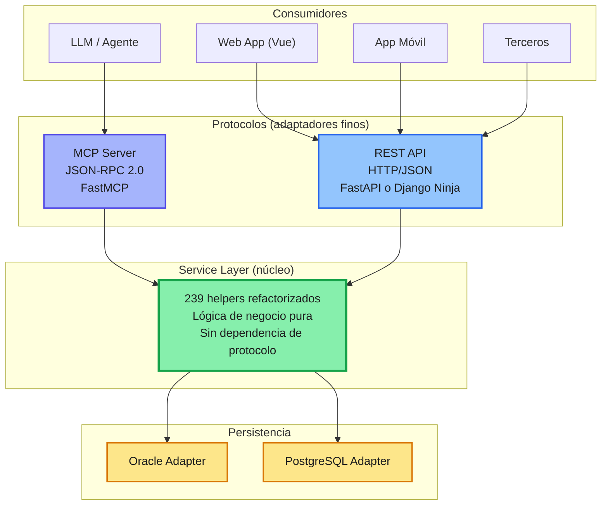

# Refactorización AI-First: Python + Service Layer vs. Java Spring Boot

> **Documento de argumentación técnica y estratégica**  
> **Contexto:** aplicación Java 2008 desplegada en Payara, con JSP/Java que mezclan presentación, lógica y acceso a datos. No existe separación de responsabilidades. Los Java y JSP incluso generan HTML directamente.  
> **Propuesta:** extraer la lógica de negocio a una **Service Layer pura en Python**, expuesta mediante adaptadores finos **REST** y **MCP**.  
> **Alternativa evaluada:** refactorizar sobre **Java Spring Boot**.  
> **Decisión recomendada:** Python + Service Layer + adaptadores REST/MCP, con migración incremental tipo *strangler fig*.

---

## 1. Resumen ejecutivo

La aplicación actual es un sistema Java 2008 sobre Payara con un problema estructural grave: **no hay separación de responsabilidades**. Los Java y JSP realizan tareas de presentación, negocio, persistencia y formateo HTML. Existen **239 helpers** que probablemente concentran lógica duplicada, acoplamiento y reglas de negocio difíciles de testear.

Para una refactorización **AI-first**, la opción más coherente no es reescribir todo en Spring Boot, sino:

1. **Aislar la lógica de negocio pura** en una Service Layer en Python.
2. Exponer esa capa mediante dos adaptadores pares:
   - **REST Adapter** para Web Vue, móvil y terceros.
   - **MCP Adapter** para LLM/agentes.
3. Mantener adaptadores de persistencia para Oracle y PostgreSQL.
4. Migrar por estrangulamiento, sin big bang.

Python no se elige por moda. Se elige porque:
- Su ecosistema AI/LLM/MCP es el más maduro y rápido.
- Reduce boilerplate y acelera la extracción de los 239 helpers.
- Permite prototipar, testear y desplegar servicios puros con menos ceremonia.
- Se alinea mejor con una arquitectura de agentes, herramientas y protocolos JSON-RPC.
- Facilita la convivencia con el legado Java/Payara durante la transición.

Spring Boot es una tecnología excelente, pero **no es la herramienta óptima para este contexto específico**: AI-first, MCP nativo, refactor incremental y necesidad de velocidad de iteración.

---

## 2. Situación actual y problema

### 2.1 Síntomas

- Aplicación Java 2008 desplegada en Payara.
- JSP y Java generan HTML directamente.
- Lógica de negocio mezclada con HTTP, sesión, SQL y presentación.
- 239 helpers sin fronteras claras.
- Difícil testear, mantener y evolucionar.
- Integración con LLM/agentes inexistente o forzada.
- Alto coste de cambio: tocar una pantalla puede romper reglas de negocio.

### 2.2 Consecuencia

Cualquier refactorización que solo cambie Java por Spring Boot mantiene el problema de fondo si no se separa primero el dominio. Spring Boot moderniza el runtime, pero **no resuelve por sí solo la ausencia de Service Layer**.

---

## 3. Arquitectura objetivo

### 3.1 Patrón correcto

```text
239 helpers → Service Layer → { REST Adapter, MCP Adapter }
```

Donde:

- **Service Layer**: lógica de negocio pura. Sin HTTP. Sin JSON-RPC. Sin protocolo.
- **REST Adapter**: capa fina que traduce HTTP → llamadas al servicio.
- **MCP Adapter**: capa fina que traduce JSON-RPC → llamadas al servicio.
- Ambos adaptadores son **pares**, no uno envuelve al otro.

### 3.2 Diagrama



### 3.3 Principios

- **Dominio puro**: sin dependencias de framework, HTTP, JSON-RPC o SQL.
- **Adaptadores finos**: solo traducen protocolo → servicio.
- **Inversión de dependencias**: el servicio define puertos; la infraestructura implementa adaptadores.
- **Testabilidad**: el núcleo se prueba sin levantar servidor ni base de datos.
- **Migración incremental**: el legado Java/Payara sigue funcionando mientras se extrae lógica.

---

## 4. ¿Por qué Python?

### 4.1 Argumentos técnicos

| Área | Python | Impacto |
|---|---|---|
| Ecosistema AI/LLM | FastMCP, Pydantic AI, LangChain, LlamaIndex | Integración natural con agentes |
| MCP | FastMCP es referencia | Adaptador MCP en pocas líneas |
| Tipado | Type hints + Pydantic + mypy | Contratos claros y validación |
| Frameworks REST | FastAPI, Django Ninja, Litestar | APIs rápidas, OpenAPI automático |
| Async | asyncio, uvicorn, httpx | Buen rendimiento I/O |
| Testing | pytest, fixtures, mocking | Refactor seguro y rápido |
| Boilerplate | Muy bajo | Más tiempo en negocio, menos en configuración |
| Despliegue | Contenedores, uvicorn/gunicorn | Menor fricción operativa |
| Observabilidad | OpenTelemetry, structlog | Trazabilidad moderna |
| Seguridad | OAuth2, JWT, dependencias FastAPI | Suficiente para APIs empresariales |
| Interoperabilidad | REST, colas, gRPC | Convive con Java/Payara |

### 4.2 Argumentos estratégicos

- **AI-first real**: los agentes consumen herramientas vía MCP; Python es el camino natural.
- **Time-to-market**: prototipos y servicios funcionales en días, no semanas.
- **Coste total de propiedad**: menos memoria, menos ceremonia, despliegues más simples.
- **Talento**: comunidad Python enorme, especialmente en AI/ML.
- **Migración por estrangulamiento**: no hay que reescribir todo el sistema de una vez.
- **Flexibilidad**: se puede empezar con Oracle y migrar a PostgreSQL sin tocar el dominio.
- **Enfoque en dominio**: los 239 helpers se convierten en casos de uso testeables.

---

## 5. ¿Por qué no Java Spring Boot?

Spring Boot es maduro, robusto y enterprise. No se descarta por incapacidad técnica. Se descarta porque **no encaja tan bien como Python en este contexto**.

### 5.1 Limitaciones para este proyecto

| Factor | Spring Boot | Python |
|---|---|---|
| Ceremonia | Alta: anotaciones, beans, configuración | Baja: funciones, clases, inyección simple |
| Velocidad de refactor | Media | Alta |
| Curva AI/MCP | Spring AI existe, pero menos maduro | FastMCP es referencia |
| Arranque | Más pesado | Más ligero |
| Memoria | Mayor consumo típico | Menor huella |
| Prototipado con agentes | Más lento | Muy rápido |
| Serverless | Posible pero pesado | Excelente |
| Evolución del ecosistema AI | Más lenta | Muy rápida |
| Migración de 239 helpers | Requiere reescribir en Java | Se pueden extraer a Python incrementalmente |

### 5.2 Lo que sí aporta Spring Boot

- Ecosistema enterprise muy maduro.
- Spring Security, Spring Data, Spring Batch.
- Transacciones declarativas robustas.
- Gran soporte para Oracle/JDBC.
- Virtual threads en Java moderno.
- Herramientas de observabilidad como Actuator/Micrometer.

### 5.3 Conclusión sobre Spring Boot

Si el objetivo fuera **solo modernizar el runtime Java** manteniendo el equipo y el stack, Spring Boot sería una opción razonable.  
Pero si el objetivo es **refactorizar con enfoque AI-first, exponer MCP y acelerar la extracción de lógica de negocio**, Python ofrece una ventaja estratégica clara.

---

## 6. Comparativa técnica resumida

| Criterio | Python + FastAPI/FastMCP | Java + Spring Boot | Ganador para este caso |
|---|---|---|---|
| Ecosistema AI/LLM/MCP | Referente | Emergente | Python |
| Velocidad de desarrollo | Muy alta | Alta | Python |
| Boilerplate | Muy bajo | Alto | Python |
| Tipado | Type hints + Pydantic | Java estático | Empate técnico |
| Rendimiento CPU | Menor | Mayor | Spring Boot |
| Concurrencia I/O | Async nativo | Reactivo/Virtual Threads | Empate |
| Memoria | Menor | Mayor | Python |
| Madurez enterprise | Alta | Muy alta | Spring Boot |
| Integración Oracle | python-oracledb | JDBC/Hibernate | Empate |
| Testing | pytest | JUnit | Python |
| Despliegue | Simple | Más pesado | Python |
| MCP nativo | FastMCP | Spring AI MCP | Python |
| Serverless | Excelente | Limitado | Python |
| Curva aprendizaje | Baja/Media | Media/Alta | Depende del equipo |
| Seguridad | FastAPI Security | Spring Security | Spring Boot |
| Observabilidad | OpenTelemetry | Micrometer/Actuator | Empate |

---

## 7. Estrategia de migración recomendada

### Fase 0 — Inventario
- Catalogar los 239 helpers.
- Clasificar en: dominio, infraestructura, presentación, utilidades.
- Detectar reglas de negocio duplicadas.

### Fase 1 — Definir puertos
- Diseñar interfaces de Service Layer.
- Definir contratos de entrada/salida con Pydantic.
- Establecer errores de dominio.

### Fase 2 — Implementar servicios puros
- Extraer lógica a Python.
- Sin HTTP, sin SQL, sin JSP.
- Pruebas unitarias con pytest.

### Fase 3 — Adaptadores REST y MCP
- REST con FastAPI o Django Ninja.
- MCP con FastMCP.
- Ambos consumen la misma Service Layer.

### Fase 4 — Persistencia
- Adaptador Oracle con python-oracledb.
- Adaptador PostgreSQL con SQLAlchemy o asyncpg.
- El dominio no sabe qué base de datos hay detrás.

### Fase 5 — Strangler Fig
- Enrutar tráfico nuevo a Python.
- JSP legado sigue para pantallas antiguas.
- Vue consume REST.
- Agentes consumen MCP.

### Fase 6 — Retirar legado
- Migrar helpers uno a uno.
- Apagar funcionalidades Java/JSP a medida que se reemplazan.
- Medir cobertura y errores.

### Fase 7 — Optimizar
- Migrar datos si aplica.
- Añadir caché, observabilidad y seguridad avanzada.
- Documentar ADRs.

---

## 8. Riesgos y mitigaciones

| Riesgo | Mitigación |
|---|---|
| Equipo sin experiencia en Python | Capacitación, pairing, estándares, linting |
| Rendimiento insuficiente | Benchmarks, async, caching, perfilado |
| Seguridad | OWASP, revisión de dependencias, OAuth2/JWT |
| Integración Oracle | Pool de conexiones, transacciones, pruebas de carga |
| Convivencia Java/Python | Contratos OpenAPI, colas, REST, versionado |
| Complejidad MCP | Autenticación, límites, versionado de herramientas |
| Deuda del legado | Migración incremental, no big bang |
| Gobernanza | ADRs, CI/CD, mypy, ruff, pytest |

---

## 9. Conclusión

Para esta refactorización **AI-first** de una aplicación Java 2008 sobre Payara, con 239 helpers y sin separación de responsabilidades, la opción más coherente es:

```text
Service Layer pura en Python
        +
REST Adapter (FastAPI / Django Ninja)
        +
MCP Adapter (FastMCP)
        +
Persistencia Oracle/PostgreSQL
```

Python no se elige porque Spring Boot sea malo. Se elige porque:
- Acelera la extracción de lógica de negocio.
- Reduce boilerplate y coste de mantenimiento.
- Tiene el ecosistema AI/MCP más maduro.
- Permite migración incremental sin reescribir todo.
- Se alinea mejor con agentes, LLM y protocolos modernos.

Spring Boot sería una buena opción si el objetivo fuera únicamente modernizar el stack Java.  
Pero para una estrategia **AI-first, MCP-first y de refactor incremental**, Python es la decisión técnica y estratégica más sólida.

---

## Apéndice A — Estructura de carpetas sugerida

```text
src/
  domain/
    models/
    errors/
    value_objects/
  services/
    cliente_service.py
    pedido_service.py
    facturacion_service.py
  adapters/
    rest/
      fastapi_app.py
      routers/
    mcp/
      fastmcp_server.py
      tools/
    persistence/
      oracle/
      postgres/
  tests/
    unit/
    integration/
    e2e/
```

---

## Apéndice B — Ejemplo de servicio puro

```python
from dataclasses import dataclass
from decimal import Decimal

@dataclass(frozen=True)
class Cliente:
    id: str
    nombre: str
    saldo: Decimal

class ClienteService:
    def __init__(self, repo):
        self.repo = repo

    def obtener_cliente(self, cliente_id: str) -> Cliente:
        cliente = self.repo.buscar_por_id(cliente_id)
        if not cliente:
            raise ClienteNoEncontrado(cliente_id)
        return cliente
```

---

## Apéndice C — Ejemplo de adaptador REST

```python
from fastapi import FastAPI, HTTPException

app = FastAPI(title="Legacy Refactor API")
svc = ClienteService(repo=OracleClienteRepository())

@app.get("/clientes/{cliente_id}")
def obtener_cliente(cliente_id: str):
    try:
        return svc.obtener_cliente(cliente_id)
    except ClienteNoEncontrado:
        raise HTTPException(status_code=404, detail="Cliente no encontrado")
```

---

## Apéndice D — Ejemplo de adaptador MCP

```python
from fastmcp import FastMCP

mcp = FastMCP("legacy-refactor")
svc = ClienteService(repo=OracleClienteRepository())

@mcp.tool()
def obtener_cliente(cliente_id: str):
    """Obtiene un cliente por ID."""
    return svc.obtener_cliente(cliente_id)
```

---

## Apéndice E — Checklist de decisión

- [ ] ¿El objetivo es AI-first? **Sí.**
- [ ] ¿Se necesita MCP nativo? **Sí.**
- [ ] ¿Hay 239 helpers que extraer? **Sí.**
- [ ] ¿Se quiere migración incremental? **Sí.**
- [ ] ¿Spring Boot es obligatorio por política? **No.**
- [ ] ¿El equipo puede adoptar Python? **Sí, con plan de capacitación.**
- [ ] ¿El rendimiento CPU es crítico? **Evaluar; probablemente no.**
- [ ] ¿Se necesita convivir con Payara? **Sí, temporalmente.**

**Decisión recomendada: Python + Service Layer + REST/MCP Adapters.**