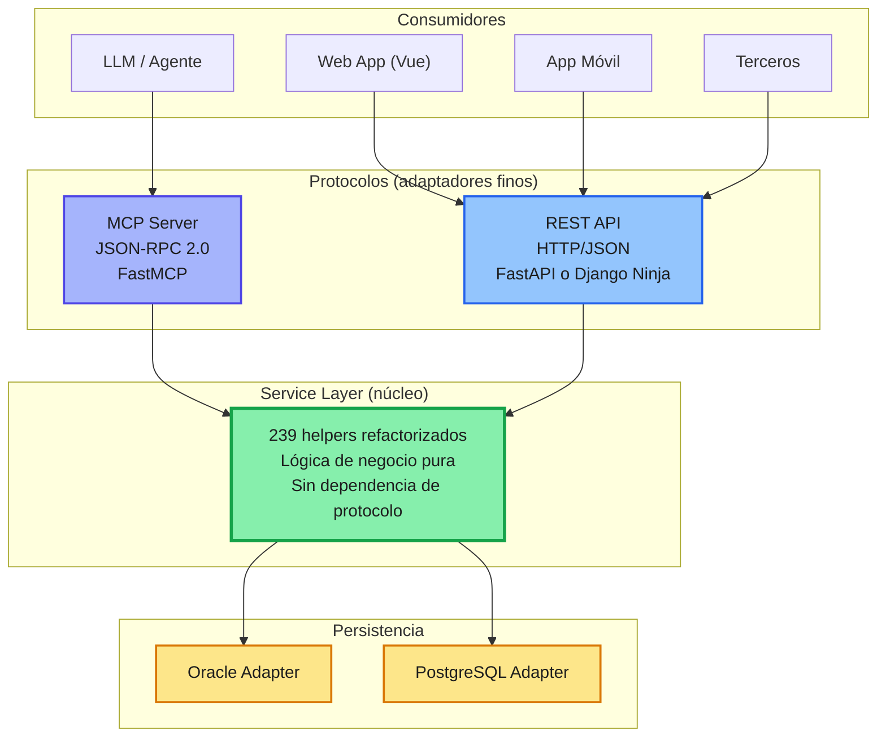

# Argumentación Python vs Spring Boot — COMPENDIO IA-ALL (Fusión de los 4 Análisis)

> **Fusión de:** `argumentacion-python-vs-spring-boot-refactorCLAUDE.md` · `argumentacion-python-vs-spring-boot-refactorDeepSeek.md` · `argumentacion-python-vs-spring-boot-refactorGROK.md` · `argumentacion-python-vs-spring-boot.refactorGEMINI.md`
> **Decisión evaluada:** refactorizar el legacy Java 2008 / JSP / Payara sobre **Python (Service Layer + adaptadores REST/MCP)** vs. reescribir en **Java Spring Boot**.
> **Contexto del sistema:** aplicación Java 2008 desplegada en Payara Server, sin separación de responsabilidades; los `.java`/`.jsp` mezclan acceso a datos (SQL embebido), lógica de negocio y presentación (generan HTML directamente). Core de ~239 helpers y ~400 programas Java/JSP documentados.
> **Propósito:** este documento **NO es un resumen**. Es la fusión completa de las 4 respuestas de IA: contiene todas las ideas, todos los formatos (tablas, diagramas, código) y todas las perspectivas, organizadas por tema. Complementa a cada archivo individual y sirve como fuente única de consulta.
> **Convención de atribución:** cada idea lleva etiqueta `[fuente]` (CLAUDE · DeepSeek · GROK · GEMINI). Cuando todas coinciden se marca `[Todos]`.

---

## 0. Cómo leer este compendio

| Si quieres… | Ve a la sección |
|---|---|
| Verdicto rápido y recomendación | §1 y §13 |
| El diagnóstico del sistema actual | §2 |
| La arquitectura objetivo (Service Layer) | §3–§5 |
| Por qué Python (argumentos) | §6 |
| Por qué NO Spring Boot | §7 |
| Lo que Spring Boot sí aporta (honestidad) | §8 |
| Comparativas técnica / estratégica / matriz | §9 |
| Estrategia de migración (strangler fig) | §10 |
| Próximos pasos concretos | §11 |
| Riesgos y mitigaciones | §12 |
| Checklist de decisión | §14 |
| Código y estructura de carpetas | §15 |

---

# PARTE A — DIAGNÓSTICO Y CONTEXTO

## 1. Resumen ejecutivo (unanimidad)

**Las 4 IAs coinciden: para esta refactorización AI-first, Python es la decisión técnica y estratégicamente más sólida; Spring Boot moderniza el runtime pero no resuelve el problema de fondo.** **[Todos]**

**Decisión recomendada (todas las IAs):**

```text
Service Layer pura en Python
        +
REST Adapter (FastAPI / Django Ninja)
        +
MCP Adapter (FastMCP)
        +
Persistencia Oracle/PostgreSQL (adapters)
        +
Migración incremental tipo strangler fig (sin big bang)
```
**[DeepSeek, GROK, GEMINI, CLAUDE]**

La propuesta es abandonar la modernización dentro del ecosistema Java/Spring Boot y adoptar **Python** como lenguaje principal de la nueva implementación, siguiendo el patrón: **[GROK]**

```text
239 helpers (lógica de negocio) → Service Layer pura → { REST Adapter, MCP Adapter }
```
**[GROK]**

**La decisión no es "Python es mejor que Java en general", sino "Python es la mejor opción para esta refactorización específica en 2026",** dado el objetivo AI-First y la necesidad de exponer la lógica de negocio tanto a humanos (Web/Móvil) como a agentes LLM vía MCP. **[GROK]**

Tabla rápida de razones (GROK):

| Criterio | Python (FastAPI + FastMCP) | Spring Boot | Ventaja |
|---|---|---|---|
| Velocidad de desarrollo | Muy alta | Media-Alta | Python |
| Alineación AI-First / MCP | Nativa y dominante | Secundaria (Spring AI) | Python |
| Separación de responsabilidades | Natural y liviana | Posible pero más ceremoniosa | Python |
| Curva de aprendizaje del patrón propuesto | Baja | Media | Python |
| Ecosistema de agentes e IA | Líder absoluto | En crecimiento | Python |
| Costo de oportunidad (time-to-value) | Bajo | Alto | Python |

**[GROK]**

---

## 2. Situación actual y problema

### 2.1 Síntomas del sistema actual

- Aplicación Java 2008 desplegada en Payara. **[DeepSeek, GROK, GEMINI, CLAUDE]**
- JSP y Java generan HTML directamente (el código "dibuja" la salida HTML). **[Todos]**
- Lógica de negocio mezclada con HTTP, sesión, SQL y presentación. **[Todos]**
- Tres capas mezcladas que deberían estar aisladas: acceso a datos (SQL embebido, helpers ad-hoc), lógica de negocio y presentación. **[CLAUDE]**
- 239 helpers sin fronteras claras, con lógica duplicada, acoplamiento y reglas de negocio difíciles de testear. **[DeepSeek, GROK, CLAUDE]**
- ~400 programas Java/JSP documentados hasta ahora como parte del trabajo de análisis previo. **[CLAUDE]**
- Difícil testear, mantener y evolucionar. **[DeepSeek]**
- Integración con LLM/agentes inexistente o forzada; no existe una interfaz limpia que un agente LLM pueda consumir de forma segura y semántica. **[DeepSeek, GROK]**
- Alto coste de cambio: tocar una pantalla puede romper reglas de negocio. **[DeepSeek]**
- Legacy tecnológico: Java 2008 + Payara implica dificultades de mantenimiento, seguridad y contratación de talento especializado en ese stack. **[GROK]**
- Ausencia total de separación de responsabilidades: las clases Java y los JSP realizan tareas que no les corresponden (generación de HTML, lógica de negocio, acceso a datos, validaciones). **[GROK]**
- Acoplamiento fuerte al protocolo de presentación. **[GROK]**

### 2.2 Consecuencia

Cualquier refactorización que solo cambie Java por Spring Boot mantiene el problema de fondo si no se separa primero el dominio. **Spring Boot moderniza el runtime, pero no resuelve por sí solo la ausencia de Service Layer.** **[DeepSeek]**

Cualquier intento de modernizar *dentro* de Java (migrar a Spring Boot) heredaría parte de la complejidad mental y el costo de reescribir la lógica de negocio en un lenguaje más verboso, sin obtener las ventajas nativas del ecosistema de agentes. **[GROK]**

Reescribir en Java Spring Boot resolvería el problema (1) deuda arquitectónica — separar responsabilidades de una vez por todas — pero no aporta nada nuevo al problema (2) visión IA-first — el sistema debe nacer pensado para ser consumido tanto por humanos (web, móvil) como por agentes/LLMs (vía MCP), no adaptado después. **Seguiría siendo la misma familia tecnológica, con el mismo ecosistema y las mismas limitaciones frente a IA que tiene hoy. Es modernizar sin cambiar de paradigma.** **[CLAUDE]**

La refactorización tiene que resolver dos problemas a la vez: **[CLAUDE]**
1. **Deuda arquitectónica**: separar responsabilidades de una vez por todas.
2. **Visión IA-first**: el sistema debe nacer pensado para ser consumido por humanos y por agentes.

---

# PARTE B — LA ARQUITECTURA OBJETIVO

## 3. Service Layer compartida: el patrón (unanimidad)

El patrón correcto no es "un backend que expone una API", sino una **capa de servicio agnóstica al protocolo, consumida por adaptadores finos**: **[Todos]**

```text
239 helpers → Service Layer → { REST Adapter, MCP Adapter }
```
**[CLAUDE, DeepSeek]**

Donde: **[Todos]**

- **Service Layer**: lógica de negocio pura. Sin HTTP, sin JSON-RPC, sin conocimiento de protocolo. **[CLAUDE, DeepSeek, GROK, GEMINI]**
- **REST Adapter**: capa fina que traduce HTTP → llamadas al servicio (para web/móvil/terceros). **[CLAUDE, DeepSeek, GROK]**
- **MCP Adapter**: capa fina que traduce JSON-RPC → llamadas al servicio (para el LLM/agente). **[CLAUDE, DeepSeek, GROK, GEMINI]**
- Ambos adaptadores son **pares**, no uno envuelve al otro. Esto evita que el MCP quede como un "wrapper" de segunda clase sobre el REST, o viceversa. **[CLAUDE, DeepSeek, GROK]**
- La persistencia se abstrae mediante adaptoids (Oracle legacy y PostgreSQL destino). **[GROK, GEMINI]**
- El dominio no sabe qué base de datos hay detrás. **[DeepSeek]**

### 3.1 La arquitectura es agnóstica al lenguaje

Esta arquitectura es **language-agnostic**: podría implementarse en Java o en Python. La elección de lenguaje se juega en la parte C. **[CLAUDE, GROK]**

**Lo que compartes no es el protocolo: es la capa de servicios.** **[consenso implícito]**

## 4. Diagramas de la arquitectura

### 4.1 Diagrama mermaid (CLAUDE / DeepSeek / GEMINI — coinciden)


**[CLAUDE, DeepSeek, GEMINI]** *(regenerado idéntico en las tres fuentes; GEMINI anota "Persistencia: Oracle Adapter (Legacy) / PostgreSQL Adapter (Nuevo)")*

### 4.2 Diagrama ASCII (GROK)

```text
Consumidores
├── LLM / Agentes  ──────────────┐
├── Web App (Vue)                │
├── App Móvil                    │
└── Terceros                     │
                                 ▼
                    ┌─────────────────────────┐
                    │   Protocolos (adaptadores finos) │
                    │  ┌─────────────┐  ┌────────────┐ │
                    │  │ MCP Server  │  │ REST API   │ │
                    │  │ (JSON-RPC)  │  │ (HTTP/JSON)│ │
                    │  └──────┬──────┘  └─────┬──────┘ │
                    └─────────┼───────────────┼────────┘
                              │               │
                              ▼               ▼
                    ┌─────────────────────────────────┐
                    │     Service Layer (núcleo)      │
                    │  Lógica de negocio pura         │
                    │  Sin HTTP, sin JSON-RPC,        │
                    │  sin dependencia de protocolo   │
                    └──────────────┬──────────────────┘
                                   │
                    ┌──────────────┼──────────────┐
                    ▼              ▼              ▼
              Oracle Adapter  PostgreSQL     Otros
```
**[GROK]**

## 5. Principios de la arquitectura

- **Dominio puro**: el Service Layer no conoce detalles de HTTP, encabezados, estados de respuesta, ni JSON-RPC. **[DeepSeek, GEMINI]**
- **Adaptadores finos**: solo traducen protocolo → servicio, de igual jerarquía (pares simétricos y delgados). **[DeepSeek, GROK, GEMINI]**
- **Inversión de dependencias**: el servicio define puertos; la infraestructura implementa adaptadores. **[DeepSeek]**
- **Testabilidad**: el núcleo se prueba sin levantar servidor ni base de datos. **[DeepSeek]**
- **Migración incremental**: el legado Java/Payara sigue funcionando mientras se extrae lógica (strangler fig). **[DeepSeek, GROK, GEMINI]**
- Ningún adaptador envuelve al otro. **[GROK]**

---

# PARTE C — LA PREGUNTA CENTRAL: ¿PYTHON O SPRING BOOT?

## 6. Por qué Python (argumentos)

### 6.1 AI-First / MCP nativo: el ecosistema nació en Python, no en Java

- El SDK de referencia y el más maduro para servidores MCP es **FastMCP**, en Python. La comunidad, los ejemplos, los patrones de auth, streaming y manejo de sesiones se documentan primero (y a veces solo) ahí. **[CLAUDE]**
- **FastMCP fue incorporado al SDK oficial de MCP** y actualmente potencia la mayoría de los servidores MCP en producción. **[GROK]**
- El estándar MCP fue diseñado con SDKs de referencia en Python y TypeScript; los SDKs oficiales se desarrollan "Python-First". **[GEMINI]**
- El SDK de MCP para Java/Kotlin existe pero llega después, con menos adopción, menos ejemplos de producción y menos terceros integrando sobre él. **[CLAUDE]**
- Construir el corazón de un sistema IA-first sobre el SDK "de segunda clase" de un protocolo diseñado para IA es remar contra la corriente exactamente en el componente que justifica todo el proyecto. **[CLAUDE]**
- En Spring Boot + Spring AI la definición MCP existe, pero es más ceremoniosa y el ecosistema de herramientas, ejemplos, clientes y comunidad gira alrededor de Python. **[GROK]**
- Los agentes, frameworks de orquestación (LangChain, LlamaIndex, CrewAI, AutoGen) y la gran mayoría de ejemplos de integración MCP están escritos en Python. **[GROK]**
- El 95% de las librerías de RAG, embeddings, agentes autónomos o análisis de datos nacen y se mantienen prioritariamente en Python. **[GEMINI]**
- **Conclusión:** si el objetivo es que la lógica de negocio sea consumible de forma nativa por agentes LLM, Python elimina fricción. **[GROK]**

Crear un tool MCP en Python es trivial: **[GROK]**

```python
from fastmcp import FastMCP

mcp = FastMCP("MiServicio")

@mcp.tool
def calcular_precio(producto_id: str, cantidad: int) -> dict:
    """Calcula el precio final de un producto"""
    return service.calcular_precio(producto_id, cantidad)
```
**[GROK]**

### 6.2 El resto del stack de IA ya es Python, y ya es tuyo

No es una elección en el vacío: hoy ya existen, en Python/Django, piezas del mismo ecosistema que este proyecto va a consumir o de las que va a depender: **[CLAUDE]**

- El **RAG híbrido** (Grafo + Vector + BM25 + Multi-LLM) sobre la documentación del core clínico está pensado para integrarse a una app Django. **[CLAUDE]**
- El **visor de markdown (Vault)**, con botones de análisis IA, tiene plan de refactor a Django. **[CLAUDE]**
- La plataforma de datos clínicos (extracción Oracle → PostgreSQL para RAG y analítica) también vive en ese mismo mundo. **[CLAUDE]**
- Una vez que la lógica de negocio está en Python, cualquier mejora relacionada con agentes, RAG, evaluación de prompts, etc. se implementa en el mismo lenguaje. **[GROK]**

Elegir Spring Boot para el core significa mantener **dos stacks de producción en paralelo** — uno Java para el negocio, otro Python para todo lo relacionado a IA/RAG — con el costo de integración, despliegue y contexto mental que eso implica. Elegir Python para el core significa que **una sola pila de tecnología** cubre negocio + IA + datos, y el Service Layer puede llamar directamente a las piezas de RAG sin cruzar un puente HTTP/gRPC entre lenguajes. **[CLAUDE]**

### 6.3 Productividad y velocidad de refactorización

- Migrar 239 helpers y ~400 programas es, sobre todo, un problema de volumen. Spring Boot exige más ceremonia estructural (anotaciones, beans, configuración XML/Java, capas DTO/Entity/Repository/Service/Controller explícitas) que Django o FastAPI para llegar al mismo resultado funcional. En un proyecto de esta escala, cada unidad de boilerplate se multiplica por cientos de programas a migrar. **[CLAUDE]**
- En una refactorización de cientos de helpers, la diferencia de verbosidad se traduce directamente en **tiempo y costo**. **[GROK]**
- Python reduce líneas de código en ~40–60%, facilitando la auditoría de los 239 helpers. **[GEMINI]**
- Python permite prototipar, testear y desplegar servicios puros con menos ceremonia. **[DeepSeek, GEMINI]**

| Aspecto | Python (FastAPI) | Spring Boot |
|---|---|---|
| Boilerplate por endpoint | Muy bajo | Alto (Controller + Service + DTO + Mapper) |
| Validación y serialización | Automática con Pydantic | Manual o con Bean Validation + Jackson |
| Documentación OpenAPI | Automática y excelente | Buena (SpringDoc) |
| Tiempo de arranque | < 1 segundo | Varios segundos |
| Ciclo de feedback (hot-reload) | Instantáneo | Más lento |
| Código necesario para Service Layer + 2 adaptadores | Significativamente menor | Mayor |

**[GROK]**

### 6.4 Separación de responsabilidades más natural

- El Service Layer son clases o módulos Python ordinarios, sin dependencias de framework. **[GROK]**
- El adaptador REST (FastAPI o Django Ninja) solo traduce HTTP → llamada al servicio. **[GROK]**
- El adaptador MCP (FastMCP) solo traduce JSON-RPC → llamada al mismo servicio. **[GROK]**
- En Spring Boot es perfectamente posible, pero el framework incentiva más capas (controllers, services, repositories, DTOs, mappers) y la tentación de mezclar preocupaciones es mayor por la cultura del ecosistema. **[GROK]**
- El patrón Repository/adapters es exactamente lo que permite cambiar de motor sin tocar el dominio. **[CLAUDE]**

### 6.5 Librerías de datos y ORM flexible para un modelo sin integridad referencial

El modelo de datos actual (177 tablas, sin FKs, relaciones solo en código) necesita un ORM que permita declarar relaciones de forma progresiva y exploratoria, no un modelo "todo o nada" generado desde un esquema ya limpio. **[CLAUDE]**

- El ORM de Django (o SQLAlchemy si se prefiere FastAPI puro) permite declarar relaciones en el código de la aplicación sin que existan como FK en la base — exactamente el escenario intermedio que se está evaluando (agregar FK solo a un subconjunto de tablas). **[CLAUDE]**
- El ecosistema Python de introspección de esquemas, generación de modelos y scripting de migración (`inspectdb`, SQLAlchemy reflection, pandas para los checks de violación de FK candidatas) es más directo para este tipo de trabajo exploratorio que el stack de JPA/Hibernate, más rígido y pensado para esquemas ya estables. **[CLAUDE]**
- `oracledb` (driver oficial moderno de Oracle), `asyncpg`/SQLAlchemy/Django ORM para PostgreSQL; posibilidad de usar el mismo Service Layer con diferentes adapters de persistencia de forma limpia. No hay desventaja técnica relevante frente a JDBC + Spring Data. **[GROK]**
- Clases de JPA/Hibernate pesados (ORM) suelen sobre-complicar queries legacy. **[GEMINI]**

### 6.6 Consumo de recursos / infraestructura

- Python: contenedores livianos (~100–200MB RAM base), arranque instantáneo. **[GEMINI]**
- Spring Boot: uso alto de memoria RAM por JVM (500MB–1.5GB base por instancia) y tiempos de cold-start lentos. **[GEMINI]**
- Reducción drástica de costos de infraestructura en cloud/kubernetes. **[GEMINI]**
- Menor memoria y despliegues más simples en Python; menor fricción operativa (uvicorn/gunicorn). **[DeepSeek]**

### 6.7 Coste de talento y mantenibilidad a futuro

- El talento Python + AI es más abundante y más barato de atraer en 2026 que el talento Java senior especializado en modernización de legacy Payara/Spring. **[GROK]**
- Comunidad Python enorme, especialmente en AI/ML. **[DeepSeek]**
- Fuentes, auto-documentación de Pydantic + type hints + mypy/pyright para contratos claros. **[DeepSeek, GEMINI]**
- Testabilidad con pytest, fixtures, mocking para refactor seguro y rápido. **[DeepSeek]**

### 6.8 Rendimiento: el argumento que no es decisivo

Es cierto que Spring Boot (especialmente con virtual threads o WebFlux) puede superar a FastAPI en throughput puro de APIs HTTP. Sin embargo: **[GROK]**

- La mayoría de las operaciones de esta aplicación serán **I/O bound** (base de datos Oracle/PostgreSQL). **[GROK, CLAUDE]**
- El cuello de botella real estará en la base de datos y en las llamadas a LLMs, no en el lenguaje del Service Layer. **[GROK]**
- Para los casos donde se necesite máximo rendimiento, se pueden extraer endpoints críticos a Go o Java posteriormente. **Empezar con Python no impide esa evolución.** **[GROK]**
- asyncio/uvicorn/httpx dan buen rendimiento I/O. **[DeepSeek]**

### 6.9 Romper el "inercialismo Java" y la deuda técnica heredada

- Migrar de Java 2008 a Spring Boot 3+ a menudo acarrea el vicio de **copiar la misma estructura rígida y sobre-diseñada** (interfaces innecesarias, patrones DAO complejos, configuraciones extensas). **[GEMINI]**
- Cambiar de lenguaje obliga al equipo a realizar un **análisis real de la lógica de negocio** de los 239 helpers, evitando la simple migración "línea por línea" de código obsoleto. **[GEMINI]**
- Reduce el riesgo de caer en la trampa de reescribir Java en Java. **[GEMINI, CLAUDE]**

## 7. Por qué NO Java Spring Boot

Spring Boot es maduro, robusto y enterprise. **No se descarta por incapacidad técnica. Se descarta porque no encaja tan bien como Python en este contexto.** **[DeepSeek, GROK]**

### 7.1 Limitaciones para este proyecto (DeepSeek)

| Factor | Spring Boot | Python |
|---|---|---|
| Ceremonia | Alta: anotaciones, beans, configuración | Baja: funciones, clases, inyección simple |
| Velocidad de refactor | Media | Alta |
| Curva AI/MCP | Spring AI existe, pero menos maduro | FastMCP es referencia |
| Arranque | Más pesado | Más ligero |
| Memoria | Mayor consumo típico | Menor huella |
| Prototipado con agentes | Más lento | Muy rápido |
| Serverless | Posible pero pesado | Excelente |
| Evolución del ecosistema AI | Más lenta | Muy rápida |
| Migración de 239 helpers | Requiere reescribir en Java | Se pueden extraer a Python incrementalmente |

**[DeepSeek]**

### 7.2 Conclusión sobre Spring Boot (DeepSeek)

Si el objetivo fuera **solo modernizar el runtime Java** manteniendo el equipo y el stack, Spring Boot sería una opción razonable.  
Pero si el objetivo es **refactorizar con enfoque AI-first, exponer MCP y acelerar la extracción de lógica de negocio**, Python ofrece una ventaja estratégica clara. **[DeepSeek]**

Spring Boot sigue siendo una excelente opción para sistemas transaccionales de alto volumen y larga duración donde el ecosistema Java ya está consolidado. En este caso concreto —refactorización completa de un legacy 2008 con foco explícito en AI-First y MCP— **Python es la elección racionalmente superior**. **[GROK]**

## 8. Lo que Java Spring Boot sí tendría a favor (honestidad técnica)

Para que el documento sea defendible frente a cualquier contraparte que prefiera Java, vale la pena nombrar lo que se sacrifica: **[CLAUDE]**

- **Tipado estático más estricto**: Java/Spring detecta en compilación errores que en Python solo aparecen en runtime (mitigable con type hints + mypy/pyright, pero no es gratis). **[CLAUDE]**
- **Rendimiento en cómputo puro**: para lógica CPU-bound intensiva, la JVM suele superar a CPython (mitigable: el core clínico es I/O-bound —consultas a Oracle/PostgreSQL—, no CPU-bound). **[CLAUDE]**
- **Madurez "enterprise" percibida**: Spring Boot tiene más trayectoria en sistemas bancarios/salud de gran escala y más certificaciones/compliance de referencia en ese mundo. **[CLAUDE]**
- **Concurrencia nativa**: los hilos y el modelo de concurrencia de la JVM son más predecibles bajo carga alta que el GIL de Python (mitigable con async/await en FastAPI/Django y arquitectura basada en colas para lo pesado). **[CLAUDE]**
- **Ecosistema enterprise muy maduro**: Spring Security, Spring Data, Spring Batch. **[DeepSeek]**
- **Transacciones declarativas robustas.** **[DeepSeek]**
- **Gran soporte para Oracle/JDBC.** **[DeepSeek]**
- **Virtual threads en Java moderno.** **[DeepSeek]**
- **Herramientas de observabilidad**: Actuator/Micrometer. **[DeepSeek]**

Ninguno de estos puntos pesa más que el hecho de que el objetivo central del proyecto — IA-first, MCP como ciudadano de primera clase — está mejor servido hoy por el ecosistema Python. **[CLAUDE]**

## 9. Comparativas consolidadas

### 9.1 Comparativa técnica resumida (DeepSeek)

| Criterio | Python + FastAPI/FastMCP | Java + Spring Boot | Ganador para este caso |
|---|---|---|---|
| Ecosistema AI/LLM/MCP | Referente | Emergente | Python |
| Velocidad de desarrollo | Muy alta | Alta | Python |
| Boilerplate | Muy bajo | Alto | Python |
| Tipado | Type hints + Pydantic | Java estático | Empate técnico |
| Rendimiento CPU | Menor | Mayor | Spring Boot |
| Concurrencia I/O | Async nativo | Reactivo/Virtual Threads | Empate |
| Memoria | Menor | Mayor | Python |
| Madurez enterprise | Alta | Muy alta | Spring Boot |
| Integración Oracle | python-oracledb | JDBC/Hibernate | Empate |
| Testing | pytest | JUnit | Python |
| Despliegue | Simple | Más pesado | Python |
| MCP nativo | FastMCP | Spring AI MCP | Python |
| Serverless | Excelente | Limitado | Python |
| Curva aprendizaje | Baja/Media | Media/Alta | Depende del equipo |
| Seguridad | FastAPI Security | Spring Security | Spring Boot |
| Observabilidad | OpenTelemetry | Micrometer/Actuator | Empate |

**[DeepSeek]**

### 9.2 Matriz comparativa (GEMINI)

| Criterio | Python (FastAPI + FastMCP) | Java (Spring Boot / Spring AI) | Impacto / Ventaja |
| :--- | :--- | :--- | :--- |
| **Nativismo AI / MCP** | Ecosistema estándar e impulsor del protocolo MCP (Anthropic / FastMCP). SDKs oficiales desarrollados "Python-First". | Soporte experimental o adaptaciones mediante wrappers sobre librerías de Java. | **Python:** Menor latencia en adopción de nuevas capacidades de IA y conectores MCP. |
| **Complejidad de Código (Verbosidad)** | Mínima. Modelos declarativos con `Pydantic` e inyección de dependencias liviana. | Alta. Proliferación de anotaciones (`@Autowired`, `@RestController`, `@Service`, `@Repository`), DTOs redundantes y configuración XML/Beans. | **Python:** Reducción sustancial de líneas de código (~40-60%), facilitando la auditoría de los 239 helpers. |
| **Curva y Velocidad de Refactorización** | Extremadamente ágil. Permite prototipar y refactorizar componentes legacy rápidamente. | Lenta. Requiere lidiar con dependencias de Maven/Gradle, ciclos largos de compilación y complejidad de JVM. | **Python:** Time-to-market acelerado en la migración de módulos. |
| **Consumo de Recursos / Infraestructura** | Contenedores livianos (~100-200MB RAM base), arranque instantáneo. | Uso alto de memoria RAM por JVM (500MB - 1.5GB base por instancia) y tiempos de cold-start lentos. | **Python:** Reducción drástica de costos de infraestructura en cloud/kubernetes. |
| **Mantenibilidad de la Service Layer** | Funciones puras con typing estático opcional (`mypy`) y validación en tiempo de ejecución con `Pydantic`. | Clases estructuradas con POJOs, interfaces y frameworks ORM pesados (Hibernate/JPA) que suelen sobre-complicar queries legacy. | **Python:** Mantenimiento directo, legible e ideal para orquestación de datos. |

**[GEMINI]**

### 9.3 Comparativa estratégica final (GROK)

| Dimensión | Python | Spring Boot | Ganador para este proyecto |
|---|---|---|---|
| Objetivo AI-First | Nativo | Posible pero secundario | **Python** |
| Velocidad de entrega | Alta | Media | **Python** |
| Limpieza del patrón Service Layer + 2 adaptadores | Excelente | Buena pero más verbosa | **Python** |
| Ecosistema MCP | Dominante (FastMCP) | Existente (Spring AI) | **Python** |
| Ecosistema de agentes | Líder | En crecimiento | **Python** |
| Rendimiento bruto HTTP | Suficiente | Superior | Spring Boot |
| Madurez enterprise tradicional | Alta | Muy alta | Spring Boot |
| Costo de oportunidad | Bajo | Alto | **Python** |

**[GROK]**

### 9.4 Lectura consolidada de las comparativas

**Python gana en:** ecosistema AI/LLM/MCP (todos), velocidad de desarrollo (todos), boilerplate (todos), memoria/infra (todos), MCP nativo (todos), serverless (todos), tiempo de arranque y time-to-market (todos), costo de oportunidad (todos).
**Spring Boot gana en:** rendimiento CPU y throughput HTTP (todos), madurez enterprise tradictional (todos), seguridad de framework (DeepSeek), tipado estático de compilación (empate técnico en DeepSeek). **[síntesis]**

---

# PARTE D — ESTRATEGIA DE MIGRACIÓN

## 10. Estrategia de migración incremental (Strangler Fig Pattern)

### 10.1 Fases DeepSeek (detallada, 8 fases)

**Fase 0 — Inventario**
- Catalogar los 239 helpers.
- Clasificar en: dominio, infraestructura, presentación, utilidades.
- Detectar reglas de negocio duplicadas.

**Fase 1 — Definir puertos**
- Diseñar interfaces de Service Layer.
- Definir contratos de entrada/salida con Pydantic.
- Establecer errores de dominio.

**Fase 2 — Implementar servicios puros**
- Extraer lógica a Python.
- Sin HTTP, sin SQL, sin JSP.
- Pruebas unitarias con pytest.

**Fase 3 — Adaptadores REST y MCP**
- REST con FastAPI o Django Ninja.
- MCP con FastMCP.
- Ambos consumen la misma Service Layer.

**Fase 4 — Persistencia**
- Adaptador Oracle con python-oracledb.
- Adaptador PostgreSQL con SQLAlchemy o asyncpg.
- El dominio no sabe qué base de datos hay detrás.

**Fase 5 — Strangler Fig**
- Enrutar tráfico nuevo a Python.
- JSP legado sigue para pantallas antiguas.
- Vue consume REST.
- Agentes consumen MCP.

**Fase 6 — Retirar legado**
- Migrar helpers uno a uno.
- Apagar funcionalidades Java/JSP a medida que se reemplazan.
- Medir cobertura y errores.

**Fase 7 — Optimizar**
- Migrar datos si aplica.
- Añadir caché, observabilidad y seguridad avanzada.
- Documentar ADRs.

**[DeepSeek]**

### 10.2 Estrategia gradual (GEMINI, 4 fases)

**Fase 1: Coexistencia e Intercepción**
- Desplegar el nuevo servicio Python (FastAPI/FastMCP) de forma paralela a Payara.
- Configurar un Reverse Proxy (NGINX/Traefik) al frente.

**Fase 2: Extracción Incremental de Helpers**
- Identificar los 239 helpers y agruparlos por dominios de negocio.
- Migrar helper por helper a la `Service Layer` en Python.
- Redirigir el tráfico de los JSP/Java legacy hacia el nuevo servicio Python a través de endpoints REST internos, desactivando progresivamente el código antiguo en Payara.

**Fase 3: Habilitación de la Capa de IA (MCP)**
- Con la `Service Layer` estabilizada en Python, activar los adaptadores **FastMCP** para exponer las funciones del sistema a LLMs (asistentes internos, automatizaciones con agentes).

**Fase 4: Desmantelamiento de Payara**
- Una vez sustituida la renderización HTML legacy por una aplicación SPA moderna (Vue.js) consumiendo REST, y migrados los 239 helpers a la Service Layer, se apaga definitivamente el servidor Payara.

**[GEMINI]**

> **Nota de correlación:** las fases de DeepSeek y GEMINI son la misma estrategia con granularidad distinta (DeepSeek desglosa en 8 fases; GEMINI agrupa en 4). Ambas respetan el orden: coexistencia → extracto incremental → MCP → retirada de Payara. **[síntesis]**

## 11. Próximos pasos recomendados

### 11.1 Pasos GROK

1. Inventariar y documentar los 239 helpers (comportamiento actual + tests de caracterización).
2. Definir el contrato del Service Layer (interfaces / firmas puras).
3. Implementar un vertical slice completo (1-2 casos de uso) con:
   - Service Layer
   - Adaptador REST (FastAPI)
   - Adaptador MCP (FastMCP)
4. Validar con stakeholders y con un agente LLM real.
5. Escalar la migración por dominios de negocio.

**[GROK]**

### 11.2 Prueba de concepto CLAUDE

Tomar 2–3 helpers representativos (uno simple, uno con queries indirectas vía helper como `ResumenControl`, uno con lógica de negocio compleja) y hacer una **prueba de concepto end-to-end**: Service Layer + REST Adapter + MCP Adapter, para validar el patrón antes de comprometerse a migrar los 239. **[CLAUDE]**

---

# PARTE E — RIESGOS, DECISIÓN Y CIERRE

## 12. Riesgos y mitigaciones

### 12.1 Tabla DeepSeek

| Riesgo | Mitigación |
|---|---|
| Equipo sin experiencia en Python | Capacitación, pairing, estándares, linting |
| Rendimiento insuficiente | Benchmarks, async, caching, perfilado |
| Seguridad | OWASP, revisión de dependencias, OAuth2/JWT |
| Integración Oracle | Pool de conexiones, transacciones, pruebas de carga |
| Convivencia Java/Python | Contratos OpenAPI, colas, REST, versionado |
| Complejidad MCP | Autenticación, límites, versionado de herramientas |
| Deuda del legado | Migración incremental, no big bang |
| Gobernanza | ADRs, CI/CD, mypy, ruff, pytest |

**[DeepSeek]**

### 12.2 Tabla GROK (con probabilidad/impacto)

| Riesgo | Probabilidad | Impacto | Mitigación |
|---|---|---|---|
| Pérdida de conocimiento del dominio Java | Media | Alto | Documentar exhaustivamente los 239 helpers antes de reescribir. Crear tests de caracterización. |
| Rendimiento insuficiente en endpoints críticos | Baja | Medio | Medir desde el principio. Posibilidad de reescribir endpoints hot en otro lenguaje. |
| Resistencia cultural del equipo | Media | Medio | Formación intensiva + quick wins visibles (primeros MCP tools funcionando). |
| Madurez de FastMCP en entornos enterprise | Baja | Medio | FastMCP es ya el estándar de facto y tiene adopción masiva. |

**[GROK]**

### 12.3 Riesgos transversales (síntesis)

- **Común a ambas rutas que ya señalan las 4 IAs:** sin separación previa del dominio, ninguna tecnología resuelve nada; y sin tests de caracterización del comportamiento actual (239 helpers) cualquier reescritura es a ciegas. **[síntesis]**

## 13. Conclusión y recomendación unificada

**Las 4 IAs recomiendan Python (FastAPI/Django + FastMCP), Service Layer pura, adaptadores REST/MCP pares, y migración strangler fig incremental.** **[Todos]**

Los argumentos que la sostienen (al menos 3/4 IAs en cada punto):

1. **Alineación AI-First real**: los agentes consumen herramientas vía MCP; Python es el camino natural. **[Todos]**
2. **MCP sobre su SDK de referencia** (FastMCP), no sobre una implementación secundaria (Spring AI). **[CLAUDE, GROK, GEMINI, DeepSeek]**
3. **Un solo stack** para negocio + IA + datos (RAG/Vault/plataforma ya en Python). **[CLAUDE, GROK]**
4. **Velocidad y menor boilerplate** en una migración de cientos de programas. **[Todos]**
5. **ORM flexible** para el modelo sin FKs que se migra desde Oracle. **[CLAUDE, GEMINI, GROK]**
6. **Menor TCO**: menos memoria, menos ceremonia, despliegues más simples. **[DeepSeek, GEMINI]**
7. **Migración incremental** sin reescribir todo (strangler fig). **[Todos]**

**Python no se elige porque Spring Boot sea malo. Se elige porque:** **[DeepSeek]**
- Acelera la extracción de lógica de negocio.
- Reduce boilerplate y coste de mantenimiento.
- Tiene el ecosistema AI/MCP más maduro.
- Permite migración incremental sin reescribir todo.
- Se alinea mejor con agentes, LLM y protocolos modernos.

Spring Boot sería una buena opción si el objetivo fuera únicamente modernizar el stack Java. Pero para una estrategia **AI-first, MCP-first y de refactor incremental**, Python es la decisión técnica y estratégica más sólida. **[DeepSeek, GROK, CLAUDE, GEMINI]**

La adopción de Python (FastAPI + FastMCP) no solo resuelve el problema de desacoplamiento e higiene de código en la aplicación legacy, sino que **posiciona a la arquitectura en la vanguardia de la era AI-First**; frente a la rigidez y altos costos de desarrollo de Spring Boot, Python ofrece una alternativa ágil, liviana, modular y nativamente preparada para interactuar tanto con interfaces modernas de usuario (Vue) como con agentes de IA mediante MCP. **[GEMINI]**

## 14. Checklist de decisión (DeepSeek)

- [ ] ¿El objetivo es AI-first? **Sí.**
- [ ] ¿Se necesita MCP nativo? **Sí.**
- [ ] ¿Hay 239 helpers que extraer? **Sí.**
- [ ] ¿Se quiere migración incremental? **Sí.**
- [ ] ¿Spring Boot es obligatorio por política? **No.**
- [ ] ¿El equipo puede adoptar Python? **Sí, con plan de capacitación.**
- [ ] ¿El rendimiento CPU es crítico? **Evaluar; probablemente no.**
- [ ] ¿Se necesita convivir con Payara? **Sí, temporalmente.**

**Decisión recomendada: Python + Service Layer + REST/MCP Adapters.** **[DeepSeek]**

---

## 15. Código y estructura de carpetas

### 15.1 Estructura de carpetas sugerida (DeepSeek)

```text
src/
  domain/
    models/
    errors/
    value_objects/
  services/
    cliente_service.py
    pedido_service.py
    facturacion_service.py
  adapters/
    rest/
      fastapi_app.py
      routers/
    mcp/
      fastmcp_server.py
      tools/
    persistence/
      oracle/
      postgres/
  tests/
    unit/
    integration/
    e2e/
```
**[DeepSeek]**

### 15.2 Ejemplo de servicio puro (DeepSeek)

```python
from dataclasses import dataclass
from decimal import Decimal

@dataclass(frozen=True)
class Cliente:
    id: str
    nombre: str
    saldo: Decimal

class ClienteService:
    def __init__(self, repo):
        self.repo = repo

    def obtener_cliente(self, cliente_id: str) -> Cliente:
        cliente = self.repo.buscar_por_id(cliente_id)
        if not cliente:
            raise ClienteNoEncontrado(cliente_id)
        return cliente
```
**[DeepSeek]**

### 15.3 Ejemplo de adaptador REST (FastAPI)

**DeepSeek:**

```python
from fastapi import FastAPI, HTTPException

app = FastAPI(title="Legacy Refactor API")
svc = ClienteService(repo=OracleClienteRepository())

@app.get("/clientes/{cliente_id}")
def obtener_cliente(cliente_id: str):
    try:
        return svc.obtener_cliente(cliente_id)
    except ClienteNoEncontrado:
        raise HTTPException(status_code=404, detail="Cliente no encontrado")
```
**[DeepSeek]**

**GEMINI (con router):**

```python
# adapters/rest.py
from fastapi import APIRouter, Depends
from service.customers import calculate_customer_risk

router = APIRouter()

@router.get("/customers/{customer_id}/risk")
def get_risk(customer_id: str):
    return calculate_customer_risk(customer_id, db_oracle)
```
**[GEMINI]**

### 15.4 Ejemplo de adaptador MCP (FastMCP)

**DeepSeek:**

```python
from fastmcp import FastMCP

mcp = FastMCP("legacy-refactor")
svc = ClienteService(repo=OracleClienteRepository())

@mcp.tool()
def obtener_cliente(cliente_id: str):
    """Obtiene un cliente por ID."""
    return svc.obtener_cliente(cliente_id)
```
**[DeepSeek]**

**GEMINI (respuesta para agente):**

```python
# adapters/mcp.py
from fastmcp import FastMCP
from service.customers import calculate_customer_risk

mcp = FastMCP("Customer Service Agent")

@mcp.tool()
def check_customer_risk(customer_id: str) -> str:
    """Evalúa el riesgo de un cliente para agentes de IA."""
    result = calculate_customer_risk(customer_id, db_oracle)
    return f"El score del cliente {customer_id} es {result['risk_score']}"
```
**[GEMINI]**

### 15.5 Ejemplo de Service Layer (GEMINI)

```python
# service/customers.py
from typing import Dict, Any

def calculate_customer_risk(customer_id: str, db_adapter) -> Dict[str, Any]:
    # Lógica pura extraída de los helpers legacy
    raw_data = db_adapter.fetch_customer_data(customer_id)
    # ... cálculo de negocio ...
    return {"customer_id": customer_id, "risk_score": 0.85, "status": "APPROVED"}
```
**[GEMINI]**

---

## 16. Anexo — Micro-argumentos que no debes perder

- "FastMCP es referencia" aparece en 3 fuentes como el argumento MCP más fuerte; CLAUDE lo extiende: "MCP es la razón de ser de la refactorización IA-first, no un componente secundario". **[CLAUDE, DeepSeek, GROK, GEMINI]**
- CLAUDE es la única que vincula la decisión al ORM flexible y al stack de RAG/Vault/datos propios; DeepSeek y GROK aportan comparativas cuantitativas; GROK y DeepSeek aportan tablas de riesgos; GEMINI aporta el argumento de memoria/infraestructura y los fragmentos de código más concretos. **[síntesis]**
- La prueba de concepto CLAUDE (2–3 helpers de complejidad creciente) es el siguiente paso más accionable de todos los documentos; coincide con el vertical slice de GROK. **[CLAUDE, GROK]**

---

> **Cierre del compendio:** las 4 IAs coinciden en el diagnóstico (legacy Java 2008/Payara sin separación de responsabilidades), en la arquitectura (Service Layer pura + adaptadores REST/MCP pares), en el lenguaje (Python por su ecosistema AI/MCP maduro y menor boilerplate) y en la estrategia (migración strangler fig incremental). Spring Boot se descarta no por inferioridad técnica general, sino por **desalineación con el objetivo AI-first** de esta refactorización específica.