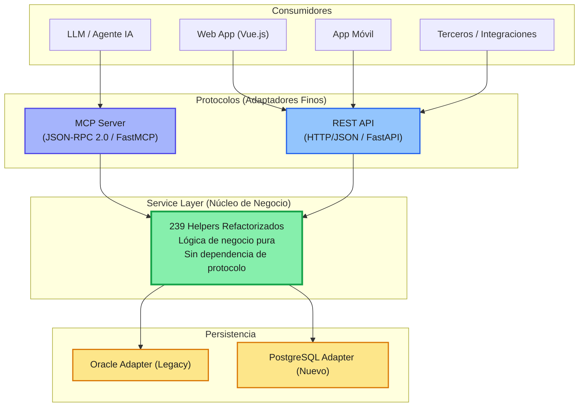

# Propuesta de Arquitectura y Estrategia de Refactorización: Modernización Legacy Payara hacia una Arquitectura AI-First (Python vs. Spring Boot)

## 1. Resumen Ejecutivo
El presente documento expone la estrategia y fundamentación técnica para llevar a cabo la refactorización de la aplicación legacy (Java 2008 / Payara Application Server). 

Actualmente, el sistema carece de separación de responsabilidades: los archivos Java y JSP contienen lógica de negocio entrelazada con renderizado HTML y llamadas directas a base de datos. Para solucionar esto y preparar el sistema para capacidades de **Inteligencia Artificial Nativa (AI-First)**, se propone descomponer el monolito legacy mediante una **Capa de Servicios Limpia (Service Layer)** expuesta de manera simétrica a través de adaptadores **REST** y **MCP (Model Context Protocol)**.

Adicionalmente, se fundamenta estratégicamente la elección del ecosistema **Python (FastAPI / FastMCP / Pydantic)** sobre **Java Spring Boot**, enfocándose en la velocidad de desarrollo, integración con IA, reducción de complejidad y menor TCO (Total Cost of Ownership).

---

## 2. Visión de Arquitectura: Service Layer Compartida

El principio rector de esta refactorización es aislar por completo la lógica de negocio de los protocolos de entrada y de la persistencia de datos.

### 2.1 Patrón Arquitectónico
La lógica migrada desde los 239 helpers legacy se concentrará en una **Service Layer pura**:
* **Sin acoplamiento a protocolos:** La Service Layer no conoce detalles de HTTP, encabezados, estados de respuesta, ni JSON-RPC.
* **Adaptadores de Igual Jerarquía:** 
  * **REST Adapter:** Encargado de exponer la API HTTP/JSON para clientes web (Vue), móviles y servicios de terceros.
  * **MCP Adapter:** Encargado de exponer las herramientas (Tools) y recursos (Resources) mediante JSON-RPC 2.0 usando **FastMCP**, permitiendo a LLMs y Agentes interactuar con el sistema de forma segura.
* **Persistencia Abstraída:** Adaptadores independientes para bases de datos (Oracle legacy y destino PostgreSQL).

### 2.2 Diagrama de Arquitectura de Target


---

## 3. Matriz Comparativa: Python (FastAPI/FastMCP) vs. Java (Spring Boot)

A continuación se analizan las razones técnicas y estratégicas por las cuales **Python** es la opción óptima frente al camino tradicional de refactorizar dentro del ecosistema Java con **Spring Boot**.

| Criterio | Python (FastAPI + FastMCP) | Java (Spring Boot / Spring AI) | Impacto / Ventaja |
| :--- | :--- | :--- | :--- |
| **Nativismo AI / MCP** | Ecosistema estándar e impulsor del protocolo MCP (Anthropic / FastMCP). SDKs oficiales desarrollados "Python-First". | Soporte experimental o adaptaciones mediante wrappers sobre librerías de Java. | **Python:** Menor latencia en adopción de nuevas capacidades de IA y conectores MCP. |
| **Complejidad de Código (Verbosidad)** | Mínima. Modelos declarativos con `Pydantic` e inyección de dependencias liviana. | Alta. Proliferación de anotaciones (`@Autowired`, `@RestController`, `@Service`, `@Repository`), DTOs redundantes y configuración XML/Beans. | **Python:** Reducción sustancial de líneas de código (~40-60%), facilitando la auditoría de los 239 helpers. |
| **Curva y Velocidad de Refactorización** | Extremadamente ágil. Permite prototipar y refactorizar componentes legacy rápidamente. | Lenta. Requiere lidiar con dependencias de Maven/Gradle, ciclos largos de compilación y complejidad de JVM. | **Python:** Time-to-market acelerado en la migración de módulos. |
| **Consumo de Recursos / Infraestructura** | Contenedores livianos (~100-200MB RAM base), arranque instantáneo. | Uso alto de memoria RAM por JVM (500MB - 1.5GB base por instancia) y tiempos de cold-start lentos. | **Python:** Reducción drástica de costos de infraestructura en cloud/kubernetes. |
| **Mantenibilidad de la Service Layer** | Funciones puras con typing estático opcional (`mypy`) y validación en tiempo de ejecución con `Pydantic`. | Clases estructuradas con POJOs, interfaces y frameworks ORM pesados (Hibernate/JPA) que suelen sobre-complicar queries legacy. | **Python:** Mantenimiento directo, legible e ideal para orquestación de datos. |

---

## 4. Argumentación Técnica Detallada para la Elección de Python

### 4.1 "AI-First" como Ventaja Competitiva Directa
1. **Liderazgo en el estándar MCP:** El Model Context Protocol fue diseñado con SDKs de referencia en Python y TypeScript. Usar **FastMCP** en Python permite exponer las funciones de negocio de la `Service Layer` como **Tools para LLMs** con anotaciones de pocas líneas de código.
2. **Ecosistema de IA Avanzado:** Si a futuro la aplicación requiere capacidades RAG (Retrieval-Augmented Generation), embeddings, agentes autónomos (LangChain, LlamaIndex, CrewAI) o análisis de datos, el 95% de estas librerías nacen y se mantienen prioritariamente en Python.

### 4.2 Romper el "Inercialismo Java" y la Deuda Técnica Heredada
* Migrar de Java 2008 a Spring Boot 3+ a menudo acarrea el vicio de **copiar la misma estructura rígida y sobre-diseñada** (interfaces innecesarias, patrones DAO complejos, configuraciones extensas).
* Cambiar de lenguaje obliga al equipo a realizar un **análisis real de la lógica de negocio** de los 239 helpers, evitando la simple migración "línea por línea" de código obsoleto.

### 4.3 Simplicidad en los Adaptadores (REST y MCP)
Con Python, la Service Layer se mantiene pura usando tipos nativos o modelos Pydantic. Los adaptadores se implementan de forma minimalista:

* **Ejemplo de Service Layer (Lógica Pura):**
  ```python
  # service/customers.py
  from typing import Dict, Any

  def calculate_customer_risk(customer_id: str, db_adapter) -> Dict[str, Any]:
      # Lógica pura extraída de los helpers legacy
      raw_data = db_adapter.fetch_customer_data(customer_id)
      # ... cálculo de negocio ...
      return {"customer_id": customer_id, "risk_score": 0.85, "status": "APPROVED"}
  ```

* **Adaptador REST (FastAPI):**
  ```python
  # adapters/rest.py
  from fastapi import APIRouter, Depends
  from service.customers import calculate_customer_risk

  router = APIRouter()

  @router.get("/customers/{customer_id}/risk")
  def get_risk(customer_id: str):
      return calculate_customer_risk(customer_id, db_oracle)
  ```

* **Adaptador MCP (FastMCP):**
  ```python
  # adapters/mcp.py
  from fastmcp import FastMCP
  from service.customers import calculate_customer_risk

  mcp = FastMCP("Customer Service Agent")

  @mcp.tool()
  def check_customer_risk(customer_id: str) -> str:
      """Evalúa el riesgo de un cliente para agentes de IA."""
      result = calculate_customer_risk(customer_id, db_oracle)
      return f"El score del cliente {customer_id} es {result['risk_score']}"
  ```

---

## 5. Estrategia de Migración Gradual (Strangler Fig Pattern)

Para minimizar el riesgo operativo de la aplicación legacy desplegada en Payara, la refactorización se ejecutará en fases:

1. **Fase 1: Coexistencia e Intercepción**
   * Desplegar el nuevo servicio Python (FastAPI/FastMCP) de forma paralela a Payara.
   * Configurar un Reverse Proxy (NGINX/Traefik) al frente.

2. **Fase 2: Extracción Incremental de Helpers**
   * Identificar los 239 helpers y agruparlos por dominios de negocio.
   * Migrar helper por helper a la `Service Layer` en Python.
   * Redirigir el tráfico de los JSP/Java legacy hacia el nuevo servicio Python a través de endpoints REST internos, desactivando progresivamente el código antiguo en Payara.

3. **Fase 3: Habilitación de la Capa de IA (MCP)**
   * Con la `Service Layer` estabilizada en Python, activar los adaptadores **FastMCP** para exponer las funciones del sistema a LLMs (asistentes internos, automatizaciones con agentes).

4. **Fase 4: Desmantelamiento de Payara**
   * Una vez sustituida la renderización HTML legacy por una aplicación Single Page Application moderna (Vue.js) consumiendo REST, y migrados los 239 helpers a la Service Layer, se apaga definitivamente el servidor Payara.

---

## 6. Conclusión

La adopción de **Python (FastAPI + FastMCP)** no solo resuelve el problema de desacoplamiento e higiene de código en la aplicación legacy, sino que posiciona a la arquitectura en la vanguardia de la era **AI-First**. 

Frente a la rigidez y altos costos de desarrollo de Spring Boot, Python ofrece una alternativa **ágil, liviana, modular y nativamente preparada** para interactuar tanto con interfaces modernas de usuario (Vue) como con Agentes de Inteligencia Artificial mediante el protocolo MCP.