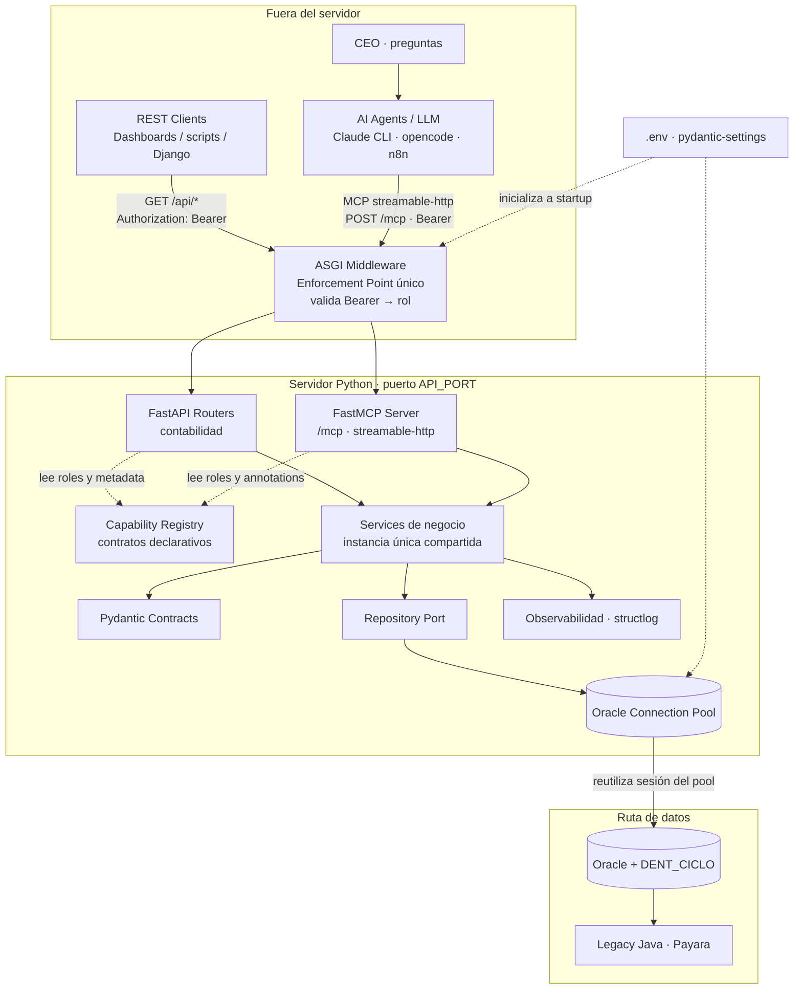
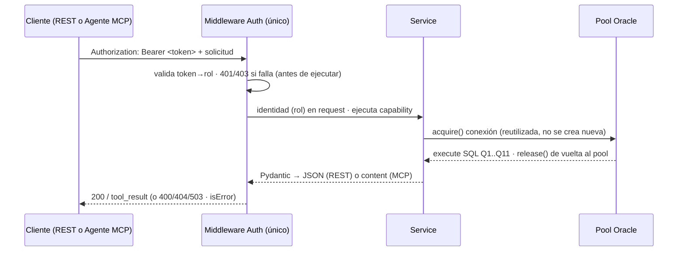
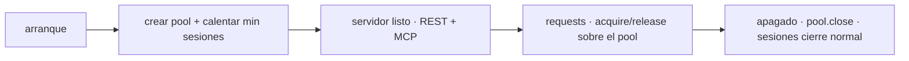
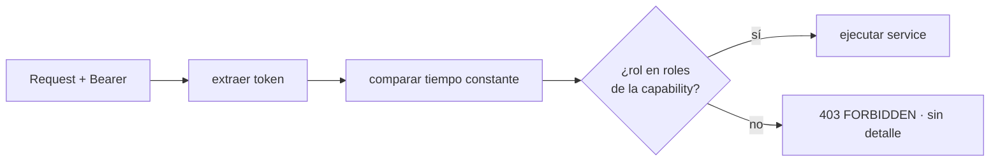
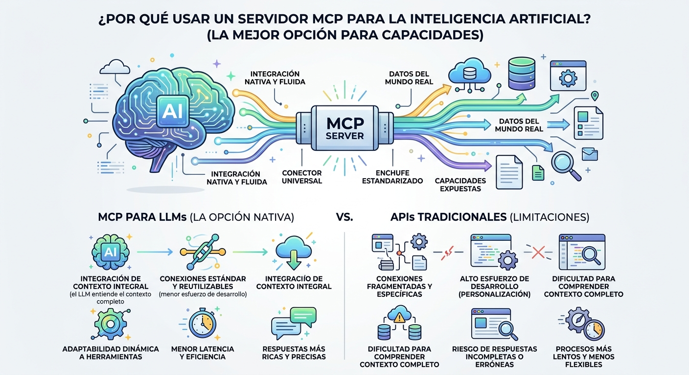
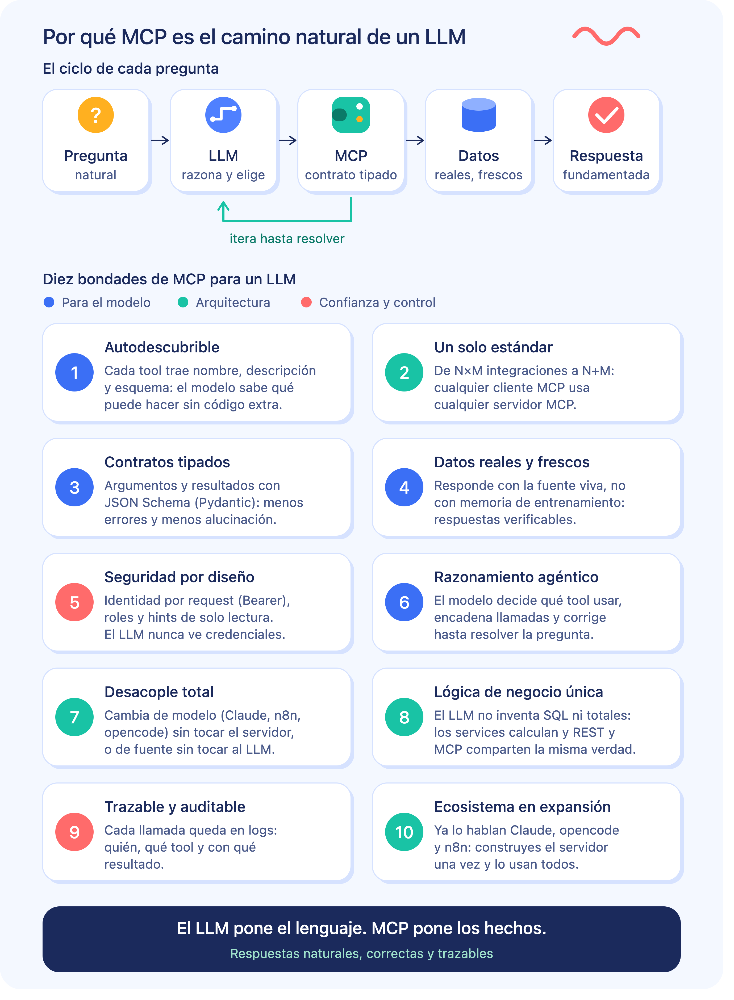
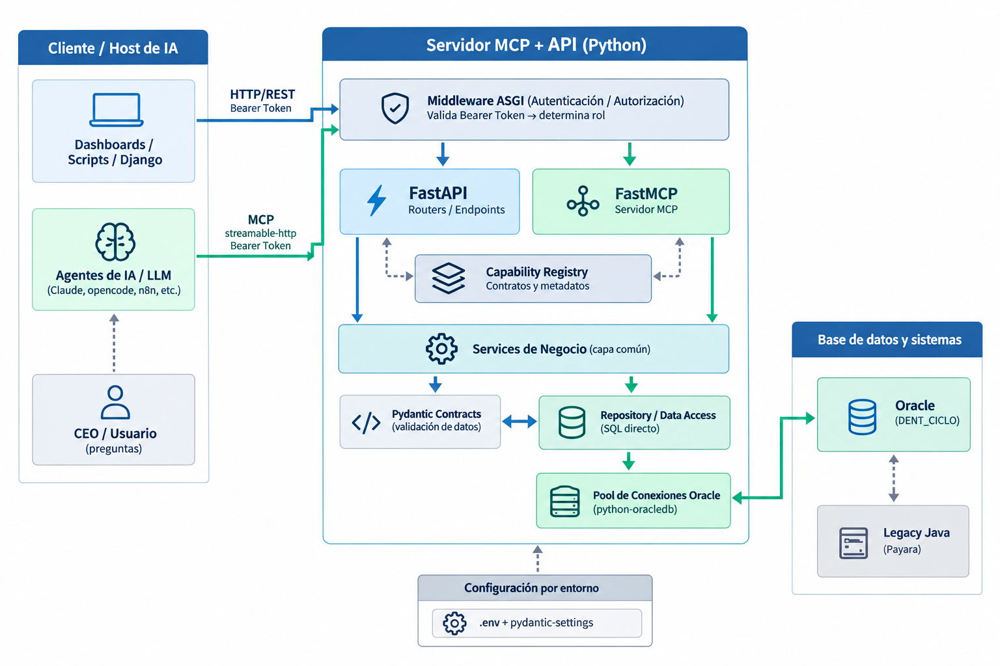
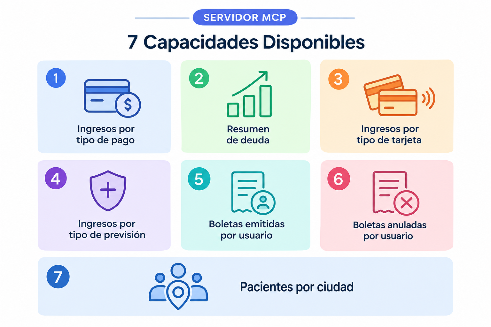

# Arquitectura del servidor — Enablement Layer (FastAPI + FastMCP sobre Oracle)

> **Alcance de este documento:** **solamente** la arquitectura del servidor Python que vamos a implementar. No cubre las capacidades de negocio (cada una vive en `capacidades/<nombre>.md`), ni la estrategia global (V2), ni el legacy. Aquí se fijan: stack, componentes, gestión de conexiones (pool), configuración por `.env`, autenticación/autorización por **Bearer token**, puerto, ciclo de vida del servidor y camino de despliegue (local → Linux Debian).
>
> Estado: **propuesta para acuerdo**. Las decisiones enmarcadas en ▣ requieren confirmación del dueño antes de codificar.

---

## 1. Principios de diseño

1. **Un solo proceso, dos protocolos.** Un único servidor Python expone REST (FastAPI) y MCP (FastMCP) apuntando a los mismos services. El enforcement point de autorización es único y cubre ambos protocolos (§5.5 de V2).
2. **Levantar una vez, disponer de las conexiones.** El pool de conexiones a Oracle se crea al arrancar el servidor y se mantiene abierto; **no** se abren/cierran conexiones por request (el legacy abre/cierra en cada `ejecutar()`).
3. **Toda configuración por `.env`.** No hay credenciales ni parámetros hardcodeados ni en el código ni en el repo. Una sola fuente de config por entorno.
4. **Simple primero, desplegable después.** Corre en la máquina local (macOS) hoy; el diseño no impide exportarlo a Linux Debian vía `systemd` (o Docker si se decide después).
5. **Sin ORM objeto-relacional completo por ahora.** El acceso a datos es SQL directo (las queries legacy deben traducirse *idénticas*), con un pool compartido y un repository por capacidad. SQLAlchemy Core (solo engine + pool) queda como opción; la decisión es **python-oracledb con pool propio**, que es lo que controla mejor hasta el 1:1 con el SQL legacy.

---

## 2. Stack

| Capa | Tecnología | Por qué |
| --- | --- | --- |
| Lenguaje | Python **3.12+** | Decisión de la estrategia (V2 §0) |
| API REST | **FastAPI** + Uvicorn | Schemas automáticos desde Pydantic, asíncrono, OpenAPI gratis |
| MCP | **FastMCP** (transporte **streamable-http**) | Identidad por request (Bearer) → enforcement point único por middleware; respuesta por llamada (no streaming incremental) |
| Acceso a Oracle | **python-oracledb** con **connection pool** | Pool de sesiones que se reutilizan; `thin mode` (sin client Oracle instalado) en local y Debian |
| Validación de contratos | **Pydantic v2** | Base única para FastAPI y MCP (V2 §7.1) |
| Config | **`.env`** + `pydantic-settings` | Todas las variables del servidor y de conexión en un archivo por entorno |
| Auth | **Bearer token** (middleware ASGI único) | Mismo token para REST y MCP; ver código §6 |
| Logging/observabilidad | `structlog` + `/health` | Trazabilidad técnica y de AI (V2 §6) |

---

## 3. Diagrama de arquitectura del servidor



### Flujo de una llamada (REST o MCP)



### 3.1 Composition root: una sola instancia compartida

REST y MCP **no** construyen sus propias dependencias. Ambas resuelven el **mismo objeto** desde `composition.py`:

```python
# composition.py
contabilidad_repository = ContabilidadRepository(pool=get_pool())  # o lazy
contabilidad_service = ContabilidadService(contabilidad_repository)
```

Consecuencias concretas:

| Si dos adapters construyeran su propia instancia | Efecto | Por qué se evita |
| --- | --- | --- |
| Dos servicios | La lógica de negocio (totales, mapeos, orden canónico) puede divergir sin que nada lo detecte | Un solo lugar donde la paridad está verificada por tests |
| Dos repositories | Dos pools o sesiones inconsistentes sobre la misma base | El pool es un recurso compartido y acotado (§5) |

`tests/test_paridad_oracle.py::test_shared_service_es_la_misma_instancia` verifica esta invariante para **los dos dominios**: el `service` del router REST y el del server MCP **son el mismo objeto**.

### 3.2 Capability Registry

`application/registry.py` es la **fuente única** de los metadatos de contrato. Cada capability se declara una vez y los adapters la leen; no la redeclaran.

```python
CapabilityContract(
    id="contabilidad.ingresos_por_tipo_pago",
    name="consultar_ingresos_por_tipo_pago",
    operation=OperationMode.READ,
    roles=(...),          # ← security.py deriva CONTABILIDAD_ROLES de aquí
    rest_path="/api/contabilidad/ingresos-por-tipo-pago",
    oracle_sql_id="Q1",   # o ENC.PACIENTES_POR_CIUDAD en el bloque Pacientes
    ...
)
```

Qué se deriva del registry, y qué pasa si se duplicara en cada adapter:

| Dato | Derivado en | Consumido por |
| --- | --- | --- |
| `roles` | `security.py` → `CONTABILIDAD_ROLES` / `PACIENTES_ROLES` | Middleware (`require_contract`) y tools MCP (`authorize_contract`) |
| `operation.mode` → annotations MCP | `adapters/mcp/server.py` (`_tool`) | `readOnlyHint`, `destructiveHint`, `idempotentHint`, `openWorldHint` |
| `name` / `rest_path` | ambos adapters | Nombre de tool y ruta HTTP |
| `description` | ambos adapters | Descripción de tool MCP y `summary` de OpenAPI |

**Las annotations nunca se escriben a mano**: se derivan de `operation.mode` (V2 R17). Si alguien las escribiera explícitamente y cambiara el modo, quedarían mintiendo.

El registry valida sus propias invariantes al importarse (`tests/test_registry.py`): nombres únicos, versión, roles no vacíos, paths y descripciones presentes, y que **ningún texto de negocio exponga nombres internos** (`NUM_DOCTO`, `id_impresora`, SQL). Esa última guarda existe porque una descripción es leída por un LLM: filtrar ahí es filtrar en la frontera.

---

## 4. Puerto

- ▣ **Default: `8090`.** El `8000` queda reservado para las aplicaciones Django propias.
- Configurable por `.env` (`API_PORT`). Un único puerto sirve REST y MCP:
  - REST: `http://localhost:8090/api/*`
  - MCP: `http://localhost:8090/mcp` (streamable-http)
- Posibles colisiones a vigilar en local: `8080`, `8090` (algunos proxies). Si `8090` estuviera ocupado, basta cambiar `API_PORT` en `.env`.

---

## 5. Gestión de conexiones: pool de Oracle

### 5.1 Modelo

El servidor mantiene un **connection pool de python-oracledb** creado una sola vez en el arranque (`lifespan`) y cerrado en el apagado. Las sesiones se **reutilizan** entre requests; nunca se abre/cierra una conexión por llamada.

- **Creación en startup:** el pool se crea con `min` sesiones **calentadas** (se adquieren y se liberan inmediatamente, para que existan físicamente desde el arranque).
- **Crecimiento:** crece bajo demanda hasta `max`.
- **Bloqueo con espera:** si `max` está agotado, el acquirer espera hasta `timeout`; si se excede → `InfrastructureError` → `503 UNAVAILABLE` (nunca una conexión nueva fuera de límite).
- **Liberación:** toda adquisición termina en `release()` (devuelve la sesión al pool). El repository usa contexto `with pool.acquire() as conexion:`.
- **Salud:** `pool.ping()` y métricas (`opened`, `checked_out`, `session_count`) expuestas en `/health`.

### 5.2 Ciclo de vida (FastAPI lifespan)



### 5.3 Parámetros del pool (vía .env)

| Variable | Default | Significado |
| --- | --- | --- |
| `DB_POOL_MIN` | `2` | Sesiones mínimas, calentadas al arrancar |
| `DB_POOL_MAX` | `5` | Tope de sesiones del pool |
| `DB_POOL_INCREMENT` | `1` | Cuántas se crean cuando se agota el pool |
| `DB_POOL_TIMEOUT` | `30` | Segundos de espera si `max` está agotado → UNAVAILABLE |

> Ajuste: las 6 queries contables son livianas y de frecuencia baja (V2 R11). `min=2 · max=5` sobra; se mide con `/health` y se ajusta si el tráfico de agente sube (V2 R19).

### 5.4 Punto abierto: ¿`dent_ciclo` vive en el mismo Oracle?

- El SQL legacy referencía `dent_ciclo.boleta` **dentro de la misma query** que `dent.boleta`, ejecutada por una sola conexión → desde el punto de vista del legacy, es un **esquema del mismo motor Oracle**.
- El RICH describe `DENT_CICLO` como "réplica Postgres externa" pero **sin verificar contra catálogo** (resumencontrolRICH.md:879).
- **Supuesto de trabajo (hasta Nivel 2 de testing):** un solo pool a Oracle sirve ambas tablas. Si al probar se confirma que `dent_ciclo` es un motor separado, el repository se parte en dos adaptadores (Oracle + Postgres) y el `union all` se resuelve en Python. Se documenta aquí porque cambia la topología del pool.

---

## 6. Autenticación y autorización: Bearer token

### 6.1 Modelo

- Cada consumidor (REST o agente MCP) presenta `Authorization: Bearer <token>` en **cada request**.
- El token se mapea a un **rol** (identidad). ▣ Token estáticos por rol definidos en `.env`:
  - `AUTH_TOKEN_CONTADOR`
  - `AUTH_TOKEN_ANALISTA_FINANCIERO`
  - `AUTH_TOKEN_GERENTE_FINANZAS`
  - `AUTH_TOKEN_AI_AGENT`
- Cada capability declara en su contrato qué **roles** la pueden invocar (V2 §9.3 `security.roles`). ▣ Default para las contables: `contador`, `analista_financiero`, `gerente_finanzas`, `ai_agent`.

### 6.2 Enforcement point único (cubre REST y MCP)

Un **solo middleware ASGI** (`BearerAuthMiddleware`) intercepta las rutas protegidas (`/api/*` y `/mcp`):

1. Extrae el Bearer del header `Authorization`.
2. Lo compara en **tiempo constante** contra el registry de tokens (no `${}` de string).
3. Adjunta la identidad/rol a `request.state` (y al `Context` MCP).
4. Si falta / no es válido → `401` (MCP: `isError` de autenticación).
5. El **service no decide autorización**: el middleware (o un `dependency` por router) valida que el **rol** esté en los `roles` permitidos de la capability antes de ejecutarla (V2 R8, §5.4). Si no → `403 FORBIDDEN` **sin revelar qué regla falló** (V2 §7.4).



### 6.3 Reglas

- **No se loguea el token** ni el contenido de `Authorization`.
- `AuthorizationError` nunca informa la regla que falló.
- Los tokens se rotan cambiando `.env` y reiniciando el servicio (mínimo viable). ▣ La emisión/revocación por consumidor (multi-tenant de tokens) se deja como evolución posterior.
- `/health` y `/docs` (OpenAPI) se **excluyen** de la autenticación; todo lo demás está protegido.

---

## 7. Configuración por `.env`

Todos los parámetros del servidor se leen de `.env` (vía `pydantic-settings`). El repositorio no guarda `.env` real: se versiona `.env.example`.

### 7.1 Variables

| Variable | Ejemplo | Descripción |
| --- | --- | --- |
| `APP_ENV` | `local` | `local` / `debian` (controla recargas y logging) |
| `API_HOST` | `127.0.0.1` | Bind (en Debian: `0.0.0.0` o IP interna) |
| `API_PORT` | `8090` | Puerto único REST + MCP |
| `MCP_PATH` | `/mcp` | Ruta del endpoint streamable-http |
| `ORACLE_DSN` | `host:1521/SERVICIO` | DSN de conexión Oracle (formato easy connect) |
| `ORACLE_USER` | `usuario_lectura` | Usuario de solo lectura |
| `ORACLE_PASSWORD` | `********` | Password (nunca en git) |
| `DB_POOL_MIN` | `2` | Ver §5.3 |
| `DB_POOL_MAX` | `5` | Ver §5.3 |
| `DB_POOL_INCREMENT` | `1` | Ver §5.3 |
| `DB_POOL_TIMEOUT` | `30` | Ver §5.3 |
| `AUTH_TOKEN_CONTADOR` | `tok_contador_...` | Bearer token → rol contador |
| `AUTH_TOKEN_ANALISTA_FINANCIERO` | `tok_analista_...` | Bearer token → rol analista |
| `AUTH_TOKEN_GERENTE_FINANZAS` | `tok_gerente_...` | Bearer token → rol gerente |
| `AUTH_TOKEN_AI_AGENT` | `tok_ai_...` | Bearer token → rol ai_agent |
| `LOG_LEVEL` | `INFO` | Nivel de logging |

### 7.2 Regla

- **Una sola fuente de config por entorno** (`.env.local` en desarrollo, `.env.debian` en el servidor, o el `.env` activo según `APP_ENV`).
- Cualquier credencial nueva entra por `.env`, no por código.

---

## 8. Observabilidad mínima del servidor

- `/health` (sin auth): estado del proceso, `pool.opened`, `pool.checked_out`, `pool.session_count`, uptime, última consulta OK.
- `request_id` en cada request (REST) y `tool_call` con metadatos (MCP), sin guardar resultados completos (minimización, V2 §6.3).
- Logging estructurado: `event`, `service/endpoint/tool`, `duration_ms`, `status`, `records` (nunca payload completa ni tokens).

---

## 9. Camino de despliegue: local → Debian

### 9.1 Local (ahora)

- macOS; `uvicorn app.main:app --host 127.0.0.1 --port 8090` (según `API_PORT`).
- `.env.local` con DSN Oracle alcanzable desde la máquina.
- Sin contenedor; código ejecutable directo con `venv`.

### 9.2 Debian (después)

- Mismo código, mismo `.env` (`.env.debian`), diferencias solo de operación:
  - `API_HOST=0.0.0.0` (o IP interna) y puerto fijo `8090`.
  - Ejecución bajo `systemd` (unit: `After=network-online.target`, `Restart=always`, `EnvironmentFile=.env`), usuario de sistema dedicado y sin shell.
  - **python-oracledb thin mode** no requiere cliente Oracle instalado → sin dependencias de sistema.
  - Bind a red interna de la clínica; `nginx` como reverse proxy **opcional** si se quiere TLS/terminación (futuro).
- ▣ Docker se deja como opción explícita posterior; hoy `systemd` es lo más simple para poca carga.

---

## 10. Decisiones a confirmar (▣)

1. **Puerto default `8090`** para REST + MCP (el `8000` es de Django).
2. **Token model:** Bearer estático por rol, desde `.env` (`contador`, `analista_financiero`, `gerente_finanzas`, `ai_agent`), enforcement único por middleware; rotación manual vía `.env`.
3. **Pool:** python-oracledb pool, `min=2 / max=5 / increment=1 / timeout=30`, calentado en startup.
4. **`dent_ciclo`**: se asume esquema del mismo Oracle (1 pool) hasta confirmarlo en Nivel 2; si fuera Postgres externo, se parte en 2 adaptadores. **Verificado 2026-10-02**: `test.ino.cl:1521/XE` responde y `DENT_CICLO.boleta` existe en el mismo motor. La tabla tiene **0 filas**, por lo que el `union all` se conserva pero no aporta datos hoy.
5. **Despliegue:** local con `uvicorn` + `.env.local` ahora; `systemd` + `.env.debian` después. Docker como opción futura.
6. **Capability Registry** (`application/registry.py`) como fuente única de contratos, roles y annotations, con composition root compartido (`composition.py`). Implementado 2026-10-02 para las 6 capabilities de Control Contable; extendido 2026-10-05 con el bloque Pacientes (`consultar_pacientes_por_ciudad_chile`).
7. **Un solo servidor MCP para todos los dominios.** La instancia de `FastMCP` vive en `adapters/mcp/server.py`, no en el archivo de un dominio, para que una tool de `pacientes` no dependa de un módulo llamado `contabilidad.py`. El nombre del servidor (`control-contable`) es la etiqueta que ve el cliente; renombrarla obligaría a tocar la config MCP de cada cliente sin ganancia funcional.

### 10.1 follow-ups técnicos abiertos

| # | Tema | Estado |
| --- | --- | --- |
| 1 | Paquete `fastmcp` incompatible con `mcp` 1.30 en ejecución standalone | Sin impacto: el servidor usa `mcp.server.fastmcp`. No instalar `fastmcp` como dependencia |
| 2 | `create_pool()` lanza `ORA-12154` si el DSN configurado está inalcanzable | El repo traduce fallos de **consulta** a `UNAVAILABLE`, pero no el fallo de **arranque**. Endurecer en Nivel 2 |
| 3 | `deuda` (Q3) sin datos después de 2023-03-30 | Comportamiento correcto; cubierto por test |

---

## 11. Configurando MCP en cliente opencode y Claude

El servidor expone un único endpoint **streamable-http** en `MCP_PATH` (`/mcp`). Todos los clientes hablan con la misma URL y el mismo Bearer token.

### 11.0 Prerrequisito común: el servidor debe estar arriba

opencode (tipo `remote`) y Claude Desktop **no arrancan** el servidor: solo se conectan a él. Antes de configurar cualquier cliente, levanta el servidor y verifícalo:

```bash
cd ~/Desktop/humbold/enablement-layer
source .venv/bin/activate
uvicorn app:app --host 127.0.0.1 --port 8090
```

En otra terminal:

```bash
curl -s http://127.0.0.1:8090/health
# → {"status":"ok","pool":{...}}

curl -s -o /dev/null -w '%{http_code}\n' \
  -H "Authorization: Bearer $AUTH_TOKEN_AI_AGENT" \
  -H 'Accept: application/json, text/event-stream' \
  http://127.0.0.1:8090/mcp/
# → 200 (directo). Sin token → 401.
```

▣ **Usa siempre la URL con slash final (`/mcp/`).** `POST /mcp` responde `307` hacia `/mcp/`, y algunos clientes (Claude Desktop de forma explícita) **no siguen redirects**; con la barra final se evita la ambigüedad.

---

### 11.1 opencode en macOS (esta máquina)

**Paso 1 — Obtener el token.** Vive en `~/Desktop/humbold/enablement-layer/.env` (`AUTH_TOKEN_AI_AGENT`, 43 caracteres).

**Paso 2 — Registrar el MCP en la config global** `~/.config/opencode/opencode.json`, dentro de `"mcp"`, con el token **literal** en el header:

```json
"control-contable": {
  "type": "remote",
  "enabled": true,
  "url": "http://127.0.0.1:8090/mcp/",
  "oauth": false,
  "headers": {
    "Authorization": "Bearer <AUTH_TOKEN_AI_AGENT>"
  }
}
```

Datos clave del formato opencode: `type: "remote"`, `url`, `headers`.

- Reemplaza `<AUTH_TOKEN_AI_AGENT>` por el valor real del `.env`. opencode **no** lee el `.env` del proyecto, así que el token se escribe en la config.
- Protege el archivo (contiene el token en claro): `chmod 600 ~/.config/opencode/opencode.json`.

▣ **`oauth` debe ser `false`.** Al recibir un `401` (token ausente o inválido), opencode intenta por defecto iniciar un flujo OAuth y reporta *"needs auth"* primero, y luego *"SSE error: Non-200 status code (401)"*. Nuestro servidor usa Bearer estático, no OAuth; hay que desactivar la detección automática para que opencode se limite a enviar el header.

**Paso 3 — Reiniciar opencode por completo.** La config se lee al arrancar: cierra opencode y vuelve a abrirlo.

**Paso 4 — Verificar.** Fuera de opencode: `opencode mcp list` → `control-contable connected`. Dentro de opencode: *"usa la tool `control-contable_consultar_resumen_deuda` para 2017-12-15"*.

**Rotar el token.** Cambia el valor en el `.env` → copia el nuevo valor al header de `opencode.json` → reinicia opencode. El servidor también debe reiniciarse para leer el nuevo token.

**Alternativas** (si no se quiere el token en claro dentro de la config):
- **Variable de entorno:** cambiar el header a `"Authorization": "Bearer {env:AUTH_TOKEN_AI_AGENT}"` y exportar `AUTH_TOKEN_AI_AGENT` desde `~/.zshrc`, leyéndola del `.env` con `sed` (sin `source`, para no ejecutar el archivo). Requiere abrir opencode desde una terminal que tenga la variable; lanzado desde la GUI, el header queda `Bearer ` → 401.
- **Archivo solo-token:** crear `~/Desktop/humbold/enablement-layer/.mcp-token` que contenga **solo** el token y usar `"Authorization": "Bearer {file:/Users/fernandosalvo/Desktop/humbold/enablement-layer/.mcp-token}"` (ruta absoluta; `{file:}` inserta el contenido tal cual, sin saltos de línea).

---

### 11.2 Claude Desktop en macOS

Archivo de config: `~/Library/Application Support/Claude/claude_desktop_config.json` (se abre desde **Settings → Developer → Edit Config**). Todo va dentro de `"mcpServers"`.

**Opción A — servidor remoto nativo (recomendada en versiones recientes de Claude Desktop).**

```json
{
  "mcpServers": {
    "control-contable": {
      "type": "http",
      "url": "http://127.0.0.1:8090/mcp/",
      "headers": {
        "Authorization": "Bearer <AUTH_TOKEN_AI_AGENT>"
      }
    }
  }
}
```

Notas:
- Reemplaza `<AUTH_TOKEN_AI_AGENT>` por el valor real. La config de Claude Desktop **no** expande `${VAR}`; el token va literal.
- Usa `/mcp/` con slash: Claude Desktop no sigue redirects y `/mcp` (sin slash) no conectará.

**Opción B — puente `mcp-remote` (compatibilidad amplia; requiere Node 18+).** Útil si tu Claude Desktop no toma la Opción A:

```json
{
  "mcpServers": {
    "control-contable": {
      "command": "npx",
      "args": [
        "-y", "mcp-remote", "http://127.0.0.1:8090/mcp/",
        "--allow-http",
        "--header", "Authorization: Bearer <AUTH_TOKEN_AI_AGENT>"
      ]
    }
  }
}
```

- `--allow-http` es obligatorio para URLs `http://` (red privada de confianza).

**Aplicar los cambios:** guarda el archivo y **cierra y reabre Claude Desktop por completo**.

**Verificar:** en la caja de mensaje aparece el ícono de herramientas (🔨); al abrirlo deben listarse las tools `control-contable_*`, tantas como filas tenga [`capacidades/CATALOGO.md`](./capacidades/CATALOGO.md) (hoy 7: 6 de Control Contable + `consultar_pacientes_por_ciudad_chile`). Si un tool call responde 401, el token es incorrecto; si no aparece ninguna tool, revisa que el servidor esté arriba y que la URL tenga el slash final.

> Ojo con el conteo de tools: el servidor se recarga al reiniciar. Si el proceso `uvicorn` quedó corriendo desde antes de un cambio de código, seguirá anunciando las tools viejas (pasó el 2026-10-02).

**Logs de diagnóstico:** `~/Library/Logs/Claude/`.

---

### 11.3 Claude Desktop en Windows

Archivo de config: `%APPDATA%\Claude\claude_desktop_config.json` (normalmente `C:\Users\<usuario>\AppData\Roaming\Claude\claude_desktop_config.json`; se abre desde **Settings → Developer → Edit Config**).

**Paso previo crítico — ¿desde dónde corre el servidor?** El servidor de este proyecto escucha en `127.0.0.1`, es decir **solo local**. Un Windows que no sea la máquina del servidor no podrá alcanzarlo. Elige uno de estos escenarios:

- **Escenario 1 — el servidor también corre en Windows (recomendado).** Clona el repo en el Windows, crea su `.env` con el mismo `AUTH_TOKEN_AI_AGENT`, levanta el servidor ahí y usa `http://127.0.0.1:8090/mcp/`.
- **Escenario 2 — el servidor corre en la Mac y Windows lo consume por LAN.** En la Mac cambia `.env` a `API_HOST=0.0.0.0` y reinicia; obtén la IP con `ipconfig getifaddr en0` (p. ej. `192.168.0.42`); permite el puerto `8090` en el firewall de macOS; en Windows usa `http://192.168.0.42:8090/mcp/`. ⚠ El token viaja **en texto plano**: úsalo solo en una red privada/VPN.

**Opción A — servidor remoto nativo.**

```json
{
  "mcpServers": {
    "control-contable": {
      "type": "http",
      "url": "http://127.0.0.1:8090/mcp/",
      "headers": {
        "Authorization": "Bearer <AUTH_TOKEN_AI_AGENT>"
      }
    }
  }
}
```

(cambia la URL a `http://<IP_de_la_Mac>:8090/mcp/` si usas el Escenario 2).

**Opción B — puente `mcp-remote`.** En Windows, Claude Desktop tiene un bug al escapar espacios dentro de `args`; la forma robusta es pasar el token por `env` y referenciarlo sin espacios alrededor de `:`:

```json
{
  "mcpServers": {
    "control-contable": {
      "command": "npx",
      "args": [
        "-y", "mcp-remote", "http://127.0.0.1:8090/mcp/",
        "--allow-http",
        "--header", "Authorization:${AUTH_HEADER}"
      ],
      "env": {
        "AUTH_HEADER": "Bearer <AUTH_TOKEN_AI_AGENT>"
      }
    }
  }
}
```

- `env.AUTH_HEADER` admite espacios; el `--header` va sin espacios alrededor de `:`.
- Alternativa más segura para no exponer el token en la lista de procesos: `--header-file C:\ruta\headers.txt` con una línea `Authorization: Bearer <token>`.

**Requisitos Windows:** Node.js 18+ si usas la Opción B; Claude Desktop reciente si usas la Opción A.

**Aplicar y verificar:** guarda, cierra Claude Desktop por completo y reábrelo; el ícono 🔨 debe listar las tools `control-contable_*`. Logs: `%APPDATA%\Claude\logs\`.

---

### 11.4 Resumen de decisiones de configuración

| Cliente | Archivo | Transporte | Token | URL |
| --- | --- | --- | --- | --- |
| opencode (macOS) | `~/.config/opencode/opencode.json` | `remote` (streamable-http) | literal en el header (`oauth: false`) | `http://127.0.0.1:8090/mcp/` |
| Claude Desktop (macOS) | `~/Library/Application Support/Claude/claude_desktop_config.json` | `http` nativo, o `mcp-remote` | literal (nativo) / `env` + `${...}` (`mcp-remote`) | `http://127.0.0.1:8090/mcp/` |
| Claude Desktop (Windows) | `%APPDATA%\Claude\claude_desktop_config.json` | `http` nativo, o `mcp-remote` | literal / `env` + `${...}` | servidor local en Windows, o `http://<IP_Mac>:8090/mcp/` |

Regla transversal: **URL siempre con slash final** y **servidor arriba antes de abrir el cliente**.

---

## 12. Referencias cruzadas

- V2 §4 (arquitectura general), §5 (seguridad/identidad), §6 (observabilidad), §11 (estructura del código), §15 (decisiones congeladas).
- **Catálogo de capacidades:** `capacidades/CATALOGO.md` (el índice, cómo elegir entre ellas, advertencias de interpretación).
- **Para agregar una capacidad:** `capacidades/PLANTILLA_CAPACIDAD.md` (12 pasos, rutas de archivo y hallazgos conocidos) + `capacidades/_plantilla/` (esqueleto copiable).
- Fichas de capacidad: `capacidades/consultar_ingresos_por_tipo_pago.md` · `consultar_resumen_deuda.md` · `consultar_ingresos_por_tipo_tarjeta.md` · `consultar_ingresos_por_tipo_prevision.md` · `consultar_boletas_emitidas_por_usuario.md` · `consultar_boletas_anuladas_por_usuario.md` · `consultar_pacientes_por_ciudad_chile.md`.
- Composition root y registry: `composition.py` · `application/registry.py` · tests `tests/test_registry.py`, `tests/test_service.py`, `tests/test_service_pacientes.py`.
- Queries validadas: `resumencontrolRICH.md` (Q1–Q15) · `ResumenControl.java` · `../docs/go/encuentros.md` (bloque Pacientes).
- Bitácora de implementación: `estado_de_sesion_2026-10-02.md` (Control Contable) · `estado_de_sesion_2026-10-02-B.md`.


---
## ##Habilitando MCP (Model Context Protocol)


# Por que usar MCP




---

# Por que es natural



---

# Arquitectura




---

# Capacidades



---
---
## Mi foco
---


# Task

- Authentication: quién llama.
- Authorization: qué capability puede usar.
- Data scope: qué datos puede tocar.
- Connection governance: pool Oracle acotado.
- Observabilidad: request/tool call, duración, estado, etc.


| Control               | Pregunta                                              | Ejemplo              |
| --------------------- | ----------------------------------------------------- | -------------------- |
| **Rate limit**        | ¿Cuántas llamadas por unidad de tiempo?               | 10/min               |
| **Burst limit**       | ¿Cuántas puede disparar inmediatamente?               | máximo 2 simultáneas |
| **Concurrency limit** | ¿Cuántas pueden estar ejecutándose al mismo tiempo?   | máximo 1             |
| **Quota**             | ¿Cuántas puede consumir en total?                     | 500/día              |
| **Cooldown**          | ¿Cuánto debe esperar entre llamadas?                  | 5 segundos           |
| **Execution budget**  | ¿Cuántas tools puede consumir una interacción/agente? | 20 llamadas          |
| **Timeout**           | ¿Cuánto puede durar una ejecución?                    | 30 s                 |


 
```python
CapabilityContract(
    id="contabilidad.ingresos_por_tipo_pago",
    name="consultar_ingresos_por_tipo_pago",

    operation=OperationMode.READ,

    roles=(...),

    execution_policy=ExecutionPolicy(
        rate_limit="10/min",
        burst=2,
        max_concurrent=2,
        cooldown_seconds=1,
        daily_quota=500,
        timeout_seconds=20,
        max_records=500,
    ),

    rest_path="/api/contabilidad/ingresos-por-tipo-pago",
    oracle_sql_id="Q1",
)
```


*** Acordar una lista de funconalidades ***

  ** automatizar bajada de boletas ** ej.
  - Otras a definir


*** Plantillas de programacion asistido por IA ***
- Evangelizar su uso


