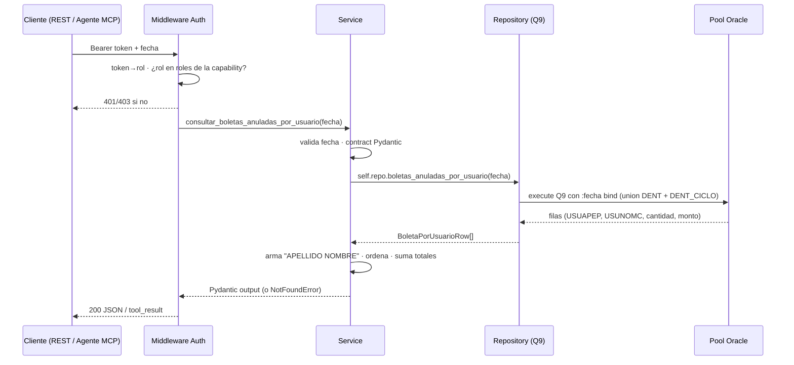

# Capacidad: `consultar_boletas_anuladas_por_usuario` (Q9)

> Ficha de la **#6 de 6 del bloque Control Contable** (§8.1 de V2). Reproduce la tabla **"Boletas anuladas"** del correo `Resumen Control (Contable)`. Es la última del bloque y la única con **dos rarezas del legacy** que se replican a propósito: el filtro de fecha **no** cubre el día completo, y los estados no son `ACT`.

---

## 1. Identidad del contrato

```yaml
id: contabilidad.boletas_anuladas_por_usuario
version: 1
name: consultar_boletas_anuladas_por_usuario
operation:
  mode: READ
```

## 2. Propósito

```text
Devuelve las boletas anuladas, devueltas o no cobradas del día, agrupadas por el
usuario que las emitió, reproduciendo la tabla "Boletas anuladas" del correo de
control contable. Úsala cuando pregunten quién generó boletas anuladas o cuál
operador tiene más anulaciones.
```

### `usage_notes` (contrato en prosa — cuándo NO usarla)

- Cuenta los estados **`ANU`** (anulada), **`DEV`** (devuelta) y **`NCI`** (no cobrada). No son equivalentes entre sí, pero el legacy los agrupa en una sola tabla.
- **El filtro de fecha es una igualdad exacta**, no un rango: solo cuenta boletas con `FEC_BOL` a las `00:00:00`. Una anulación registrada a las 14:30 **no aparece**. No lo corrijas por intuición: es el comportamiento que el legacy tiene y que el correo refleja (V2 §19 h2).
- `fecha` es **obligatoria**.
- Contiene **nombres y apellidos de empleados** (PII). Mismas reglas que `consultar_boletas_emitidas_por_usuario`.
- **NO** usar para boletas emitidas → `consultar_boletas_emitidas_por_usuario`.

---

## 3. Proyección al protocolo MCP

```yaml
mcp:
  enabled: true
  tool: consultar_boletas_anuladas_por_usuario   # sin sufijo de versión (R10)
  annotations:                                   # derivadas de operation.mode (R17)
    readOnlyHint: true
    destructiveHint: false
    idempotentHint: true
    openWorldHint: false
```

| Input (MCP) | Tipo | Obligatorio |
| --- | --- | --- |
| `fecha` | `string` `YYYY-MM-DD` | sí |

| Output (MCP) | Tipo | Descripción |
| --- | --- | --- |
| `fecha` | `string` | Fecha consultada |
| `items` | `array` | Filas `{apellido, nombre, usuario, cantidad, monto}` |
| `total_cantidad` | `number` | Suma de cantidades de las filas |
| `total_monto` | `number` | Suma de montos de las filas |

Mensaje de éxito: devuelve `items` + `total_cantidad` + `total_monto`. Sin boletas en esos estados para la fecha → `NO_DATA`. Oracle o `dent_ciclo` no responden → `UNAVAILABLE`.

---

## 4. Proyección al protocolo REST

```text
GET /api/contabilidad/boletas-anuladas-por-usuario?fecha=YYYY-MM-DD
Authorization: Bearer <token>
```

| Código | Caso | Cuerpo |
| --- | --- | --- |
| `200` | OK | `{fecha, items[], total_cantidad, total_monto}` |
| `400` | `fecha` ausente/mal formada | `INVALID_ARGUMENT` |
| `404` | Sin boletas ANU/DEV/NCI para la fecha | `NO_DATA` |
| `401` | Bearer ausente/inválido | error de autenticación |
| `403` | Token válido pero rol sin permiso | `FORBIDDEN` (sin detalle) |
| `503` | Pool agotado / Oracle o réplica caída | `UNAVAILABLE` |

---

## 5. Modo de ejecución (flujo de la llamada)



Reglas de esta capa:
- **Misma forma de resultado que Q8, distinto SQL.** Comparten `BoletaPorUsuarioItem` a propósito: el correo muestra dos tablas con las mismas columnas y el agente no debería aprender dos formatos para lo mismo.
- **Un solo viaje a Oracle** con `union all` de los dos esquemas.
- **`USULOGIN` se usa solo como llave de join** y no se proyecta.
- **La autorización ocurre antes** de ejecutar (V2 R8).

---

## 6. Query incluida en el servicio (Q9 — validada contra el fuente)

Método legacy: `ResumenControl.getBoletasAnuladasPorUsuario()` — `ResumenControl.java:547-582`.

```sql
select USUAPEP, USUNOMC, count(1) cantidad, sum(mto_bol) monto from (
  select us.USUAPEP, us.USUNOMC, bo.mto_bol
  from DENT.boleta bo, DENT.usuarios us
  where bo.FEC_BOL = to_date(:fecha,'YYYY-MM-DD')
    and bo.ind_estado in ('ANU', 'DEV', 'NCI')
    and bo.COD_USUARIO = us.USULOGIN
  union all
  select us.USUAPEP, us.USUNOMC, bo.mto_bol
  from DENT_CICLO.boleta bo, DENT.usuarios us
  where bo.FEC_BOL = to_date(:fecha,'YYYY-MM-DD')
    and bo.ind_estado in ('ANU', 'DEV', 'NCI')
    and bo.COD_USUARIO = us.USULOGIN
) group by USUAPEP, USUNOMC
```

### 6.1 Diferencias deliberadas vs el fuente (semántica idéntica)

| Aspecto | Legacy (Java) | Capa nueva | Tipo de cambio |
| --- | --- | --- | --- |
| Inyección de `fecha` | Concatenación dentro del literal de `to_date` | **Bind** `:fecha` | Seguridad; misma semántica |
| Filtro de fecha | **`FEC_BOL = to_date('fecha','YYYY-MM-DD')`, igualdad exacta** | Idéntico, **sin `trunc` ni rango** | Se replica (V2 §19 h2) |
| Estados | `ind_estado in ('ANU','DEV','NCI')` | Idéntico | Se replica |
| `order by` | **Ausente** | Ausente en el SQL; orden canónico en el service | Aditivo y determinista |
| `usuarios` sin owner | Owner por defecto de la sesión | **`DENT.usuarios`** explícito | V2 §19 h6 |
| Nombre en la fila | `USUAPEP + " " + USUNOMC` en `ConsultaControl.java:383` | `usuario` armado en el service | Aditivo |
| Lectura del monto | `getString` → `Long.parseLong` (`ConsultaControl.java:279`) | `Decimal` | **Divergencia declarada** (§7.1) |
| TOTAL | Sumado en Java | Sumado en el service | Misma aritmética |

> **Sobre la igualdad exacta:** Oracle convierte `date` a `timestamp` con hora `00:00:00` al comparar contra un `DATE`. En la base QA, las 163.369 boletas de `FEC_BOL` a medianoche y las 8.553 con hora distinta de medianoche muestran por qué esta diferencia importa: Q8 y Q9 miran poblaciones distintas. Se conserva exactamente; corregirlo rompería la paridad con el correo.

### 6.2 Conteo de la diferencia con Q8 (medido en Oracle QA, `2025-05-12`)

| Capability | Filtro | Filas que mira |
| --- | --- | --- |
| Q8 (emitidas) | `00:00:00` a `23:59:59`, estado `ACT` | 1305 boletas / `54151100` |
| Q9 (anuladas) | **solo** `00:00:00`, estados `ANU`/`DEV`/`NCI` | 45 boletas / `4428000` |

> Las dos diferencias (rango de fecha y conjunto de estados) operan a la vez. Por eso los números **no** son comparables entre sí como si fueran subconjuntos.

---

## 7. Reglas de negocio

```yaml
business_rules:
  - fecha_obligatoria
  - fecha_exacta_sin_trunc            # ⚠ igualdad exacta, no rango (V2 §19 h2)
  - estados_no_activos: [ANU, DEV, NCI]
  - unir_dent_y_dent_ciclo
  - agrupar_por_operador:
      boleta.COD_USUARIO == usuarios.USULOGIN
  - exponer_nombre_completo
  - no_exponer_usulogin
  - ordenar_por_apellido_y_nombre     # orden canónico added en service
  - totales_calculados_en_service
```

### 7.1 `Long.parseLong` del legacy

`ConsultaControl.java:279` convierte los montos con `Long.parseLong`. La capa usa `Decimal` y no reproduce ese fallo. Divergencia consciente, igual que en Q8 y Q10.

### 7.2 Por qué `apellido = "."` también aparece acá

Las boletas anuladas de procesos automáticos existen igual que las emitidas. La misma regla de Q8 aplica: se muestra `"."` tal cual, sin normalizar.

---

## 8. Contrato Pydantic

```python
class ConsultarBoletasAnuladasPorUsuarioInput(BaseModel):
    fecha: date   # obligatoria

# Mismos modelos de salida que Q8 (BoletaPorUsuarioItem /
# ConsultarBoletasPorUsuarioOutput): comparten forma, cambian el SQL.
```

---

## 9. Datos y gobernanza

```yaml
data:
  profile: financial
  sources:
    oracle:
      - BOLETA (DENT)
      - BOLETA (DENT_CICLO, réplica)
      - USUARIOS (DENT)
  classification: confidential
  pii: true             # ⚠ nombres y apellidos de empleados
  clinical_data: false
  ai_allowed: yes
  allowed_fields:
    - apellido
    - nombre
    - usuario
    - cantidad
    - monto
    - fecha
  forbidden_fields:
    - USULOGIN
    - cod_usuario
    - ind_estado     # el estado no se expone por fila; el agregado ya lo define
    - clave
    - rut
    - diagnostico
    - ficha_clinica
    - nombre_paciente
```

> `ind_estado` **no** se expone por fila. El contrato define que la tabla cubre `ANU`/`DEV`/`NCI`; agregar el estado por fila sería inventar una dimension que el legacy no tiene.

---

## 10. Seguridad

```yaml
security:
  classification: internal
  access: read
  roles:
    - contador
    - analista_financiero
    - gerente_finanzas
    - ai_agent
```

- Autorización antes de ejecutar (middleware único). `403 FORBIDDEN` sin detalle.
- **Mismas consideraciones de PII que Q8**: el único campo extra de esta consulta es `ind_estado`, que no agrega exposición.
- El payload **no se escribe en logs** (§12).

---

## 11. Errores (`content` MCP / códigos REST)

| Error | `error_code` | HTTP | Mensaje (accionable, sin traceback) |
| --- | --- | --- | --- |
| `ValidationError` | `INVALID_ARGUMENT` | `400` | "fecha es obligatoria y debe ser YYYY-MM-DD." |
| `NotFoundError` | `NO_DATA` | `404` | "No hay boletas anuladas, devueltas o no cobradas para esa fecha. Resultado válido, no es un fallo." |
| `InfrastructureError` | `UNAVAILABLE` | `503` | "No pude consultar los datos (¿réplica dent_ciclo caída o pool agotado?). Reintenta; si persiste, escala a TI." |
| `AuthorizationError` | `FORBIDDEN` | `403` | Sin detalle de la regla. |

- **El `NO_DATA` de esta capability es engañoso por diseño**: puede significar "no hubo anulaciones" o "las hubo pero con hora distinta a medianoche". El mensaje no promete más de lo que el SQL puede sostener.
- En MCP todos los errores se devuelven `isError: true` con el mensaje en el `content`; nunca traceback.

---

## 12. Observabilidad

```yaml
observability:
  level: tech + ai
  metadata:
    tool: consultar_boletas_anuladas_por_usuario
    args: { fecha: ... }
    result: { status, records, total_cantidad, duration_ms }
```

**No se registran los nombres de los operadores** en los logs: el `result` lleva el conteo, no el detalle (V2 §6.3).

---

## 13. Paridad (Nivel 0) — criterio de aceptación

- `fecha` explícita en el test (nunca vacía — V2 §12).
- Para una fecha dada, los **valores numéricos** de cantidad y monto por operador deben igualar la tabla **"Boletas anuladas"** del correo real del legacy.
- La comparación es **insensible al orden**.
- Los totales deben cuadrar con la suma de las filas.
- Si `dent_ciclo` cae → `UNAVAILABLE`, nunca "cero".

### Verificación ejecutada (2026-10-02, Oracle QA)

`tests/test_paridad_oracle.py::test_q9_paridad_de_anuladas` — `fecha = 2025-05-12`: **2 usuarios**, `total_cantidad = 45`, `total_monto = 4428000`.

| `usuario` | `cantidad` | `monto` |
| --- | --- | --- |
| `MORALES VICENTE` | 28 | `3247000` |
| `ZELADA KATHALINA ALEJANDRA` | 17 | `1181000` |

---

## 14. Ejemplos

### 14.1 Entrada

```text
fecha = "2025-05-12"
```

### 14.2 Salida (REST 200)

```json
{
  "fecha": "2025-05-12",
  "items": [
    { "apellido": "MORALES", "nombre": "VICENTE",               "usuario": "MORALES VICENTE",               "cantidad": 28, "monto": "3247000" },
    { "apellido": "ZELADA",  "nombre": "KATHALINA ALEJANDRA",  "usuario": "ZELADA KATHALINA ALEJANDRA",  "cantidad": 17, "monto": "1181000" }
  ],
  "total_cantidad": 45,
  "total_monto": "4428000"
}
```

---

## 15. Modo de ejecución de la capability (resumen operativo)

- **Invocation:** agente MCP llama `consultar_boletas_anuladas_por_usuario(fecha)`, o cliente REST `GET /api/contabilidad/boletas-anuladas-por-usuario?fecha=...`.
- **Conectividad:** una adquisición del pool; `union all` de los dos esquemas en la misma sentencia.
- **Costo:** la más barata del bloque: la igualdad exacta sobre `FEC_BOL` usa índice y el rango de estados es muy selectivo. Sin cache (V2 R11); límite blando `max_calls_per_session: 10` (V2 R19).
- **Auditabilidad:** cada invocación queda con su `request_id`, `duration_ms` y métrica `records`/`total_cantidad`, **sin nombres**.

---

## 16. Trazabilidad técnica

| Ítem | Referencia |
| --- | --- |
| Método legacy | `ResumenControl.getBoletasAnuladasPorUsuario()` |
| Líneas fuente | `ResumenControl.java:547-582`; armado del nombre y TOTAL en `ConsultaControl.java:383` |
| Documentación legacy | `helper.md` → `ResumenControl.getBoletasAnuladasPorUsuario.md` |
| Id de query (registry) | `oracle_sql_id: Q9` |
| SQL en código | `Q9_SQL` en `infrastructure/oracle/contabilidad_repository.py` |
| Test de paridad | `tests/test_paridad_oracle.py::test_q9_paridad_de_anuladas` |
| Guardas de SQL | `tests/test_repository_sql.py` → `test_q9_*` |

---

## 17. Fuentes / referencias

- `000_MiEstrategiaV2.md`: §8.1 (catálogo, fila 6), §9.3, §11, §12, §14.3, §19 (hallazgos h1, h2, h6).
- `ResumenControl.java:547-582` (fuente real de Q9).
- `encuentros.md` §2.3 (Contable).
- `arquitectura.md` (pool, Bearer, `.env`, puerto).
- `consultar_boletas_emitidas_por_usuario.md` (Q8, sister capability).
- `../CATALOGO.md` (índice de las 7 capabilities).