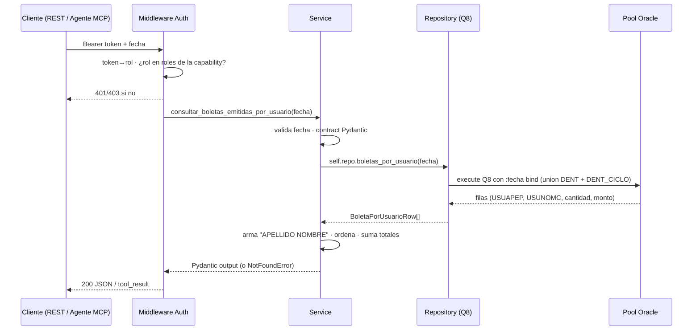

# Capacidad: `consultar_boletas_emitidas_por_usuario` (Q8)

> Ficha de la **#5 de 6 del bloque Control Contable** (§8.1 de V2). Reproduce la tabla **"Boletas emitidas"** del correo `Resumen Control (Contable)`. Es la primera capability del bloque que devuelve **datos personales identificables** (nombre y apellido del operador), por lo que su ficha es también la que fija las reglas de gobernanza de PII del bloque.

---

## 1. Identidad del contrato

```yaml
id: contabilidad.boletas_emitidas_por_usuario
version: 1
name: consultar_boletas_emitidas_por_usuario
operation:
  mode: READ
```

## 2. Propósito

```text
Devuelve las boletas activas emitidas el día, agrupadas por el usuario que las
emitió, reproduciendo la tabla "Boletas emitidas" del correo de control contable.
Úsala cuando pregunten quién emitió más boletas, o cuánto emitirió cada operador.
```

### `usage_notes` (contrato en prosa — cuándo NO usarla)

- Contiene **nombres y apellidos de empleados**: es la capability más sensible del bloque. Ver §9.
- El login del operador (`USULOGIN`) **no** se expone: solo el nombre con el que aparece en el correo.
- `apellido = "."` identifica las boletas emitidas por un **proceso automático** (no por una persona). No es un dato faltante.
- `fecha` es **obligatoria**; el rango es el día completo.
- **NO** usar para boletas anuladas/devueltas → `consultar_boletas_anuladas_por_usuario`.
- **NO** usar para agrupar por previsión → `consultar_ingresos_por_tipo_prevision`.

---

## 3. Proyección al protocolo MCP

```yaml
mcp:
  enabled: true
  tool: consultar_boletas_emitidas_por_usuario   # sin sufijo de versión (R10)
  annotations:                                   # derivadas de operation.mode (R17)
    readOnlyHint: true
    destructiveHint: false
    idempotentHint: true
    openWorldHint: false
```

| Input (MCP) | Tipo | Obligatorio |
| --- | --- | --- |
| `fecha` | `string` `YYYY-MM-DD` | sí |

| Output (MCP) | Tipo | Descripción |
| --- | --- | --- |
| `fecha` | `string` | Fecha consultada |
| `items` | `array` | Filas `{apellido, nombre, usuario, cantidad, monto}` |
| `total_cantidad` | `number` | Suma de cantidades de las filas |
| `total_monto` | `number` | Suma de montos de las filas |

Mensaje de éxito: devuelve `items` + `total_cantidad` + `total_monto`. Sin boletas activas para la fecha → `NO_DATA`. Oracle o `dent_ciclo` no responden → `UNAVAILABLE`.

---

## 4. Proyección al protocolo REST

```text
GET /api/contabilidad/boletas-emitidas-por-usuario?fecha=YYYY-MM-DD
Authorization: Bearer <token>
```

| Código | Caso | Cuerpo |
| --- | --- | --- |
| `200` | OK | `{fecha, items[], total_cantidad, total_monto}` |
| `400` | `fecha` ausente/mal formada | `INVALID_ARGUMENT` |
| `404` | Sin boletas activas para la fecha | `NO_DATA` |
| `401` | Bearer ausente/inválido | error de autenticación |
| `403` | Token válido pero rol sin permiso | `FORBIDDEN` (sin detalle) |
| `503` | Pool agotado / Oracle o réplica caída | `UNAVAILABLE` |

---

## 5. Modo de ejecución (flujo de la llamada)



Reglas de esta capa:
- **El `order by` no está en el SQL**, a diferencia del legacy: no lo tiene, y Oracle devolvería las filas en cualquier orden. El service aplica un **orden canónico** (`apellido`, luego `nombre`) para que el contrato sea estable entre llamadas. Ver §6.1.
- **Un solo viaje a Oracle** con `union all` de los dos esquemas.
- **`USULOGIN` se usa solo como llave de join** (`bo.COD_USUARIO = us.USULOGIN`) y no se proyecta.
- **La autorización ocurre antes** de ejecutar (V2 R8).

---

## 6. Query incluida en el servicio (Q8 — validada contra el fuente)

Método legacy: `ResumenControl.getBoletasPorUsuario()` — `ResumenControl.java:507-544`.

```sql
select USUAPEP, USUNOMC, count(1) cantidad, sum(mto_bol) monto from (
  select us.USUAPEP, us.USUNOMC, bo.mto_bol
  from DENT.boleta bo, DENT.usuarios us
  where bo.fec_bol >= to_date(:fecha || ' 00:00:00','YYYY-MM-DD HH24:MI:SS')
    and bo.fec_bol <= to_date(:fecha || ' 23:59:59','YYYY-MM-DD HH24:MI:SS')
    and bo.ind_estado = 'ACT'
    and bo.COD_USUARIO = us.USULOGIN
  union all
  select us.USUAPEP, us.USUNOMC, bo.mto_bol
  from DENT_CICLO.boleta bo, DENT.usuarios us
  where bo.fec_bol >= to_date(:fecha || ' 00:00:00','YYYY-MM-DD HH24:MI:SS')
    and bo.fec_bol <= to_date(:fecha || ' 23:59:59','YYYY-MM-DD HH24:MI:SS')
    and bo.ind_estado = 'ACT'
    and bo.COD_USUARIO = us.USULOGIN
) group by USUAPEP, USUNOMC
```

### 6.1 Diferencias deliberadas vs el fuente (semántica idéntica)

| Aspecto | Legacy (Java) | Capa nueva | Tipo de cambio |
| --- | --- | --- | --- |
| Inyección de `fecha` | Concatenación en 4 lugares | **Bind** `:fecha` | Seguridad; misma semántica |
| `order by` | **Ausente** | **Ausente en el SQL**; orden canónico en el service | Aditivo y determinista; no cambia los números |
| `usuarios` sin owner | Owner por defecto de la sesión | **`DENT.usuarios`** explícito | V2 §19 h6 |
| `dent_ciclo` | Réplica en la misma conexión | Mismo pool | Solo cambia la conexión |
| Nombre en la fila | `USUAPEP + " " + USUNOMC` armado en `ConsultaControl.java:373` | `usuario` armado en el service | Aditivo: evita que el agente arme strings |
| Lectura del monto | `getString` → `Long.parseLong` (`ConsultaControl.java:278`) | `Decimal` | **Divergencia declarada** (§7.1) |
| TOTAL | Sumado en Java | Sumado en el service | Misma aritmética |

> **Sobre el orden:** el legacy no garantiza orden y el correo tampoco. La capa **sí** lo garantiza, y eso es deliberado: un contrato MCP cuya lista cambia de orden entre llamadas impediría que el agente compare dos consultas de forma confiable. La paridad se valida **como conjunto de filas**, no por posición.

---

## 7. Reglas de negocio

```yaml
business_rules:
  - fecha_obligatoria
  - banda_horaria_000000_235959
  - solo_activas                     # ind_estado = 'ACT'
  - unir_dent_y_dent_ciclo
  - agrupar_por_operador:
      boleta.COD_USUARIO == usuarios.USULOGIN
  - exponer_nombre_completo          # USUAPEP + " " + USUNOMC
  - no_exponer_usulogin              # llave de join, nunca sale
  - ordenar_por_apellido_y_nombre     # orden canónico added en service
  - totales_calculados_en_service
```

### 7.1 `Long.parseLong` del legacy

`ConsultaControl.java:278` convierte los montos con `Long.parseLong`. La capa usa `Decimal` y no reproduce ese fallo. Queda declarado como divergencia consciente: es una restricción del formateo del correo, no una regla de negocio.

### 7.2 `apellido = "."`

Las boletas de operadores automáticos (kioscos, procesos batch) tienen `USUAPEP = '.'`. El legacy lo imprime tal cual, y la capa **no lo normaliza** a `null` ni a `"SISTEMA"`: el correo y el contrato deben decir lo mismo. El service solo documenta el significado en la descripción del campo.

---

## 8. Contrato Pydantic

```python
class ConsultarBoletasPorUsuarioInput(BaseModel):
    fecha: date   # obligatoria

class BoletaPorUsuarioItem(BaseModel):
    apellido: str   # USUAPEP; '.' si la boleta la emitió un proceso automático
    nombre: str     # USUNOMC
    usuario: str    # 'APELLIDO NOMBRE', como lo arma el correo
    cantidad: int
    monto: Decimal

class ConsultarBoletasPorUsuarioOutput(BaseModel):
    fecha: date
    items: list[BoletaPorUsuarioItem]
    total_cantidad: int
    total_monto: Decimal
```

El mismo `BoletaPorUsuarioItem` y el mismo output los usan Q8 y Q9: comparten forma porque comparten consulta con dos estados distintos.

---

## 9. Datos y gobernanza

```yaml
data:
  profile: financial
  sources:
    oracle:
      - BOLETA (DENT)
      - BOLETA (DENT_CICLO, réplica)
      - USUARIOS (DENT)        # USUAPEP / USUNOMC
  classification: confidential
  pii: true             # ⚠ nombres y apellidos de empleados
  clinical_data: false
  ai_allowed: yes
  allowed_fields:
    - apellido
    - nombre
    - usuario
    - cantidad
    - monto
    - fecha
  forbidden_fields:
    - USULOGIN        # identificador del operador: no sale del service
    - cod_usuario     # solo llave de join
    - rut
    - clave           # la tabla USUARIOS tiene password; jamás se proyecta
    - diagnostico
    - ficha_clinica
    - nombre_paciente
```

> **El mayor riesgo de la tabla `DENT.usuarios` es que contiene credenciales.** El SQL de esta capability proyecta **solo** `USUAPEP` y `USUNOMC`. Agregar cualquier columna a esa lista requiere revisión de seguridad, no solo de paridad.

---

## 10. Seguridad

```yaml
security:
  classification: internal
  access: read
  roles:
    - contador
    - analista_financiero
    - gerente_finanzas
    - ai_agent
```

- Autorización antes de ejecutar (middleware único). `403 FORBIDDEN` sin detalle.
- **PII de empleados:** la capability está habilitada para los mismos roles que las demás del bloque, porque el correo de control contable ya es un documento interno de gerencia. Si la organización quiere restringir el detalle por operador, el lugar correcto es `roles` en el Capability Registry, no una condición en el service.
- El payload **no se escribe en logs** (§12).

---

## 11. Errores (`content` MCP / códigos REST)

| Error | `error_code` | HTTP | Mensaje (accionable, sin traceback) |
| --- | --- | --- | --- |
| `ValidationError` | `INVALID_ARGUMENT` | `400` | "fecha es obligatoria y debe ser YYYY-MM-DD." |
| `NotFoundError` | `NO_DATA` | `404` | "No hay boletas activas para esa fecha. Resultado válido, no es un fallo." |
| `InfrastructureError` | `UNAVAILABLE` | `503` | "No pude consultar los datos (¿réplica dent_ciclo caída o pool agotado?). Reintenta; si persiste, escala a TI." |
| `AuthorizationError` | `FORBIDDEN` | `403` | Sin detalle de la regla. |

- En MCP todos los errores se devuelven `isError: true` con el mensaje en el `content`; nunca traceback.

---

## 12. Observabilidad

```yaml
observability:
  level: tech + ai
  metadata:
    tool: consultar_boletas_emitidas_por_usuario
    args: { fecha: ... }
    result: { status, records, total_cantidad, duration_ms }
```

**No se registran los nombres de los operadores** en los logs: el `result` lleva el conteo, no el detalle. El payload completo queda fuera del log por PII (V2 §6.3).

---

## 13. Paridad (Nivel 0) — criterio de aceptación

- `fecha` explícita en el test (nunca vacía — V2 §12).
- Para una fecha dada, los **valores numéricos** de cantidad y monto por operador deben igualar la tabla **"Boletas emitidas"** del correo real del legacy.
- La comparación es **insensible al orden** (el legacy no lo define).
- Los totales deben cuadrar con la suma de las filas.
- Si `dent_ciclo` cae → `UNAVAILABLE`, nunca "cero".

### Verificación ejecutada (2026-10-02, Oracle QA)

`tests/test_paridad_oracle.py::test_q8_paridad_por_usuario` — `fecha = 2025-05-12`: **23 usuarios**, `total_cantidad = 1305`, `total_monto = 54151100`. Primeras filas (orden canónico):

| `usuario` | `cantidad` | `monto` |
| --- | --- | --- |
| `MENDEZ ROXANA IVETTE` | 114 | `2735000` |
| `RAPIMAN MACARENA` | 103 | `3390500` |
| `JOFRE VANIA` | 98 | `2595100` |
| `SOT KRISHNA` | 89 | `3393500` |
| `GALDAMES LIA` | 81 | `3142500` |
| `. SISTEMA` | 71 | `3130000` |

> `. SISTEMA` es el caso `apellido = "."` de §7.2, con el proceso automático como nombre.

---

## 14. Ejemplos

### 14.1 Entrada

```text
fecha = "2025-05-12"
```

### 14.2 Salida (REST 200, recortada)

```json
{
  "fecha": "2025-05-12",
  "items": [
    { "apellido": "MENDEZ", "nombre": "ROXANA IVETTE", "usuario": "MENDEZ ROXANA IVETTE", "cantidad": 114, "monto": "2735000" },
    { "apellido": "RAPIMAN", "nombre": "MACARENA",        "usuario": "RAPIMAN MACARENA",        "cantidad": 103, "monto": "3390500" },
    { "apellido": ".",      "nombre": "SISTEMA",         "usuario": ". SISTEMA",              "cantidad": 71,  "monto": "3130000" }
  ],
  "total_cantidad": 1305,
  "total_monto": "54151100"
}
```

> (Recortado a 3 de las 23 filas; los totales son los reales de la fecha de ejemplo.)

---

## 15. Modo de ejecución de la capability (resumen operativo)

- **Invocation:** agente MCP llama `consultar_boletas_emitidas_por_usuario(fecha)`, o cliente REST `GET /api/contabilidad/boletas-emitidas-por-usuario?fecha=...`.
- **Conectividad:** una adquisición del pool; `union all` de los dos esquemas en la misma sentencia.
- **Costo:** agregación de un día con join por código de usuario. Sin cache (V2 R11); límite blando `max_calls_per_session: 10` (V2 R19).
- **Auditabilidad:** cada invocación queda con su `request_id`, `duration_ms` y métrica `records`/`total_cantidad`, **sin nombres**.

---

## 16. Trazabilidad técnica

| Ítem | Referencia |
| --- | --- |
| Método legacy | `ResumenControl.getBoletasPorUsuario()` |
| Líneas fuente | `ResumenControl.java:507-544`; armado del nombre y TOTAL en `ConsultaControl.java:373` |
| Documentación legacy | `helper.md` → `ResumenControl.getBoletasPorUsuario.md` |
| Id de query (registry) | `oracle_sql_id: Q8` |
| SQL en código | `Q8_SQL` en `infrastructure/oracle/contabilidad_repository.py` |
| Test de paridad | `tests/test_paridad_oracle.py::test_q8_paridad_por_usuario` |
| Guardas de SQL | `tests/test_repository_sql.py` → `test_q8_*` |

---

## 17. Fuentes / referencias

- `000_MiEstrategiaV2.md`: §8.1 (catálogo, fila 5), §9.3, §11, §12, §14.3, §19 (hallazgos h1, h2, h6).
- `ResumenControl.java:507-544` (fuente real de Q8).
- `encuentros.md` §2.3 (Contable).
- `arquitectura.md` (pool, Bearer, `.env`, puerto).
- `consultar_boletas_anuladas_por_usuario.md` (Q9, mismo contrato con otros estados).
- `consultar_ingresos_por_tipo_prevision.md` (Q11, control cruzado de totales).
- `../CATALOGO.md` (índice de las 7 capabilities).