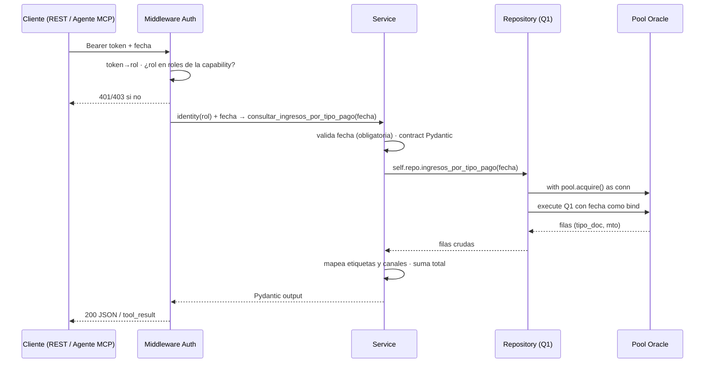

# Capacidad: `consultar_ingresos_por_tipo_pago` (Q1)

> Ficha de implementación de la **primera capability del bloque Control Contable**. Reproduce exactamente la tabla **"Ingresos por tipo pago"** del correo `Resumen Control (Contable)` que el legacy ya envía a gerencia. Es la #1 de 6 porque arma el repository, el mapping de canales y la unión con la réplica (V2 §14.3).

---

## 1. Identidad del contrato

```yaml
id: contabilidad.ingresos_por_tipo_pago
version: 1
name: consultar_ingresos_por_tipo_pago
operation:
  mode: READ
```

## 2. Propósito

```text
Consultar los ingresos del día agrupados por tipo de pago, reproduciendo la tabla
"Ingresos por tipo pago" del correo de control contable. Úsala cuando pregunten
cuánto se recaudó hoy por tipo de pago (efectivo, tarjeta, cheque, webpay, totem,
caja vecina Bco.Est.) o cuál es el total del día.
```

### `usage_notes` (contrato en prosa — cuándo NO usarla)

- **NO** usar para el detalle por tipo de tarjeta de un canal → eso es `consultar_ingresos_por_tipo_tarjeta`.
- **NO** usar para la descomposición por previsión → eso es `consultar_ingresos_por_tipo_prevision`.
- **NO** usar para comparar días ni calcular variaciones → eso es una tool ANALYZE (bloque KPI, fuera de la milla cero).
- `fecha` es **obligatoria** (las queries del legacy requieren fecha explícita; el default vacío del legacy es SQL inválido — V2 §19 h4).

---

## 3. Proyección al protocolo MCP

```yaml
mcp:
  enabled: true
  tool: consultar_ingresos_por_tipo_pago   # sin sufijo de versión (R10)
  annotations:                             # derivadas de operation.mode (R17) — NO escribir a mano
    readOnlyHint: true
    destructiveHint: false
    idempotentHint: true
    openWorldHint: false
```

| Input (MCP)    | Tipo | Obligatorio |
| -------------- | --- | --- |
| `fecha`        | `string` `YYYY-MM-DD` | sí |

| Output (MCP)   | Tipo | Descripción |
| -------------- | --- | --- |
| `fecha`        | `string` | Fecha consultada |
| `items`        | `array` | Filas `{tipo_pago, etiqueta, monto}` |
| `total`        | `number` | Suma de montos (fila TOTAL del correo) |

Mensaje de éxito de la tool: devuelve `items` + `total`. Si no hay boletas para la fecha → `NO_DATA` (resultado válido, no fallo). Si la réplica `dent_ciclo` está caída → `UNAVAILABLE`.

---

## 4. Proyección al protocolo REST

```text
GET /api/contabilidad/ingresos-por-tipo-pago?fecha=YYYY-MM-DD
Authorization: Bearer <token>
```

| Código | Caso | Cuerpo |
| --- | --- | --- |
| `200` | OK | `{fecha, items[], total}` |
| `400` | `fecha` ausente/mal formada | `INVALID_ARGUMENT` |
| `404` | Sin boletas activas para la fecha | `NO_DATA` |
| `401` | Bearer ausente/inválido | error de autenticación |
| `403` | Token válido pero rol sin permiso | `FORBIDDEN` (sin detalle) |
| `503` | Pool agotado / Oracle o réplica caída | `UNAVAILABLE` |

---

## 5. Modo de ejecución (flujo de la llamada)



Reglas de esta capa:
- **La autorización ocurre antes** de ejecutar la capability (V2 R8), nunca dentro de la query.
- **El SQL vive solo en el Repository**; el service expone conceptos de negocio (`tipo_pago`, `etiqueta`) — no se expone `id_impresora` ni `NUM_DOCTO` crudo (V2 R7).
- **El adapter MCP no implementa lógica**: delega en el service (V2 R5, R6).
- **Validación de `fecha`** (obligatoria, `YYYY-MM-DD`) en el contrato Pydantic antes de tocar la BD.

---

## 6. Query incluida en el servicio (Q1 — validada contra el fuente)

Método legacy: `ResumenControl.setTablaIngresoPago()` — `ResumenControl.java:132-189` · `helper.md` `setTablaIngresoPago` · RICH Q1.

> **Nota de descripción del RICH:** el RICH/helper declaran "9 `union all`"; el fuente tiene **8 bloques / 7 `union all`** (V2 §19 h8). El SQL de abajo es el del fuente y es la fuente de verdad.

```sql
select NUM_DOCTO tipo_doc, sum(mto_bol) mto from (
  select NUM_DOCTO, mto_bol
  from dent.boleta
  where fec_bol >= to_date(:fecha || ' 00:00:00','YYYY-MM-DD HH24:MI:SS')
    and fec_bol <= to_date(:fecha || ' 23:59:59','YYYY-MM-DD HH24:MI:SS')
    and id_impresora like 'IBM%'
    and ind_estado in ('ACT')
  union all
  select NUM_DOCTO, mto_bol
  from dent_ciclo.boleta
  where fec_bol >= to_date(:fecha || ' 00:00:00','YYYY-MM-DD HH24:MI:SS')
    and fec_bol <= to_date(:fecha || ' 23:59:59','YYYY-MM-DD HH24:MI:SS')
    and ind_estado in ('ACT')
    and id_impresora like 'IBM%'
  union all
  select 'WEBPAY' NUM_DOCTO, mto_bol
  from dent.boleta
  where fec_bol >= to_date(:fecha || ' 00:00:00','YYYY-MM-DD HH24:MI:SS')
    and fec_bol <= to_date(:fecha || ' 23:59:59','YYYY-MM-DD HH24:MI:SS')
    and ind_estado in ('ACT')
    and id_impresora = 'WPTN'
  union all
  select 'WEBPAY' NUM_DOCTO, mto_bol
  from dent_ciclo.boleta
  where fec_bol >= to_date(:fecha || ' 00:00:00','YYYY-MM-DD HH24:MI:SS')
    and fec_bol <= to_date(:fecha || ' 23:59:59','YYYY-MM-DD HH24:MI:SS')
    and ind_estado in ('ACT')
    and id_impresora = 'WPTN'
  union all
  select 'CAJA VECINA BCO.EST.' NUM_DOCTO, mto_bol
  from dent.boleta
  where fec_bol >= to_date(:fecha || ' 00:00:00','YYYY-MM-DD HH24:MI:SS')
    and fec_bol <= to_date(:fecha || ' 23:59:59','YYYY-MM-DD HH24:MI:SS')
    and ind_estado in ('ACT')
    and id_impresora = 'BESTA'
  union all
  select 'CAJA VECINA BCO.EST.' NUM_DOCTO, mto_bol
  from dent_ciclo.boleta
  where fec_bol >= to_date(:fecha || ' 00:00:00','YYYY-MM-DD HH24:MI:SS')
    and fec_bol <= to_date(:fecha || ' 23:59:59','YYYY-MM-DD HH24:MI:SS')
    and ind_estado in ('ACT')
    and id_impresora = 'BESTA'
  union all
  select 'TOTEM' NUM_DOCTO, mto_bol
  from dent.boleta
  where fec_bol >= to_date(:fecha || ' 00:00:00','YYYY-MM-DD HH24:MI:SS')
    and fec_bol <= to_date(:fecha || ' 23:59:59','YYYY-MM-DD HH24:MI:SS')
    and ind_estado in ('ACT')
    and id_impresora like 'TOT%'
  union all
  select 'TOTEM' NUM_DOCTO, mto_bol
  from dent_ciclo.boleta
  where fec_bol >= to_date(:fecha || ' 00:00:00','YYYY-MM-DD HH24:MI:SS')
    and fec_bol <= to_date(:fecha || ' 23:59:59','YYYY-MM-DD HH24:MI:SS')
    and ind_estado in ('ACT')
    and id_impresora like 'TOT%'
) group by NUM_DOCTO
```

### 6.1 Diferencias deliberadas vs el fuente (semántica idéntica)

| Aspecto | Legacy (Java) | Capa nueva | Tipo de cambio |
| --- | --- | --- | --- |
| Inyección de `fecha` | Concatenación directa en 16 lugares (riesgo SQL injection, RICH: riesgo alto) | **Bind parameter** `:fecha` (equivalente a PreparedStatement) | Seguridad; misma semántica |
| `where fec_bol>=to_date('<fecha> 00:00:00',...)` | Concatenado | `to_date(:fecha || ' 00:00:00',...)` | Idéntico resultado |
| `dent` / `dent_ciclo` | Esquemas en la misma conexión | Mismo pool (ver `arquitectura.md` §5.4) | Solo cambio de la conexión |
| Owner de tablas | Por defecto de la sesión | **Se fija el owner explícito** (`DENT.boleta`, `DENT_CICLO.boleta`) según hallazgo §19 h6 | Elimina fragilidad; misma query |
| Lectura de `mto` | `rs1.getInt("mto")` (trunca a int) | Se lee como `Decimal` (suma exacta) | Se conserva el valor completo para paridad |
| TOTAL | Sumado en Java (`:204`) | Sumado en el service | Misma aritmética |

> **Regla de no-innovación:** no se cambian banda horaria, `ind_estado in ('ACT')`, ni filtros de impresora. La única excepción deliberada es la **parametrización segura** de `fecha` y la **fijación de owner** (ambas documentadas en V2 §19).

---

## 7. Reglas de negocio

```yaml
business_rules:
  - fecha_obligatoria            # ValidationError si falta o no es YYYY-MM-DD (V2 §19 h4)
  - banda_horaria_000000_235959  # rango >= 00:00:00 AND <= 23:59:59 (idéntico al legacy, V2 §19 h2)
  - ind_estado_act_solo          # solo ind_estado in ('ACT') en los 8 bloques
  - unir_dent_y_dent_ciclo       # unión con la réplica vía union all (decisión V2 §0.2)
  - mapear_canales:
      - "IBM%": CAJA               # bloque EFE/TRJ/CHQ (sin etiqueta de canal)
      - "WPTN": WEBPAY             # bloque que etiqueta NUM_DOCTO='WEBPAY'
      - "BESTA": CAJA VECINA BCO.EST.  # bloque que etiqueta NUM_DOCTO='CAJA VECINA BCO.EST.'
      - "TOT%": TOTEM              # bloque que etiqueta NUM_DOCTO='TOTEM'
  - etiquetar_tipos:              # mapeo EN Java (:197-199), replica en service
      - "EFE": "CAJA - EFECTIVO"
      - "TRJ": "CAJA - TARJETA"
      - "CHQ": "CAJA - CHEQUE"
```

### 7.1 Semántica del `tipo_pago` (código de contrato vs etiqueta del correo)

El correo muestra etiquetas legibles; el contrato expone el **código canónico** + etiqueta:

| `tipo_pago` (contrato) | `etiqueta` (como sale en el correo) | Origen |
| --- | --- | --- |
| `EFE` | CAJA - EFECTIVO | `NUM_DOCTO='EFE'` con `IBM%` + mapeo Java `:197` |
| `TRJ` | CAJA - TARJETA | `NUM_DOCTO='TRJ'` con `IBM%` + mapeo Java `:198` |
| `CHQ` | CAJA - CHEQUE | `NUM_DOCTO='CHQ'` con `IBM%` + mapeo Java `:199` |
| `WEBPAY` | WEBPAY | Bloque con literal `'WEBPAY'` (WPTN) |
| `CAJA VECINA BCO.EST.` | CAJA VECINA BCO.EST. | Bloque con literal `'CAJA VECINA BCO.EST.'` (BESTA) |
| `TOTEM` | TOTEM | Bloque con literal `'TOTEM'` (TOT%) |

- Los 6 tipos salen del `group by NUM_DOCTO` de Q1 (3 reales + 3 literales).
- El **TOTAL** del correo es la suma en el service (misma lógica que `ResumenControl.java:204`).

---

## 8. Contrato Pydantic

```python
class ConsultarIngresosPorTipoPagoInput(BaseModel):
    fecha: date   # obligatoria

class IngresoPorTipoPagoItem(BaseModel):
    tipo_pago: str      # EFE | TRJ | CHQ | WEBPAY | CAJA VECINA BCO.EST. | TOTEM
    etiqueta: str       # etiqueta del correo (7.1)
    monto: Decimal

class ConsultarIngresosPorTipoPagoOutput(BaseModel):
    fecha: date
    items: list[IngresoPorTipoPagoItem]
    total: Decimal
```

---

## 9. Datos y gobernanza

```yaml
data:
  profile: financial
  sources:
    oracle:
      - BOLETA (DENT)
      - BOLETA (DENT_CICLO, réplica)
  classification: confidential
  pii: false            # montos agregados por tipo, sin personas
  clinical_data: false
  ai_allowed: yes
  allowed_fields:
    - tipo_pago
    - etiqueta
    - monto
    - fecha
  forbidden_fields:
    - rut
    - diagnostico
    - ficha_clinica
    - id_impresora      # nunca se expone crudo; viaja solo en el mapeo de canal
```

---

## 10. Seguridad

```yaml
security:
  classification: internal
  access: read
  roles:
    - contador
    - analista_financiero
    - gerente_finanzas
    - ai_agent
```

- Autorización antes de ejecutar (middleware único, `arquitectura.md` §6). Rol del token debe estar entre los `roles`.
- `403 FORBIDDEN` sin detalle si no procede.

---

## 11. Errores (`content` MCP / códigos REST)

| Error | `error_code` | HTTP | Mensaje (accionable, sin traceback) |
| --- | --- | --- | --- |
| `ValidationError` | `INVALID_ARGUMENT` | `400` | "Argumentos inválidos. fecha debe ser YYYY-MM-DD." |
| `NotFoundError` | `NO_DATA` | `404` | "No hay boletas activas para esa fecha. Resultado válido, no es un fallo." |
| `InfrastructureError` | `UNAVAILABLE` | `503` | "No pude consultar los datos (¿réplica dent_ciclo caída o pool agotado?). Reintenta; si persiste, escala a TI." |
| `AuthorizationError` | `FORBIDDEN` | `403` | Sin detalle de la regla. |

- **NO_DATA ≠ UNAVAILABLE** (V2 R18/§7.4): tabla vacía que parece "cero" está prohibida; réplica caída = `UNAVAILABLE`.
- En MCP todos los errores se devuelven `isError: true` con el mensaje en el `content`; nunca traceback.

---

## 12. Observabilidad

```yaml
observability:
  level: tech + ai
  metadata:
    tool: consultar_ingresos_por_tipo_pago
    args: { fecha: ... }
    result: { status, records, total, duration_ms }
```

Sin guardar el payload completo (V2 §6.3 — minimización de datos `financial`).

---

## 13. Paridad (Nivel 0) — criterio de aceptación

- `fecha` explícita en el test (nunca vacía — V2 §12).
- Para una fecha dada, los **valores numéricos** de `items[]` (6 filas si existen) y `total` deben **igualar el cuadro "Ingresos por tipo pago"** del correo real del legacy (comparando números crudos, no el formato `DecimalFormat` del HTML).
- Si una fila de tipo no aparece, se omite (igual que el legacy: el `group by` solo devuelve los que existen).
- Dos fechas mínimo: **día hábil con datos** y **día sin actividad**.
- Si `dent_ciclo` cae, la paridad falla con `UNAVAILABLE`, no con "cero".

---

## 14. Ejemplos

### 14.1 Entrada

```text
fecha = "2026-09-25"
```

### 14.2 Salida (REST 200)

```json
{
  "fecha": "2026-09-25",
  "items": [
    { "tipo_pago": "EFE",  "etiqueta": "CAJA - EFECTIVO", "monto": 1240000 },
    { "tipo_pago": "TRJ",  "etiqueta": "CAJA - TARJETA",  "monto": 980000 },
    { "tipo_pago": "CHQ",  "etiqueta": "CAJA - CHEQUE",   "monto": 250000 },
    { "tipo_pago": "WEBPAY", "etiqueta": "WEBPAY",        "monto": 1650000 },
    { "tipo_pago": "CAJA VECINA BCO.EST.", "etiqueta": "CAJA VECINA BCO.EST.", "monto": 0 },
    { "tipo_pago": "TOTEM", "etiqueta": "TOTEM",          "monto": 730000 }
  ],
  "total": 4850000
}
```

> (Montos ilustrativos; el valor real lo dicta la paridad contra el correo.)

---

## 15. Modo de ejecución de la capability (resumen operativo)

- **Invocation:** agente MCP llama `consultar_ingresos_por_tipo_pago(fecha)`, o cliente REST `GET /api/contabilidad/ingresos-por-tipo-pago?fecha=...`.
- **Conectividad:** una sesión del pool Oracle (se reutiliza, no se abre/cierra por llamada).
- **Costo:** query liviana (agregación de 1 día), sin cache (V2 R11); límite blando `max_calls_per_session: 10` (V2 R19).
- **Auditabilidad:** cada invocación queda con su `request_id`, `duration_ms` y métrica `records`/`total`.

---

## 16. Trazabilidad técnica

| Ítem | Referencia |
| --- | --- |
| Método legacy | `ResumenControl.setTablaIngresoPago()` |
| Líneas fuente | `ResumenControl.java:132-189` (SQL `:132-189`; etiquetas `:197-199`; TOTAL `:204`) |
| Documentación legacy | `helper.md` → `setTablaIngresoPago` |
| Query validada | `resumencontrolRICH.md` Q1 (líneas 426–492) |
| Id de query (registry) | `oracle_sql_id: Q1` |
| Bloques/union | 8 bloques / 7 `union all` (el RICH dice 9 — ver V2 §19 h8) |

---

## 17. Fuentes / referencias

- `000_MiEstrategiaV2.md`: §8.1 (catálogo), §9.3 (ficha YAML), §11 (estructura), §12 (Nivel 0), §14.3 (orden de construcción), §19 (hallazgos h1–h4, h8).
- `ResumenControl.java:130-219` (fuente real de Q1).
- `resumencontrolRICH.md` Q1.
- `encuentros.md` §2.3 (b).
- `arquitectura.md` (servidor: pool, Bearer, .env, puerto).