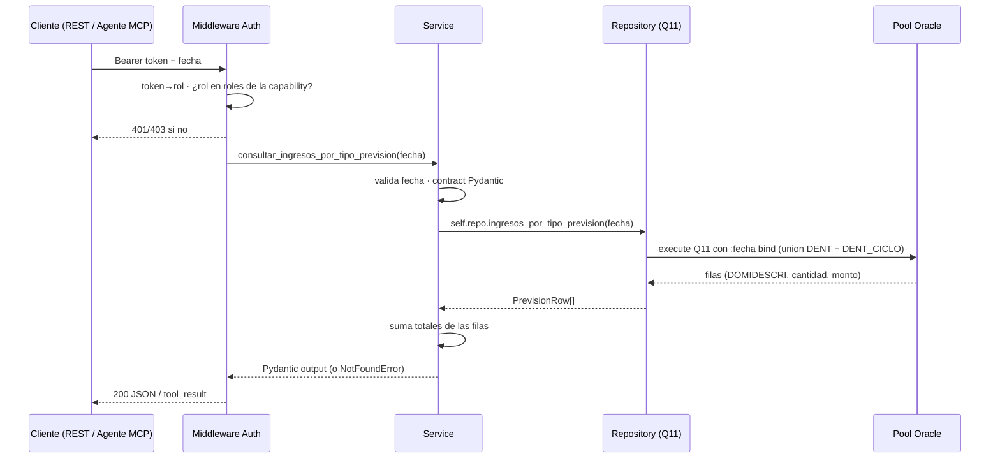

# Capacidad: `consultar_ingresos_por_tipo_prevision` (Q11)

> Ficha de la **#4 de 6 del bloque Control Contable** (§8.1 de V2). Reproduce la tabla **"Ingresos tipo previsión"** del correo `Resumen Control (Contable)`. Es la única capability del bloque que necesita **dos joins extra** (`fichas` y `dominio`) para traducir una boleta a una previsión.

---

## 1. Identidad del contrato

```yaml
id: contabilidad.ingresos_por_tipo_prevision
version: 1
name: consultar_ingresos_por_tipo_prevision
operation:
  mode: READ
```

## 2. Propósito

```text
Devuelve los ingresos del día agrupados por tipo de previsión (el código de
previsión de la ficha del paciente), reproduciendo la tabla "Ingresos tipo
previsión" del correo de control contable. Úsala cuando pregunten cuánto se facturó
por previsión o cuál previsión maneja más facturación.
```

### `usage_notes` (contrato en prosa — cuándo NO usarla)

- La previsión se resuelve por **`DENT.dominio` filtrado por `DOMINOMBRE = 'TIPO_PREVISION'`**; el texto expuesto es `DOMIDESCRI`.
- Las boletas **sin ficha** o cuya ficha **no tiene previsión** no aparecen en ninguna fila. Sus montos tampoco entran en el total.
- `fecha` es **obligatoria**; el rango es el día completo (`00:00:00` a `23:59:59`).
- **NO** usar para el detalle por persona → `consultar_boletas_emitidas_por_usuario` (muestra quién emitió, no qué previsión se facturó).
- **NO** usar para el total por forma de pago → `consultar_ingresos_por_tipo_pago`.

---

## 3. Proyección al protocolo MCP

```yaml
mcp:
  enabled: true
  tool: consultar_ingresos_por_tipo_prevision   # sin sufijo de versión (R10)
  annotations:                                  # derivadas de operation.mode (R17)
    readOnlyHint: true
    destructiveHint: false
    idempotentHint: true
    openWorldHint: false
```

| Input (MCP) | Tipo | Obligatorio |
| --- | --- | --- |
| `fecha` | `string` `YYYY-MM-DD` | sí |

| Output (MCP) | Tipo | Descripción |
| --- | --- | --- |
| `fecha` | `string` | Fecha consultada |
| `items` | `array` | Filas `{prevision, cantidad, monto}` ordenadas alfabéticamente |
| `total_cantidad` | `number` | Suma de cantidades de las filas |
| `total_monto` | `number` | Suma de montos de las filas |

Mensaje de éxito: devuelve `items` + `total_cantidad` + `total_monto`. Si no hay boletas con previsión para la fecha → `NO_DATA`. Si Oracle, `DENT.fichas` o `DENT.dominio` no responden → `UNAVAILABLE`.

---

## 4. Proyección al protocolo REST

```text
GET /api/contabilidad/ingresos-por-tipo-prevision?fecha=YYYY-MM-DD
Authorization: Bearer <token>
```

| Código | Caso | Cuerpo |
| --- | --- | --- |
| `200` | OK | `{fecha, items[], total_cantidad, total_monto}` |
| `400` | `fecha` ausente/mal formada | `INVALID_ARGUMENT` |
| `404` | Sin boletas activas con previsión para la fecha | `NO_DATA` |
| `401` | Bearer ausente/inválido | error de autenticación |
| `403` | Token válido pero rol sin permiso | `FORBIDDEN` (sin detalle) |
| `503` | Pool agotado / Oracle o réplica caída | `UNAVAILABLE` |

---

## 5. Modo de ejecución (flujo de la llamada)



Reglas de esta capa:
- **Un solo viaje a Oracle** con `union all`: la réplica `dent_ciclo` se consulta en la misma sentencia, no en una segunda llamada.
- **El `order by DOMIDESCRI` vive en el SQL**, igual que en el legacy: el correo muestra esa tabla ya ordenada y el service no reordena.
- **Los owner de esquema son explícitos** (`DENT.boleta`, `DENT.fichas`, `DENT.dominio`) para no depender de los sinónimos del usuario de conexión (V2 §19 h6).
- **La autorización ocurre antes** de ejecutar (V2 R8).

---

## 6. Query incluida en el servicio (Q11 — validada contra el fuente)

Método legacy: `ResumenControl.getDetIngresPorTipoPrevision()` — `ResumenControl.java:503-544`.

```sql
select DOMIDESCRI, count(1) cantidad, sum(mto_bol) monto from (
  select do.DOMIDESCRI, bo.mto_bol
  from DENT.boleta bo, DENT.fichas fi, DENT.dominio do
  where bo.fec_bol >= to_date(:fecha || ' 00:00:00','YYYY-MM-DD HH24:MI:SS')
    and bo.fec_bol <= to_date(:fecha || ' 23:59:59','YYYY-MM-DD HH24:MI:SS')
    and bo.NUM_FICHA = fi.NUM_FICHA
    and bo.ind_estado = 'ACT'
    and fi.TIP_PREVISION = do.DOMICODIGO
    and do.DOMINOMBRE = 'TIPO_PREVISION'
  union all
  select do.DOMIDESCRI, bo.mto_bol
  from DENT_CICLO.boleta bo, DENT.fichas fi, DENT.dominio do
  where bo.fec_bol >= to_date(:fecha || ' 00:00:00','YYYY-MM-DD HH24:MI:SS')
    and bo.fec_bol <= to_date(:fecha || ' 23:59:59','YYYY-MM-DD HH24:MI:SS')
    and bo.NUM_FICHA = fi.NUM_FICHA
    and bo.ind_estado = 'ACT'
    and fi.TIP_PREVISION = do.DOMICODIGO
    and do.DOMINOMBRE = 'TIPO_PREVISION'
) group by DOMIDESCRI order by DOMIDESCRI
```

### 6.1 Diferencias deliberadas vs el fuente (semántica idéntica)

| Aspecto | Legacy (Java) | Capa nueva | Tipo de cambio |
| --- | --- | --- | --- |
| Inyección de `fecha` | Concatenación en 4 lugares | **Bind** `:fecha` | Seguridad; misma semántica |
| Bandas horarias | `>= 00:00:00` y `<= 23:59:59` | Idéntico | Se replica (V2 §19 h2) |
| `fichas`, `dominio` sin owner | Owner por defecto de la sesión | **`DENT.fichas`, `DENT.dominio`** | V2 §19 h6 |
| `dent_ciclo` | Réplica en la misma conexión | Mismo pool | Solo cambia la conexión |
| `order by DOMIDESCRI` | En el SQL | En el SQL | Idéntico |
| Lectura del monto | `rs1.getDouble(3)` → `DecimalFormat` | `Decimal` crudo | Se conserva el valor completo para paridad |
| TOTAL | Sumado en Java (`ConsultaControl.java:410`) | Sumado en el service | Misma aritmética |

> **Regla de no-innovación:** no se cambia el `join` implícito por comas a `join ... on` (mismo plan en Oracle), ni se agrega `left join` para incluir boletas sin previsión (eso **cambiaría** el total).

---

## 7. Reglas de negocio

```yaml
business_rules:
  - fecha_obligatoria
  - banda_horaria_000000_235959
  - solo_activas                     # ind_estado = 'ACT'
  - unir_dent_y_dent_ciclo
  - resolucion_de_prevision:
      boleta.NUM_FICHA == fichas.NUM_FICHA
      fichas.TIP_PREVISION == dominio.DOMICODIGO
      dominio.DOMINOMBRE == 'TIPO_PREVISION'   # evita mezclar dominios
  - exponer_domidescri               # el texto, no el código
  - excluir_boletas_sin_prevision     # inner join: no hay fila, no hay monto
  - ordenar_por_descripcion
  - totales_calculados_en_service
```

### 7.1 Por qué el total puede no cuadrar con Q1

Q1 cuenta **todas** las boletas activas del día. Q11 solo las que tienen ficha con previsión mapeada en `dominio`. Por lo tanto:

- `total_monto` de Q11 **puede ser menor** que el `total` de Q1.
- La diferencia son boletas de caja sin ficha, fichas sin `TIP_PREVISION`, o previsiones ausentes en `DENT.dominio`.

Esto es el comportamiento del legacy, no un error de la capa. Es la razón por la que ambas capabilities existen separadas y por la que no deben cruzarse en un mismo cuadro sin explicitar esa diferencia.

---

## 8. Contrato Pydantic

```python
class ConsultarIngresosPorTipoPrevisionInput(BaseModel):
    fecha: date   # obligatoria

class IngresoPorTipoPrevisionItem(BaseModel):
    prevision: str     # DOMIDESCRI literal de TIPO_PREVISION
    cantidad: int
    monto: Decimal

class ConsultarIngresosPorTipoPrevisionOutput(BaseModel):
    fecha: date
    items: list[IngresoPorTipoPrevisionItem]
    total_cantidad: int
    total_monto: Decimal
```

---

## 9. Datos y gobernanza

```yaml
data:
  profile: financial
  sources:
    oracle:
      - BOLETA (DENT)
      - BOLETA (DENT_CICLO, réplica)
      - FICHAS (DENT)          # solo para resolver TIP_PREVISION
      - DOMINIO (DENT)         # solo para resolver DOMIDESCRI
  classification: confidential
  pii: false            # se agrupa por previsión, no por paciente
  clinical_data: false
  ai_allowed: yes
  allowed_fields:
    - prevision
    - cantidad
    - monto
    - fecha
  forbidden_fields:
    - NUM_FICHA           # identificador de ficha: nunca sale del service
    - TIP_PREVISION      # código crudo: el contrato expone DOMIDESCRI
    - DOMICODIGO
    - rut
    - diagnostico
    - ficha_clinica
    - nombre_paciente
```

> `NUM_FICHA` es el punto de contacto con la ficha clínica: se usa **solo** como llave de join dentro del SQL y jamás se proyecta al contrato.

---

## 10. Seguridad

```yaml
security:
  classification: internal
  access: read
  roles:
    - contador
    - analista_financiero
    - gerente_finanzas
    - ai_agent
```

- Autorización antes de ejecutar (middleware único). `403 FORBIDDEN` sin detalle.
- Esta capability **cruza el límite entre lo financiero y lo clínico** en la base, pero **no transporta ningún dato clínico**: el `join` es una proyección agregada por un dominio de negocio (`TIPO_PREVISION`).

---

## 11. Errores (`content` MCP / códigos REST)

| Error | `error_code` | HTTP | Mensaje (accionable, sin traceback) |
| --- | --- | --- | --- |
| `ValidationError` | `INVALID_ARGUMENT` | `400` | "fecha es obligatoria y debe ser YYYY-MM-DD." |
| `NotFoundError` | `NO_DATA` | `404` | "No hay boletas activas con previsión para esa fecha. Resultado válido, no es un fallo." |
| `InfrastructureError` | `UNAVAILABLE` | `503` | "No pude consultar los datos (¿réplica dent_ciclo caída, dominio no disponible o pool agotado?). Reintenta; si persiste, escala a TI." |
| `AuthorizationError` | `FORBIDDEN` | `403` | Sin detalle de la regla. |

- Si `DENT.dominio` pierde filas y el resultado queda vacío, la capa responde `NO_DATA`: es indistinguible de "no hubo boletas". La distinción real la hace el log de `InfrastructureError` cuando la consulta **falla**, no cuando no trae filas.
- En MCP todos los errores se devuelven `isError: true` con el mensaje en el `content`; nunca traceback.

---

## 12. Observabilidad

```yaml
observability:
  level: tech + ai
  metadata:
    tool: consultar_ingresos_por_tipo_prevision
    args: { fecha: ... }
    result: { status, records, total_cantidad, duration_ms }
```

Sin guardar el payload completo (V2 §6.3 — minimización de datos `financial`).

---

## 13. Paridad (Nivel 0) — criterio de aceptación

- `fecha` explícita en el test (nunca vacía — V2 §12).
- Para una fecha dada, los **valores numéricos** de cantidad y monto deben igualar el cuadro **"Ingresos tipo previsión"** del correo real del legacy, **en el mismo orden**.
- Si una previsión no aparece en el correo, tampoco aparece acá.
- Si no hay ninguna boleta con previsión → `NO_DATA`.
- Si `dent_ciclo` cae → `UNAVAILABLE`, nunca "cero".

### Verificación ejecutada (2026-10-02, Oracle QA)

`tests/test_paridad_oracle.py::test_q11_paridad_por_prevision` — `fecha = 2025-05-12`: **34 filas**, `total_cantidad = 1305`, `total_monto = 54151100`. Primeras filas:

| `prevision` | `cantidad` | `monto` |
| --- | --- | --- |
| `2022 BRACKET ESTETICO V2` | 9 | `643000` |
| … | … | … |
| `2024 BRACKET METALICO` | 534 | `28414500` |

> **Control cruzado:** `total_cantidad = 1305` y `total_monto = 54151100` coinciden **exactamente** con los totales de Q8 para la misma fecha. Es la evidencia de que los dos journeys tocan el mismo universo de boletas activas; la diferencia está solo en la clave de agrupación.

---

## 14. Ejemplos

### 14.1 Entrada

```text
fecha = "2025-05-12"
```

### 14.2 Salida (REST 200, recortada)

```json
{
  "fecha": "2025-05-12",
  "items": [
    { "prevision": "2022 BRACKET ESTETICO V2", "cantidad": 9, "monto": "643000" },
    { "prevision": "2024 BRACKET METALICO", "cantidad": 534, "monto": "28414500" }
  ],
  "total_cantidad": 1305,
  "total_monto": "54151100"
}
```

> (Recortado a dos de las 34 filas; los totales son los reales de la fecha de ejemplo.)

---

## 15. Modo de ejecución de la capability (resumen operativo)

- **Invocation:** agente MCP llama `consultar_ingresos_por_tipo_prevision(fecha)`, o cliente REST `GET /api/contabilidad/ingresos-por-tipo-prevision?fecha=...`.
- **Conectividad:** una adquisición del pool; `union all` de los dos esquemas en la misma sentencia.
- **Costo:** la más pesada del bloque: 2 tablas más en el join sobre ~172 mil boletas. Sin cache (V2 R11); límite blando `max_calls_per_session: 10` (V2 R19).
- **Auditabilidad:** cada invocación queda con su `request_id`, `duration_ms` y métrica `records`/`total_cantidad`.

---

## 16. Trazabilidad técnica

| Ítem | Referencia |
| --- | --- |
| Método legacy | `ResumenControl.getDetIngresPorTipoPrevision()` |
| Líneas fuente | `ResumenControl.java:503-544`; TOTAL en `ConsultaControl.java:410` |
| Documentación legacy | `helper.md` → `ResumenControl.getDetIngresPorTipoPrevision.md` |
| Id de query (registry) | `oracle_sql_id: Q11` |
| SQL en código | `Q11_SQL` en `infrastructure/oracle/contabilidad_repository.py` |
| Test de paridad | `tests/test_paridad_oracle.py::test_q11_paridad_por_prevision` |
| Guardas de SQL | `tests/test_repository_sql.py` → `test_q11_*` |

---

## 17. Fuentes / referencias

- `000_MiEstrategiaV2.md`: §8.1 (catálogo, fila 4), §9.3, §11, §12, §14.3, §19 (hallazgos h1, h2, h6).
- `ResumenControl.java:503-544` (fuente real de Q11).
- `encuentros.md` §2.3 (Contable).
- `arquitectura.md` (pool, Bearer, `.env`, puerto).
- `consultar_boletas_emitidas_por_usuario.md` (Q8, control cruzado de totales).
- `../CATALOGO.md` (índice de las 7 capabilities).