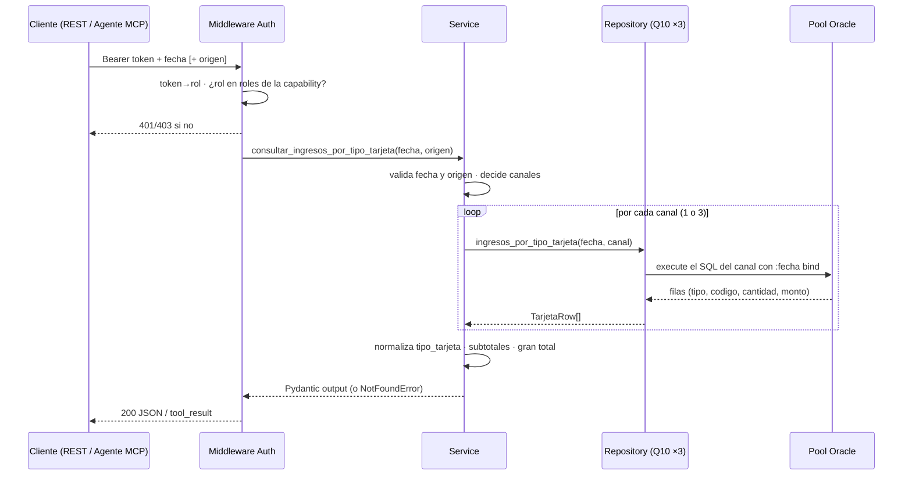

# Capacidad: `consultar_ingresos_por_tipo_tarjeta` (Q10)

> Ficha de la **#3 de 6 del bloque Control Contable** (§8.1 de V2). Reproduce las **tres tablas de tarjeta** del correo `Resumen Control (Contable)`. Es la capability con más superficie del bloque: el legacy usa **tres SQL distintos** según el canal, y esta capa los expone como **una sola llamada** con `origen` opcional.

---

## 1. Identidad del contrato

```yaml
id: contabilidad.ingresos_por_tipo_tarjeta
version: 1
name: consultar_ingresos_por_tipo_tarjeta
operation:
  mode: READ
```

## 2. Propósito

```text
Devuelve los ingresos con boleta de tipo TRJ del día, agrupados por tipo de tarjeta
(crédito/débito) y separados por canal de origen: CAJA, TOTEM y WEBPAY. Reproduce
las tres tablas de tarjeta del correo de control contable. Úsala cuando pregunten
cuánto entró por tarjeta y de qué tipo, o comparen caja contra totem/webpay.
```

### `usage_notes` (contrato en prosa — cuándo NO usarla)

- Solo considera **boletas activas de tipo tarjeta**; el efectivo, el cheque y el webpay como forma de pago van en `consultar_ingresos_por_tipo_pago`.
- **Ojo con el filtro de fecha:** el canal `CAJA` cuenta boletas con **fecha exacta** mientras `TOTEM` y `WEBPAY` cuentan **todo el día**. Un canal vacío puede deberse a esa diferencia y no a falta de datos.
- `fecha` es **obligatoria**. `origen` es **opcional**: si se omite, devuelve los tres canales.
- **NO** usar para el total por forma de pago → `consultar_ingresos_por_tipo_pago`.
- **NO** usar para la descomposición por previsión → `consultar_ingresos_por_tipo_prevision`.

---

## 3. Proyección al protocolo MCP

```yaml
mcp:
  enabled: true
  tool: consultar_ingresos_por_tipo_tarjeta   # sin sufijo de versión (R10)
  annotations:                               # derivadas de operation.mode (R17)
    readOnlyHint: true
    destructiveHint: false
    idempotentHint: true
    openWorldHint: false
```

| Input (MCP) | Tipo | Obligatorio |
| --- | --- | --- |
| `fecha` | `string` `YYYY-MM-DD` | sí |
| `origen` | `string` `CAJA` \| `TOTEM` \| `WEBPAY` | no (si se omite, los 3) |

| Output (MCP) | Tipo | Descripción |
| --- | --- | --- |
| `fecha` | `string` | Fecha consultada |
| `items` | `array` | Filas `{origen, tipo_tarjeta, codigo_tarjeta, etiqueta_correo, cantidad, monto}` |
| `totales` | `array` | Un total por canal consultado, **incluye los vacíos en cero** |
| `total` | `object` | Gran total `{cantidad, monto}` de los canales consultados |

Mensaje de éxito: devuelve `items` + `totales` + `total`. Si los canales consultados vienen vacíos → `NO_DATA`. Si Oracle o `dent_ciclo` no responde → `UNAVAILABLE`.

---

## 4. Proyección al protocolo REST

```text
GET /api/contabilidad/ingresos-por-tipo-tarjeta?fecha=YYYY-MM-DD[&origen=CAJA|TOTEM|WEBPAY]
Authorization: Bearer <token>
```

| Código | Caso | Cuerpo |
| --- | --- | --- |
| `200` | OK | `{fecha, items[], totales[], total}` |
| `400` | `fecha` ausente/mal formada, o `origen` inválido | `INVALID_ARGUMENT` |
| `404` | Todos los canales consultados sin datos | `NO_DATA` |
| `401` | Bearer ausente/inválido | error de autenticación |
| `403` | Token válido pero rol sin permiso | `FORBIDDEN` (sin detalle) |
| `503` | Pool agotado / Oracle o réplica caída | `UNAVAILABLE` |

---

## 5. Modo de ejecución (flujo de la llamada)



Reglas de esta capa:
- **`origen` es una decisión de transporte, no de negocio**: sin él se ejecutan los 3 SQL y se agregan. El legacy lo llamaba 3 veces desde `ConsultaControl.java:269/310/350` y armaba el correo; el agente obtiene el cuadro completo en 1 llamada.
- **Cada canal tiene su propio SQL** (3 constantes separadas, sin interpolación: no hay superficie de inyección por el nombre del canal).
- **Los totales los calcula el service**, nunca el LLM: el legacy los sums en `ConsultaControl.java:322-323/362-363/402-403`.
- **La autorización ocurre antes** de ejecutar (V2 R8).

---

## 6. Query incluida en el servicio (Q10 — validada contra el fuente)

Método legacy: `ResumenControl.getDetIngresPorTipoTarjeta()` — `ResumenControl.java:590-657`. El legacy arma el WHERE con un `if/else` sobre el canal (`qryCaja` / `qryTotem` / `qryWebpay`). Acá hay **tres constantes** en lugar de un `if` dentro del SQL.

### 6.1 Canal CAJA (filtro por fecha **exacta**)

```sql
select codigo tipo, codigo codigo_tarjeta, count(1) cantidad, sum(mto_bol) monto from (
  select bo.TIP_TARJETA codigo, bo.mto_bol
  from DENT.boleta bo
  where bo.FEC_BOL = to_date(:fecha,'YYYY-MM-DD')
    and bo.NUM_DOCTO = 'TRJ'
    and bo.ind_estado = 'ACT'
    and bo.id_impresora like 'IBM%'
    and bo.id_impresora like 'IBM%'
  union all
  select bo.TIP_TARJETA, bo.mto_bol
  from DENT_CICLO.boleta bo
  where bo.FEC_BOL = to_date(:fecha,'YYYY-MM-DD')
    and bo.NUM_DOCTO = 'TRJ'
    and bo.ind_estado = 'ACT'
    and bo.id_impresora like 'IBM%'
    and bo.id_impresora like 'IBM%'
) group by codigo
```

### 6.2 Canal TOTEM (filtro por `trunc`)

```sql
select decode(codigo,'CRD1','CREDITO','DEB1','DEBITO',codigo) tipo,
       codigo codigo_tarjeta,
       count(1) cantidad,
       sum(mto_bol) monto
from (
  select bo.TIP_TARJETA codigo, bo.mto_bol
  from DENT.boleta bo
  where trunc(bo.FEC_BOL) = to_date(:fecha,'YYYY-MM-DD')
    and bo.NUM_DOCTO = 'TRJ'
    and bo.ind_estado = 'ACT'
    and bo.id_impresora like 'TOT%'
  union all
  select bo.TIP_TARJETA, bo.mto_bol
  from DENT_CICLO.boleta bo
  where trunc(bo.FEC_BOL) = to_date(:fecha,'YYYY-MM-DD')
    and bo.NUM_DOCTO = 'TRJ'
    and bo.ind_estado = 'ACT'
    and bo.id_impresora like 'TOT%'
) group by codigo
```

### 6.3 Canal WEBPAY (filtro por `trunc`, impresora exacta)

```sql
select decode(codigo,'CRD1','CREDITO','DEB1','DEBITO',codigo) tipo,
       codigo codigo_tarjeta,
       count(1) cantidad,
       sum(mto_bol) monto
from (
  select bo.TIP_TARJETA codigo, bo.mto_bol
  from DENT.boleta bo
  where trunc(bo.FEC_BOL) = to_date(:fecha,'YYYY-MM-DD')
    and bo.NUM_DOCTO = 'TRJ'
    and bo.ind_estado = 'ACT'
    and bo.id_impresora = 'WPTN'
  union all
  select bo.TIP_TARJETA, bo.mto_bol
  from DENT_CICLO.boleta bo
  where trunc(bo.FEC_BOL) = to_date(:fecha,'YYYY-MM-DD')
    and bo.NUM_DOCTO = 'TRJ'
    and bo.ind_estado = 'ACT'
    and bo.id_impresora = 'WPTN'
) group by codigo
```

### 6.4 Diferencias deliberadas vs el fuente (semántica idéntica)

| Aspecto | Legacy (Java) | Capa nueva | Tipo de cambio |
| --- | --- | --- | --- |
| Selección de canal | `if/else` que concatena el WHERE y fija `ipre` | 3 constantes SQL separadas, elegidas por diccionario | Estructural; mismos filtros |
| Inyección de `fecha` | Concatenación dentro del literal de `to_date` | **Bind** `:fecha` en las 6 apariciones | Seguridad; misma semántica |
| Filtro de CAJA | `FEC_BOL = to_date('fecha','YYYY-MM-DD')` (igualdad) | Idéntico | Se replica (V2 §19 h2) |
| Filtro de TOTEM/WEBPAY | `trunc(FEC_BOL) = to_date('fecha','YYYY-MM-DD')` | Idéntico | Se replica |
| `id_impresora like 'IBM%'` en CAJA | **Aparece dos veces** (redundante) | **Aparece dos veces** | Se replica tal cual (V2 §19 h3) |
| `decode` de `TIP_TARJETA` | Solo en TOTEM y WEBPAY | Solo en TOTEM y WEBPAY | Se replica la asimetría |
| Columna del código | No se expone por separado | Se agrega `codigo_tarjeta` y se agrupa por `codigo` | **Aditivo**: el `decode` es función determinista del código, así que los grupos son los mismos; permite exponer el crudo sin perder la etiqueta del correo |
| Lectura del monto | `rs1.getString(3)` → `Long.parseLong` en `ConsultaControl.java:398` | `Decimal` | **Divergencia declarada** (§7.1) |
| TOTAL por canal | Sumado en Java | Sumado en el service | Misma aritmética |

> **Regla de no-innovación:** no se unifican los tres filtros de fecha, ni se quita el `like 'IBM%'` duplicado, ni se aplica `decode` a CAJA. Esas tres cosas parecen errores y **son el comportamiento del legacy**: la paridad manda.

### 6.5 Bug del legacy que NO se replica

`ConsultaControl.java:324` y `:364` decide si la fila **TOTAL** de TOTEM y WEBPAY se dibuja mirando `resp.size() == 0`, donde `resp` es el vector de **CAJA**, no el de TOTEM/WEBPAY. Efecto: la presencia de la fila TOTAL de esas dos tablas depende del resultado de CAJA.

La capa calcula los totales por canal correctamente. La paridad se valida **sobre los números** (cantidades y montos por tipo de tarjeta), no sobre si el legacy dibuja o no la fila TOTAL.

---

## 7. Reglas de negocio

```yaml
business_rules:
  - fecha_obligatoria
  - origen_opcional                 # sin origen → CAJA, TOTEM y WEBPAY
  - origen_enum: [CAJA, TOTEM, WEBPAY]
  - solo_boletas_trj                 # NUM_DOCTO = 'TRJ'
  - solo_activas                     # ind_estado = 'ACT'
  - unir_dent_y_dent_ciclo           # union all
  - filtro_por_canal:
      CAJA:   "id_impresora like 'IBM%'  (x2, redundante del legacy)"
      TOTEM:  "id_impresora like 'TOT%'"
      WEBPAY: "id_impresora = 'WPTN'"
  - fecha_exacta_solo_caja: true     # V2 §19 h2, replicado
  - decodificar_tarjeta: [CRD1, DEB1]
  - omitir_canales_sin_datos        # en items; el total del canal queda en cero
  - totales_por_canal_y_gran_total   # los calcula el service
```

### 7.1 `tipo_tarjeta` vs `codigo_tarjeta` vs `etiqueta_correo`

El legacy **no** es uniforme entre canales: el correo muestra `CRD1` en la tabla CAJA y `CREDITO` en las de TOTEM/WEBPAY. Si la capa expusiera solo una de esas dos formas, el agente necesitaría saber de qué canal vino cada fila para interpretarla. Por eso hay tres campos:

| Campo | CAJA | TOTEM / WEBPAY | Para qué |
| --- | --- | --- | --- |
| `tipo_tarjeta` | `CREDITO` | `CREDITO` | **Valor uniforme** para el agente; el service aplica el mapeo a los tres canales |
| `codigo_tarjeta` | `CRD1` | `CRD1` | Valor crudo de la base, para auditoría |
| `etiqueta_correo` | `CRD1` | `CREDITO` | **Paridad**: es lo que muestra el legacy para ese canal |

Un código fuera del mapeo (`CRD1`/`DEB1`) se devuelve tal cual en `tipo_tarjeta`, sin inventar una categoría.

### 7.2 `Long.parseLong` del legacy

`ConsultaControl.java:277, 318, 359` convierte los montos con `Long.parseLong`, o sea que el correo legacy **falla** si el monto de una fila de tarjeta trae decimales. La capa usa `Decimal` y no reproduce ese fallo. Queda declarado como divergencia consciente: es una restricción del formateo del correo, no una regla de negocio.

---

## 8. Contrato Pydantic

```python
Origen = Literal["CAJA", "TOTEM", "WEBPAY"]
ORIGENES: tuple[Origen, ...] = ("CAJA", "TOTEM", "WEBPAY")

class ConsultarIngresosPorTipoTarjetaInput(BaseModel):
    fecha: date
    origen: Origen | None = None

class IngresoPorTipoTarjetaItem(BaseModel):
    origen: Origen
    tipo_tarjeta: str     # uniforme: CREDITO | DEBITO | código crudo
    codigo_tarjeta: str   # crudo: CRD1 | DEB1 | ...
    etiqueta_correo: str  # lo que muestra el legacy para ese canal
    cantidad: int
    monto: Decimal

class TotalesPorOrigen(BaseModel):
    origen: Origen
    cantidad: int
    monto: Decimal

class TotalesGenerales(BaseModel):
    cantidad: int          # sin `origen`: puede abarcar varios canales
    monto: Decimal

class ConsultarIngresosPorTipoTarjetaOutput(BaseModel):
    fecha: date
    items: list[IngresoPorTipoTarjetaItem]
    totales: list[TotalesPorOrigen]
    total: TotalesGenerales
```

---

## 9. Datos y gobernanza

```yaml
data:
  profile: financial
  sources:
    oracle:
      - BOLETA (DENT)
      - BOLETA (DENT_CICLO, réplica)
  classification: confidential
  pii: false
  clinical_data: false
  ai_allowed: yes
  allowed_fields:
    - origen
    - tipo_tarjeta
    - codigo_tarjeta
    - etiqueta_correo
    - cantidad
    - monto
    - fecha
  forbidden_fields:
    - rut
    - diagnostico
    - ficha_clinica
    - id_impresora      # viaja solo como literal de canal dentro del SQL
    - TIP_TARJETA       # el crudo viaja como codigo_tarjeta, con nombre de contrato
```

---

## 10. Seguridad

```yaml
security:
  classification: internal
  access: read
  roles:
    - contador
    - analista_financiero
    - gerente_finanzas
    - ai_agent
```

- **El canal no se interpola en el SQL**: `origen` se valida contra el `Literal` de Pydantic y solo después se usa como clave de un diccionario de 3 constantes SQL. Un canal desconocido es `INVALID_ARGUMENT`, nunca una inyección.
- Autorización antes de ejecutar (middleware único). `403 FORBIDDEN` sin detalle.

---

## 11. Errores (`content` MCP / códigos REST)

| Error | `error_code` | HTTP | Mensaje (accionable, sin traceback) |
| --- | --- | --- | --- |
| `ValidationError` | `INVALID_ARGUMENT` | `400` | "fecha es obligatoria y debe ser YYYY-MM-DD; origen debe ser CAJA, TOTEM o WEBPAY." |
| `NotFoundError` | `NO_DATA` | `404` | "No hay boletas de tarjeta (TRJ) para {fecha} en los canales: {canales}. Resultado válido, no es un fallo." |
| `InfrastructureError` | `UNAVAILABLE` | `503` | "No pude consultar los datos (¿réplica dent_ciclo caída o pool agotado?). Reintenta; si persiste, escala a TI." |
| `AuthorizationError` | `FORBIDDEN` | `403` | Sin detalle de la regla. |

- Un canal vacío **no** dispara `NO_DATA`: el error solo se dispara si **todos** los canales consultados vienen vacíos.
- En MCP todos los errores se devuelven `isError: true` con el mensaje en el `content`; nunca traceback.

---

## 12. Observabilidad

```yaml
observability:
  level: tech + ai
  metadata:
    tool: consultar_ingresos_por_tipo_tarjeta
    args: { fecha: ..., origen: ... }
    result: { status, records, canales, duration_ms }
```

Sin guardar el payload completo (V2 §6.3 — minimización de datos `financial`).

---

## 13. Paridad (Nivel 0) — criterio de aceptación

- `fecha` explícita en el test (nunca vacía — V2 §12).
- Para cada canal, los **valores numéricos** de cantidad y monto deben igualar el cuadro correspondiente del correo real.
- **La comparación debe ser insensible al orden**: el legacy no tiene `ORDER BY`, así que Oracle devuelve las filas en cualquier orden. La capa ordena por `codigo_tarjeta` para que el contrato sea estable.
- `etiqueta_correo` debe igualar **literalmente** la primera columna del cuadro: `CRD1` en CAJA, `CREDITO`/`DEBITO` en TOTEM y WEBPAY.
- Si un canal no aparece en el correo, tampoco aparece en `items`; su total queda en cero.
- Si los tres están vacíos → `NO_DATA`.

### Verificación ejecutada (2026-10-02, Oracle QA)

`tests/test_paridad_oracle.py::test_q10_paridad_de_los_tres_canales` — `fecha = 2025-05-12`:

| Canal | `codigo_tarjeta` | `tipo_tarjeta` | `etiqueta_correo` | `cantidad` | `monto` |
| --- | --- | --- | --- | --- | --- |
| CAJA | `CRD1` | `CREDITO` | `CRD1` | 243 | `15749600` |
| CAJA | `DEB1` | `DEBITO` | `DEB1` | 843 | `30033500` |
| TOTEM | `CRD1` | `CREDITO` | `CREDITO` | 4 | `92000` |
| TOTEM | `DEB1` | `DEBITO` | `DEBITO` | 7 | `206500` |
| WEBPAY | `CRD1` | `CREDITO` | `CREDITO` | 16 | `939000` |
| WEBPAY | `DEB1` | `DEBITO` | `DEBITO` | 44 | `1892500` |

| Total por canal | `cantidad` | `monto` |
| --- | --- | --- |
| CAJA | 1086 | `45783100` |
| TOTEM | 11 | `298500` |
| WEBPAY | 60 | `2831500` |
| **Gran total** | **1157** | **`48913100`** |

---

## 14. Ejemplos

### 14.1 Entrada (los tres canales)

```text
fecha = "2025-05-12"
```

### 14.2 Salida (REST 200)

```json
{
  "fecha": "2025-05-12",
  "items": [
    { "origen": "CAJA",   "tipo_tarjeta": "CREDITO", "codigo_tarjeta": "CRD1", "etiqueta_correo": "CRD1",    "cantidad": 243, "monto": "15749600" },
    { "origen": "CAJA",   "tipo_tarjeta": "DEBITO",  "codigo_tarjeta": "DEB1", "etiqueta_correo": "DEB1",    "cantidad": 843, "monto": "30033500" },
    { "origen": "TOTEM",  "tipo_tarjeta": "CREDITO", "codigo_tarjeta": "CRD1", "etiqueta_correo": "CREDITO", "cantidad": 4,   "monto": "92000" },
    { "origen": "TOTEM",  "tipo_tarjeta": "DEBITO",  "codigo_tarjeta": "DEB1", "etiqueta_correo": "DEBITO",  "cantidad": 7,   "monto": "206500" },
    { "origen": "WEBPAY", "tipo_tarjeta": "CREDITO", "codigo_tarjeta": "CRD1", "etiqueta_correo": "CREDITO", "cantidad": 16,  "monto": "939000" },
    { "origen": "WEBPAY", "tipo_tarjeta": "DEBITO",  "codigo_tarjeta": "DEB1", "etiqueta_correo": "DEBITO",  "cantidad": 44,  "monto": "1892500" }
  ],
  "totales": [
    { "origen": "CAJA",   "cantidad": 1086, "monto": "45783100.00" },
    { "origen": "TOTEM",  "cantidad": 11,   "monto": "298500.00" },
    { "origen": "WEBPAY", "cantidad": 60,   "monto": "2831500.00" }
  ],
  "total": { "cantidad": 1157, "monto": "48913100.00" }
}
```

### 14.3 Entrada (un solo canal)

```text
fecha = "2025-05-12"   origen = "CAJA"
```

```json
{
  "fecha": "2025-05-12",
  "items": [
    { "origen": "CAJA", "tipo_tarjeta": "CREDITO", "codigo_tarjeta": "CRD1", "etiqueta_correo": "CRD1", "cantidad": 243, "monto": "15749600" },
    { "origen": "CAJA", "tipo_tarjeta": "DEBITO",  "codigo_tarjeta": "DEB1", "etiqueta_correo": "DEB1", "cantidad": 843, "monto": "30033500" }
  ],
  "totales": [
    { "origen": "CAJA", "cantidad": 1086, "monto": "45783100.00" }
  ],
  "total": { "cantidad": 1086, "monto": "45783100.00" }
}
```

---

## 15. Modo de ejecución de la capability (resumen operativo)

- **Invocation:** agente MCP llama `consultar_ingresos_por_tipo_tarjeta(fecha, origen?)`, o cliente REST `GET /api/contabilidad/ingresos-por-tipo-tarjeta?fecha=...`.
- **Conectividad:** 1 o 3 adquisiciones del pool (una por canal consultado).
- **Costo:** agregación de 1 día sobre ~172 mil boletas; el `trunc(FEC_BOL)` de TOTEM/WEBPAY impide el uso de índice en `FEC_BOL` (es el mismo costo que paga el legacy). Sin cache (V2 R11); límite blando `max_calls_per_session: 10` (V2 R19).
- **Auditabilidad:** cada invocación queda con su `request_id`, `duration_ms` y métrica `records`/`canales`.

---

## 16. Trazabilidad técnica

| Ítem | Referencia |
| --- | --- |
| Método legacy | `ResumenControl.getDetIngresPorTipoTarjeta()` |
| Líneas fuente | `ResumenControl.java:590-657` (SQL y canales); totales en `ConsultaControl.java:277/318/359`; bug del TOTAL en `:324` y `:364` |
| Documentación legacy | `helper.md` → `ResumenControl.getDetIngresPorTipoTarjeta.md` |
| Id de query (registry) | `oracle_sql_id: Q10` |
| SQL en código | `Q10_CAJA_SQL`, `Q10_TOTEM_SQL`, `Q10_WEBPAY_SQL` en `infrastructure/oracle/contabilidad_repository.py` |
| Mapeo de tarjeta | `TARJETA_LABELS` en `application/contabilidad/service.py` |
| Test de paridad | `tests/test_paridad_oracle.py::test_q10_paridad_de_los_tres_canales` |
| Guardas de SQL | `tests/test_repository_sql.py` → `test_q10_*` |

---

## 17. Fuentes / referencias

- `000_MiEstrategiaV2.md`: §8.1 (catálogo, fila 3), §9.3, §11, §12, §14.3, §19 (hallazgos h1, h2, h3, h6).
- `ResumenControl.java:590-657` (fuente real de Q10).
- `encuentros.md` §2.3 (Contable).
- `arquitectura.md` (pool, Bearer, `.env`, puerto).
- `consultar_ingresos_por_tipo_pago.md` (Q1, sister capability).
- `../CATALOGO.md` (índice de las 7 capabilities).