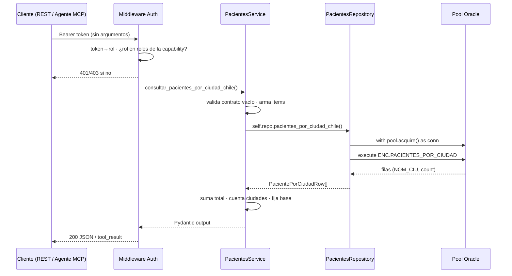

# Capacidad: `consultar_pacientes_por_ciudad_chile`

> Ficha de la **primera capability del bloque Pacientes**. Viene de una fuente distinta al Control Contable: la sección `## Cantidad de pacientes por ciudad` de `docs/go/encuentros.md`. Es una consulta sin filtros y sin `fecha`, así que rompe el patrón del bloque contable en dos puntos: el schema de entrada es vacío y el resultado es un censo, no un corte del día.

---

## 1. Identidad del contrato

```yaml
id: pacientes.pacientes_por_ciudad_chile
version: 1
name: consultar_pacientes_por_ciudad_chile
operation:
  mode: READ
```

## 2. Propósito

```text
Devuelve la cantidad de pacientes con al menos una dirección vigente, agrupada por
ciudad de Chile y ordenada de mayor a menor. Úsala cuando pregunten cómo se reparte
la cartera de pacientes entre ciudades, en qué ciudad se concentran o qué ciudades
tienen más pacientes.
```

### `usage_notes` (contrato en prosa — cuándo NO usarla)

- **NO** usar para contar pacientes **activos**: la consulta no filtra por `PAC_IND_ESTADO`. Cuenta fichas dadas de alta, inactivas y temporales que tengan dirección vigente. Si el negocio necesita "pacientes activos", es otra consulta con otro nombre.
- **NO** usar para el detalle de una ciudad concreta, una comuna o un rango de fechas: no acepta filtros.
- **NO** usar para datos clínicos, económicos o de contacto de los pacientes: el payload es un conteo agregado.
- Los nombres de ciudad salen del maestro y vienen recortados (`SAN JOSE DE MA` es San José de Maipo). La capa no los corrige.
- Los pacientes sin dirección vigente **no aparecen** y tampoco suman al total.

---

## 3. Proyección al protocolo MCP

```yaml
mcp:
  enabled: true
  tool: consultar_pacientes_por_ciudad_chile   # sin sufijo de versión (R10)
  annotations:                                # derivadas de operation.mode (R17)
    readOnlyHint: true
    destructiveHint: false
    idempotentHint: true
    openWorldHint: false
```

| Input (MCP) | Tipo | Obligatorio |
| --- | --- | --- |
| _(ninguno)_ | — | — |

El schema MCP se publica **vacío** (`properties: {}`, sin `required`). Es parte del contrato: una capacidad con filtro prometería un parámetro que la consulta no usa. El guard de `test_input_schema_de_las_sin_argumentos_esta_vacio` falla si alguien agrega una propiedad.

| Output (MCP) | Tipo | Descripción |
| --- | --- | --- |
| `items` | `array` | Filas `{ciudad, cantidad_pacientes}` |
| `total_pacientes` | `number` | Suma de las cantidades por ciudad, calculada en la capa |
| `cantidad_ciudades` | `number` | Cuántas ciudades tienen al menos un paciente |
| `base` | `string` | Literal `pacientes_con_direccion_vigente` |
| `incluye_pacientes_no_activos` | `boolean` | Siempre `true`, para que el agente no lo infiera |

Los dos últimos campos son deliberados: son la semántica hecha dato. Sin ellos, un agente que solo mira `items` puede leer "pacientes" como "pacientes activos" y reportar 2.307 pacientes activos cuando el número real de fichas activas es 340.

Si no hay ningún paciente con dirección vigente → `NO_DATA`. Si Oracle no responde → `UNAVAILABLE`.

---

## 4. Proyección al protocolo REST

```text
GET /api/pacientes/pacientes-por-ciudad-chile
Authorization: Bearer <token>
```

Sin query params: el router no declara ninguno, así que `?fecha=...` se ignora en silencio. Es el precio de no tener filtros.

| Código | Caso | Cuerpo |
| --- | --- | --- |
| `200` | OK | `{items[], total_pacientes, cantidad_ciudades, base}` |
| `401` | Bearer ausente/inválido | `UNAUTHORIZED` |
| `403` | Token válido pero rol sin permiso | `FORBIDDEN` (sin detalle) |
| `404` | Ningún paciente con dirección vigente | `NO_DATA` |
| `503` | Pool agotado / Oracle caído | `UNAVAILABLE` |

No hay `400`: sin argumentos no hay nada que validar.

---

## 5. Modo de ejecución (flujo de la llamada)



Reglas de esta capa:

- **La autorización ocurre antes** de ejecutar (V2 R8). El rol `contador` está explícitamente fuera: no es un trabajo contable.
- **El SQL vive solo en el Repository**; el service no sabe qué tabla ni qué columna existen.
- **El adapter MCP no implementa lógica**: delega en el service (V2 R5, R6).
- **La capa no reordena.** El `order by` del SQL ya es un orden total (cantidad desc, nombre asc, y el nombre es único dentro del grupo). Un segundo `sorted()` en Python dejaría el contrato dependiendo del `NLS_SORT` de Oracle en vez del texto original.

---

## 6. Query incluida en el servicio

Fuente: `docs/go/encuentros.md`, sección `## Cantidad de pacientes por ciudad`. Id de registry: `oracle_sql_id: ENC.PACIENTES_POR_CIUDAD`.

```sql
select ci.NOM_CIU ciudad,
       count(distinct p.PAC_CODIGO) cantidad_pacientes
from DENT.PACIENTES p
join DENT.DIRECCIONES d on d.COD_PERSONA = p.PAC_CODIGO
join DENT.CIUDADES ci on ci.COD_CIU = d.COD_CIUDAD
where d.IND_ESTADO = 'VIG'
group by ci.NOM_CIU
order by cantidad_pacientes desc, ci.NOM_CIU
```

No lleva parámetros, así que el repository no concatena nada ni declara binds.

### 6.1 Decisiones del texto original que se replican tal cual

| # | Decisión | Por qué importa |
| --- | --- | --- |
| h1 | **No** filtra `p.PAC_IND_ESTADO` | El resultado mezcla `ALT` (2.041), `ACT` (340), `TMP`, `RTR`, `TER`, `INA`, `BLQ`. No es "pacientes activos" |
| h2 | Solo `d.IND_ESTADO = 'VIG'` | Un paciente con varias direcciones cuenta una vez por ciudad gracias al `count(distinct)` |
| h3 | Inner joins | Quien no tiene dirección vigente, o cuya ciudad no está en el maestro, desaparece del censo |
| h4 | Agrupa por `NOM_CIU`, no por `COD_CIU` | Dos códigos con el mismo nombre se fusionarían. En QA no hay nombres duplicados (verificado) |
| h5 | Sin umbral mínimo | El legacy cercano (`rptPacientesActivos.jsp:112-114`) usaba `HAVING COUNT(1) >= 50`; esta consulta **no** trae ese filtro y hay 35 ciudades con 1 paciente |

### 6.2 Diferencia deliberada vs el legacy más cercano

`WebContent/dent/graph/rptPacientesActivos.jsp:112-114` es el reporte más parecido que existe, y **no** es la fuente:

| Aspecto | `rptPacientesActivos.jsp` | Esta capacidad |
| --- | --- | --- |
| Filtro de paciente | Solo `ACT` | Ninguno |
| Agrupación | Comuna + población | Ciudad (`NOM_CIU`) |
| Contador | `COUNT(1)` sobre filas de unión | `COUNT(DISTINCT PAC_CODIGO)` |
| Umbral | `HAVING COUNT(1) >= 50` | Ninguno |

Se implementa la consulta de `encuentros.md`, no el JSP. La diferencia importa: agregar el filtro de estado o el `HAVING` "corregiría" la capacidad hacia un alcance que el texto no pide.

---

## 7. Reglas de negocio

```yaml
business_rules:
  - sin_parametros            # la consulta es un censo; no hay fecha ni filtros
  - sin_filtro_de_estado      # no se agrega PAC_IND_ESTADO (h1)
  - solo_direcciones_vigentes # d.IND_ESTADO = 'VIG' (h2)
  - conteo_distinto_por_ciudad
  - agrupar_por_nombre_de_ciudad   # NOM_CIU, no COD_CIU (h4)
  - sin_umbral_minimo              # no se replica el HAVING >= 50 del JSP (h5)
  - orden_del_sql_es_orden_total
```

---

## 8. Contrato Pydantic

```python
class ConsultarPacientesPorCiudadChileInput(BaseModel):
    model_config = ConfigDict(extra="forbid")   # contrato vacío

class PacientePorCiudadItem(BaseModel):
    ciudad: str
    cantidad_pacientes: int

class ConsultarPacientesPorCiudadChileOutput(BaseModel):
    items: list[PacientePorCiudadItem]
    total_pacientes: int
    cantidad_ciudades: int
    base: Literal["pacientes_con_direccion_vigente"]
```

El input existe aunque esté vacío: el schema MCP sale de la firma de la tool, y el modelo fija que cualquier argumento futuro es un error explícito y no un parámetro ignorado en silencio.

`total_pacientes` **puede** superar la cantidad de pacientes distintos si alguno tuviera direcciones vigentes en dos ciudades. En QA no ocurre (el total por ciudad es igual al `count(distinct)` global), pero la aritmética lo permite y está documentada en el campo.

---

## 9. Datos y gobernanza

```yaml
data:
  profile: operational        # NO financial_pii: no hay montos ni datos de una persona
  sources:
    oracle:
      - PACIENTES (DENT)
      - DIRECCIONES (DENT)
      - CIUDADES (DENT)
  classification: confidential
  pii: false                  # salida agregada; ningún identificador de paciente
  clinical_data: false
  ai_allowed: yes
  allowed_fields:
    - ciudad
    - cantidad_pacientes
    - total_pacientes
    - cantidad_ciudades
  forbidden_fields:
    - pac_codigo
    - pac_rut
    - cod_persona
    - nom_ciu_codigo   # el nombre sí viaja; el código nunca
    - direccion        # calle, número, departamento
    - telefono
    - email
```

El conteo agregado por ciudad es un dato de tamaño de cartera, no de una persona. Aun así hay 35 ciudades con 1 solo paciente: un consumidor no autorizado podría cruzar la rareza de un valor con la ficha de ese paciente. Mitigación aplicada: la capability no expone identificadores, no acepta filtros que permitan acotar a una persona y excluye el rol `contador`. Si el negocio pidiera el detalle, sería otra capacidad con revisión de gobernanza aparte.

---

## 10. Seguridad

```yaml
security:
  classification: internal
  access: read
  roles:
    - analista_financiero
    - gerente_finanzi
    - ai_agent
```

- El token `contador` queda **fuera** a propósito: la distribución geográfica de la cartera no es trabajo contable. Decisión del dueño de la capability; si se revierte, el cambio es una línea en el registry y una prueba.
- No hay token ni rol nuevo: los tres ya existen en `.env`.
- Autorización antes de ejecutar; `403 FORBIDDEN` sin detalle.

---

## 11. Errores (`content` MCP / códigos REST)

| Error | `error_code` | HTTP | Mensaje |
| --- | --- | --- | --- |
| `NotFoundError` | `NO_DATA` | `404` | "No hay pacientes con dirección vigente en ninguna ciudad. Resultado válido, no es un fallo." |
| `InfrastructureError` | `UNAVAILABLE` | `503` | "No pude consultar los datos (¿Oracle o pool agotado?). Reintenta; si persiste, escala a TI." |
| `AuthorizationError` | `FORBIDDEN` | `403` | Sin detalle de la regla. |

`NO_DATA` distingue "cero pacientes" de "no pude consultar". Un pool caído nunca se traduce en un censo vacío.

---

## 12. Observabilidad

```yaml
observability:
  level: tech + ai
  metadata:
    tool: consultar_pacientes_por_ciudad_chile
    args: {}                                  # sin datos de entrada que registrar
    result: { status, records, duration_ms }
```

El `result` lleva conteos, nunca la lista de ciudades.

---

## 13. Paridad (Nivel 0) — criterio de aceptación

A diferencia del bloque contable, **no se fijan números**: un censo de cartera cambia con cada paciente que se registra, y una prueba con números fijos se rompería sin que nadie haya tocado el código.

Lo que se verifica en `tests/test_paridad_oracle.py`:

- La salida del service **iguala, fila por fila**, el mismo SQL corrido a mano sobre QA (`SQL_PACIENTES_REFERENCIA`).
- REST devuelve lo mismo que el service.
- `total_pacientes` es la suma de las filas y `cantidad_ciudades` es la cantidad de filas.
- El orden es `(-cantidad, ciudad)` ascendente.
- El total incluye estados no activos: el desglose por `PAC_IND_ESTADO` suma el total, y `ACT` es una fracción menor.

Si una de estas falla, el desvío es de la capa. Si el dato cambió, el censo cambió y no hay nada que arreglar.

Referencia del estado en QA al momento de escribir la ficha (2026-10-05, no es un golden file):

| Métrica | Valor |
| --- | --- |
| Ciudades con pacientes | 69 |
| Pacientes con dirección vigente | 2.530 |
| Santiago | 2.307 |
| Peñaflor | 26 |
| Buin | 16 |
| Ciudades con 1 paciente | 35 |
| Fichas totales en `PACIENTES` | 505.304 |
| Fichas **sin** dirección vigente | 502.774 |

Esa última fila es la advertencia más importante de esta ficha: el censo cubre 2.530 de 505.304 fichas. El 99,5% restante no tiene ninguna dirección vigente y por lo tanto no aparece en ninguna ciudad. Un "total de pacientes" leído como 2.530 es un error de interpretación fácil de cometer.

---

## 14. Ejemplos

### 14.1 Entrada

```text
(sin argumentos)
```

### 14.2 Salida (REST 200, recortada)

```json
{
  "items": [
    { "ciudad": "SANTIAGO", "cantidad_pacientes": 2307 },
    { "ciudad": "PENAFLOR", "cantidad_pacientes": 26 },
    { "ciudad": "BUIN", "cantidad_pacientes": 16 },
    { "ciudad": "PAINE", "cantidad_pacientes": 13 }
  ],
  "total_pacientes": 2530,
  "cantidad_ciudades": 69,
  "base": "pacientes_con_direccion_vigente"
}
```

La tool MCP devuelve lo mismo más `"incluye_pacientes_no_activos": true`.

---

## 15. Trazabilidad técnica

| Ítem | Referencia |
| --- | --- |
| Fuente normativa | `docs/go/encuentros.md` §`## Cantidad de pacientes por ciudad` |
| Legacy cercano (no es la fuente) | `WebContent/dent/graph/rptPacientesActivos.jsp:112-114` |
| Id de query (registry) | `oracle_sql_id: ENC.PACIENTES_POR_CIUDAD` |
| Archivos | `application/pacientes/{models,ports,service}.py`, `infrastructure/oracle/pacientes_repository.py`, `adapters/rest/pacientes.py`, `adapters/mcp/pacientes.py`, `composition.py`, `app.py` |
| Instancia MCP compartida | `adapters/mcp/server.py` — la tool de pacientes se registra sobre el mismo `FastMCP` que las 6 contables |
| Tests | `test_service_pacientes.py` (9), `test_paridad_oracle.py` (5), guardas SQL en `test_repository_sql.py`, casos de auth en `test_contracts.py` |

---

## 16. Referencias

- `../000_MiEstrategiaV2.md` — §8.1 (catálogo), §11 (estructura), §12 (Nivel 0), §19 (no-innovación).
- `../../../docs/go/encuentros.md` — la consulta (sección `## Cantidad de pacientes por ciudad`).
- `../CATALOGO.md` — índice de las 7 capabilities.
- `../arquitectura.md` — pool Oracle, Bearer, composición, un proceso dos protocolos.
