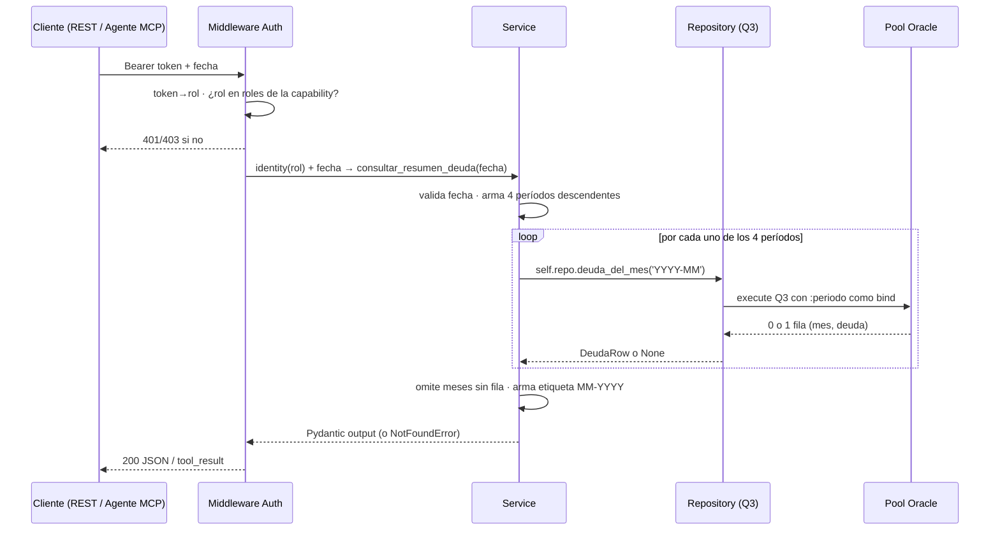

# Capacidad: `consultar_resumen_deuda` (Q3)

> Ficha de implementación de la **#1 de 6 del bloque Control Contable** (§8.1 de V2). Reproduce la tabla **"Deuda promedio"** del correo `Resumen Control (Contable)`. Es la única capability del bloque que **no** parte de `BOLETA`: lee `DENT.bat_deuda` y **arma el período en el service**, no en el SQL.

---

## 1. Identidad del contrato

```yaml
id: contabilidad.resumen_deuda
version: 1
name: consultar_resumen_deuda
operation:
  mode: READ
```

## 2. Propósito

```text
Devuelve la deuda promedio mensual de los últimos 4 meses contando desde el mes de
fecha (incluido), reproduciendo la tabla "Deuda promedio" del correo de control
contable. Úsala cuando pregunten cómo viene la deuda o cuál fue el promedio de
deuda de un mes.
```

### `usage_notes` (contrato en prosa — cuándo NO usarla)

- El valor es el **PROMEDIO DIARIO** de deuda del mes (`round(avg(...), 0)`), **NO el saldo de cierre**: no lo interpretes como saldo final ni como "deuda acumulada".
- Los meses **sin registros se omiten** del resultado (pueden venir menos de 4 ítems); solo si los 4 meses están vacíos se responde `NO_DATA`.
- `fecha` es **obligatoria** y solo se usan su **año y mes**.
- **NO** usar para el detalle de cobranza del día → `consultar_ingresos_por_tipo_pago`.
- **NO** usar para comparar meses ni calcular variaciones → eso es una tool ANALYZE (bloque KPI, fuera de la milla cero).

---

## 3. Proyección al protocolo MCP

```yaml
mcp:
  enabled: true
  tool: consultar_resumen_deuda      # sin sufijo de versión (R10)
  annotations:                       # derivadas de operation.mode (R17) — NO escribir a mano
    readOnlyHint: true
    destructiveHint: false
    idempotentHint: true
    openWorldHint: false
```

| Input (MCP) | Tipo | Obligatorio |
| --- | --- | --- |
| `fecha` | `string` `YYYY-MM-DD` | sí |

| Output (MCP) | Tipo | Descripción |
| --- | --- | --- |
| `fecha` | `string` | Fecha consultada |
| `meses_consultados` | `number` | Períodos pedidos a Oracle: 4 (fijo del legacy) |
| `items` | `array` | Filas `{mes, periodo, deuda}` |
| `deuda_es_promedio_diario` | `boolean` | Siempre `true`: evita que el agente lo lea como saldo |

Mensaje de éxito: devuelve `items` + `meses_consultados`. Si los 4 meses están vacíos → `NO_DATA`. Si Oracle o `DENT.bat_deuda` no responde → `UNAVAILABLE`.

---

## 4. Proyección al protocolo REST

```text
GET /api/contabilidad/resumen-deuda?fecha=YYYY-MM-DD
Authorization: Bearer <token>
```

| Código | Caso | Cuerpo |
| --- | --- | --- |
| `200` | OK | `{fecha, meses_consultados, items[]}` |
| `400` | `fecha` ausente/mal formada | `INVALID_ARGUMENT` |
| `404` | Los 4 meses sin registros | `NO_DATA` |
| `401` | Bearer ausente/inválido | error de autenticación |
| `403` | Token válido pero rol sin permiso | `FORBIDDEN` (sin detalle) |
| `503` | Pool agotado / Oracle caído | `UNAVAILABLE` |

---

## 5. Modo de ejecución (flujo de la llamada)



Reglas de esta capa:
- **El período lo arma el service, no el SQL.** El legacy concatenaba el período dentro del `WHERE`; la capa calcula `YYYY-MM` en Python y lo manda como bind. Se conservan los **4 viajes a Oracle** del legacy en vez de colapsar a un `RANGE` (decisión V2 §0.3).
- **Un mes sin filas no se completa con cero**: se omite. Un `0` sería un dato falso.
- **El SQL vive solo en el Repository**; el service no ve `bat_deuda`.
- **La autorización ocurre antes** de ejecutar la capability (V2 R8).

---

## 6. Query incluida en el servicio (Q3 — validada contra el fuente)

Método legacy: `ResumenControl.setTablaDeuda()` — `ResumenControl.java:265-309`.

```sql
select to_char(bat_fecha,'MM') mes, round(avg(bat_deuda),0) deuda
from DENT.bat_deuda
where to_char(bat_fecha,'YYYY-MM') = :periodo
group by to_char(bat_fecha,'MM')
```

### 6.1 Diferencias deliberadas vs el fuente (semántica idéntica)

| Aspecto | Legacy (Java) | Capa nueva | Tipo de cambio |
| --- | --- | --- | --- |
| Filtro de período | `"to_char(to_date('"+fechaCns+"','YYYY-MM-dd'),'YYYY-MM')"`, 4 veces concatenado | **Bind** `:periodo` (`YYYY-MM`) | Seguridad; misma semántica |
| Iteración | `for (i = 1; i <= 4; i++)` en el service Java, con rollback de mes | `for _ in range(4)` en el service Python, `_periodo_anterior()` | Se replica el loop y el salto de año |
| Saltar de diciembre a enero | `if (mes == 0) { mes = 12; agno--; }` | `if mes == 1: return f"{anio-1}-12"` | Equivalente (`01` → `12` del año previo) |
| `bat_deuda` sin owner | Owner por defecto de la sesión | **`DENT.bat_deuda`** explícito | V2 §19 h6 |
| Lectura del monto | `rs1.getDouble("deuda")` → `DecimalFormat.format()` | `Decimal` crudo de `round(avg(...),0)` | Se conserva el valor completo para paridad |
| Etiqueta de la fila | `mes+"-"+agno` en Java | `mes` + `periodo` en el service, con `periodo` normalizado | Aditivo: el agente no parsea `"09-2017"` |

> **Regla de no-innovación:** no se cambia `round(avg(bat_deuda),0)` a `sum`, ni `bat_deuda` a otra tabla, ni el número de períodos. Las dos únicas diferencias son la **parametrización segura** del período y la **fijación de owner**, ambas documentadas en V2 §19.

---

## 7. Reglas de negocio

```yaml
business_rules:
  - fecha_obligatoria                 # ValidationError si falta o no es YYYY-MM-DD
  - solo_ano_y_mes_de_fecha          # el día no influye en el resultado
  - periodos_fijos: 4                # MESES_CONSULTADOS, constante del legacy
  - orden_descendente                # del mes de fecha hacia atrás
  - promedio_no_saldo                # round(avg(bat_deuda),0)
  - omitir_meses_sin_filas           # nunca 0 sintético
  - fila_por_periodo                 # la query agrupa por MM, por eso 0 o 1 fila
```

### 7.1 Semántica de `mes` vs `periodo`

| Campo | Formato | Origen | Para qué |
| --- | --- | --- | --- |
| `mes` | `MM-YYYY` (ej. `09-2017`) | `row.mes` + año del período | Paridad directa con la etiqueta del correo |
| `periodo` | `YYYY-MM` (ej. `2017-09`) | Calculado en el service | Evita que el agente parsee la etiqueta |

`deuda` es siempre el **promedio diario** del mes, no el saldo de cierre.

---

## 8. Contrato Pydantic

```python
class ConsultarResumenDeudaInput(BaseModel):
    fecha: date   # obligatoria

class ResumenDeudaItem(BaseModel):
    mes: str          # etiqueta del correo, MM-YYYY
    periodo: str      # YYYY-MM normalizado
    deuda: Decimal    # promedio diario, NO saldo de cierre

class ConsultarResumenDeudaOutput(BaseModel):
    fecha: date
    meses_consultados: int              # siempre 4
    items: list[ResumenDeudaItem]       # meses con datos, sin los vacíos
```

---

## 9. Datos y gobernanza

```yaml
data:
  profile: financial
  sources:
    oracle:
      - BAT_DEUDA (DENT)
  classification: confidential
  pii: false            # deuda agregada por mes, sin personas
  clinical_data: false
  ai_allowed: yes
  allowed_fields:
    - mes
    - periodo
    - deuda
    - fecha
  forbidden_fields:
    - rut
    - diagnostico
    - ficha_clinica
    - bat_deuda          # nombre de tabla; no se expone al contrato
```

---

## 10. Seguridad

```yaml
security:
  classification: internal
  access: read
  roles:
    - contador
    - analista_financiero
    - gerente_finanzas
    - ai_agent
```

Los roles salen del Capability Registry (`application/registry.py`), no de una lista local en el adapter. Autorización antes de ejecutar (middleware único). `403 FORBIDDEN` sin detalle.

---

## 11. Errores (`content` MCP / códigos REST)

| Error | `error_code` | HTTP | Mensaje (accionable, sin traceback) |
| --- | --- | --- | --- |
| `ValidationError` | `INVALID_ARGUMENT` | `400` | "fecha es obligatoria y debe ser YYYY-MM-DD." |
| `NotFoundError` | `NO_DATA` | `404` | "Sin registros de deuda para {mes} ni los 3 meses previos. Resultado válido, no es un fallo." |
| `InfrastructureError` | `UNAVAILABLE` | `503` | "No pude consultar los datos. Reintenta; si persiste, escala a TI." |
| `AuthorizationError` | `FORBIDDEN` | `403` | Sin detalle de la regla. |

- **NO_DATA ≠ UNAVAILABLE** (V2 R18): los 4 meses vacíos son un resultado válido; una tabla caída es `UNAVAILABLE`.
- En MCP todos los errores se devuelven `isError: true` con el mensaje en el `content`; nunca traceback.

---

## 12. Observabilidad

```yaml
observability:
  level: tech + ai
  metadata:
    tool: consultar_resumen_deuda
    args: { fecha: ... }
    result: { status, records, meses_consultados, duration_ms }
```

Sin guardar el payload completo (V2 §6.3 — minimización de datos `financial`).

---

## 13. Paridad (Nivel 0) — criterio de aceptación

- `fecha` explícita en el test (nunca vacía — V2 §12).
- Para una fecha dada, los **valores numéricos** de `items[]` deben igualar el cuadro **"Deuda promedio"** del correo real del legacy, mes a mes y en el mismo orden.
- Si un mes no aparece en el correo, tampoco aparece acá.
- Si el mes consultado tiene datos pero los 3 previos no, la respuesta tiene **1 ítem** y `meses_consultados: 4` (no es `NO_DATA`).
- Si los 4 están vacíos → `NO_DATA`.
- Si `DENT.bat_deuda` cae → `UNAVAILABLE`, nunca "cero".

### Verificación ejecutada (2026-10-02, Oracle QA)

`tests/test_paridad_oracle.py::test_q3_paridad_2017_12` — `fecha = 2017-12-15`:

| `mes` | `periodo` | `deuda` |
| --- | --- | --- |
| `12-2017` | `2017-12` | `900601075` |
| `11-2017` | `2017-11` | `896653783` |
| `10-2017` | `2017-10` | `891873367` |
| `09-2017` | `2017-09` | `896509697` |

> **Alcance del dato:** `DENT.bat_deuda` termina en **2023-03-30** (1820 filas desde 2011-01). Cualquier fecha de hoy devuelve `NO_DATA`. Es el comportamiento correcto, no un desvío: `test_q3_sin_datos_recientes_es_nodata` lo fija.

---

## 14. Ejemplos

### 14.1 Entrada

```text
fecha = "2017-12-15"
```

### 14.2 Salida (REST 200)

```json
{
  "fecha": "2017-12-15",
  "meses_consultados": 4,
  "items": [
    { "mes": "12-2017", "periodo": "2017-12", "deuda": "900601075" },
    { "mes": "11-2017", "periodo": "2017-11", "deuda": "896653783" },
    { "mes": "10-2017", "periodo": "2017-10", "deuda": "891873367" },
    { "mes": "09-2017", "periodo": "2017-09", "deuda": "896509697" }
  ]
}
```

### 14.3 Salida con meses faltantes

```text
fecha = "2018-02-10"   # feb-2018 sin datos, ene-2018 con datos
```

```json
{
  "fecha": "2018-02-10",
  "meses_consultados": 4,
  "items": [
    { "mes": "01-2018", "periodo": "2018-01", "deuda": "1095007885" }
  ]
}
```

> Un mes sin datos se **omite**; no aparece con `deuda: 0`.

---

## 15. Modo de ejecución de la capability (resumen operativo)

- **Invocation:** agente MCP llama `consultar_resumen_deuda(fecha)`, o cliente REST `GET /api/contabilidad/resumen-deuda?fecha=...`.
- **Conectividad:** 4 adquisiciones del pool (una por período), liberadas al terminar cada query.
- **Costo:** 4 agregaciones de una tabla de 1820 filas; sin cache (V2 R11); límite blando `max_calls_per_session: 10` (V2 R19).
- **Auditabilidad:** cada invocación queda con su `request_id`, `duration_ms` y métrica `records`/`meses_consultados`.

---

## 16. Trazabilidad técnica

| Ítem | Referencia |
| --- | --- |
| Método legacy | `ResumenControl.setTablaDeuda()` |
| Líneas fuente | `ResumenControl.java:265-309` |
| Documentación legacy | `helper.md` → `ResumenControl.setTablaDeuda.md` |
| Id de query (registry) | `oracle_sql_id: Q3` |
| Constant de negocio | `MESES_CONSULTADOS = 4` en `application/contabilidad/service.py` |
| Test de paridad | `tests/test_paridad_oracle.py::test_q3_paridad_2017_12` |
| Guardas de SQL | `tests/test_repository_sql.py` → `test_q3_*` |

---

## 17. Fuentes / referencias

- `000_MiEstrategiaV2.md`: §8.1 (catálogo, fila 1), §9.3 (ficha YAML), §11 (estructura), §12 (Nivel 0), §14.3 (orden), §19 (hallazgos h1, h2, h6).
- `ResumenControl.java:265-309` (fuente real de Q3).
- `encuentros.md` §2.3 (Contable).
- `arquitectura.md` (pool, Bearer, `.env`, puerto).
- `../CATALOGO.md` (índice de las 7 capabilities).