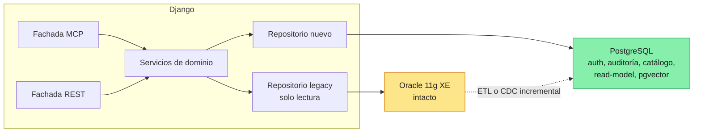
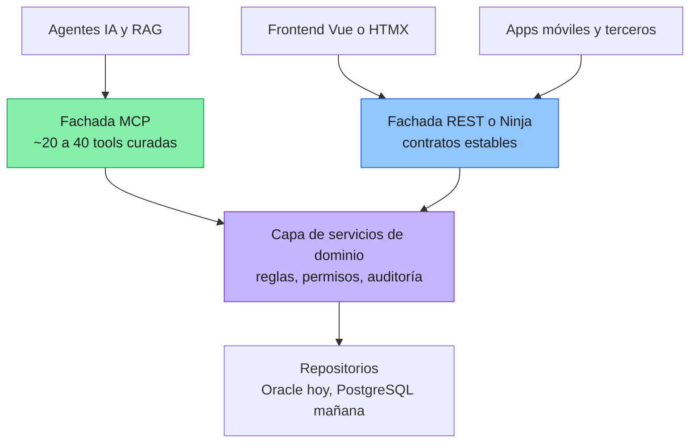
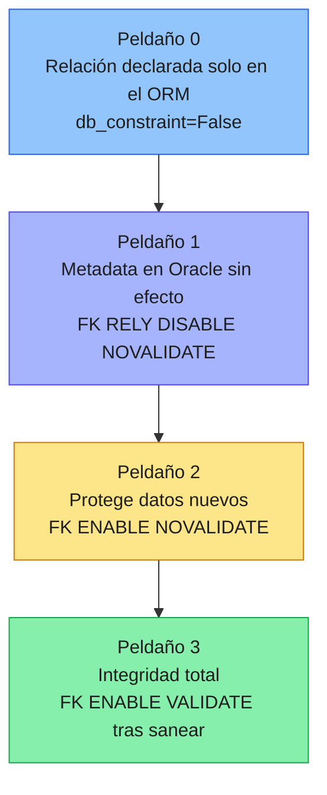
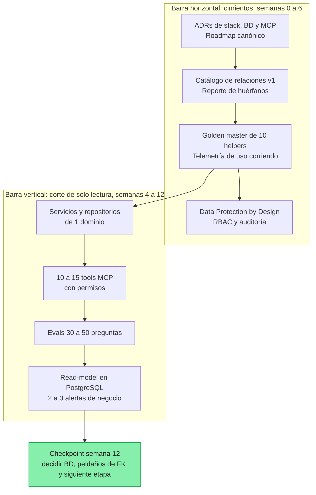

# DREAMS Explorer — COMPENDIO IA-ALL (Fusión de los 8 Análisis)

> **Fusión de:** `dreams_explorerResponseDSeek.md` · `dreams_explorerResponseGPT.md` · `dreams_explorerResponseGemini.md` · `dreams_explorerResponseGrok.md` · `dreams_explorerResponseKIMI3.md` · `dreams_explorerResponseMimo.md` · `dreams_explorerResponseBigPickle.md` · `dreams_explorerResponseCLAUDE.md`
> **Documento base analizado por todos:** `dreams_explorer.md` (DREAMS_02 · Agosto 2026) — DentWeb12, Java 21 / Payara 7 / JSP / Oracle 11g XE
> **Propósito:** este documento **NO es un resumen**. Es la fusión completa de las 8 respuestas de IA: contiene todas las ideas, todos los formatos (tablas, diagramas, código) y todas las perspectivas, organizadas por tema. Complementa a cada archivo individual y sirve como fuente única de consulta.
> **Convención de atribución:** cada idea lleva etiqueta `[fuente]` (DSeek · GPT · Gemini · Grok · KIMI3 · Mimo · BigPickle · CLAUDE). Cuando todas coinciden se marca `[Todos]`.
> **Versión 2 (revisada):** incorpora `dreams_explorerResponseCLAUDE.md`, que había quedado fuera en la primera fusión. Incluye un aviso de "fuentes verificadas" de CLAUDE. *(Si un tema figura sin atribución en algún párrafo heredado de la v1, prevalece la fuente etiquetada; el material de CLAUDE es nuevo y lleva su etiqueta.)*

---

## 0. Cómo leer este compendio

| Si quieres… | Ve a la sección |
|---|---|
| Veredicto rápido y acentos de cada IA | §1 y §2 |
| Las fortalezas del documento madre | §3 |
| "¿Dónde empiezo?" (la pregunta central) | §4 |
| Inclinación **Django** bajo la lupa | §5 |
| Inclinación **MCP / JSON-RPC** bajo la lupa | §6 |
| Estrategia **Oracle sin FK + ORM** | §7 |
| La **brecha ideal vs real** | §8 |
| **Caminos / estrategias de inicio** | §9 |
| **Frameworks de ejecución** (capability, ADR, ledgers…) | §10 |
| **Arquitectura consolidada** | §11 |
| **Riesgos** que el documento subestima | §12 |
| **Plan de 30/90 días** consolidado | §13 |
| **Preguntas abiertas** que el documento debe responder | §14 |
| **Frases de trabajo** | §15 |
| **Checklist de lo que falta agregar** al documento madre | §16 |
| Los **diagramas clave** que no debes perder | §17 |
| **Spikes de 2 días** para decidir la BD con evidencia | §9.10 |
| **Coexistencia y sesión compartida** | §10.13 |

---

# PARTE A — EVALUACIÓN DEL DOCUMENTO

## 1. Veredicto general (unanimidad)

> **Todas las IAs coinciden: vas por muy buen camino. El documento DREAMS_02 es excepcional, está por encima del estándar de la industria, y el reencuadre de los pasos 30–39 es su corazón.** **[Todos]**

Frases representativas:

- *"Pocas veces se ve un análisis tan maduro de un sistema legacy."* **[DSeek]**
- *"No es simplemente un assessment técnico. Está evolucionando hacia una estrategia de transformación."* **[GPT]**
- *"Tu documento tiene una calidad estratégica excepcional para estar en la fase de definición. 1933 líneas de estrategia antes de escribir código es una ventaja competitiva enorme, no una demora."* **[Mimo]**
- *"El documento está en el ~75–80% de lo que una estrategia de modernización seria necesita, y en algunos aspectos está por encima del estándar."* **[KIMI3]**
- *"Estás en un camino mejor que el de la mayoría de los proyectos de modernización de sistemas legacy."* **[Grok]**
- *"El documento ya cumplió su función. Te falta cerrar decisiones y ejecutar un piloto."* **[BigPickle]**
- *"¿Vas por buen camino? Sí, y bastante más adelantado que la mayoría de proyectos legacy. Tienes lo más difícil de conseguir: un diagnóstico honesto, un inventario con código incrustado (689 archivos RICH), un reencuadre estratégico potente y principios sanos."* **[CLAUDE]**

**Matiz común:** el documento es fuerte en el **qué** y el **por qué**; más débil en el **cómo concreto** y en **qué pasa si falla**. Es un documento de *exploración* que necesita convertirse en un documento de *decisión y ejecución*. **[DSeek, GPT, Grok, KIMI3, BigPickle, CLAUDE]**

### 1.1 Nota / acento de cada IA (para complementar cada archivo)

| IA | Acento distintivo único |
|---|---|
| **DSeek** | 7 caminos de inicio + análisis del antipatrón "REST→MCP" + estrategias para lidiar con 239 tools (agrupación por dominio, Resources vs Tools, estimación real de tools) + 25 preguntas abiertas |
| **GPT** | Paradigma "Capability First" + vertical slice + separar 5 decisiones + 4 taxonomías (niveles 0-3) + ADR + Capability Map + Rule Catalog + Transformation Ledger + Source of Truth Stack + Definition of Done por capability |
| **Gemini** | Implementación práctica de código (pool `db.py` + servidor JSON-RPC 2.0 con FastAPI) + tabla de brecha "positiva" |
| **Grok** | Arquitectura de capas Django+MCP+Oracle + Opción D híbrida (A+B) + criterio MCP vs REST + 4 condiciones para mantener Oracle |
| **KIMI3** | **El descubrimiento técnico clave: Django moderno ↔ Oracle 11g XE son incompatibles** (soporte oficial 12.1+ / thin mode 12.1+) + Salida 2: "PostgreSQL entra por el lado del nuevo desarrollo" + checklist de 12 items accionables + ruta 0-90 días con gates |
| **Mimo** | **El blanco más grande: falta el dominio de negocio** (cero ejemplos del dominio dental) + flujos e2e + escala 0-100 de preparación (~47/100) + patrón "Logical Domain over Physical Chaos" |
| **BigPickle** | Decisiones ocultas no cubiertas (procedures/triggers y write-path) + "gemelo analítico" PostgreSQL + selective re-platform + DentWeb Copilot + schema-as-code + odontograma decide el frontend |
| **CLAUDE** | **Coexistencia y seguridad en primer plano** (un solo escritor por tabla, sesión/auth compartida, Ley 21.719 con vigencia 1-dic-2026) + la **escalera de formalización de FKs (peldaños 0-3)** + el **catálogo de relaciones como fuente única de verdad** + **camino en T a 90 días** + **7 spikes de 2 días** + MCP *stateless* (spec 2026-07-28) + evals como "characterization de la capa de IA" + auditoría por muestreo del dossier |

**Veredicto en 60 segundos de CLAUDE (lo que tienes y lo que falta, por propósito):**

| Para qué | ¿Estás listo? | Comentario (CLAUDE) |
|---|---|---|
| Empezar **experimentos** (spikes, un corte vertical, un MCP de solo lectura) | **Sí, ya** | No necesitas más análisis para arrancar. |
| **Decidir** stack y orden con evidencia | **~70 %** | Faltan 3–4 experimentos baratos (los spikes S1–S7). |
| **Ejecutar con seguridad** una migración real | **~40–45 %** | Faltan coexistencia, seguridad/privacidad, operación y equipo. |
| **Financiar / vender** al CEO | **~60 %** | El argumento está, faltan baselines y KPIs medibles. |

---

## 2. Evaluación dimensional del documento madre

### 2.1 Vista consolidada (DSeek + KIMI3 + Mimo + GPT + CLAUDE combinadas)

| Dimensión | Evaluación | Fuente |
|-----------|-----------|--------|
| Claridad de problema (3 problemas A/B/C) | Muy avanzada / Excelente | DSeek, KIMI3, GPT, CLAUDE |
| Diagnóstico técnico | Excelente / Muy avanzado | DSeek, GPT |
| Reencuadre estratégico (pasos 30-39) | Excelente / el mayor acierto | Todos |
| Metodología (gates, una dimensión por vez) | Muy buena | DSeek, KIMI3, CLAUDE |
| Characterization testing / shadow mode | Correcto, falta instrumento | KIMI3, Mimo, CLAUDE |
| Rigor en estimaciones | Media (el doc lo reconoce) | DSeek |
| Concreción de ejecución ("semana 1, día 1") | Media | DSeek |
| Manejo de riesgos / plan de contingencia | Media | DSeek, KIMI3 |
| Alineación con stakeholders / CEO | Media - buena narrativa, faltan números | DSeek, KIMI3, CLAUDE |
| Sostenibilidad del equipo | Baja - no se define quién ejecuta | DSeek, Mimo |
| Modelo de costos | Baja - sin números | DSeek, KIMI3 |
| Dominio de negocio (dental) | **Muy baja (~20/100)** - el blanco más grande | Mimo |
| Modelo de datos simplificado (ER) | Media (~40/100) | Mimo |
| Seguridad / legislación salud | Baja (~10/100) - prácticamente inexistente | Mimo, DSeek, KIMI3, **CLAUDE** |
| **Coexistencia / mecánica de migración** | **~25% - no toca quién escribe qué, rollback, sesión compartida** | **CLAUDE** |
| **Contradicciones internas (documento canónico)** | **Baja - tres secuencias de fases y dos stacks en pugna; el RAG las heredará** | **CLAUDE** |
| Observabilidad | Debe crecer | GPT, KIMI3 |
| Estrategia BD | Hipótesis, no decisión | GPT, KIMI3 |
| Migración PostgreSQL | Correctamente no cerrada | GPT, KIMI3 |
| Score global de preparación para ejecución | **~47/100** → "estrategia madura, ejecución incipiente" | Mimo |

### 2.2 La frase del documento que debe estar en la pared

> *"No queremos reescribir la aplicación. Queremos recuperar su conocimiento, separar sus responsabilidades, preservar su comportamiento y reemplazar progresivamente su tecnología."* **[DSeek]** — *"Esta frase debería estar en la pared de la oficina."*

**Complemento propuesto por GPT (para la siguiente iteración):**
> *"No vamos a transformar una aplicación completa. Vamos a transformar capacidades de negocio, una por una, preservando evidencia, desacoplando su dominio, exponiéndolas mediante contratos y reemplazando progresivamente sus implementaciones."*

> *"Oracle no tiene que desaparecer para que la nueva arquitectura exista."*

> *"MCP no será el dominio de la aplicación; será una de las puertas de entrada a sus capacidades."**

**Complemento CLAUDE (data de la fecha límite legal):**
> *"La Ley 21.719 (protección de datos personales) entra en vigencia el 1 de diciembre de 2026: en ~10 semanas desde la fecha de este análisis. En datos de salud eso es la brecha #1."*

### 2.3 Madurez por dimensión (CLAUDE — 12 dimensiones de una estrategia de modernización de un sistema clínico crítico)

Modelo de comparación: una estrategia de modernización de un sistema clínico crítico debería cubrir ~12 dimensiones. Madurez = qué tanto está *documentado y decidido* (no qué tanto has trabajado; en varias has hecho más de lo que está escrito).

| # | Dimensión | Madurez | Qué tienes | Qué falta (lo esencial) |
|---|---|---|---|---|
| 1 | Diagnóstico y narrativa | **90 %** | Ferrari del 89, 3 problemas, costo de inacción | Baselines cuantitativos (tiempos, incidentes, costo actual) |
| 2 | Inventario y conocimiento del sistema | **80 %** | 689 RICH con código, helpers, jasper, diccionario | **Métricas de uso reales** (qué JSP/tabla se usa), auditoría de exactitud del dossier |
| 3 | Estrategia de secuenciación | **70 %** | Strangler + módulos + gates; hipótesis de orden | **Un solo roadmap canónico**; criterios numéricos por gate |
| 4 | Arquitectura destino | **40 %** | Capas, Repository/adapters, MCP | ADRs, *bounded contexts*, integraciones (Jasper, jobs, scripts hacia ERP), estrategia de reportes |
| 5 | Datos y BD | **55 %** | Profiling→FK, EAV identificado, PG como destino | Reglas de calidad medibles, identidad de paciente (ficha vs RUT), plan de EAV, replicación/CDC, qué hacer con PL/SQL |
| 6 | Coexistencia y migración | **25 %** | «Strangler», «shadow mode» como idea | **Dueño de escritura por tabla**, sesión/auth compartida, ruteo, rollback, reconciliación, plan de cutover |
| 7 | Validación y testing | **45 %** | Characterization testing como principio | Datos de prueba anonimizados, definición de «equivalente» (redondeos, orden, zona horaria), no funcionales, UAT con usuarios reales |
| 8 | IA y MCP | **50 %** | Semantic layer, RAG, MCP, ejemplos de negocio | Catálogo curado de tools, **evals**, modelo (local/nube), observabilidad, defensa contra prompt injection, límites de escritura |
| 9 | Seguridad, privacidad, cumplimiento | **10 %** | Mención a riesgo SQL injection en helpers | Ley 21.719 / 19.628 / 20.584, clasificación de datos, PII hacia LLM, auditoría, AuthN/AuthZ, retención, notificación de brechas |
| 10 | Gobierno, equipo, costos | **25 %** | Piloto para calibrar esfuerzo | Quién ejecuta y valida, expertos de negocio, RACI, modelo de costos (humano + tokens + infra), registro de decisiones |
| 11 | Operación y DevOps | **20 %** | Repo SVN, Payara identificados como faltantes | Git + CI/CD, ambientes, observabilidad, RPO/RTO de Oracle XE, despliegue del nuevo stack |
| 12 | Riesgos y contingencia | **50 %** | Hidden Logic Inventory con severidades | Registro de riesgos con dueño/mitigación/trigger; plan B por fase |

**Lectura honesta (CLAUDE):** el documento es **fuerte donde es intelectual** (diagnóstico, estrategia, conocimiento) y **débil donde es operacional** (coexistencia, seguridad, DevOps, gobierno). Es la típica asimetría de quien ha pasado meses entendiendo un sistema: el «qué y por qué» está; el «cómo lo hacemos sin que nada se caiga un martes a las 10 am» está por escribir.

**Brecha total (CLAUDE):** la parte que falta no es «más análisis del legacy». Es (a) **decidir y registrar** (ADRs), (b) **coexistencia**, y (c) **seguridad/compliance**. Con esas tres cerradas, el documento pasa de «estrategia» a «plan ejecutable».

---

## 3. Las fortalezas del documento (acuerdo unánime)

1. **La separación de los tres problemas (paso 31).** "El insight más valioso del documento." La mayoría de proyectos fracasan tratando de resolver A, B y C simultáneamente; C puede atacarse sin A y B. **[DSeek, GPT, KIMI3, Mimo, Grok, BigPickle]**

```text
Problema A — Legacy tecnológico          → Urgencia media
Problema B — Modelo de información       → Urgencia media
Problema C — Explotación del conocimiento → Urgencia ALTA
```
**[DSeek]**

2. **El reencuadre "el legacy no es el enemigo" (paso 30).** *"No modernicemos porque sea viejo. Modernicemos donde lo viejo impida evolucionar."* **[DSeek]** El verdadero dolor es el techo de evolución, no la existencia del sistema. **[GPT, BigPickle]**

3. **Intelligence-First y el ciclo virtuoso.** Secuencia Expose → Intelligence → Modernize no contradice el strangler: lo financia. **[KIMI3]** El argumento para el CEO pasa de "defensivo tecnológico" a "crear capacidad de negocio". **[Todos]**

4. **Los 6 gates con evidencia (paso 22).** *"Ningún gate se considera superado sin evidencia concreta y reproducible."* Debe ser una regla **inmutable**; evita el "big bang encubierto". **[DSeek, KIMI3]** — *GPT propone reemplazarlos por gates arquitectónicos (ver §10.7).*

5. **El dossier como Knowledge Graph (paso 33).** 689 archivos RICH con código fuente incrustado "está por encima del 95% de los proyectos legacy en inteligibilidad previa". **[KIMI3, DSeek, GPT]** Sin este activo, la mitad del documento sería wishful thinking. **[KIMI3]**

6. **No tocar Oracle primero (pasos 16-17).** "La decisión más sabia del documento. Aislar la variable." **[DSeek, GPT, Grok, BigPickle]** — *KIMI3 matiza: "Oracle estable" es relativo, 11g XE es EOL y frágil operativamente (ver §7.5).* — *CLAUDE añade: es una decisión **reversible** ("puerta de dos sentidos"): declarar relaciones en el ORM no toca un byte de Oracle. La regla de oro es decidir primero lo reversible y dejar lo irreversible para cuando haya evidencia.* **[CLAUDE]*

7. **Characterization testing y shadow mode (Idea 7).** "De las diez ideas de la tormenta, la más valiosa técnicamente." La equivalencia funcional no se asume: se mide. **[KIMI3, DSeek, GPT]**

8. **La comparación REST vs MCP (Parte III).** Honesta, no vende MCP como solución mágica. **[DSeek]** — *KIMI3 corrige puntos de esa tabla (ver §6.4).*

9. **La crítica a las estimaciones tradicionales + piloto calibrador (paso 14).** No calibrar con un piloto es el error #1 de estimación. **[KIMI3, DSeek]**

10. **El concepto de "Semantic Data Layer" / "los agentes no tocan Oracle físico".** El LLM consulta el modelo analítico, no las 100 columnas EAV. **[GPT, Grok, BigPickle]**

**Extras de CLAUDE (fortalezas que conviene no tocar):**

11. **Diagnóstico sin dramatismo (§1, §30):** "no modernicemos porque sea viejo, modernicemos donde lo viejo impida evolucionar". Es la frase más valiosa del documento. **[CLAUDE]**

12. **Costos de la inacción bien argumentados (§2) + riesgo real identificado (§9–10):** el riesgo no es la tecnología, es *no saber dónde viven las reglas de negocio*; el Hidden Logic Inventory con severidades es la herramienta adecuada. **[CLAUDE]**

13. **Honestidad epistemológica (§11, §14) y disciplina metodológica (§21–22):** admites que las estimaciones son hipótesis y propones un piloto para calibrarlas; una dimensión por vez, gates con evidencia reproducible, "no se avanza por opinión". Poco común. **[CLAUDE]**

14. **Separar dominio de modelo físico (§18):** el patrón Repository/adapters es exactamente lo que te salva si cambias de motor. **[CLAUDE]**

15. **La lista de "qué falta" de la Parte II** (repo original, config Payara, métricas de uso, historial SVN, equipo) está bien identificada; **CLAUDE subiría dos** prioridades: métricas de uso y equipo. **[CLAUDE]**

16. **Las ideas 9 (exponer helpers vía MCP) y 8 (agente de conocimiento como primer entregable)** son de lo mejor de la tormenta de ideas; el resto son ajustes, no correcciones de rumbo. **[CLAUDE]**

### 3.1 Lo que el documento todavía no es (problemas de forma — CLAUDE)

Es un documento que **creció por capas de razonamiento**. Eso es natural, pero hoy mezcla tres cosas distintas y arrastra contradicciones.

**Tres documentos en uno:**

| Capa | Dónde | Naturaleza |
|---|---|---|
| Bitácora de razonamiento | Parte I §1–29 | Cómo llegaste a las hipótesis (Spring/Vue, orden Front→Modelo→PG) |
| Reencuadre estratégico | §30–39 | La tesis vigente (inteligencia primero) |
| Prototipo técnico | Parte III | Código de ejemplo y recomendaciones nuevas (Python, MCP) |

Un lector nuevo (o un LLM) no sabe **qué es vigente y qué está superado**.

**Contradicciones internas:**

| Tema | Versión A | Versión B | Riesgo |
|---|---|---|---|
| Stack destino | Spring Boot + Vue (§7, §20, §28 #7, §37 fase D) | Django/FastAPI/SQLAlchemy + MCP (Parte III) y tu decisión actual: Django | Nadie sabe cuál rige |
| Secuencia de fases | 10 pasos de §28 | Fases A–F de §37 (A=Understand… F=Retire) | Las letras significan cosas distintas |
| | | Fases A'–G de la Parte III (A'=validación de fuentes… G=Oracle→PG) | Tres cronologías compitiendo |
| Principio «una dimensión por vez» (§21) | Cambiar solo una variable crítica | Pasar de Java a Django cambia lenguaje + framework + arquitectura a la vez | Hay que **decirlo explícitamente** y compensarlo con gates más duros |
| Argumento de PostgreSQL | «Oracle cobra recurrente» (§4) | El sistema corre **Oracle 11g XE** (gratis pero sin soporte) | El argumento de licencias puede ser falso en producción |
| Estado de Fase A' / B | «Pendiente» en Parte III (validación de fuentes, RAG) | En la práctica ya avanzaste mucho: documentación con código, RAG híbrido, Dosier en Django | El documento quedó **atrasado respecto a la realidad** |
| Cifras del inventario | 239 helpers, 94 tablas en diccionario, 51 jasper, 35 relaciones | Las cifras con las que trabajas hoy (≈150 métodos en `helper.md`, 59 jrxml, un modelo de 177 tablas) | Reconciliar antes de usar como línea base |

**Por qué esto es más grave de lo que parece: tu RAG lo va a heredar.** Vas a ingerir este documento en tu RAG. Si el mismo archivo dice «backend = Spring Boot» y «backend = Django», el recuperador traerá ambos fragmentos y **el LLM responderá con la mezcla**. La solución barata: frontmatter `status: vigente | superseded | hipótesis` por sección (o mejor, por archivo) y ADRs (sección 10.3). **[CLAUDE]**

**Un punto sutil: contenido de IA como fuente de verdad.** Gran parte del dossier lo generó IA. Para usarlo como **especificación** (para generar código, tools o tests) necesitas saber *qué tan exacto es*. Falta una **auditoría por muestreo**: elegir, digamos, 30 archivos RICH al azar, que un humano verifique contra el código (líneas de SQL, tablas tocadas, reglas) y calcular una tasa de error. Con esa cifra sabes cuánto confiar. Sin ella, el «grounding» es una creencia. **[CLAUDE]**

---

# PARTE B — LA PREGUNTA CENTRAL: ¿DÓNDE EMPIEZO?

## 4. Respuestas directas de cada IA

| IA | Respuesta corta |
|---|---|
| **Gemini** | Empieza por la Capa MCP y micro-servicios de **lectura** (JSON-RPC) sin tocar Oracle ni la app. Luego backend/frontend progresivo. Finalmente formaliza modelo y migra a PG. |
| **Grok** | Empieza en la **capa de exposición de conocimiento y servicios** (MCP + Semantic Layer), no en la BD ni en la reescritura de la app. |
| **DSeek** | **Hybrid-First**: RAG → Data Quality → MCP → Semantic Layer → Dashboard → Piloto. "Siempre. Es la secuencia que recomiendo." |
| **GPT** | No respondas "BD vs app vs datos": repregunta **"¿cuál es la primera capacidad que puedo aislar?"** y arranca un **vertical slice** (disponibilidad_dia). |
| **KIMI3** | Empieza por **un dominio acotado + un harness de caracterización**. La BD con 0 FK no es el punto de partida; es un riesgo que se encapsula. La app completa no es el punto de partida; es la suma de dominios. |
| **Mimo** | **Ya.** Primer MCP Server con 5-10 helpers en 2 semanas, pero define el **dominio de negocio** en paralelo (es el blanco más grande). |
| **BigPickle** | Datos (lectura/profiling/semántica) primero + **un módulo piloto** acotado en paralelo; la BD (Oracle→PG) NO se toca en el arranque; la app completa NO se reescribe. |
| **CLAUDE** | Empieza por **contratos y evidencia** — ni por "los datos" como bloque: (a) el JSON de relaciones convertido en **catálogo ejecutable**, (b) **captura del comportamiento actual** (golden master + telemetría de uso), (c) **un corte vertical de solo lectura** expuesto por una capa de servicios con fachada MCP. Reversible, barato, demuestra valor y te da datos para decidir todo lo demás. |

### 4.1 El consenso (dónde NO empezar)

**NO por la BD (migrar a PostgreSQL ya):** [Todos]
- Oracle tiene 0 FKs: migrar ahora es *trasladar ambigüedad* a otro motor. [Grok, DSeek]
- El costo de error es alto y el valor de negocio inmediato es bajo. [Grok]
- Cambiar motor y aplicación a la vez multiplica variables. [DSeek, KIMI3, CLAUDE]
- La BD nueva es «mover la pared maestra»: **se decide al final y con planos** (CLAUDE). [CLAUDE]

**NO por reescribir la app completa:** [Todos]
- El sistema operacional funciona y genera cero valor hasta muy tarde. [Grok]
- Riesgo extremadamente alto; es el camino más largo. [DSeek, GPT, Mimo]

**SÍ por la capa de exposición de conocimiento + datos (en lectura) + un dominio piloto:** [Todos]
- No toca la aplicación operacional. [Grok]
- Entrega valor visible en semanas, no meses. [Grok, Gemini]
- Genera el caso de negocio para financiar la modernización. [Grok, KIMI3]
- Construye el puente natural hacia Django. [Grok]
- Convierte el dossier en un activo vivo. [Grok]
- Despeja el denominador común de todo: MCP, ORM con relaciones, IA. [BigPickle]
- *"Antes de mover paredes hay que **mapear cañerías y cableado** (catálogo de relaciones), **fotografiar cómo funciona todo hoy** (golden master) y armar **una cocina provisoria** (corte vertical de solo lectura)."* [CLAUDE]

### 4.2 La reformulación de GPT (cambio de pregunta)

> La pregunta ya no debería ser "¿Por dónde empiezo: BD, aplicación o datos?" sino **"¿Cuál es la primera capacidad que puedo aislar del sistema actual para comenzar a crear una nueva arquitectura sin necesitar transformar todo el sistema?"**

"Porque 'BD vs aplicación vs datos' obliga a elegir un componente. 'capacidad → boundary → contrato → implementación → evidencia' obliga a elegir una **unidad de transformación**." **[GPT]**

Unidad de transformación puede ser: una capacidad de negocio, un workflow, una consulta crítica, una tool MCP, un caso de uso, un módulo, una vista semántica, un servicio de aplicación, una funcionalidad completa de usuario. **[GPT]**

### 4.3 Doce puntos de partida alternativos, organizados por familias (CLAUDE)

Tu pregunta («¿en la BD, en la app, en los datos?») supone que hay tres puertas. En realidad hay más, y varias **no son ni BD ni app ni datos «a secas»**: son *contratos, evidencia y controles*. **[CLAUDE]**

**Familia 1 — Contratos y evidencia (bajo riesgo, informan todo lo demás):**

| # | Punto de partida | Qué haces | Qué obtienes | Reversible |
|---|---|---|---|---|
| **A** | **Catálogo de relaciones ejecutable** | Conviertes tu JSON en un catálogo versionado con estado/evidencia, más el PL/SQL de huérfanos | Fuente única para modelos, FKs, capa semántica, grafo RAG y schema MCP | Sí, 100 % |
| **D** | **Captura de comportamiento (golden master)** | Para 10–20 helpers/pantallas críticas, guardas *entrada → salida* en QA (SQL, respuestas JSON, HTML relevante) | La vara con la que medir *toda* reimplementación; atrapa bugs de lógica | Sí |
| **E** | **Telemetría de uso y poda de alcance** | Analizas los *access logs* de Payara (qué JSP/servlet se usa, por qué rol, con qué frecuencia) y, si puedes, `V$SQL` periódico. **Empieza cuanto antes: necesita semanas de datos** | Sabes qué de los 689 programas **realmente importa**; probablemente un 20–30 % concentra la mayor parte del uso | Sí |
| **J** | **Reglas ocultas ejecutables** | Cada regla del Hidden Logic Inventory (PL/SQL, triggers, funciones como `get_edad`) se transforma en un **test** (dado X → Y) | El inventario deja de ser un documento y pasa a ser una red de seguridad | Sí |
| **K** | **Contract-first / spec-driven** | Defines el *schema de tools* y las specs antes de codificar; el dossier alimenta las specs | Código generado más consistente; contratos revisables por humanos | Sí |

**Familia 2 — Valor visible para el negocio (financian el proyecto):**

| # | Punto de partida | Qué haces | Qué obtienes | Reversible |
|---|---|---|---|---|
| **C** | **Fachada de servicios + MCP de solo lectura sobre Oracle** | 10–30 tools orientadas a tarea sobre helpers curados, con RBAC y auditoría | Demo funcional con IA en semanas, sin tocar la app | Sí |
| **B** | **Read-model en PostgreSQL** | ETL/CDC incremental de un dominio a PostgreSQL con modelo analítico limpio (paciente, atención, pago, stock…) y MCP/BI encima | Analytics/IA **sin cargar la Oracle XE**; primer paso real hacia PG *sin migrar la operación* | Sí (es una copia) |
| **F** | **Corte vertical de una pantalla en Django, lado a lado** | Una vista de solo lectura (p. ej. «ficha resumida» o «agenda del día»), misma data, comparada con la JSP | Prueba de todo el stack nuevo (auth, repos, servicios, UI) en pequeño | Sí |

**Familia 3 — Habilitadores (los que nadie quiere hacer pero deciden si sobrevives):**

| # | Punto de partida | Qué haces | Qué obtienes | Reversible |
|---|---|---|---|---|
| **I** | **Seguridad y privacidad primero** | Hoja de «Data Protection by Design», clasificación de datos, RBAC, auditoría, política de LLM (local/nube), usuario de BD solo lectura | Cumplimiento (Ley 21.719 desde el 1-dic-2026) y confianza del cliente | Sí |
| **H** | **Estabilizar la BD sin cambiar comportamiento** | Backups verificados y RPO/RTO medidos; usuario `ro_`; FKs en **peldaño 1** para pares claros; inventario de jobs/triggers | Menos riesgo operativo **hoy**; mejor metadata para todo lo demás | Casi (DDL aditivo) |
| **G** | **Strangler en el borde** | Reverse proxy delante de Payara + identidad/sesión compartida | Habilita ruteo por URL para migrar pantalla a pantalla | Medio |

**Familia 4 — Para después (no empezar por aquí):**

| # | Punto de partida | Por qué esperar |
|---|---|---|
| **L** | **Shadow mode en un flujo de escritura pequeño** | Requiere golden master (D), reglas ocultas (J) y dueño de escritura claro. Es el paso *posterior* al corte de solo lectura. |

**Una sola frase para elegir (CLAUDE):** empieza por lo que **reduce incertidumbre y es reversible** (A, D, E, I), y **en paralelo** por lo que **demuestra valor** (C, B, F). Deja para después lo que **cambia el sistema operacional** (G, L, la BD destino).

**Matriz de decisión de CLAUDE** (criterios: equipo pequeño tú + IA, Django + MCP, Oracle XE, datos clínicos, CEO que quiere ver valor. Puntaje 1–5; en *Riesgo* y *Esfuerzo*, 5 = menos riesgo / menos esfuerzo):

| Punto | Valor temprano | Riesgo bajo | Reversible | Informa decisiones | Encaje Django + MCP | Esfuerzo bajo | **Total /30** |
|---|:-:|:-:|:-:|:-:|:-:|:-:|:-:|
| **A** Catálogo ejecutable | 3 | 5 | 5 | 5 | 5 | 4 | **27** |
| **C** MCP lectura sobre Oracle | 5 | 4 | 5 | 3 | 5 | 3 | **25** |
| **D** Golden master | 3 | 5 | 5 | 5 | 4 | 3 | **25** |
| **E** Telemetría de uso | 3 | 5 | 5 | 5 | 3 | 4 | **25** |
| **I** Seguridad/privacidad | 3 | 5 | 5 | 3 | 5 | 3 | **24** |
| **K** Contract-first | 3 | 5 | 5 | 3 | 5 | 3 | **24** |
| **B** Read-model PostgreSQL | 5 | 4 | 4 | 4 | 4 | 2 | **23** |
| **F** Corte vertical en Django | 4 | 4 | 4 | 4 | 4 | 2 | **22** |
| **J** Reglas ocultas ejecutables | 3 | 5 | 5 | 4 | 3 | 2 | **22** |
| **H** Estabilizar BD | 2 | 4 | 4 | 3 | 3 | 4 | **20** |
| **G** Strangler en el borde | 3 | 3 | 3 | 3 | 3 | 2 | **17** |
| **L** Shadow mode escritura | 2 | 2 | 3 | 3 | 3 | 1 | **14** |

Lectura: **A, C, D, E** lideran; **I** y **K** son casi obligatorios; **B y F** son el segundo movimiento; **G y L** esperan.

---

## 5. INCLINACIÓN 1 — Django como arquitectura

### 5.1 Argumentos a favor (consolidado)

| Argumento | Detalle | Fuente |
|---|---|---|
| **Productividad** | CRUD, formularios, tablas y workflows administrativos = el 80% de una app de clínica. Admin panel, ORM, migraciones, autenticación incluidos. | DSeek, KIMI3, Mimo |
| **Ecosistema de IA** | Python es el ecosistema natural de LangChain, LlamaIndex, pandas, scikit-learn, PyTorch. FastMCP es de las implementaciones más maduras. | DSeek, KIMI3, Gemini, Grok |
| **Comunidad y talento** | Comunidad enorme; más fácil que Java/JSP. | DSeek |
| **Coherencia con IA-assisted refactoring** | El mismo lenguaje para el agente y para el producto reduce fricción. | KIMI3 |
| **ORM maduro con soporte Oracle y migraciones (schema-as-code)** | Django puede apuntar a Oracle hoy y PG mañana. | BigPickle |
| **Velocidad** | Python/Django o FastAPI ofrecen velocidad de implementación ~3x vs Java. | Gemini |
| **Admin como backoffice temporal** | El admin de Django puede servir como backoffice provisional. | DSeek |
| **Django es infraestructura, no todo** | Usarlo como plataforma (config, admin, seguridad, modelos, web), no como "el framework que reemplaza Java". | GPT |
| **Se queda en el destino (BD propia) y habla con Oracle por repositorios** | Django con PostgreSQL como BD propia (usuarios, permisos, auditoría, catálogo, read-model) + capa de repositorios hacia Oracle. Esto **no invalida Django** ante el conflicto 11g (ver 5.3). | CLAUDE |

### 5.2 Riesgos y objeciones

| Riesgo | Detalle | Mitigación | Fuente |
|---|---|---|---|
| **Salto de lenguaje** | Cambiar lenguaje, ecosistema y paradigma a la vez viola "una dimensión a la vez". Spring habría conservado Java; Django cambia dos dimensiones. | No es veto, es costo a registrar en el ADR; decidir con el piloto, no por simpatía. | DSeek, KIMI3, Grok |
| **Django + Oracle 11g XE = conflicto técnico** | Ver §5.3 — la objeción más seria. | Salida 2 (§5.4). | KIMI3, **CLAUDE** |
| **ORM sin FKs** | Django ORM espera FKs; sin ellas `db_constraint=False`, `RawSQL`, JOINs costosos. | Reglas de §7.3. | DSeek |
| **Rendimiento** | Django ORM puede ser más lento que SQL directo en consultas complejas; sin índices los JOINs pesan. Un ORM con N+1 sobre una XE de 1 CPU puede ser peor que el JSP original. **Mide.** | Planes de ejecución, índices selectivos; métricas en los spikes. | DSeek, **CLAUDE** |
| **Tipado** | Python no es fuertemente tipado; para salud el tipado de Java/TS puede ser ventaja. | Pydantic, mypy, contratos. | DSeek |
| **Talento enterprise** | Menos talento "enterprise" comparado con Java/Spring en algunos mercados. | Usar Django solo para la capa nueva. | Grok |
| **ORM se convierta en representación directa del legacy** | Riesgo de que el modelo Django replique las tablas feas. | Separar Persistence Model / Domain Model. | GPT, KIMI3 |

### 5.3 EL DESCUBRIMIENTO CLAVE — Django moderno ↔ Oracle 11g XE (KIMI3 + confirmación independiente de CLAUDE)

Hechos verificados:

- Django 2.2 soporta oficialmente Oracle **12.1+**; las versiones recientes (4.2 LTS, 5.x) requieren Oracle **12.2+ / 19c**. Oracle 11g quedó fuera del soporte oficial del framework hace años. Puede *funcionar* con acomodos, pero es combinación no soportada. **[KIMI3]**
- El driver moderno `python-oracledb` opera en *thin mode* (sin clientes Oracle) solo contra Oracle **12.1+**. Para 11g requiere **thick mode** con Oracle Instant Client 19+, reintroduciendo dependencia nativa — "exactamente el tipo de acoplamiento que quieres eliminar". **[KIMI3]**
- Oracle 11g XE: ~11 GB de datos, 1 CPU, 1 GB RAM, fuera de soporte/párcheo. **[KIMI3]**

**CLAUDE llega a la misma conclusión de manera independiente** (verificado contra python-oracledb el 2026-09-21):
- El **modo *thin*** de `python-oracledb` requiere **Oracle Database 12.1+**; para 11.2 hay que usar **modo *thick*** con librerías de Oracle Client (un cliente 19c puede conectarse a 11.2).
- Las versiones recientes de **Django solo soportan oficialmente Oracle 19c o superior** (además el backend usa sintaxis de paginación de 12c+).
- **Traducción práctica:** *«Django ORM contra Oracle 11g XE en producción»* puede no funcionar o funcionar a medias. **No lo asumas: pruébalo en el spike S1**. Si falla, tus opciones son: SQL directo con `oracledb` (thick) en repositorios, SQLAlchemy Core (verificar soporte de la versión de Oracle), o subir Oracle a una versión soportada como paso previo (que ya es un proyecto en sí mismo).
- Esto **no invalida Django**: puedes usar Django con **PostgreSQL como BD propia** (usuarios, permisos, auditoría, catálogo, read-model) y hablar con Oracle por una capa de repositorios. **[CLAUDE]**

**Conclusión de KIMI3:** "Backend nuevo en Django moderno + Oracle 11g XE sin tocar por años" genera una **tensión creciente** — cada versión nueva de Django, del driver y de cualquier herramienta del ecosistema Python pagará un *impuesto de compatibilidad 11g*. Esa es "exactamente el tipo de deuda técnica que tu documento critica".

> **Implicancia central:** probablemente haya que **invertir el orden de llegada de PostgreSQL**: no como migración operacional, sino como **plataforma del nuevo desarrollo**. **[KIMI3]**

### 5.4 Las tres salidas posibles (KIMI3)

- **Salida 1 — Django contra Oracle 11g con thick mode y acomodos.** Funciona, pero: no soportado, dependencia nativa (Instant Client), `managed=False`, deuda desde el día 1. Solo como puente corto explícito.
- **Salida 2 — PostgreSQL entra primero por el lado del nuevo desarrollo (analítico + piloto), Oracle sigue operando.** Django vive contra PostgreSQL (combinación de primera clase, thin mode, sin clientes nativos). Oracle se mantiene intacto, alimentando por **ETL programado** un almacén PostgreSQL que sirve (a) la capa de inteligencia y (b) el dominio del piloto en modo lectura. La migración operacional queda para después. **"PostgreSQL no llega como 'migración de Oracle' (gran, riesgosa) sino como 'plataforma del nuevo' (pequeña, reversible)."** → **RECOMENDADA.**
- **Salida 3 — SQLAlchemy + FastAPI contra Oracle si insistes en Oracle primero.** Evita Django/11g pero sacrifica productividad y mantiene el impuesto 11g.

**Complemento de BigPickle (misma línea, distinto nombre):** el "**gemelo analítico**" PostgreSQL. "En vez de '¿cuándo migramos Oracle→PG?', pregúntate '¿cuándo montamos una copia analítica PG de las tablas que importan?' Un snapshot diario (incremental) de las ~30 tablas operativas clave te da: banco de pruebas para toda la inteligencia sin tocar Oracle, entorno de desarrollo para modelos Django y migrations futuras, prueba de fuego de la migración en miniatura, y de-risquea la muerte súbita de Oracle XE. **No es migrar la BD primero: Oracle sigue siendo el maestro operacional.**"

**Complemento de CLAUDE (mismo destino, arquitectura concreta):** ver §5.9 — Django con **dos bases y un router**: `default` = PostgreSQL (ya en destino), `legacy` = Oracle con router que **prohíbe migraciones y escrituras** (`allow_migrate → False`, `db_for_write` → error), y un usuario `ro_dent` con permisos **SELECT** solamente ("es tu primer control de seguridad, y gratis").

### 5.5 Decidir por evidencia, no por simpatía (todos)

- **GPT:** no conviertas "probablemente Django" en "Django → ORM → PostgreSQL" de una vez. Son **3 decisiones** (framework, modelo de persistencia, motor). Sepáralas:
  - **Decisión A**: lenguaje/framework del nuevo núcleo (Python + Django, o Django + servicios ASGI).
  - **Decisión B**: modelo de dominio — todavía debe descubrirse.
  - **Decisión C**: modelo de persistencia — Oracle inicialmente, PG posteriormente.
  - **Decisión D**: interfaz de integración — aquí sí puedes experimentar temprano con MCP/JSON-RPC/Tools/Resources sin decidir PG.
- Matriz "puede decidirse ahora vs puede esperar": Python (hipótesis/piloto, sí), Django (candidato, sí), ORM (para experimentar, sí), Oracle inicialmente (sí), PostgreSQL (no necesariamente), modelo relacional definitivo (no), FK físicas (no), MCP (sí, como canal AI), arquitectura de dominio (parcialmente), microservicios (no, mucho después). **[GPT]**
- **KIMI3 / DSeek:** "La decisión debe ser del piloto, no de la simpatía — tu propio documento lo dice (paso 14)." Construye el mismo caso pequeño dos veces (Django ORM + SQLAlchemy) y mide. **[GPT]**
- **Grok:** "Formalizar la decisión provisional Django + MCP + Oracle (sin tocar)" como primer paso de ejecución; usar Django solo para la nueva capa, dejar el core Java hasta que el valor esté demostrado.
- **CLAUDE:** el spike **S1** (¿Django o SQLAlchemy pueden leer Oracle 11g XE de forma fiable?) y los criterios de salida de la semana 12 deciden. "No te cases con un enfoque hasta el spike S1."

### 5.6 Reglas si Django apunta a esquema legacy (cualquier motor) (KIMI3 + CLAUDE)

1. `managed=False` en **todos** los modelos legacy. Las migraciones de Django nunca tocan el esquema viejo; las tablas nuevas del piloto sí pueden ser gestionadas. **[KIMI3, CLAUDE]**
2. **Toda tabla necesita PK declarada** en el modelo; si no hay PK usable, designa el campo real (ROWID u otro) y documéntalo. **[KIMI3]** — *Django exige una PK simple por modelo; para tablas sin PK o compuestas, mapear `ROWID` como PK es un truco de solo lectura que hay que **probar en el spike S1**.* **[CLAUDE]**
3. Relaciones declaradas solo como **"lectura semántica"**: `ForeignKey(..., db_constraint=False)` te da el JOIN sin crear constraint. **[KIMI3]**
4. **Las escrituras del piloto pasan solo por el nuevo backend**, nunca por SQL manual, envueltas en transacciones que validan integridad en aplicación. **[KIMI3]**
5. **Auditoría periódica de huérfanos** (queries programadas) para el dominio del piloto. **[KIMI3]**
6. **Fecha de vencimiento registrada:** esta deuda muere cuando el dominio migra a PostgreSQL con FK reales. "Sin fecha, se convierte en la próxima década de ambigüedad." **[KIMI3]** — *CLAUDE la llama "fecha de caducidad del puente" con un gate que dispare la migración (p. ej. ir a PG antes de fin de año o cuando XE se acerque a sus límites).*
7. **Funciones PL/SQL (get_edad, get_comuna_pcte) envueltas** en funciones propias del ORM (Func/expressions) para que el día de la migración cambien en un solo punto. **[KIMI3]**

### 5.7 La estructura Django que gustaría ver (GPT)

```text
dentweb/
├── apps/
│   ├── agenda/        ├── pacientes/       ├── caja/
│   │   ├── domain/        ├── ...
│   │   ├── application/
│   │   ├── infrastructure/
│   │   └── presentation/
│   ├── laboratorio/   ├── stock/
├── shared/
├── mcp/
│   ├── tools/  schemas/  policies/  server.py
├── persistence/
│   ├── oracle/
│   └── postgres/
├── analytics/
├── tests/
│   ├── characterization/  contract/  integration/  domain/
└── docs/
    ├── adr/  capabilities/  rules/  data/
```

"No porque esta estructura sea 'la correcta'. Sino porque obliga a separar Domain / Application / Infrastructure / Interfaces." **[GPT]**

**Regla escrita literal (GPT):**
> **"El dominio no debe saber que Oracle existe. El dominio no sabe de Oracle, SQL, Django ni MCP. El dominio conoce Paciente, Ficha, Agenda, Pago, Disponibilidad. Infrastructure conoce Oracle/SQLAlchemy/Django ORM. MCP conoce tools/schemas/authorization/transport."**

### 5.8 Django + MCP: opciones de integración (Mimo)

- **Opción A — Django como backend web + MCP Server separado** (FastMCP aparte). Separación clara.
- **Opción B — Django como backend + MCP integrado** (django-mcp). Un solo proceso, una config.
- **Opción C (recomendada por Mimo) — Django como backend + FastMCP separado.** FastMCP es más ligero, más rápido de iterar, diseñado específicamente para MCP. Django no necesita ser todo.

**Nota de CLAUDE sobre la opción B:** la librería `django-mcp-server` declara soporte de **Streamable HTTP stateless** y funcionar en **WSGI y ASGI**, con herramientas para exponer modelos y hasta convertir vistas DRF en tools. **Ojo con un gotcha:** al montar un **segundo endpoint MCP**, la configuración global de clases de autenticación **se ignora** y debes pasar `authentication_classes`/`permission_classes` a mano — fácil dejar un endpoint abierto por error. Verifica que la versión elegida esté alineada con la revisión de spec que soportas. **[CLAUDE]**

### 5.9 Arquitectura Django que te deja todas las puertas abiertas: dos bases, un router (CLAUDE)


**[CLAUDE]** *(versión mermaid original con estilos CSS, restaurada del archivo fuente)*

- `default` = **PostgreSQL** (nace ya en el destino: usuarios, permisos, auditoría de MCP, catálogo de relaciones, read-model, `pgvector` si quieres embeddings en el mismo motor).
- `legacy` = **Oracle**, con un *database router* que **prohíbe migraciones y escrituras** (`allow_migrate → False`, `db_for_write` → error).
- Los servicios de dominio **no conocen** de dónde vienen los datos: hablan con repositorios. Hoy el repositorio lee Oracle; mañana lee PostgreSQL; **el MCP y el REST no cambian**. Es tu §18 llevado a código.
- Con esto, el destino PostgreSQL deja de ser «el gran día»: es **un cambio de adaptador módulo por módulo**.

```python
# settings.py (esquema)
DATABASES = {
    "default": {"ENGINE": "django.db.backends.postgresql", "NAME": "dosier"},
    "legacy":  {"ENGINE": "django.db.backends.oracle", "NAME": "XE", "USER": "ro_dent"},  # usuario SOLO LECTURA
}
DATABASE_ROUTERS = ["core.routers.LegacyReadOnlyRouter"]

# models generados desde el catálogo
class Ficha(models.Model):
    num_ficha = models.CharField(primary_key=True, max_length=20, db_column="NUM_FICHA")
    cod_persona = models.CharField(max_length=15, db_column="COD_PERSONA")  # RUT en FICHAS
    class Meta:
        managed = False
        db_table = "FICHAS"

class Telefono(models.Model):
    rowid = models.CharField(max_length=18, primary_key=True, db_column="ROWID")  # truco solo lectura: validar en spike
    ficha = models.ForeignKey(Ficha, db_column="COD_PERSONA", db_constraint=False,
                              on_delete=models.DO_NOTHING, null=True, related_name="telefonos")
    class Meta:
        managed = False
        db_table = "TELEFONOS"
```

*(Ilustrativo: sujeto a lo que muestre el spike S1 con tu versión de Oracle. Crea el usuario `ro_dent` con permisos `SELECT` solamente: es tu primer control de seguridad, y gratis.)*

### 5.10 ¿ORM, SQL directo o ambos? (CLAUDE)

| Enfoque | Pros | Contras | Cuándo |
|---|---|---|---|
| **SQL directo** en repositorios (`oracledb`) | Fidelidad total con los helpers ya documentados; funciona con Oracle viejo (thick); cero magia | Más código; acopla a Oracle | Primera etapa de lectura y golden master |
| **Django ORM** (`managed=False`) | Relaciones, admin, codegen desde el catálogo, migración futura más fácil | Puede no soportar tu Oracle; trampas de §7.10 | Módulos donde las relaciones importan y el spike lo valide |
| **SQLAlchemy** (Core/ORM) | Flexible, buen manejo de esquemas legacy | Otro ORM en un proyecto Django; verificar soporte de versión Oracle | Si Django ORM falla y quieres ORM |
| **Vistas/materializadas en Oracle** | Encapsulan EAV/DECODE en la BD | Toca Oracle (aunque sea DDL aditivo); carga en XE | Solo si un caso lo exige |

**Sugerencia de CLAUDE:** empieza con **SQL directo en repositorios** para los helpers (equivalencia exacta con lo que ya documentaste), y **usa el ORM donde el catálogo de relaciones agrega valor real**. No te cases con uno hasta el spike S1.

---

## 6. INCLINACIÓN 2 — MCP / JSON-RPC como mecanismo de integración

### 6.1 Corrección conceptual importante (KIMI3 + GPT + DSeek + CLAUDE)

> **"MCP no es 'JSON-RPC en vez de REST'."** **[KIMI3]**

MCP es JSON-RPC 2.0 como transporte, pero su valor no es el transporte: es el **contrato semántico de herramientas auto-describibles pensado para LLMs**. JSON-RPC puro no te da nada de eso; y REST no es el enemigo — es el estándar maduro para consumo por aplicaciones. La comparación correcta no es "MCP vs REST", sino **"¿qué consumidores estoy sirviendo?"** **[KIMI3, GPT]**

**Distinción conceptual (GPT):** REST es principalmente un mecanismo de exposición de recursos/capacidades HTTP para consumidores de software. MCP es un protocolo orientado a que clientes/hosts de IA *descubran y utilicen* capacidades, tools, resources y prompts. "MCP está construido sobre JSON-RPC, pero MCP no es simplemente 'una REST API hecha con JSON-RPC'."

**Matiz de CLAUDE ("un core, dos fachadas"):** *"Lo que compartes no es el protocolo, es la capa de servicios."* MCP está diseñado para que un modelo descubra y llame capacidades; para un **frontend web o app móvil** sigues queriendo lo que HTTP/REST te da gratis: códigos de estado, caché, paginación estándar, versionado, OpenAPI → generación de clientes, tooling de pruebas, gateways. **MCP-first sigue siendo verdad para IA** (lo construyes primero), sin cerrarte la puerta a una UI moderna. Si aún así quieres JSON-RPC para la UI también, es legítimo, pero asume el costo: menos tooling estándar, más código propio de caché/errores/paginación. **[CLAUDE]**

| Consumidor | Protocolo correcto | Fuente |
|---|---|---|
| Agentes de IA / RAG / chatbots / copilotos | **MCP** | KIMI3, GPT, DSeek, Grok, CLAUDE |
| Apps web, móviles, terceros, integraciones | **OpenAPI/REST** (o GraphQL si aplica) | KIMI3, GPT, DSeek, CLAUDE |
| El equipo de desarrollo (exploración) | Ambos | KIMI3 |

### 6.2 MCP como capa principal del core: riesgos (KIMI3, DSeek, GPT)

1. **Madurez:** en autenticación/autorización fina, versionado de contratos, paginación, rate limiting, observabilidad, generación de clientes, testing de contratos y ecosistema, **OpenAPI lleva una década de ventaja**. Construir el core de una clínica sobre el protocolo más joven contradice tu principio #1 de reducir riesgo. **[KIMI3, DSeek]**
2. **Granularidad:** "239 helpers = 239 tools" replica 1:1 la granularidad, la semántica de décadas y los defectos del legacy (helpers con SQL de riesgo, sin autorización por contexto). Los LLMs consumen bien tools **gruesas de dominio** y mal catálogos de 239 primitivas. **[KIMI3, GPT, DSeek, CLAUDE]**
3. **Escritura:** exponer tools de escritura a un LLM sobre datos clínicos y financieros exige authZ fina, allowlists, confirmación humana y auditoría. Regla sana: **MCP en modo lectura durante las primeras fases**; las escrituras pasan por la API con humano en el loop. **[KIMI3, GPT]**
4. **Selección del LLM:** con más de ~30-50 tools el LLM degrada su capacidad de selección; el schema de 239 tools ocupa mucho contexto. **[DSeek]** — *CLAUDE: "Los LLM eligen peor entre muchas herramientas parecidas y cada definición consume contexto. Con 200+ tools la selección se degrada y el costo sube. Los helpers son la API interna del legacy (granular, orientada a implementación); las tools deben ser orientadas a tarea (lo que un humano pediría)."*
5. **Debugging y acoplamiento:** JSON-RPC es más difícil de debuggear; si el MCP es la única interfaz, cualquier cambio en tools rompe a todos los consumidores. **[DSeek]**

### 6.3 El antipatrón "REST → MCP" (DSeek) — y tu instinto acertó

El patrón `239 helpers → REST API → MCP Server (wrapper)` es un **antipatrón**. Problemas: doble protocolo y doble auth; MCP ciudadano de segunda; latencia acumulada; sincronización de schemas OpenAPI/schema-MCP; pérdida de semántica (verbos HTTP ≠ tools); debugging en dos capas; evolución acoplada; dependencia circular (si REST cae, MCP cae). **[DSeek]**

Metáfora: *"Es como construir una casa con dos entradas: una puerta principal (REST) y una ventana (MCP). Mejor: una sola entrada (el servicio) y dos formas de llegar a ella (REST y MCP), ambas pares."*

> **La frase que resume la decisión (DSeek):** *"No construyas una API y luego la envuelvas en MCP. Construye un servicio, y dale dos formas de llegar a él."*

### 6.4 Correcciones puntuales a tu tabla comparativa (KIMI3)

- "Requiere CORS" no es ventaja de MCP: cualquier HTTP consumido desde navegador enfrenta CORS igual.
- "Validación automática por el protocolo" también la tienes con FastAPI/Pydantic + OpenAPI; no es diferencial real.
- "El LLM obtiene las tools disponibles" es cierto, pero no elimina el diseño del contrato: un tool mal diseñado es un endpoint mal diseñado, solo que ahora lo invoca un modelo.

### 6.5 La arquitectura sana: un Service Layer, dos fachadas (consenso)

**Vista mermaid de CLAUDE ("un core, dos fachadas"):**


**[CLAUDE]** *(versión mermaid original con estilos CSS, restaurada del archivo fuente)*

```
┌────────────────────────────────────────────┐
│              Service Layer                  │
│   (casos de uso de dominio, validaciones,   │
│    authZ, transacciones, auditoría)         │        ← 239 helpers refactorizados
└───────┬───────────────────────┬─────────────┘
        │                       │
┌───────▼───────┐       ┌───────▼────────┐
│  MCP fachada  │       │ OpenAPI/REST   │
│ (tools gruesas,│       │  fachada        │
│  read-first)  │       │ (apps, móvil,   │
│ FastMCP       │       │  terceros)      │
└───────┬───────┘       └───────┬────────┘
        │                       │
   Agentes IA              Vue / apps
```
**[KIMI3, DSeek, GPT, BigPickle, Mimo, CLAUDE]**

```text
Agentes IA y RAG → Fachada MCP (20 a 40 tools curadas)
Frontend Vue o HTMX → Fachada REST o Ninja (contratos estables)
Apps móviles y terceros → Fachada REST
Todas → Capa de servicios de dominio (reglas, permisos, auditoría) → Repositorios (Oracle hoy, PostgreSQL mañana)
```
**[CLAUDE]**

**Detalles del consenso:**
- Los adaptadores son **pares** (5-10 líneas), ninguno envuelve al otro. Ambos llaman al servicio. **[DSeek]**
- Si solo quieres MCP al inicio, no construyes el adaptador REST; el servicio existe igual. "Esa es la decisión arquitectónica más importante que puedes tomar: el servicio es independiente del protocolo." **[DSeek]**
- MCP es "una puerta de entrada especializada para IA, no el lugar donde vive el negocio". **[GPT]**
- **Django service layer** (no views, no models) para la lógica pura; MCP = FastMCP; REST = FastAPI o Django Ninja. **[DSeek]**

**Orden de construcción (DSeek):** 1. Service Layer (10-20 helpers críticos) → 2. MCP Server #1 (Pacientes, 10 tools) → 3. Auth middleware → 4. REST API #1 (mismos servicios) → 5. Validar con LLM y web → 6. Expandir 2-3 dominios → 7. Semantic Layer → 8. Django Admin (backoffice) → 9. Piloto de modernización.

### 6.6 "¿Y si solo quieres MCP al inicio?" (DSeek)

Entonces no construyes el adaptador REST. Punto. El servicio existe igual. Si mañana necesitas REST, lo agregas sin tocar el servicio. "MCP como protocolo primario (IA primero); REST se agrega después para web/móvil." Pero **no** MCP como única interfaz para siempre. **[GPT, DSeek]**

### 6.7 El problema de los 239 tools y las estrategias de agrupación (DSeek + CLAUDE)

**Por qué 239 tools es un problema:** selección del LLM (degradación >30-50 tools), context window, latencia, mantenimiento, seguridad (un token con 239 tools es muy poderoso).

| Estrategia | Descripción | Evaluación |
|---|---|---|
| **A — MCP Servers por dominio** | ~8-10 servidores (Pacientes ~25, Agenda ~20, Cobros ~30, Laboratorio ~20, Tratamientos ~25, Stock ~15, Reportes ~40 resources, Admin ~20, Utils ~15) | Ventajas: número manejable de tools, tokens por servidor, mantenible. Desventajas: más infra, cliente gestiona múltiples conexiones, posible duplicación. |
| **B — Un servidor con namespacing** (`paciente_get_datos`, `agenda_get_citas`) | Fácil, un solo servidor | El LLM sigue viendo 239 tools; no resuelve selección. |
| **C — Resources para lectura, Tools para escritura** | MCP distingue: Tools = acciones, Resources = datos legibles. Muchos de los 239 helpers son de lectura → Resources (`reportes://ventas/mes/{mes}`) | Reduce tools activas, semánticamente más correcto. |
| **D — Tool Registry dinámico** | 2 tools meta: `buscar_tools(query)` + `ejecutar_tool(name, params)` | LLM solo ve 2 tools pero pierde auto-documentación; dos pasos en lugar de uno. |

**Recomendación: combinar A + C.** Dividir en ~8-10 servidores por dominio (15-30 tools cada uno), mover helpers de lectura a Resources, escritura queda como Tools, cada servidor con su token/scope (un token de "recepción" accede a Agenda y Pacientes, no a Admin). **[DSeek]**

**Estimación realista post-análisis (DSeek):** de los 239 helpers probablemente encontrarás ~30 duplicados/redundantes, ~20 obsoletos, ~80 de lectura (→ Resources), ~60 de escritura (→ Tools), ~49 internos (no expuestos) → **~60-80 tools MCP reales** en 8-10 servidores = 6-10 tools por servidor. "Perfectamente manejable."

**Complemento GPT (misma dirección, más radical):** no hagas 239 tools. Los 239 helpers son **materia prima para descubrir capacidades**, no catálogo final. Ejemplo de reducción: `239 helpers → 82 funciones técnicas → 37 reglas de negocio → 18 application services → 12 MCP tools`. El proceso correcto por helper es: *helper → SQL → tablas → relaciones → reglas → resultado → capacidad → application service → MCP*.

**Complemento CLAUDE — tools orientadas a tarea (el detalle práctico):**

| En vez de… (granular) | Piensa en… (orientada a tarea) |
|---|---|
| `getDatosPaciente`, `getTelefono`, `getComuna`, `getEdad` | `resumen_paciente(ficha_o_rut)` |
| `getCitas`, `getEstadoCita`, `getAgendaDia` | `agenda_del_dia(fecha, profesional)` |
| 15 helpers de cobros y saldos | `estado_cartera(filtro)`, `pagos_pendientes(paciente)` |
| Consultas SQL libres | `consulta_analitica(modelo_semantico, filtros)` sobre el **read-model**, no sobre tablas |

Reglas prácticas de CLAUDE: **20–40 tools por dominio y rol**, nombres y descripciones en lenguaje de negocio, **respuestas acotadas y paginadas**, solo lectura marcada explícitamente, y **conjuntos de tools por rol** (recepción no ve odontograma). Los 239 helpers siguen existiendo **detrás**, como métodos del servicio o repositorio.

### 6.8 Seguridad de herramientas MCP (GPT + DSeek + KIMI3 + CLAUDE)

**Clasificación de tools por riesgo (GPT):**

```text
READ  → bajo riesgo
ANALYTICAL → acceso controlado
ACTION → autorización
MUTATING → autorización + auditoría
DESTRUCTIVE → autorización fuerte + confirmación
```

Ejemplos: `get_datos_paciente` (READ), `disponibilidad_dia` (READ), `analizar_cartera` (ANALYTICAL), `reservar_hora` (ACTION), `registrar_pago` (MUTATING), `eliminar_reserva` (DESTRUCTIVE).

**Auth (DSeek):** el token resuelve *autenticación* (quién llama), autorización básica, auditoría, rate limiting. **No** resuelve automáticamente: estándar de auth de MCP (no definido en el protocolo; se resuelve en el transporte), transporte stdio (el proceso ya está auth por OS), HTTP (token como `Authorization: Bearer` antes del JSON-RPC), OAuth 2.0 (MCP alineándose, más complejo), scopes por tool, y **restricción por paciente** (un token de recepcionista ¿puede ver cualquier paciente? — crítico en salud).

```python
# Middleware de auth para FastMCP (transporte HTTP) — DSeek
from fastmcp import FastMCP
from fastmcp.server.middleware import Middleware

class TokenAuthMiddleware(Middleware):
    async def on_request(self, context, call_next):
        token = context.request.headers.get("Authorization", "").replace("Bearer ", "")
        user = validate_token(token)
        if not user:
            raise PermissionError("Invalid token")
        context.state.user = user
        return await call_next(context)
```

> *"El token dice quién eres; la tool decide si puedes hacer esto."* **[DSeek]** La autorización fina (por tool, por recurso, por paciente) vive en la capa de servicio. **[DSeek, KIMI3]**

**Política de exposición MCP (consenso):** read-first en fases tempranas, allowlists por tool, authZ por usuario clínico, auditoría de invocaciones, prohibición de tools de escritura al inicio, confirmación humana para operaciones sensibles. **[KIMI3, GPT, BigPickle, CLAUDE]**

**Separar "AI read" de "AI write" (GPT):** progresión: LLM consulta → LLM propone + validación humana → acción autónoma. No saltar al último nivel. El MCP debe comenzar como **"read-only intelligence plane"**. **[GPT]**

**Mínimo viable de seguridad del MCP en contexto clínico (CLAUDE):**
- **AuthN:** cada llamada asociada a un usuario o cuenta de servicio (tokens; para servidores remotos la especificación define un modelo basado en OAuth).
- **AuthZ en el servidor** (Django), nunca "confiando en el prompt": permisos por rol/sucursal/paciente. **Un LLM no es un control de acceso.**
- **Auditoría:** quién, qué tool, con qué argumentos, cuántos registros, cuándo (sirve para cumplimiento y para depurar).
- **Solo lectura al inicio**; si hay tools de escritura: confirmación humana, idempotencia y lista blanca.
- **Prompt injection vía datos:** campos de texto libre de la BD (observaciones, notas) pueden contener instrucciones. Trata todo dato devuelto como *no confiable*; recorta y etiqueta.
- **Límite de volumen** por llamada y por usuario (evitar exfiltración masiva vía agente).

### 6.9 Observabilidad del ecosistema MCP (GPT)

Cada capability nueva debería registrar: `request_id, capability, input, actor, source, duration, database_time, rows_returned, result_status, error, correlation_id`. Para MCP: `mcp_request, tool_name, arguments, authorization, execution, result, latency, error`. "Especialmente importante cuando agentes IA empiecen a ejecutar herramientas."

### 6.10 Implementación práctica que aporta Gemini (JSON-RPC 2.0)

Pool de conexiones (compartido por API y MCP):

```python
# db.py — Pool de conexiones Oracle XE
import oracledb
from contextlib import contextmanager

_pool = None

def get_pool():
    global _pool
    if _pool is None:
        _pool = oracledb.create_pool(
            user="dent", password="***", dsn="localhost:1521/XE",
            min=2, max=10, increment=1
        )
    return _pool

@contextmanager
def get_connection():
    pool = get_pool()
    conn = pool.acquire()
    try:
        yield conn
    finally:
        pool.release(conn)
```
**[Gemini, reproduciendo el patrón del documento madre]**

Servidor MCP / JSON-RPC 2.0 con registro de tools:

```python
# mcp_server.py — FastAPI + JSON-RPC 2.0 (Gemini)
from fastapi import FastAPI, Request
from pydantic import BaseModel
from db import get_connection

app = FastAPI(title="DentWeb12 MCP Server (JSON-RPC 2.0)")

class JsonRpcRequest(BaseModel):
    jsonrpc: str = "2.0"
    method: str
    params: dict | None = None
    id: int | str | None = None

TOOLS = {}

def mcp_tool(name: str):
    def decorator(func):
        TOOLS[name] = func
        return func
    return decorator

@mcp_tool("get_datos_paciente")
def get_datos_paciente(ficha_o_rut: str):
    """Herramienta MCP para obtener los datos consolidados de un paciente."""
    with get_connection() as conn:
        cursor = conn.cursor()
        if '-' in ficha_o_rut:
            cursor.execute("SELECT NUM_FICHA FROM FICHAS WHERE COD_PERSONA = :1", [ficha_o_rut])
        else:
            cursor.execute("SELECT COD_PERSONA FROM FICHAS WHERE NUM_FICHA = :1", [ficha_o_rut])
        row = cursor.fetchone()
        if not row:
            return {"error": "Paciente no encontrado"}
        ficha = row[0]
        cursor.execute("""
            SELECT PAC_NOMBRES, PAC_SOCIAL, PAC_APELLIDO_PATERNO, PAC_APELLIDO_MATERNO,
                   get_edad(PAC_FEC_NACIMIENTO) AS EDAD, PAC_EMAIL, get_comuna_pcte(:1) AS COMUNA
            FROM PACIENTES WHERE PAC_CODIGO = :1
        """, [ficha])
        datos = cursor.fetchone()
        cursor.execute("""
            SELECT COD_AREA || NUM_TELEFONO FROM TELEFONOS
            WHERE COD_PERSONA = :1 AND IND_ESTADO = 'VIG' AND IND_PRIORIDAD = 'S'
        """, [ficha])
        tel_row = cursor.fetchone()
        return {
            "num_ficha": ficha,
            "nombres": datos[0] if datos else "",
            "nombre_social": datos[1] if datos else "",
            "apellido_paterno": datos[2] if datos else "",
            "apellido_materno": datos[3] if datos else "",
            "edad": datos[4] if datos else 0,
            "email": datos[5] if datos else "",
            "comuna": datos[6] if datos else "",
            "telefono": tel_row[0] if tel_row else ""
        }

@app.post("/mcp")
async def handle_json_rpc(request: Request):
    body = await request.json()
    rpc_req = JsonRpcRequest(**body)
    if rpc_req.method not in TOOLS:
        return {"jsonrpc": "2.0", "error": {"code": -32601, "message": "Method not found"}, "id": rpc_req.id}
    try:
        handler = TOOLS[rpc_req.method]
        result = handler(**(rpc_req.params or {}))
        return {"jsonrpc": "2.0", "result": result, "id": rpc_req.id}
    except Exception as e:
        return {"jsonrpc": "2.0", "error": {"code": -32603, "message": str(e)}, "id": rpc_req.id}
```

> **Ajuste señalado por Gemini:** definir explícitamente los **JSON-Schemas** para que los agentes MCP descubran las herramientas automáticamente. (Con FastMCP esto es nativo.)

### 6.11 La novedad del protocolo: MCP *stateless* (spec 2026-07-28) (CLAUDE)

- La revisión **2026-07-28 de la especificación MCP hizo el protocolo *stateless***: eliminó el handshake `initialize` y el header `Mcp-Session-Id`; cada petición lleva versión de protocolo y capacidades en `_meta`. Eso hace mucho más natural montar MCP **dentro de Django (incluso WSGI)** detrás de un balanceador, como cualquier servicio HTTP. **Buena noticia para tu plan.** **[CLAUDE]**
- Librerías como `django-mcp-server` declaran soporte de **Streamable HTTP stateless** y funcionan en WSGI y ASGI. Verifica que la versión que elijas esté alineada con la revisión 2026-07-28 o fija explícitamente la revisión que soporta. **[CLAUDE]**
- **El `curl` del documento madre** (`tools/call` directo) omite detalles de protocolo: bajo la revisión 2026-07-28 la petición debe llevar `MCP-Protocol-Version`, `Mcp-Method`, `Accept: application/json, text/event-stream` y los metadatos en `_meta`; bajo revisiones anteriores necesitabas antes el handshake `initialize` y el `Mcp-Session-Id`. **Conclusión práctica:** fija la revisión de spec que vas a soportar y **usa un SDK/librería**, no armes JSON-RPC a mano. **[CLAUDE]**

### 6.12 Evals: la pieza que falta para que "no alucine" (CLAUDE)

Tu objetivo explícito con el RAG es que no alucine y que no diga «no tengo información» cuando sí la tiene. La forma de **demostrarlo** es un **set de evaluación**:

- 30–50 preguntas reales de negocio con **respuesta esperada y tool/consulta esperada**.
- Métricas: ¿eligió la tool correcta?, ¿argumentos correctos?, ¿la respuesta coincide con la verdad (SQL directo)?, ¿respetó permisos?, ¿cuánto costó/tardó?
- Se corre en cada cambio de prompts, tools o modelo. Es el equivalente a tu characterization testing, **pero para la capa de IA**.

### 6.13 Errores concretos en el código de ejemplo del documento (vale la pena corregirlos) (CLAUDE)

1. **Bug de lógica en `get_datos_paciente` (MCP):** cuando el input es una **ficha** (sin guion), la consulta selecciona `COD_PERSONA` (el RUT) y luego hace `ficha = row[0]`. A partir de ahí usa el **RUT como si fuera la ficha** en las consultas siguientes. Solo funciona bien cuando el input es un RUT. Es exactamente el tipo de error que **un golden master atraparía en minutos**.
2. **Errores como «éxito»:** cuando no encuentra al paciente devuelve un objeto válido con `ficha="ERROR"` y `nombres="Paciente no encontrado"`. Un LLM puede tratarlo como dato real. En MCP debes **devolver error de herramienta** (`isError`/excepción de tool) para que el modelo lo razone. Igual con `get_edad_paciente` que devuelve `0` si no encuentra: **0 parece una edad válida**.
3. **Sin autenticación, autorización ni auditoría** (ver 6.8).
4. **Devuelve PII completa siempre** (nombre, email, teléfono). **Minimización primero.**
5. **Sin anotaciones de solo lectura** ni límites de tasa.
6. **En el ORM:** PK de `Telefono` en `COD_PERSONA` (ver §7.10-2) y la promesa de portabilidad por cambio de URL (§7.7).
7. **El `curl` del documento** omite detalles de protocolo (ver 6.11).

---

## 7. INCLINACIÓN 3 — Oracle sin FK + ORM con relaciones declaradas

### 7.1 La idea central (unanimidad: viable y legítima)

> **Mantener Oracle tal como está (0 FKs) y declarar las relaciones en el ORM es una decisión profesional válida.** Es literalmente un **Anti-Corruption Layer**. **[Todos]**

- "El modelo físico de Oracle no necesariamente representa el modelo conceptual del negocio. La ausencia de FK no significa ausencia de relación: la relación está expresada en SQL, Java, JSP, convenciones, código, datos o comportamiento." **[GPT, Mimo]**
- "Esto no bloquea un ORM": SQLAlchemy permite `relationship()`, `foreign_keys`, `primaryjoin`, `foreign()`, y Django permite `ForeignKey(..., db_constraint=False)`. **[GPT, DSeek, Grok, Gemini]**
- **Distinción fundamental (GPT):** *"Que el ORM pueda representar una relación no significa que Oracle tenga integridad referencial. Son dos cosas diferentes."*
- **Concepto Mimo:** patrón **"Logical Domain over Physical Chaos"** — la capa de verdad es el ORM (relaciones en Python, cardinalidades explícitas, validaciones de dominio), Oracle queda como datos crudos.
- **Matiz de CLAUDE:** *"Es una buena idea como **puente**, no como destino."* Tiene una propiedad muy valiosa: es una **decisión reversible** («puerta de dos sentidos»): declarar relaciones en el ORM no toca ni un byte de Oracle. Migrar a PostgreSQL es lo contrario: costoso de revertir. La regla de oro es **decidir primero lo reversible y dejar lo irreversible para cuando tengas evidencia**.

```text
┌─ ORACLE (sin cambios) ─┐      ┌─ ORM — capa de verdad ──┐      ┌─ MCP / API / Django ──┐
│ 0 FK                    │  ▲   │ relaciones en código    │  ▲   │ consumen el ORM,      │
│ sin integridad          │  │   │ cardinalidades          │  │   │ NO Oracle directo    │
│ datos "crudos"          │  │   │ validaciones de dominio │  │   │ reglas en Python     │
└─────────────────────────┘  └───│ mapeo tablas → clases  ─┘  └───│ tests sobre el ORM    │
```
**[Mimo]**

### 7.2 Los tres niveles de relación (GPT) + la escalera de formalización (CLAUDE)

```text
Nivel 1 — Relación descubierta        (existe según código/datos)
Nivel 2 — Relación declarada en el modelo (el ORM la conoce)
Nivel 3 — Integridad referencial física  (FK/constraints en la BD)
```
"No necesitas saltar de 1 a 3. Puedes pasar 1 → 2 mucho antes. Y ese puede ser uno de los mejores movimientos iniciales del proyecto." **[GPT]**

**La escalera de formalización de CLAUDE** (no es "FK sí / FK no": son peldaños, cada uno da valor y sube el riesgo un poco):


**[CLAUDE]** *(versión mermaid original con estilos CSS, restaurada del archivo fuente)*

| Peldaño | Qué haces | Efecto en la app legacy | Valor | Riesgo |
|---|---|---|---|---|
| **0** | `ForeignKey(..., db_constraint=False)` en Django | Ninguno | Navegación de relaciones, admin, codegen, grafo | Muy bajo |
| **1** | `ALTER TABLE hijo ADD CONSTRAINT fk ... RELY DISABLE NOVALIDATE` | Ninguno (no se aplica) | La relación **aparece en el diccionario de Oracle**: la ven DBeaver, herramientas ER, Text-to-SQL, catálogos, y `inspectdb`-like | Bajo (es DDL, probar en QA; el padre necesita PK/UNIQUE o Oracle da ORA-02270) |
| **2** | `... ENABLE NOVALIDATE` | **Sí**: rechaza DML nuevo que viole la FK (deja los huérfanos viejos) | Deja de crecer el problema | **Medio**: si el legacy inserta hijo antes que padre o depende de huérfanos, aparecerán ORA-02291/02292 en producción |
| **3** | Sanear huérfanos y `ENABLE VALIDATE` | Sí | Integridad completa | Alto si no hubo profiling y validación con negocio |

El **peldaño 1** es el más subestimado: te da relaciones «oficiales» en el catálogo de Oracle **sin cambiar el comportamiento**. Es la forma más barata de que un LLM, un data catalog o una herramienta de ER *entiendan* tu esquema. Pruébalo en QA con los dos o tres pares de tablas más claros. **[CLAUDE]**

Como planeas FK solo para un subconjunto de tablas, la escalera te dice **qué subconjunto va a qué peldaño**: p. ej., relaciones «confirmadas con 0 % huérfanos» → peldaño 2/3; «candidatas» → peldaño 0/1; «dudosas» → solo catálogo. **[CLAUDE]**

### 7.3 Reglas de operación para el "Oracle sin FK + ORM" (consolidado)

1. **`db_constraint=False`** en Django (`ForeignKey(..., on_delete=models.DO_NOTHING, db_constraint=False, to_field=..., db_column=...)`) o `primaryjoin`/`foreign_keys` en SQLAlchemy. **[Grok, DSeek, KIMI3]**
2. **`managed=False`** en todos los modelos legacy; las migraciones de Django nunca tocan el esquema viejo. **[KIMI3]**
3. **Data profiling / validación ANTES de confiar en el ORM.** Correr queries de huérfanos:
   ```sql
   SELECT COUNT(*) FROM FICHAS f LEFT JOIN PACIENTES p ON f.COD_PERSONA = p.PAC_CODIGO WHERE p.PAC_CODIGO IS NULL;
   ```
   **[DSeek, Mimo, BigPickle]** → BigPickle lo formaliza como **"Informe de Salud de Relaciones"**:
   ```text
   | Relación declarada | Columnas        | Huérfanos | %     | Veredicto                    |
   |--------------------|-----------------|-----------|-------|------------------------------|
   | FICHAS→PACIENTES   | NUM_FICHA…      | 12        | 0.02% | Limpia → promover a FK real  |
   | ...                | ...             | 3,451     | 41%   | Ficción → decisión de negocio|
   ```
   → CLAUDE usa este mismo informe como evidencia del catálogo (rellena `huerfanos_pct`) y como criterio del spike S2. **[CLAUDE]**
4. **Manejo de huérfanos (Mimo):** 3 opciones — ignorar silenciosamente (`viewonly=True`/`lazy="ignore"`), detectar y reportar (data profiling), o fallback con recuperación por relación implícita.
5. **Documentar cada relación implícita** (el dossier ya tiene 35; úsalas como contrato). **[DSeek]**
6. **Escrituras centralizadas**: las escrituras pasan solo por el nuevo backend con validación en aplicación; la integridad de escritura es responsabilidad del service layer. **[BigPickle, KIMI3, DSeek]**
7. **Auditoría periódica de huérfanos** + **fecha de vencimiento** de la deuda (migración a PG con FKs). **[KIMI3]**
8. **Secuencias**: antes de escribir contra cualquier tabla, mapear cómo se genera el PK hoy (sequence/trigger/prepend). **[BigPickle]**
9. **No descartar PostgreSQL como destino**: "Oracle sin FKs es una etapa. PostgreSQL con FKs es el destino." **[DSeek]**
10. **Progresión para crear FK físicas (GPT):** data profiling → relaciones inferidas → modelo lógico → ORM/domain relationships → tests de integridad → FK candidata → validación → FK física. Y **"algunas FK quizá nunca deban existir"**: relación histórica, opcional, polimórfica, derivada, basada en códigos, temporal, con excepciones de negocio. *No comiences agregando FK al Oracle productivo.* **[GPT]**
11. **Las 6 condiciones que CLAUDE exigiría para que el puente funcione:** (1) verificar compatibilidad Django/driver con tu versión de Oracle; (2) **solo lectura** hacia Oracle desde el nuevo stack mientras dure la coexistencia; (3) **relaciones con estado y evidencia** (catálogo, §7.9), no dispersas en `models.py`; (4) **tests de equivalencia** contra los helpers actuales (golden master); (5) **tolerancia a huérfanos** (el ORM no debe «perder» filas por un JOIN interno); (6) **fecha de caducidad**: el puente se documenta como transitorio, con un gate que dispare la migración.

### 7.4 ORM "legacy-aware": 3 capas para no obligar al dominio a pensar como Oracle (GPT)

```text
Oracle legacy → Legacy Persistence Model (representa Oracle casi como es) → Domain Model → Application Services
```
- **Capa 1 Persistence Model:** espejo de Oracle (PACIENTES, FICHAS, TELEFONOS).
- **Capa 2 Domain Model:** Paciente, Ficha, Contacto.
- **Capa 3 Application Services:** `obtener_paciente()`, `buscar_historial()`, `obtener_disponibilidad()`.
"Esta separación puede ser muchísimo más valiosa que migrar inmediatamente a PostgreSQL." **[GPT]**

**Complemento (BigPickle, Regla 4):** EAV y columnas sobrecargadas rompen al ORM con FK clásica. Para EAV: o modelo genérico `Atributo(clave,valor,ficha_id)` en Django, o **aplastarla en la capa semántica** (un modelo analítico aplanado alimentado por views). "No obligues al ORM a entender EAV; haz que la capa semántica lo resuelva una sola vez."

### 7.5 Oracle 11g XE: el elefante en la habitación (KIMI3 + BigPickle + CLAUDE)

- **"Oracle estable" es relativo.** 11g XE: fuera de soporte, sin parches de seguridad, límites 11GB/1CPU/1GB RAM. Estable funcionalmente y **frágil operativamente**. "Cada mes que pasa, el argumento 'no tocar Oracle' se vuelve más débil, no más fuerte." **[KIMI3]**
- **CDC/integración en XE es limitado**: sin GoldenGate ni herramientas enterprise, opciones realistas para alimentar el Semantic Layer: **ETL programado** (Python + oracledb thick), **vistas** en Oracle, o **export periódico** (Data Pump). Ninguna es trivial ni aparece planificada. **[KIMI3]**
- **Consecuencias prácticas:** plan de respaldo/restore **verificado con ensayo real** (no asumido); Data Baseline ampliado a procedimiento de restauración; el ETL hacia PG analítico debe diseñarse temprano (es el cuello de botella real de la Fase B / Expose); registrar contingencia: "si Oracle XE falla mañana, ¿cuánto tardan en reponer operación? Eso define tu verdadera urgencia." **[KIMI3]**
- **CLAUDE lo llama "problema de continuidad", no "solo viejo":** sin soporte estándar ni parches hace años (lo contrario de lo que quieres para el corazón de un sistema clínico); límites duros de XE (verifica en tu instancia, pero implica que **cualquier carga analítica, ETL agresivo o consulta de un agente compite con la operación de la clínica** en una máquina muy justa); y **el argumento de licencias podría ser falso** — XE es gratuito, así que "Oracle cobra recurrente" no aplica si producción corre XE (el assessment se hizo sobre QA), y **el CEO lo va a notar**. El argumento verdadero y más fuerte es: *plataforma sin soporte, sin parches, con techo de capacidad, y con talento cada vez más escaso*. **Consecuencia estratégica:** no puedes dejar Oracle XE «intacto» *y a la vez expuesto a IA/analytics* indefinidamente → refuerza la idea de **una réplica/read-model fuera de Oracle desde temprano** (§4.3, punto B).

### 7.6 ¿Django ORM o SQLAlchemy? (GPT + BigPickle)

- **Camino A — Django ORM:** integración natural, admin, convenciones, migraciones, ecosistema. Riesgo: "que el ORM termine convirtiéndose en una representación demasiado directa del Oracle legacy."
- **Camino B — Django + SQLAlchemy:** más complejo, control explícito de persistencia, útil para convivencia larga con Oracle y PG.
- **Recomendación GPT:** construir **el mismo caso pequeño dos veces** (ej. `disponibilidad_dia`) con cada ORM y medir: complejidad, cantidad de código, facilidad para representar relaciones, consultas, performance, transacciones, testing, trazabilidad, facilidad para MCP, facilidad para migrar a PG, facilidad de comprensión por agentes IA. "La arquitectura se decide con evidencia."
- **Recomendación BigPickle (frontera por proceso):** **Django ORM en la app de negocio (MCP + web); SQLAlchemy (o SQL + polars) en los pipelines analíticos/ELT/semántica, en procesos separados.**"Dos ORMs en el mismo proceso = dos mundos de sesiones. Frontera clara por proceso y responsabilidad."

### 7.7 Corrección de una afirmación del documento madre (GPT + CLAUDE)

> "Cambiar de Oracle a PostgreSQL = cambiar la URL de conexión" **no debe quedar como conclusión arquitectónica**. SQLAlchemy abstrae parte del acceso con dialectos, pero una aplicación real no queda portable simplemente cambiando `oracle+oracledb://` por `postgresql://`. Tu sistema contiene funciones Oracle, PL/SQL, `SYSDATE`, `ADD_MONTHS`, packages, triggers, tipos, secuencias, comportamiento transaccional. "La abstracción debe estar por encima de la semántica específica de Oracle, no solamente en el driver."

**CLAUDE coincide y detalla:** la promesa de portabilidad «no es cierta mientras uses funciones/SQL específicos de Oracle» y **contradice tu propio principio (§4)**: *no migrar «Oracle legacy → PostgreSQL legacy»*. Añade que estas funciones (`get_edad`, `get_comuna_pcte`) se llaman desde el ORM con `func.` y **no se migran solas**: son reglas de negocio ocultas, candidatas al Hidden Logic Inventory y a reimplementarse en el dominio. **[CLAUDE]**

### 7.8 El ORM no debe convertirse en la arquitectura (GPT)

```text
Oracle → ORM → Django   ≠   desacoplar
Business capability → Domain → Repository → Persistence   =  desacoplar
```
"El ORM es una herramienta dentro de Persistence. No es el Domain."

### 7.9 El catálogo de relaciones como fuente única de verdad (una idea que multiplica valor) (CLAUDE)

Ya tienes un JSON que relaciona el modelo (el de los desarrolladores del cliente). **Es probablemente tu activo más subestimado.** Conviértelo en un **catálogo versionado y ejecutable** con un registro por relación:

```yaml
- id: rel_ficha_telefono
  hijo: TELEFONOS.COD_PERSONA
  padre: FICHAS.NUM_FICHA
  cardinalidad: "1:N"
  significado_negocio: "Teléfonos vigentes de un paciente (por ficha)"
  estado: candidata            # confirmada | candidata | dudosa | rechazada
  fuente: [json_devs_cliente, helper.DatosPaciente, sql_helper_line_123]
  evidencia:
    huerfanos_pct: null        # lo rellena el PL/SQL de profiling
    muestra_revisada_por: null
  peldano_objetivo: 1          # 0..3 de la escalera
  notas: "Ojo: COD_PERSONA en FICHAS es RUT; en TELEFONOS parece ser ficha"
```

De **un** archivo salen **cinco** consumidores:

1. **Generador de `models.py`** (Django, `managed=False`, FKs con `db_constraint=False`).
2. **Reporte de huérfanos** (tu procedimiento PL/SQL que anticipa violaciones por FK candidata) → rellena `evidencia`.
3. **Capa semántica / glosario** (qué significa cada campo y relación).
4. **Aristas del grafo del RAG híbrido** (relaciones confirmadas como conocimiento estructurado).
5. **Schema/descripciones de tools MCP** (las tools heredan los nombres de negocio, no los de columnas).

> **Ejemplo real dentro de tu propio documento:** en los SQL de `DatosPaciente`, `FICHAS.COD_PERSONA` guarda el **RUT** (`WHERE COD_PERSONA = '<rut>'`) mientras que `TELEFONOS.COD_PERSONA` se filtra con la **ficha** (`WHERE COD_PERSONA='<ficha>'`). Mismo nombre de columna, significado distinto (o clave polimórfica). Esto es exactamente lo que confunde a un LLM en Text-to-SQL y a un desarrollador nuevo. El catálogo es el lugar donde ese conocimiento *deja de vivir en la cabeza de alguien*.

### 7.10 Las 8 trampas del ORM cuando la BD no tiene FK (CLAUDE)

1. **JOINs internos que «pierden» filas.** Con FK no nulas, `select_related` genera INNER JOIN y los registros con padre inexistente **desaparecen del resultado** sin error. Diferirías del legacy sin darte cuenta. Mitigación: declarar la FK como `null=True` (LEFT JOIN en `select_related`) y ejecutar el reporte de huérfanos.
2. **Llaves primarias imposibles.** Django exige una PK simple por modelo. Si una tabla no tiene PK o es compuesta, hay que recurrir a soporte de PK compuesta (reciente; verifica su alcance, sobre todo para FK hacia ellas) o a trucos de solo lectura (p. ej. mapear `ROWID` como PK; **pruébalo en el spike S1**). En el ejemplo SQLAlchemy de tu documento, `Telefono` tiene `COD_PERSONA` como PK: si un paciente tiene varios teléfonos, el *identity map* del ORM **colapsa filas**. Es un bug clásico.
3. **Homónimos** (§7.9): el ORM no sabe que dos columnas con el mismo nombre significan cosas distintas.
4. **Funciones PL/SQL** (`get_edad`, `get_comuna_pcte`) llaman a Oracle desde el ORM con `func.` y **no se migran solas**. Son reglas de negocio ocultas: candidatas al Hidden Logic Inventory y a reimplementarse en el dominio.
5. **Semántica Oracle**: `''` = `NULL`, identificadores en mayúsculas, `DATE` con hora, `NUMBER` sin tipo, `DECODE`, `ROWNUM`, secuencias + triggers para IDs. Al pasar a PostgreSQL esto cambia.
6. **La promesa «cambiar de Oracle a PostgreSQL = cambiar la URL de conexión»** no es cierta mientras uses funciones/SQL específicos de Oracle. Contradice tu propio §4.
7. **Escritura por ORM sobre tablas con triggers y secuencias**: los triggers dispararán y tú no lo sabrás. Refuerza la regla de solo lectura (§8.6-5.4).
8. **Rendimiento:** un ORM haciendo N+1 sobre una Oracle XE de 1 CPU puede ser peor que el JSP original. Mide.

---

# PARTE C — BRECHA ENTRE LO IDEAL Y LO REAL

## 8. La brecha (la pregunta explícita del encargo)

### 8.1 La frase que la condensa (Todas)

- *"El documento dice qué hacer (10 pasos) pero no cómo hacerlo. No hay 'semana 1, día 1'."* **[DSeek]**
- *"Tu documento tiene mucha comprensión del 'qué tenemos' y bastante del 'hacia dónde queremos ir', pero todavía necesita formalizar con mucha mayor precisión el 'cómo atravesamos el espacio entre ambos'."* — Esa es la **arquitectura de transición**. **[GPT]**
- *"La brecha no es de calidad de pensamiento. Es de cierre de decisiones y de traducción a un plan de ejecución concreto."* **[Grok]**
- *"La brecha no es conceptual, es de ejecución y gobernanza. Tienes el 'qué' y el 'por qué' mejor resueltos que la mayoría; te falta el 'con qué instrumentos' y 'quién y cuándo'."* **[KIMI3]**
- *"La brecha está en el cómo lo sostengo y lo ejecuto (infra de código, instancia, métricas, decisiones) y en una decisión estratégica no pensada (procedures Oracle / write-path). Es una brecha de ejecución, no de visión."* **[BigPickle]**
- *"La brecha total no es 'más análisis del legacy': es (a) **decidir y registrar** (ADRs), (b) **coexistencia**, y (c) **seguridad/compliance**. Con esas tres cerradas, el documento pasa de 'estrategia' a 'plan ejecutable'."* **[CLAUDE]**

### 8.2 Tablas de brecha (consolidadas)

**DSeek — estrategia ideal vs real:**

```text
Semana 1:    Entusiasmo. Se empieza a explorar.
Semana 2-3:  Se descubre que hay más complejidad de la esperada.
Semana 4:    Primer obstáculo. El equipo se divide.
Semana 6:    Presión del negocio por resultados.
Semana 8:    Se pospone la "Fase C" para "terminar la B".
Semana 12:   El proyecto compite con el mantenimiento diario.
Semana 16:   Se cuestiona si vale la pena.
Semana 20:   Se entrega algo, pero no lo planeado.
Semana 24:   Se declara "éxito parcial" y se sigue con el legacy.
```
"Esta es la realidad de la mayoría de los proyectos de modernización. No porque la estrategia sea mala, sino porque la ejecución es difícil." **[DSeek]**

| Dimensión | Ideal | Real | Brecha | Fuente |
|---|---|---|---|---|
| Tiempo | 6 fases secuenciales | Presión por resultados rápidos | Alta | DSeek |
| Equipo | Dedicado y con experiencia | Comparte tiempo con operación | Media | DSeek |
| Presupuesto | Definido | Incierto o limitado | Media | DSeek |
| Conocimiento | Disponible | En la cabeza de 1-2 personas | **Alta** | DSeek |
| IA | Acelera todo | Acelera algo, requiere validación | Media | DSeek |
| Negocio | Apoya el cambio | Quiere resultados sin disrupción | Media | DSeek |
| Datos | Limpios | Con huérfanos e inconsistencias | **Alta** | DSeek |
| Testing | Characterization | "Probamos en producción" | **Alta** | DSeek |
| Stack backend | Decidida con evidencia | Hipótesis Spring → simpatía Django (conflicto 11g) | Alta | KIMI3 |
| Estrategia BD | Modelo explícito antes de modernizar | Oracle "estable" indefinido, sin registrar EOL | Alta | KIMI3 |
| Datos de prueba | Snapshot sanitizado + casos dorados | **No mencionado — hueco crítico** | Alta | KIMI3 |
| NFRs | Performance baseline, RTO/RPO | Ausente | Alta | KIMI3 |
| Seguridad | AuthN/Z + reglas tools | Genérica | Alta | KIMI3, Mimo, **CLAUDE** |
| Reporting | Plan para 102 Jasper | Inventariado, sin plan (varios son fiscales/legales) | Alta | KIMI3 |
| Equipo/capacidad | Modelo de quién ejecuta | Item de prioridad baja — subestimado | Alta | KIMI3 |
| Observabilidad | Logs/métricas/trazas | Ausente | Alta | KIMI3, GPT |
| Ambientes | Dev/staging con copia Oracle | Ausente | Alta | KIMI3 |
| Rollback | Runbook por gate | Ausente ("un gate sin reversa es una apuesta, no un control") | Alta | KIMI3, DSeek |
| Gobernanza | ADRs, dossier vivo | Ausente | Alta | KIMI3, GPT |
| **Coexistencia** | **Un solo escritor por tabla; ruteo; rollback; reconciliación** | **«Strangler» y «shadow mode» como idea, sin mecánica** | **Alta** | **CLAUDE** |
| **Sesión / autenticación** | **Identidad compartida (proxy/cookie/token/IdP)** | **Cero menciones (grep: 0)** | **Alta — "suele ser el primer obstáculo real de un strangler"** | **CLAUDE** |
| **Seguridad / privacidad / cumplimiento** | **Ley 21.719 (1-dic-2026), 19.628, 20.584; PII; auditoría** | **Casi inexistente en el texto** | **Crítica** | **CLAUDE** |

### 8.3 Los huecos concretos (consolidado de los 8 gaps de DSeek + 6 de BigPickle + 7 de Mimo + CLAUDE)

1. **Ejecución "semana 1, día 1":** falta plan de primera semana, criterios de aceptación del primer entregable, definición de "terminado" por fase, plan de comunicación, presupuesto de tiempo/dinero. **[DSeek]**
2. **Equipo:** ¿1 dev + IA, 2-3, o 5+? Horas semanales reales, full-time vs part-time, presupuesto para contratar, riesgo de burnout, dependencia de una persona. **[DSeek, KIMI3, Mimo]**
3. **Costos:** sin números (costo anual Oracle, infraestructura Semantic Layer, costo de oportunidad de no tener IA, presupuesto del piloto). "Sin números, la conversación con el CEO es emocional, no racional. Los CEOs aprueban ROI, no diagramas Mermaid." **[DSeek, KIMI3]**
4. **Seguridad:** autenticación del MCP Server, autorización de tools, auditoría, protección de PII, **Ley 19.628 en Chile** / Ley de Derechos y Deberes del Paciente. "Un MCP Server sin autenticación es un desastre esperando a ocurrir." **[DSeek, Mimo]** — *CLAUDE amplía: Ley 21.719 con vigencia 1-dic-2026, datos de salud = sensibles, minimización/pseudonimización, registro de auditoría, responsable vs encargado del tratamiento, fichas clínicas (Ley 20.584).* **[CLAUDE]**
5. **Testing:** cómo capturar comportamiento actual, herramientas (Selenium/Playwright/grabación), cómo comparar outputs, qué pasa con bugs del legacy (¿preservar o corregir?). Sin instrumento, el characterization testing se queda como intención. **[DSeek, Mimo, KIMI3]**
6. **Rollback:** si MCP/Semantic Layer/módulo piloto falla, ¿cómo se revierte? Plan de contingencia por fase. Feature flag maestro ("volver a legacy en 5 minutos"). **[DSeek, BigPickle]**
7. **Gestión del conocimiento:** expertos de dominio, cuánto tiempo tienen para validar, qué pasa si se van mañana. **[DSeek]**
8. **Definition of Done para la IA:** qué tareas hace, cómo se mide efectividad, qué pasa cuando se equivoca, quién valida. "Usar IA sin métricas es una intención, no una estrategia." **[DSeek]**
9. **Dominio de negocio** (el blanco más grande según Mimo): qué es ficha/agenda/tratamiento/cobro/laboratorio/stock/comprobante; cuántos odontólogos; sin esto el Semantic Layer no puede construirse. **[Mimo]**
10. **Flujos de negocio e2e:** 6 flujos a documentar (ver §10.2). **[Mimo]**
11. **Modelo de datos simplificado:** diagrama ER de 15-20 tablas, cardinalidades reales, estados de entidades, inventario de funciones Oracle. **[Mimo]**
12. **Procedures / triggers / "trámites" de Oracle — la decisión oculta:** el documento no cubre cómo se escriben desde la nueva plataforma ni quién porta esa lógica al estrangular. El inventario de PL/SQL con sus reglas es tan prioritario como el de Java/JSP. **[BigPickle]** + *"Mantener PL/SQL temporalmente e invocar desde ORM/MCP es correcto en la primera fase"* **[Gemini]** + *"las reglas no se reescriben, se envuelven"* **[KIMI3]**
13. **Write-path (escritura nueva):** estrategias de doble fuente de verdad (outbox, routing por entidad, cutover por dominio), secuencias, triggers. Primera escritura NO en el piloto. **[BigPickle, KIMI3]**
14. **Métricas de uso real:** qué JSPs se usan, qué tablas trafican, dead code. Sin esto el módulo piloto se elige a ciegas. **[BigPickle]** — *CLAUDE: "la telemetría es lo único que necesita **tiempo transcurrido**: arranca en la semana 0-2."*
15. **Código en control de versiones + instancia ejecutable:** los RICH sirven para leer, no para correr/diffear. Necesario para CI, characterization tests ejecutables. **[BigPickle]**
16. **DoD medible por gate:** "Nueva app funciona sobre Oracle" sin % de casos, sin umbral de equivalencia, no es gate, es deseo. **[BigPickle]**
17. **Cronograma y puntos de no retorno:** rangos por fase, dependencias, criterios go/no-go. **[Mimo]**
18. **KPIs de valor Fase C:** "entregar valor en semanas" necesita instrumento: qué métrica se mueve, en cuánto, medido cómo. Ej: % trabajos laboratorio fuera de SLA, días de stock crítico, cartera vencida por tramo. **[KIMI3]**
19. **Plan de reporting de los 102 Jasper:** (a) reemplazables por BI, (b) legales/fiscales que requieren reimplementación cuidadosa, (c) muertos. **[KIMI3]**
20. **Gobernanza del conocimiento:** cómo se mantiene vivo el dossier + Semantic Layer, dueños ("el Semantic Layer sin dueño muere como murió la documentación anterior"). **[Grok, KIMI3]**
21. **Coexistencia: un solo escritor por tabla.** Mientras legacy y nuevo conviven sobre la **misma Oracle**: si **ambos escriben** en la misma tabla, el nuevo sistema no conoce las reglas escondidas en JSP/Java/triggers → datos corruptos que nadie detecta durante semanas. Regla propuesta: para cada tabla (o agregado), un **dueño de escritura** declarado (`legacy` hasta el cutover de ese módulo; recién ahí `nuevo`); mientras tanto el nuevo stack es **solo lectura**. Simplifica MCP (solo lectura primero) y hace verificable el shadow mode. Cuando llegue escribir desde el nuevo sistema: primero **una tabla/flujo pequeño**, con **reconciliación automática** (conteos, sumas de control) y un **interruptor de vuelta atrás**. **[CLAUDE]**
22. **Sesión y autenticación compartidas.** Si vas a hacer *strangler* (ruteo por URL: unas pantallas en JSP, otras en Django), el usuario **no puede volver a iniciar sesión** al pasar de una a otra. Opciones típicas: un reverse proxy que valide una cookie común, un token emitido por el login legacy y validado por Django, o un proveedor de identidad. El documento no menciona sesión ni autenticación (grep: 0 menciones relevantes). **Esto suele ser el primer obstáculo real de un strangler.** **[CLAUDE]**
23. **Auditoría por muestreo del dossier como especificación.** 30 archivos RICH al azar verificados por humano contra el código → tasa de error por categoría. Sin esa cifra no sabes cuánto confiar en el "grounding". **[CLAUDE]**

### 8.4 Cómo gestionar la brecha (DSeek)

1. Define un **MVP de la Fase C** concreto y medible ("un dashboard que muestra X"), entregable en 2 semanas.
2. Asigna **tiempo protegido** (si el equipo comparte tiempo con operación, el proyecto se diluye).
3. **Documenta el conocimiento crítico** antes de que se vaya la persona que sabe.
4. **Mide con entregables, no con fases**: "10 tools MCP funcionando" es concreto; "Fase B completada" es abstracto.
5. **Ten un plan B**: si el proyecto se detiene, que quede un Semantic Layer parcial o un MCP con 5 tools. "Eso ya es valor."

### 8.5 El riesgo #1: parálisis de análisis (DSeek, BigPickle, KIMI3)

"El documento es tan completo que puede llevar a la parálisis. 39 pasos, 3 partes, 7 alternativas... Es fácil quedarse en la fase de planificación." **[DSeek]** — "Documentos como el tuyo son tan buenos que el riesgo más probable no es diseñar mal, es seguir diseñando. Fase A está cerrada; todo análisis adicional tiene rendimiento decreciente." **[BigPickle]** — KIMI3: modelo de ADR con fecha y condición de reversa para que el documento nunca sea "una tormenta permanente donde nada se cierra". — *CLAUDE: "Tu documento ya contestó la pregunta más difícil: por qué y con qué principios. Lo que sigue no es pensar más: es convertir el conocimiento en artefactos que se pueden ejecutar y medir."*

---

# PARTE D — CAMINOS, ARQUITECTURAS Y EJECUCIÓN

## 9. Caminos / estrategias de inicio (compilación completa)

### 9.1 Los 7 caminos de DSeek

| Camino | Qué hace | Ventajas | Desventajas | Cuándo elegir | Primer entregable |
|---|---|---|---|---|---|
| **1. Data-First** | Profiling, huérfanos, cardinalidad, relaciones implícitas | No toca la app; genera conocimiento crítico; bajo riesgo | No genera valor visible; puede ser lento | Equipo pequeño que necesita entender el terreno | Informe de Data Quality (top-20 tablas volumen, relaciones validadas, candidatas a Semantic Layer) |
| **2. App-First** | Analizar código (RICH) para validar assessment, inventario completo | Conocimiento de dominio; IA analiza 689 archivos rápido | Sin valor visible; abrumador; requiere código real | Tienes acceso al código | Source-Based Assessment |
| **3. Intelligence-First** | Semantic Layer sobre Oracle (dominio acotado: Cobros) | Valor en semanas; no toca la app; financia el resto | Requiere dominio; acceso a datos; infra | Necesitas demostrar valor rápido al ejecutivo | Dashboard que responde una pregunta de negocio concreta |
| **4. MCP-First** | MCP Server con 10-20 helpers como tools | Valor técnico inmediato; lo consumen LLMs y apps | Sin valor de negocio directo; seguridad pendiente | Equipo técnico explorando MCP | MCP Server funcional (`get_datos_paciente`, `get_agenda_dia`, `get_stock_producto`…) |
| **5. RAG-First** | RAG sobre los 689 RICH (agente del sistema) | Valor inmediato para el equipo; onboarding; base IA | No valor directo al CEO; infra vectores | Equipo necesita entender el sistema rápido | Chatbot que responde "¿qué hace agenda.jsp?", "¿qué tablas toca ContableService?" |
| **6. Pilot-First** | Modernizar un módulo representativo completo (Django+MCP+PG) | Datos reales de estimación; valida arquitectura | Alto riesgo (toca app); mucho esfuerzo | Tienes claridad y quieres validar | Módulo funcionando con characterization testing |
| **7. Hybrid-First** | Combinar los anteriores: RAG → Data Quality → MCP → Semantic → Dashboard → Piloto | Valor rápido + conocimiento + valor técnico + valor negocio + validación | Requiere disciplina y no saltarse pasos | Siempre. "Es la secuencia que recomiendo." | — |

### 9.2 Las opciones de Grok (A-D)

- **Opción A — MCP-First + Semantic Layer (recomendada):** 239 helpers → tools MCP → Semantic Layer mínimo (Paciente, Agenda, Cobros, Laboratorio) → MCP Server (Django + FastMCP) → 2-3 casos de inteligencia (alertas stock, riesgo pago, retrasos laboratorio). Valor rápido, bajo riesgo, alineado 100%.
- **Opción B — AI Knowledge Agent primero:** RAG sobre los 689 RICH. Muy rápido, valor inmediato para equipo técnico; no entrega valor de negocio directo al CEO.
- **Opción C — Piloto de un dominio completo** (Strangler por dominio): un solo dominio (Cobros o Agenda) de punta a punta en Django + MCP manteniendo Oracle. Aprendes el costo real, characterization tests reales.
- **Opción D — Hybrid (la que más recomienda Grok en la práctica):** combina A + B → Semanas 1-2 RAG Knowledge Agent; 2-5 MCP Server con 15-25 tools críticas + Semantic Layer mínimo; 5-8 2-3 casos de inteligencia; Semana 8 presentación al CEO con resultados.

### 9.3 Las fases de GPT (FASE 0-6) y el roadmap de ondas

**Fases:**
```text
FASE 0  Source Validation + Capability Discovery + Data Baseline + Rule Catalog
FASE 1  Vertical Slice        (una sola capability: disponibilidad_dia)
FASE 2  MCP Read-Only
FASE 3  Semantic Application Layer
FASE 4  AI / Analytics
FASE 5  Nuevo módulo operacional
FASE 6  Migración de datos
```

**Roadmap de ondas** (la transformación avanza por **evidencia**, no por tiempo):
```text
Onda 0 Understand (hecha) → Onda 1 Validate → Onda 2 Expose → Onda 3 MCP →
Onda 4 Intelligence → Onda 5 Modernize → Onda 6 Data Transformation → Onda 7 Retire
```

Dos diferencias de GPT con tu roadmap: (1) introduce **VALIDATION como concepto transversal** entre cada onda; (2) la onda se considera cerrada cuando hay evidencia, no cuando pasa el tiempo.

### 9.4 La ruta 0-90 días de KIMI3 (con gates)

- **Semanas 1-2 — Fase 0: fundaciones** (sin lógica de negocio). Repo, CI, ambientes dev/staging, snapshot sanitizado de Oracle, verificación de respaldo/restore, ADR #1 (Django + PG-del-piloto + Oracle operacional), selección del módulo piloto con matriz. *Gate 0: puedo restaurar Oracle en staging y tengo datos de prueba sanitizados.*
- **Semanas 3-6 — Fase 1: caracterización del dominio piloto.** Extraer casos de uso del dossier, characterization tests contra el legacy, dataset dorado, esqueleto Django + PG, ETL inicial read-only. *Gate 1: evidencia reproducible del comportamiento actual.*
- **Semanas 7-10 — Fase 2: implementación del dominio en Django.** Modelos (`managed=False` o nuevos), Service Layer, pruebas diferenciales en shadow mode, **sin MCP todavía**. *Gate 2: equivalencia funcional demostrada.*
- **Semanas 11-13 — Fase 3: primera fachada MCP (read-only) + primer caso de inteligencia.** 3-5 tools gruesas de dominio consumidas por un agente; un KPI con línea base y dashboard mínimo. *Gate 3: el CEO ve valor medible sin tocar la app operacional.*
- **Después:** calibrar estimaciones (paso 8 del roadmap) y decidir el siguiente dominio.
- **Nota sobre escrituras:** el piloto es read-first a propósito. "La primera escritura del nuevo sistema introduce el problema de doble fuente de verdad y exige una estrategia de sincronización (outbox, routing por entidad, o cutover por dominio). No lo abordes en el piloto: abórdalo como segundo dominio, con el harness ya existente."

### 9.5 El plan 30 días de Gemini

Semana 1: prototipo MCP (FastAPI o Django) con 5 helpers sobre pool Oracle XE → Semana 2: conectar agente IA para consultas operacionales → Semana 3: mapear 10 modelos ORM con relaciones implícitas → Semana 4: PoC a la directiva (capa de inteligencia operando en paralelo).

### 9.6 El plan de 90 días por horizontes de BigPickle

- **Horizonte 0 (días 1-30, base de evidencia):** (1) repositorio de código de verdad; (2) instancia legacy ejecutable; (3) perfil de uso real (top-JSP, top-tablas); (4) Informe de Salud de Relaciones; (5) esqueleto Django + Oracle + MCP (5-10 tools); (6) demo al CEO de "cartera vencida" (risk-score + RAG). Regla: nada toca Oracle operativo ni la app legacy.
- **Horizonte 1 (semanas 5-16, gate del piloto):** seleccionar módulo con evidencia; modelos `managed=False` validados; characterization/shadow tests en CI; estrangular 1 pantalla real detrás de feature flag; MCP tools completas del módulo; **medir horas humanas, tokens, iteraciones de IA, % reutilización → decide el stack.**
- **Horizonte 2 (trimestres 2-3):** gemelo analítico PG; Semantic Data Layer (aplanar EAV); roll-out módulo a módulo como *release de valor*; portar lógica PL/SQL crítica con cada módulo que muera; decidir FKs en Oracle o dejar "Oracle sin tocar, PG limpio".
- **Regla transversal:** un demo de valor de negocio cada 4-6 semanas, sin excepción.

### 9.7 Los experimentos / vertical slices de GPT (semilla de arquitectura)

**Experimento 1 — "demostrar una nueva capacidad completa sobre Oracle sin modificar DentWeb12":** `disponibilidad_dia` (entrada: fecha + unidad opcional → proceso MCP→Application Service→Domain rule→Repository→Oracle → salida JSON). Después agregar Characterization Test comparando A (legacy) == B (nueva). "Eso es una semilla de arquitectura."

**Experimento 2 — relación sin FK:** navegar `Paciente → Ficha → Atenciones → Tratamientos → Pagos` sin agregar ninguna FK. Objetivo: responder **"¿podemos modernizar el modelo lógico sin modernizar el modelo físico?"** Hipótesis de GPT: sí.

**Experimento 3 — PostgreSQL como sombra:** correr la misma query en Oracle y en PG y comparar cardinalidad, valores, nulls, fechas, cálculos, funciones, agregaciones. Resultado: una **Migration Compatibility Matrix** por capacidad (tabla "capacidad | Oracle | PostgreSQL | diferencias"). "La migración deja de ser un gran proyecto futuro y empieza a ser una acumulación de evidencia."

**El vertical slice (GPT):** en vez de construir 30% de cada capa, construir el 100% de una sola capacidad: MCP + Application Service + Tests + Domain + Repository + Oracle. "Mucho más informativo que construir 30% de cada capa."

**El piloto perfecto (GPT):** alta relevancia + complejidad media + lectura principalmente + reglas claras + varias tablas + valor para negocio + potencial MCP. `disponibilidad_dia` cumple varias; reforzado por la prueba real: usuario pregunta en lenguaje natural → LLM → MCP → disponibilidad_dia → service → Oracle → resultado estructurado → LLM → respuesta comprensible, **y simultáneamente** legacy vs nuevo en el mismo escenario → COMPARE.

**Complemento BigPickle — el piloto "aburrido":** elegir el módulo que maximize señal y minimice riesgo (usado diariamente, complejidad media, datos limpios, sin el peor spaghetti), no el más "sexy". El Informe de Salud de Relaciones + perfil de uso eligen el módulo por ti.

**Complemento Mimo — semana 1-4:** completar dominio (7 entidades centrales: Paciente, Ficha, Atención/Tratamiento, Agenda, Cobro, Laboratorio, Stock; para cada una: qué es, tablas, estados, reglas) → 3 flujos e2e (el más simple, el más complejo presupuesto→ejecución→cobro, el más analítico reporte comisiones) → data profiling de 10 tablas principales → MCP Server con 10 helpers críticos → dashboard simple + alerta ("pacientes sin atención en 6 meses") → presentar al CEO: "en 8 semanas construimos inteligencia sin tocar una línea de Java".

**Complemento CLAUDE — el criterio del corte vertical de solo lectura:** elige **un dominio** con criterios explícitos: alto uso (telemetría), bajo acoplamiento, datos razonablemente limpios (reporte de huérfanos), valor visible para el CEO. Candidatos de tu propio documento: *Cobros/cartera*, *Agenda*, *Laboratorio*, *Stock*. Inclinación de CLAUDE: **Cobros/cartera en lectura** si los datos están limpios (es el ejemplo de valor más tangible), y **Agenda** como plan B por ser más simple técnicamente.

### 9.8 La "milla cero" (GPT)

```text
LLM → MCP → MCP Tool (disponibilidad_dia) → Application Service → Domain/Rules
     → Repository → Oracle 11g XE SIN MODIFICAR
     + Characterization Tests + Observability + Rule Catalog + ADR
```
"Y solamente cuando esto funcione, Oracle se convierte en Oracle Adapter y aparece PostgreSQL Adapter."

### 9.9 El "camino en T" a 90 días (CLAUDE)

**Idea:** una barra horizontal **ancha y delgada** de cimientos (decisiones, contratos, evidencia, seguridad) y una barra vertical **estrecha y profunda** (un corte de solo lectura de punta a punta, con MCP). La horizontal reduce incertidumbre; la vertical demuestra valor y valida el stack.


**[CLAUDE]** *(versión mermaid original con estilos CSS, restaurada del archivo fuente)*

**Semanas 0–2 · Decidir y desbloquear**
- **Arranca la telemetría de uso ya** (logs de acceso de Payara): es lo único que necesita *tiempo transcurrido*.
- ADR-001 *stack* (Django, con sus consecuencias sobre "una dimensión por vez"), ADR-002 *BD como puente*, ADR-003 *un core, dos fachadas*.
- Usuario Oracle **solo lectura** (`ro_dent`); repo Git; PostgreSQL para la BD propia de Django.
- Hoja *Data Protection by Design* (2 páginas) y decisión de política de LLM (local vs nube) con el cliente.
- Reconciliar cifras del inventario (helpers, jasper, tablas).
- **Spikes S1 y S2**.

**Semanas 2–6 · Construir evidencia**
- **Catálogo de relaciones v1** (las ~40 relaciones más usadas primero) + **reporte de huérfanos**.
- **Golden master** de 10 helpers/pantallas (incluye `DatosPaciente`, que atraparía el bug de §6.13-1).
- **Auditoría por muestreo** de 30 RICH contra el código (mide la exactitud del dossier).
- Primeros FKs en **peldaño 1** en QA para 2-3 pares claros.

**Semanas 4–10 · Corte vertical de solo lectura**
- Un dominio con los criterios de §9.7 (inclinación: Cobros/cartera; plan B: Agenda).
- Servicios + repositorios (SQL directo primero), **10–15 tools MCP** orientadas a tarea, RBAC, auditoría, set de **evals**.
- Comparación contra el golden master.

**Semanas 8–12 · Read-model y demo**
- ETL/CDC incremental del dominio a PostgreSQL; medir carga sobre Oracle XE.
- 2–3 **alertas de negocio** concretas (cartera vencida concentrada, stock que no alcanza, retrasos de laboratorio).
- **Demo al CEO con números**: preguntas respondidas, exactitud medida, tiempo ahorrado, alertas generadas.

**Semana 12 · Checkpoint (el gate real) — criterios de salida propuestos por CLAUDE:**

| Área | Criterio de salida propuesto |
|---|---|
| Equivalencia | ≥ 98 % de casos del golden master idénticos; **100 %** en cifras monetarias |
| Datos | Reporte de huérfanos para el 100 % de FKs candidatas; clasificación confirmada/candidata/dudosa |
| IA | ≥ 90 % de tool correcta y ≥ 95 % de respuestas exactas en preguntas cerradas; **0** fugas de PII en pruebas de permisos |
| Rendimiento | p95 por tool dentro de un umbral acordado; impacto en Oracle XE medido y aceptable |
| Cumplimiento | Hoja de protección de datos aprobada; auditoría de accesos funcionando |
| Decisión | ADR-002 actualizada: ruta de BD (¿PG en 6 meses? ¿peldaño 2 en qué FKs?) y re-estimación con datos reales |

**Frase de trabajo v2 de CLAUDE (actualizada a tu rumbo actual):**
> «No reemplazamos la aplicación: **recuperamos su conocimiento en un catálogo ejecutable, medimos lo que hace hoy, y la rodeamos de una capa de servicios (con MCP para la IA y REST para las interfaces) que empieza en solo lectura.** La base de datos destino se decide con evidencia, no por fe. Una dimensión crítica a la vez; donde cambiamos varias, subimos la vara de las pruebas.»

### 9.10 Siete spikes de 2 días para decidir la BD y el stack con evidencia (CLAUDE)

Cada spike responde **una pregunta**, con criterio de salida claro. Son baratos y evitan meses de suposiciones.

| Spike | Pregunta | Cómo | Criterio de salida |
|---|---|---|---|
| **S1** | ¿Django (o SQLAlchemy) puede leer Oracle 11g XE de forma fiable? | Cliente Oracle en modo *thick*, conexión desde Django a QA, `inspectdb` sobre 10 tablas, consultas ORM con filtros, paginación, joins y el truco `ROWID` como PK | «Funciona / funciona con parches / no funciona» + lista de qué falla. Si no funciona → SQL directo o subir versión de Oracle |
| **S2** | ¿Cuán sucios están los datos para las FKs candidatas? | Tu procedimiento PL/SQL de huérfanos sobre 15 FKs; probar **peldaño 1** en QA con 3 pares | % de huérfanos por FK, clasificación, y confirmación de que el peldaño 1 no altera el comportamiento del legacy |
| **S3** | ¿Sabemos capturar el comportamiento actual? | Golden master de 10 helpers con 20–50 entradas cada uno, guardado como JSON | Pipeline repetible que compara legacy vs nuevo; bug de §6.13-1 detectado |
| **S4** | ¿Podemos sacar un dominio de Oracle a PostgreSQL sin dañar la operación? | ETL incremental por timestamp/clave (o evaluar si LogMiner/CDC está disponible en tu XE) de un dominio; conteos y sumas de control | Carga sobre Oracle medida; latencia de réplica; reconciliación al 100 % |
| **S5** | ¿Qué tan bien responde el MCP y con qué modelo? | 8 tools + 30 preguntas de eval; **mismo set** con modelo local y con nube | Tabla de exactitud/latencia/costo por modelo; decisión de política de LLM |
| **S6** | ¿Cómo compartimos sesión entre JSP y Django? | Reverse proxy + cookie/token de prueba entre una JSP y una vista Django | Usuario que pasa de una a otra sin volver a iniciar sesión; permisos coherentes |
| **S7** | ¿Qué tan confiable es el dossier como especificación? | 30 RICH al azar verificados por humano contra el código | Tasa de error por categoría (SQL, tablas, reglas); define cuánta validación humana necesitas |

---

## 10. Frameworks de ejecución (el aporte más valioso de la fusión)

### 10.1 Capability First (GPT)

En vez de `Tabla → ORM → endpoint → pantalla`:

```text
CAPACIDAD DE NEGOCIO → CONTRATO → CASO DE USO → REGLAS → DATOS → PERSISTENCIA
   → INTERFACES (MCP · Web · Mobile · Integraciones)
```

Ejemplo: `disponibilidad_dia` no debería ser `SELECT...`, ni `helper.disponibilidad()`, ni `GET /agenda`. Primero debería existir conceptualmente:

```text
Capability: disponibilidad_dia
Input: fecha, unidad opcional
Output: disponibilidad por unidad/estación/bloque
Business rules: estados válidos, tipos válidos, rangos de fechas, exclusiones
```

### 10.2 Capability Map y Rule Catalog (GPT)

**Capability Map** (inventario de capacidades, no técnico):

```text
AGENDA    buscar disponibilidad · reservar hora · cancelar hora · modificar hora · consultar agenda · bloquear agenda
PACIENTE  buscar paciente · consultar ficha · consultar historial · consultar contacto · consultar tratamientos
CAJA      consultar saldo · registrar pago · consultar deuda · emitir documento
```

Y por cada capability: `Capability → Legacy implementation → Tables → Rules → Risk → New implementation → MCP tool → Test`.

**Business Rule Catalog** — dar el siguiente paso al Hidden Logic Inventory ("encontramos lógica" → "¿qué significa esa lógica?"):

```yaml
id: RULE-AGENDA-017
domain: agenda
name: disponibilidad_unidad
source:
  - disponibilidad_dia.sql
  - CalendarHelper.java
  - agenda.jsp
description: >
  Una unidad puede ser considerada disponible cuando...
inputs: [ fecha, unidad ]
conditions: [ estado = A, tipo IN (...) ]
output: { type: availability }
confidence: high
validated_by: [ technical_analysis, runtime_test, business_owner ]
implemented_in: [ legacy, new_application ]
```
"Esto es oro para IA."

### 10.3 ADR — Decision Records (GPT + KIMI3 + CLAUDE)

Registrar cada decisión (Django, ORM, Oracle-inicial, MCP, PG-post, monopólito modular, no microservicios, Vue, semantic layer). **[GPT]**

```text
ADR-001 — Oracle permanece inicialmente
ADR-002 — PostgreSQL no es prerequisite
ADR-003 — MCP como AI integration surface
ADR-004 — No microservices initially
ADR-005 — Domain model independiente del físico
ADR-006 — No FK físicas inicialmente
ADR-007 — Django como candidato (piloto decide)
ADR-008 — ORM relationships pueden ser lógicas
```
Formato: Context · Decision · Alternatives · Consequences · Status · Date · Evidence. **[GPT]** — *"Cada decisión con condición de reversa: sin fecha y reversa, dentro de seis meses volverás a discutir lo mismo."* **[KIMI3]**

**Formato mínimo del ADR (CLAUDE):** `Contexto → Decisión → Alternativas descartadas → Consecuencias → "Cómo sabremos que estamos equivocados"`. La última línea es la más valiosa: define el **gatillo de reversión**. **[CLAUDE]**

### 10.4 Transformation Ledger (GPT)

Registro por transformación:

```text
TL-0001 · Capability: disponibilidad_dia
Legacy: JavaHelperX | New: Python ApplicationService | MCP: disponibilidad_dia
Oracle: unchanged | Tests: 27 | Equivalent: 100% | Runtime: 14ms legacy / 11ms new
Status: Shadow validated
```
"Cuando tengas 100 capabilities así documentadas, tendrás una evidencia brutal del avance."

### 10.5 KPIs de transformación (GPT)

No medir `Java eliminados / JSP eliminados / clases convertidas`. Medir: capabilities discovered/verified/modernized/exposed/migrated/retired; rules recovered/verified; characterization tests; legacy dependencies removed; Oracle dependencies removed.

### 10.6 Source of Truth Stack (GPT)

```text
Nivel 1 Código fuente real → 2 Runtime → 3 Datos → 4 Tests → 5 Dossier → 6 LLM/RAG
"El LLM nunca debería ser la autoridad. Debe ser un intérprete."
```

Y añadir **confidence** a cada regla/capacidad (low/medium/high/verified; por fuente: source_analysis/data_analysis/runtime/business_validation). "Extraordinariamente útil para controlar el proyecto."

### 10.7 Gates arquitectónicos (GPT + KIMI3)

GPT propone sustituir/añadir a tus 6 gates:
```text
Gate 0 Knowledge Confidence  → ¿sabemos qué hace realmente?
Gate 1 Capability Contract   → ¿podemos describir la capacidad sin hablar de tablas?
Gate 2 Characterization      → ¿el nuevo comportamiento coincide?
Gate 3 Persistence Independence → ¿el dominio depende de Oracle?
Gate 4 MCP Safety            → ¿puede exponerse la capability de forma segura a agentes?
Gate 5 Operational Equivalence → ¿puede convivir con el legacy?
Gate 6 Cutover               → ¿podemos apagar la implementación antigua?
```
Complemento KIMI3: el instrumento del gate es el **harness de pruebas diferenciales** (JSON diff con tolerancias, umbrales de equivalencia por gate, reporte de reconciliación) + dataset dorado + NFRs (baseline performance, RTO/RPO).

### 10.8 Definition of Done por capability (GPT)

```text
[ ] Capability definida
[ ] Regla documentada
[ ] Fuentes legacy identificadas
[ ] Datos involucrados identificados
[ ] Contrato definido
[ ] Application Service implementado
[ ] Repository implementado
[ ] Oracle validado
[ ] Characterization test
[ ] Integration test
[ ] MCP tool
[ ] Autorización
[ ] Observabilidad
[ ] Resultado equivalente
[ ] Documentación actualizada
[ ] Legacy dependency registrada
```
"Eso convierte la modernización en un proceso industrializable."

### 10.9 Modelos de datos: 3 capas (GPT)

- **Operational Model:** Oracle legacy.
- **Semantic Model:** Paciente, Atención, Tratamiento, Pago, Agenda, Laboratorio, Stock, Comisión.
- **Analytical Model** (eventual): `fact_atencion, fact_pago, fact_laboratorio, fact_stock, dim_paciente, dim_unidad, dim_profesional, dim_tiempo`.
"No necesitas construir el tercero ahora, pero debes evitar que la IA tenga que aprender 100 columnas/EAV para responder '¿qué pacientes tienen compromisos atrasados?'"

### 10.10 Taxonomía del conocimiento y Knowledge Graph evolucionado (GPT)

```text
LEVEL 0 Physical  → Oracle: tables, columns, indexes, procedures, triggers
LEVEL 1 Technical → Java, JSP, helpers, queries, dependencies
LEVEL 2 Business  → entities, relationships, rules, workflows, states, capabilities
LEVEL 3 Intelligence → KPIs, signals, anomalies, predictions, alerts, agents
```
"Tu dossier ya cubre muy bien 0+1. Ahora debes hacer crecer 2 y después 3."

El Knowledge Graph extendido: `Business → Capability/Rule → Domain → Application → Technical/Data → Oracle` y encima `Business → KPI → Signal → Prediction → Alert → Agent`. "El mismo conocimiento alimenta refactoring, RAG, MCP, analytics, IA, documentación, onboarding, arquitectura."

### 10.11 El círculo virtuoso de la IA (GPT)

```text
IA analiza legacy → recupera conocimiento → genera capabilities → genera tests →
genera Application Services → genera MCP tools → MCP alimenta agentes →
agentes utilizan capabilities → la nueva arquitectura genera más conocimiento
```
"Es más interesante que 'usar IA para programar más rápido'. Es una AI-assisted transformation architecture."

### 10.12 Selective re-platform + DentWeb Copilot + schema-as-code (BigPickle)

- **Selective re-platform:** del 100% de flujos → 20% genera el 80% del valor (agenda, odontograma, cobros, laboratorio) → se reimplementan; 30% de relleno que trabaja bien → se envuelve tras MCP tools y se deja; 50% posiblemente muerto → documentar y archivar. "No reescribir deja de ser pecado y se vuelve estrategia legítima."
- **DentWeb Copilot (primer producto que se enseña):** RAG sobre los 689 RICH (responde "¿cómo funciona el cobro de laboratorio?") + MCP tools sobre Oracle (responde "muéstrame los pacientes con más retraso de pago"). "Un chat que contesta preguntas de código y de datos vivos. Es tangible, no promete arquitectura, promete respuestas."
- **Schema-as-code:** modelos Django `managed=False` sobre Oracle = mapa lógico; el mismo modelo `managed=True` apuntando a PG = esquema futuro. "La migración de un módulo se vuelve: correr migrate en PG, copiar datos, validar, flipar el flujo. Un solo archivo de modelos es la fuente de verdad."

### 10.13 Coexistencia: un solo escritor por tabla + sesión compartida (CLAUDE)

**Mecánica de convivencia (el punto que más migraciones rompe):**
- **Dueño de escritura por tabla:** para cada tabla (o agregado) se declara `legacy` o `nuevo`. `legacy` = dueño hasta el cutover de ese módulo; recién ahí pasa a `nuevo`. Mientras tanto, el nuevo stack es **solo lectura** sobre esas tablas. Esto simplifica MCP (solo lectura primero) y hace verificable el shadow mode.
- Cuando llegue el momento de escribir desde el nuevo sistema: primero **una tabla/flujo pequeño**, con **reconciliación automática** (conteos, sumas de control) y un **interruptor de vuelta atrás** (rollback inmediato).
- **Sesión y autenticación compartidas:** el usuario no puede volver a iniciar sesión al pasar de una pantalla JSP a una Django. Opciones: un reverse proxy que valide una cookie común, un token emitido por el login legacy y validado por Django, o un proveedor de identidad. **Esto suele ser el primer obstáculo real de un strangler** → spike S6.

### 10.14 Separar IA como *constructor* vs. IA como *producto* (CLAUDE)

Tu documento usa «IA» para dos cosas distintas y las mezcla:

| | IA como **constructor** | IA como **producto** |
|---|---|---|
| Qué es | Codex/OpenCode/Claude que documentan, generan código y tests | RAG, MCP, analytics predictivo que usa el negocio |
| Quién la usa | Tú y el equipo técnico | Recepción, doctores, gerencia |
| Cómo se mide | Horas ahorradas, tasa de error del código generado | Decisiones mejoradas, alertas útiles, precisión de respuestas |
| Riesgo principal | Código plausible pero incorrecto | Alucinación, fuga de datos, decisiones erradas |
| Gobierno | Revisión humana + tests | Evals, permisos, auditoría, cumplimiento |

Sepáralas en el documento y en el roadmap: tienen métricas, riesgos y audiencias distintos. Tu argumento al CEO se apoya en la segunda; tu productividad se apoya en la primera. **[CLAUDE]**

### 10.15 Reestructurar el documento (vault) + ADRs mínimos (CLAUDE)

**Estructura sugerida para tu vault (CLAUDE):**

```text
00-README-canon.md            ← 1 página: la tesis vigente y el roadmap canónico
01-diagnostico/               ← §1–6 y §30–32 (limpios)
02-decisiones/                ← ADR-001 stack, ADR-002 BD puente, ADR-003 MCP+REST, ...
03-roadmap/roadmap-canonico.md
04-datos/                     ← catalogo-relaciones.yaml, reportes de huérfanos, glosario del dominio
05-mcp/                       ← catalogo-tools.md, política de permisos, evals/
06-seguridad-privacidad/      ← data-protection-by-design.md, política de LLM
07-riesgos/registro-riesgos.md
08-bitacora/                  ← Parte I original con status: superseded
```

Y en **cada archivo** un frontmatter mínimo (te ayuda también al RAG):

```yaml
---
status: vigente | hipotesis | superseded
decision: ADR-001            # si aplica
ultima_revision: 2026-09-21
depende_de: [ADR-002]
---
```

---

## 11. Arquitectura consolidada

### 11.1 Arquitectura de transición (el modelo que falta — GPT)

```text
                  LEGACY (Oracle)
                        │
          ┌─────────────┴─────────────┐
     DentWeb12 legacy          New Platform
                                   │ Persistence (Oracle Adapter)
                                   │ Domain
                                   │ Application Services
                                   │  ├─ MCP fachada (IA)
                                   │  └─ Web (UI)
```
"Esta arquitectura puede existir durante años. Y eso no es malo."

### 11.2 Arquitectura objetivo (consenso de las 8)

```text
AI Agents / BI / Alertas
   │
MCP (FastMCP, JSON-RPC 2.0)   ⋯⋯   Web / Móvil / Terceros (OpenAPI/REST)
   └──────────────┬───────────────────┘
         Application Services (Service Layer, 239 helpers → ~60-80 tools)
                  │
               Domain (no sabe que Oracle existe)
                  │
            Repository / Persistence (Oracle Adapter hoy; + PostgreSQL Adapter luego)
                  │
   Oracle 11g XE (operacional, sin tocar)   ⋯⋯   PostgreSQL (gemelo analítico / piloto)
                            │
                     Semantic Data Layer → Analytics / RAG / Text-to-SQL
```
**[DSeek, GPT, KIMI3, Grok, Mimo, Gemini, BigPickle, CLAUDE]** — *"Las tecnologías son herramientas dentro de ese proceso. La estrategia es recuperar conocimiento → explicitar capacidades → explicitar reglas → separar dominio → aislar persistencia → exponer capacidades → validar comportamiento → modernizar progresivamente → transformar datos → retirar legacy."* **[GPT]**

### 11.3 Decisiones clave de la mesa (DSeek, consolidado)

| Decisión | Recomendación | Por qué |
|---|---|---|
| Backend | Django (decisión del piloto) | Productividad + Python para IA + ecosistema |
| Service Layer | Django services (no views, no models) | Lógica pura, testeable, reutilizable |
| REST | FastAPI o Django Ninja (solo si se necesita) | Moderno, async, OpenAPI automático |
| MCP | FastMCP, 8-10 servidores por dominio | Estándar emergente; manejo de tools |
| ORM | Django ORM `db_constraint=False` (o SQLAlchemy si pesa la convivencia) | Sin FKs en Oracle pero relaciones en código |
| BD inicial | Oracle sin tocar (usuario **solo lectura** `ro_`) | Punto de comparación estable; [CLAUDE] |
| BD destino | PostgreSQL ("por el lado del nuevo") | Open source, ecosistema, thumb relativo 11g |
| Auth | Token JWT + scopes por dominio + authZ fina por tool | Estándar, granular |
| MCP grouping | 8-10 servidores por dominio; Resources para lectura | Manejo de 239 tools |
| Tools | 20-40 tools curadas orientadas a tarea, sets por rol | Selección del LLM y mínimo de contexto; [CLAUDE] |
| Frontend | Templates/HTMX para CRUD; Vue/Canvas solo donde se exige (odontograma, dashboards) | La UI es 80% formularios; evitar reescritura de 439 JSP | [BigPickle, GPT] |
| Forma del protocolo | Un core, dos fachadas (MCP para agentes, REST para interfaces) | Lo que se comparte es la capa de servicios, no el transporte; [CLAUDE] |

---

## 12. Riesgos que el documento subestima (consolidado)

| # | Riesgo | Mitigación | Fuente |
|---|---|---|---|
| 1 | **Parálisis por análisis** (documento tan completo que nunca se ejecuta) | Definir un primer entregable concreto y empezar | DSeek, BigPickle |
| 2 | **IA como muleta** (no entiende negocio, alucina, no asume responsabilidad) | Definir qué hace IA y qué humano; validación siempre humana | DSeek |
| 3 | **Deuda técnica del ORM sin FK** si nunca se paga | Migración a PG con FKs planificada como fase, con fecha | DSeek, KIMI3 |
| 4 | **MCP como apuesta** si no se adopta masivamente | Usar MCP en paralelo con REST; no apostar todo a MCP | DSeek, KIMI3 |
| 5 | **Seguridad** (MCP sin auth, datos PII) | Estrategia de seguridad antes de exponer datos; Ley 19.628 y **21.719 (1-dic-2026)** | DSeek, Mimo, **CLAUDE** |
| 6 | **Burnout** (1 dev + IA) | Ritmo sostenible; celebrar logros | DSeek |
| 7 | **Conflicto silencioso Django ↔ 11g XE** | Salida 2 (PG del piloto); thick mode solo puente corto; **spike S1** | KIMI3, **CLAUDE** |
| 8 | **Semantic Layer sobre datos no perfilados** (propaga errores con autoridad nueva) | Data quality audit ligero previo | KIMI3 |
| 9 | **MCP con granularidad 1:1 de helpers** (replica el legacy en el protocolo nuevo) | Tools gruesas de dominio; service layer único | KIMI3, GPT, **CLAUDE** |
| 10 | **Oracle XE muere antes de que exista contingencia** | Ensayo real de restore; ETL diseñado temprano; RTO real; réplica/read-model temprana | KIMI3, **CLAUDE** |
| 11 | **Piloto elige dominio equivocado (Caja)** | Matriz de selección; read-first; evitar dinero en piloto 1 | KIMI3 |
| 12 | **El documento nunca cierra decisiones** | ADRs con fecha y condición de reversa | KIMI3 |
| 13 | **Datos de salud expuestos sin sanitización** | Anonimización (Ley 19.628); authZ tools; auditoría; **minimización/PII hacia LLM** | KIMI3, **CLAUDE** |
| 14 | **Inteligencia promete "valor en semanas" sin KPIs** | Línea base de 2-3 KPIs antes de la Fase C | KIMI3 |
| 15 | **Construir MCP sin entender el negocio** (expones confusión, no inteligencia) | Dominio de negocio y flujos e2e primero | Mimo |
| 16 | **Procedures/triggers "trámites" de Oracle sin dueño** | Inventario de PL/SQL; envolver primero; portar con cada módulo | BigPickle |
| 17 | **Doble escritura (write-path)** sin estrategia | Outbox / routing por entidad / cutover por dominio; piloto read-first | BigPickle, KIMI3 |
| 18 | **El ORM se convierte en la representación directa del legacy** | Separar Persistence Model / Domain Model | GPT |
| 19 | **Oracle como problema de continuidad** (sin soporte/parches; límites duros XE; argumento de licencias posiblemente falso con XE gratis — "el CEO lo va a notar") | Réplica/read-model fuera de Oracle desde temprano; argumento verdadero: sin soporte, sin parches, techo de capacidad, talento escaso | CLAUDE |
| 20 | **Incompatibilidad oficial Django ↔ 11g XE** no validada por spike | Spike S1 (thick mode, inspectdb, ROWID); si falla → SQL directo / SQLAlchemy Core / subir Oracle | CLAUDE |
| 21 | **Incumplimiento de Ley 21.719** (vigencia 1-dic-2026, ~10 semanas; notificación de brechas en 72h; multas hasta 20.000 UTM — valida con asesor legal) | Data Protection by Design (hoja de 2 páginas); regla del piloto: tools con datos agregados/pseudonimizados; identificables solo por rol; modelo local vs nube decidido con el cliente | CLAUDE |
| 22 | **Ambos sistemas escriben la misma tabla** (corrupción silenciosa de semanas) | Un solo escritor por tabla; nuevo stack solo lectura; reconciliación automática; interruptor de vuelta atrás | CLAUDE |
| 23 | **Sesión/auth que impide el strangler** (cero menciones en el doc) | Reverse proxy con cookie común, token del login legacy, o IdP; probe con spike S6 | CLAUDE |
| 24 | **RAG hereda las contradicciones del documento** (Spring vs Django; tres cronologías) | Documento canónico + frontmatter `status: vigente/superseded/hipótesis` + ADRs | CLAUDE |
| 25 | **"No alucina" sin evals que lo demuestren** | Set de evals 30-50 preguntas (tool correcta, argumentos, verdad vs SQL directo, permisos, costo) que corre ante cada cambio | CLAUDE |
| 26 | **Dossier como especificación sin auditoría** (el "grounding" es una creencia) | Muestreo de 30 RICH verificado por humano; tasa de error por categoría | CLAUDE |
| 27 | **Tools MCP 1:1 con helpers** (anti-patrón "239 = 239") | Herramientas orientadas a tarea; 20-40 por dominio/rol | DSeek, GPT, CLAUDE |
| 28 | **El ORM «pierde» filas por JOIN interno** con huérfanos | `null=True` (LEFT JOIN en `select_related`) + reporte de huérfanos | CLAUDE |

---

## 13. Plan de 30 / 90 días consolidado (semana a semana)

**Integración de todas las rutas (DSeek + Grok + KIMI3 + Gemini + GPT + Mimo + BigPickle + CLAUDE).**

### Semanas 1-2 — Fundaciones y conocimiento
- Formalizar la **decisión provisional** como ADR: Django + MCP + Oracle (sin tocar) + PG del piloto. **[Grok, KIMI3]** — *ADRs ADR-001 stack (Django, con sus consecuencias sobre "una dimensión por vez"), ADR-002 BD puente, ADR-003 un core dos fachadas, cada uno con "cómo sabremos que estamos equivocados".* **[CLAUDE]**
- Repo de código de verdad, CI, ambientes dev/staging con copia Oracle (sanitizada), **verificación de backup/restore con ensayo real**. **[KIMI3, BigPickle]**
- Usuario Oracle **solo lectura** (`ro_dent`), PostgreSQL para la BD propia de Django. **[CLAUDE]**
- **Arrancar la telemetría de uso ya** (logs de acceso de Payara + `V$SQL` periódico) — es lo único que necesita semanas de datos. **[CLAUDE, BigPickle]**
- Hoja **Data Protection by Design** (2 páginas) + decisión de política de LLM (local/nube) con el cliente (Ley 21.719 vigente desde 1-dic-2026). **[CLAUDE]**
- **RAG sobre el dossier (Knowledge Agent)** sobre los 689 RICH. **[DSeek, Grok]**
- Seleccionar 15-20 helpers críticos (Cobros, Agenda, Paciente, Laboratorio). **[Grok]**
- Seleccionar el **módulo piloto** con matriz (valor + complejidad + riesgo + dato; read-first, evitar dinero). **[KIMI3]** — *criterios CLAUDE: alto uso (telemetría), bajo acoplamiento, datos limpios, valor visible para el CEO; inclinación: Cobros/cartera, plan B: Agenda.* **[CLAUDE]**
- **Spikes S1 y S2** (compatibilidad Django↔11g; suciedad de datos para FKs). **[CLAUDE]**
- Reconciliar cifras del inventario (helpers, jasper, tablas). **[CLAUDE]**
- Meta: *Gate 0 — puedo restaurar Oracle en staging y tengo datos de prueba sanitizados.* **[KIMI3]**

### Semanas 3-6 — Caracterización y data quality
- **Data Quality Report**: top-20 tablas por volumen, huérfanos y cardinalidad validados, tabla grado de confianza por tabla, tablas candidatas a Semantic Layer. **[DSeek, Mimo, BigPickle]**
- **Catálogo de relaciones v1** (las ~40 relaciones más usadas primero) + **reporte de huérfanos** que llena `huerfanos_pct`. **[CLAUDE]**
- **Characterization tests** del dominio piloto contra el legacy (o outputs capturados) + **dataset dorado** de casos con outputs esperados. **[KIMI3]** — *golden master de 10 helpers/pantallas, incluye `DatosPaciente` (atraparía el bug ficha/RUT).* **[CLAUDE]**
- **Auditoría por muestreo de 30 RICH** contra el código (tasa de error del dossier como especificación). **[CLAUDE]**
- Primeros FKs en **peldaño 1** en QA para 2-3 pares de tablas claros. **[CLAUDE]**
- Esqueleto Django + PostgreSQL + **ETL inicial read-only** desde Oracle. **[KIMI3]**
- Meta: *Gate 1 — evidencia reproducible del comportamiento actual del dominio.* **[KIMI3]**

### Semanas 4-10 — Corte vertical de solo lectura
- Modelos del dominio piloto (`managed=False` o tablas nuevas), Service Layer puro, **shadow mode** (queries legacy vs nuevas en CI, JSON diff con tolerancias). **[KIMI3, BigPickle, DSeek]** — *sigue el "camino en T": la barra vertical del corte de punta a punta.* **[CLAUDE]**
- Meta: *Gate 2 — equivalencia funcional demostrada en dataset dorado + muestreo real.* **[KIMI3]**
- **MCP Server** con 3-5 tools **gruesas** de dominio ("agenda_del_dia", "resumen_paciente", "estado_cartera"), autenticación (token + authZ fina), read-only. **[KIMI3, DSeek, GPT]** — *10-15 tools orientadas a tarea con RBAC, auditoría y límites de volumen.* **[CLAUDE]**
- **Set de evals** 30-50 preguntas con respuesta/tool esperada (el "characterization testing" de la capa de IA). **[CLAUDE]**
- Consumir desde un LLM y desde curl/HTTP. **[DSeek, Gemini]**

### Semanas 8-12 — Read-model y primer valor de negocio
- **ETL/CDC incremental** del dominio a PostgreSQL; **medir carga sobre Oracle XE**. **[KIMI3, CLAUDE, BigPickle]**
- **Un caso de inteligencia concreto** con KPI y línea base: cartera vencida / retrasos laboratorio / stock crítico. **[DSeek, Grok, BigPickle, KIMI3]** — *2-3 alertas de negocio (cartera vencida concentrada, stock que no alcanza, retrasos de laboratorio).* **[CLAUDE]**
- **Demo al CEO con números**: preguntas respondidas, exactitud medida, tiempo ahorrado, alertas generadas. **[CLAUDE]**
- Meta: *Gate 3 — el CEO ve valor medible sin tocar la app operacional.* **[KIMI3]**

### Semana 12 — Checkpoint (el gate real)
Criterios de salida consolidados (CLAUDE):

| Área | Criterio de salida propuesto |
|---|---|
| Equivalencia | ≥ 98 % de casos del golden master idénticos; **100 %** en cifras monetarias |
| Datos | Reporte de huérfanos para el 100 % de FKs candidatas; clasificación confirmada/candidata/dudosa |
| IA | ≥ 90 % de tool correcta y ≥ 95 % de respuestas exactas en preguntas cerradas; **0** fugas de PII en pruebas de permisos |
| Rendimiento | p95 por tool dentro de un umbral acordado; impacto en Oracle XE medido y aceptable |
| Cumplimiento | Hoja de protección de datos aprobada; auditoría de accesos funcionando |
| Decisión | ADR-002 actualizada: ruta de BD (¿PG en 6 meses? ¿peldaño 2 en qué FKs?) y re-estimación con datos reales |

### Semanas 13+ — Decisión y segundo movimiento
- Calibrar estimaciones con datos reales (tu paso 8 del roadmap): horas humanas, tokens, iteraciones de IA, % reutilización. **[KIMI3, DSeek, BigPickle]**
- Elegir el siguiente dominio y decidir profundización de PG. **[KIMI3]**
- Empezar a planear el primer **escritura** (segundo dominio) con estrategia de sincronización (un solo escritor por tabla; outbox / routing / cutover; reconciliación + interruptor de vuelta atrás). **[KIMI3, BigPickle, CLAUDE]**

> **Regla transversal:** un demo de valor de negocio cada 4-6 semanas genera el apoyo para financiar la modernización. "Mide el progreso con entregables, no con fases." **[DSeek, BigPickle]**

---

## 14. Preguntas abiertas que el documento debe responder (consolidadas)

### 14.1 Las 25 de DSeek

**Equipo:** 1. ¿Quién ejecuta? ¿Full-time o part-time? 2. ¿Presupuesto para contratar? 3. ¿Quién es el experto de dominio? 4. ¿Cuánto tiempo tiene disponible? 5. ¿Qué pasa si se va?

**Negocio:** 6. ¿Cuál es el dolor más urgente? 7. ¿Qué decisión no se puede tomar hoy por falta de datos? 8. ¿Qué reporte manual se automatizaría? 9. ¿Qué alerta proactiva tendría más impacto? 10. ¿Cuánto está dispuesto a invertir?

**Tecnología:** 11. ¿Acceso al código fuente real (no solo RICH)? 12. ¿Configuración Payara? 13. ¿Acceso a BD producción? 14. ¿Ambiente de staging? 15. ¿CI/CD?

**Datos:** 16. ¿Volumen de datos? 17. ¿Datos históricos? 18. ¿PII? 19. ¿Regulaciones de privacidad? 20. ¿Backups verificados?

**Estrategia:** 21. ¿Criterio de éxito? 22. ¿Plazo máximo? 23. ¿Qué pasa si el proyecto falla? 24. ¿Plan B? 25. ¿Quién decide?

### 14.2 Las 10 preguntas duras (KIMI3)

1. ¿Qué pasa si Oracle 11g XE muere mañana? (RTO/RPO real, no deseado)
2. ¿Quién escribe código los próximos 90 días y cuántas horas semanales reales tiene?
3. ¿Cuál es el KPI #1 que el CEO aceptará como "valor demostrado"?
4. ¿Qué dominio tiene entradas/salidas comparables para caracterizar, y por qué ese y no otro?
5. ¿Quién valida funcionalmente? (tu propia tabla: validación funcional = esfuerzo humano muy alto)
6. ¿Cuál es la condición de reversa de la decisión Django si el piloto la contradice?
7. ¿Qué pasa con los 102 Jasper que son documentos fiscales?
8. ¿Qué herramienta del ecosistema 11g te va a fallar primero: driver, ORM o el propio XE (11GB)?
9. ¿El Semantic Layer tiene dueño?
10. ¿Qué decisión tomarías si el proyecto tuviera solo la mitad del presupuesto esperado?

### 14.3 Preguntas del dominio dental (Mimo)

¿Qué es una "ficha"? ¿"agenda" incluye block de odontólogo? ¿"tratamiento" es presupuesto, ejecución o ambos? ¿"cobro" incluye seguros/convenios/planes? ¿"laboratorio" es externo o interno? ¿Cuántos odontólogos (1/10/50)? ¿Qué es un "comprobante" (boleta/factura)? ¿Qué es "stock" (descartables/materiales)? ¿Qué significa "VIG" en TELEFONOS? ¿Cuántas funciones Oracle (get_edad, get_comuna_pcte) existen y qué hacen?

### 14.4 Las 11 de CLAUDE (solo tú o el cliente pueden responder)

1. **¿Qué edición y versión de Oracle corre en producción?** (¿XE también?). Cambia el argumento económico y la compatibilidad de drivers.
2. **¿Quién ejecuta y quién valida?** ¿Solo tú + IA? ¿Con cuántas horas? ¿Quién del cliente es el **experto de negocio** que valida reglas? ¿Los desarrolladores internos que armaron el JSON pueden ser tus *SME*?
3. **¿Cuántos usuarios y qué roles** (recepción, doctores, administración)? ¿Concurrencia pico?
4. **Integraciones externas reales:** scripts que hablan con el ERP on-prem, reportes Jasper, documentos tributarios, pasarelas de pago, correo/SMS. ¿Cuáles son críticas y cuáles se pueden dejar?
5. **Backups y continuidad de Oracle XE:** ¿RPO/RTO reales? ¿Se probó restaurar?
6. **Política de LLM aceptada por el cliente:** ¿solo modelos locales? ¿nube con qué garantías? ¿Qué datos pueden salir?
7. **Hosting y restricciones de red** del entorno de producción (para MCP, ETL y proxy).
8. **Fecha o evento que fuerza el calendario** (además del 1-dic-2026 legal): renovación, auditoría, cambio de proveedor.
9. **¿Qué significa «éxito» para el CEO** en 3 y 12 meses? (una métrica: cartera recuperada, retraso de laboratorio, horas de recepción…).
10. **Acceso al código original y a datos de prueba anonimizados:** repo SVN/Git, historial, y un dataset de QA representativo.
11. **Propiedad intelectual y contrato:** ¿quién es dueño del catálogo, de las tools y de los prompts generados?

---

## 15. Frases de trabajo (recopilación de las 8 IAs)

- *"No queremos reescribir la aplicación. Queremos recuperar su conocimiento, separar sus responsabilidades, preservar su comportamiento y reemplazar progresivamente su tecnología."* **[documento madre, resaltada por DSeek]**
- *"El legacy no es el enemigo. El enemigo es no entenderlo. Tú lo estás entendiendo. Ahora empieza a transformarlo."* **[DSeek #1]**
- *"El problema no es MCP ni REST. El problema es acoplar protocolos. Sepáralos, y ambos serán tus aliados. Júntalos, y serán tu condena."* **[DSeek #2]**
- *"El documento es un mapa excelente. Pero un mapa no es el territorio. El siguiente paso no es refinar el mapa, sino empezar a caminar."* **[DSeek]**
- *"No construyan una API y luego la envuelvan en MCP. Construyan un servicio, y denle dos formas de llegar a él."* **[DSeek]**
- *"No moderanicemos la aplicación completa. Transformemos capacidades de negocio, una por una, preservando evidencia, desacoplando su dominio, exponiéndolas mediante contratos y reemplazando progresivamente sus implementaciones."* **[GPT]**
- *"Oracle no tiene que desaparecer para que la nueva arquitectura exista."* **[GPT]**
- *"MCP no será el dominio de la aplicación; será una de las puertas de entrada a sus capacidades."* **[GPT]**
- *"No modernicemos porque sea viejo. Modernicemos donde lo viejo impida evolucionar."* **[documento madre / DSeek]**
- *"Un dominio por vez, con evidencia de equivalencia, datos de prueba sanitizados y decisiones registradas como ADR. PostgreSQL entra por la inteligencia, MCP por la fachada, y Oracle se queda quieto hasta que la evidencia diga lo contrario."* **[KIMI3]**
- *"No modernizamos la aplicación porque sea antigua. Construimos primero una capa de inteligencia y exposición controlada sobre el sistema que ya funciona. Usamos MCP como contrato principal. Mantenemos Oracle estable mientras el dominio se vuelve explícito en el código. Y solo entonces, con evidencia, modernizamos el core que realmente lo necesite."* **[Grok]**
- *"La estrategia sin ejecución es alucinación. La ejecución sin estrategia es caos. Tú tienes la estrategia; ahora dale contexto de negocio y empieza a construir."* **[Mimo]**
- *"El dossier que construiste no es documentación: es el activo más valioso para la modernización. Úsalo como base para la IA, como schema para el MCP Server y como conocimiento para el Domain Model. No lo dejes dormir."* **[documento madre / BigPickle]**
- *"Entendimiento adquirido; ahora decisión y evidencia. Un módulo piloto que enseñe vale más que otro capítulo de estrategia."* **[BigPickle]**
- *"Estás remodelando una casa donde la familia sigue viviendo. Antes de mover paredes hay que **mapear cañerías y cableado** (catálogo de relaciones), **fotografiar cómo funciona todo hoy** (golden master) y armar **una cocina provisoria** (corte vertical de solo lectura) para comprobar que puedes cocinar sin quemar la casa. La BD nueva es «mover la pared maestra»: se decide al final y con planos."* **[CLAUDE]**
- *"Tu documento ya contestó la pregunta más difícil: por qué y con qué principios. Lo que sigue no es pensar más: es **convertir el conocimiento en artefactos que se pueden ejecutar y medir** (catálogo, golden master, tools, evals). Cuando eso exista, la discusión Django vs Spring, Oracle vs PostgreSQL, deja de ser una opinión y pasa a ser una lectura de resultados."* **[CLAUDE]**
- *"Un LLM no es un control de acceso."* **[CLAUDE]**
- *"Mismo nombre de columna, significado distinto. El catálogo es el lugar donde ese conocimiento deja de vivir en la cabeza de alguien."* **[CLAUDE]**
- *"Los datos de salud son datos sensibles. Decide primero lo reversible y deja lo irreversible para cuando tengas evidencia."* **[CLAUDE]**
- *"Sin fecha de reversa, una decisión se convierte en la próxima década de ambigüedad."* **[KIMI3 / CLAUDE]**

---

## 16. Checklist final: lo que falta agregar al documento madre (todas las IAs, consolidadas)

### Nuevas secciones a incorporar (GPT: secciones 40-55 + KIMI3 checklist + BigPickle + CLAUDE)

- [ ] **40. Arquitectura de transición** (el tercer modelo: AS-IS → TO-BE → TRANSITIONAL) — [GPT]
- [ ] **41. Capability Map** (inventario de capacidades de negocio) — [GPT]
- [ ] **42. Business Rule Catalog** (with confidence + validated_by) — [GPT]
- [ ] **43. Application Service Contract** (contrato por capability) — [GPT]
- [ ] **44. MCP Architecture** (8-10 servers por dominio; Resources vs Tools) — [GPT, DSeek]
- [ ] **45. MCP Security Model** (READ/ANALYTICAL/ACTION/MUTATING/DESTRUCTIVE; token + scopes; read-first) — [GPT, DSeek, KIMI3, CLAUDE]
- [ ] **46. ORM Strategy** (Django ORM vs SQLAlchemy → decidir con experimento) — [GPT, CLAUDE]
- [ ] **47. Oracle Legacy Persistence Strategy** (`managed=False`, PK declarada, db_constraint=False, secuencias) — [GPT, KIMI3, CLAUDE]
- [ ] **48. Semantic Application Layer** (no solo datos: reglas, capacidades, permisos) — [GPT]
- [ ] **49. Characterization Test Strategy** (harness, dataset dorado, umbrales, JSON diff) — [GPT, KIMI3, CLAUDE]
- [ ] **50. Transformation Ledger** (TL-0001...) — [GPT]
- [ ] **51. Architecture Decision Records** (ADR-001..ADR-008 con reversa; formato "cómo sabremos que estamos equivocados") — [GPT, KIMI3, CLAUDE]
- [ ] **52. Vertical Slice Pilot** (`disponibilidad_dia` u otro con matriz de selección) — [GPT, KIMI3, CLAUDE]
- [ ] **53. Migration Compatibility Matrix** (capacidad | Oracle | PG | diferencias) — [GPT]
- [ ] **54. Observability Model** (request_id, capability, actor, latency, error, correlation_id; MCP audit) — [GPT]
- [ ] **55. Definition of Done por capability** (16-item checklist) — [GPT]
- [ ] **Datos de prueba:** snapshot sanitizado (Ley 19.628) + dataset dorado + política de refresco — [KIMI3]
- [ ] **NFRs:** performance baseline del legacy, objetivos del nuevo, RTO/RPO — [KIMI3]
- [ ] **Politica de seguridad del ecosistema MCP:** allowlists, auditoría, humano en loop para escritura — [KIMI3, CLAUDE]
- [ ] **Plan de reporting:** clasificar los 102 Jasper (BI / legales-fiscales / muertos) — [KIMI3]
- [ ] **KPIs de valor Fase C:** 2-3 métricas con línea base — [KIMI3]
- [ ] **Modelo económico y equipo:** quién ejecuta, costos, valor demostrable — [KIMI3, DSeek]
- [ ] **Ambientes:** repo, CI/CD desde el día 1, dev/staging con copia Oracle — [KIMI3]
- [ ] **Runbook de rollback por gate** — [KIMI3, DSeek]
- [ ] **Data quality audit ligero** de las 10-15 tablas del dominio de inteligencia más valioso — [KIMI3]
- [ ] **Criterios de selección del módulo piloto** (matriz de puntuación; read-first) — [KIMI3]
- [ ] **Dominio de negocio:** entidades centrales, 3-6 flujos e2e, ER de 15-20 tablas, estados, inventario de funciones Oracle — [Mimo]
- [ ] **Estrategia de procedures/triggers y write-path** (outbox / routing / cutover por dominio) — [BigPickle, KIMI3]
- [ ] **`estrategia_decidida.md` (nuevo documento vivo):** stack congelado + ADRs + gates con DoD + backlog de 90 días, para que el documento madre no sea leído como si Spring/Vue siguieran siendo la decisión — [BigPickle]
- [ ] **Roadmap canónico único** (reemplaza las tres secuencias de fases con letras superpuestas) + frontmatter `status: vigente | hipótesis | superseded` en cada archivo — [CLAUDE]
- [ ] **Catálogo de relaciones v1 ejecutable** (+ reporte de huérfanos que rellena `huerfanos_pct`) como fuente única para modelos/FKs/capa semántica/grafo RAG/schema MCP — [CLAUDE]
- [ ] **Plan de golden master** (qué helpers, cuántas entradas, cómo se compara: redondeos, orden, zona horaria) — [CLAUDE]
- [ ] **Catálogo de tools MCP** curado (nombre, descripción, rol autorizado, datos devueltos, límites; orientadas a tarea, 20-40 por dominio) — [CLAUDE]
- [ ] **Set de evals** (30-50 preguntas con respuesta/tool esperada, métricas, corrida ante cada cambio) — [CLAUDE]
- [ ] **Data Protection by Design + política de LLM** (local/nube; minimización; auditoría de quién preguntó qué) — [CLAUDE]
- [ ] **Plan de coexistencia:** dueño de escritura por tabla, sesión compartida (proxy/cookie/token/IdP), ruteo, rollback, reconciliación, plano de cutover — [CLAUDE]
- [ ] **Registro de riesgos** (riesgo, probabilidad, impacto, dueño, mitigación, gatillo) — [CLAUDE]
- [ ] **Modelo de costos** (horas humanas + tokens + infra) y **quién** hace qué — [CLAUDE]
- [ ] **Runbook de cutover y vuelta atrás** (por módulo) — [CLAUDE]
- [ ] **Glosario del dominio odontológico** (homónimos como `COD_PERSONA`: RUT en FICHAS vs ficha en TELEFONOS) — [CLAUDE]
- [ ] **Auditoría por muestreo del dossier** (30 RICH al azar verificado por humano → tasa de error por categoría) — [CLAUDE]
- [ ] **Bloque de "spikes de 2 días"** (S1-S7) definidos con criterio de salida — [CLAUDE]
- [ ] **Estructura del vault reorganizada** (00-README-canon / 01-diagnostico / 02-decisiones / 03-roadmap / 04-datos / 05-mcp / 06-seguridad-privacidad / 07-riesgos / 08-bitacora) — [CLAUDE]

### Lo que NO necesitas todavía (GPT)

No necesitas: microservicios, Kubernetes, service mesh, Kafka, event sourcing, CQRS completo, DDD táctico exhaustivo, PostgreSQL productivo, migración masiva, Vue completo, API completa, IA autónoma escribiendo datos. **"Ninguno debería ser prerequisite del primer vertical slice."**

### Lo que SÍ necesitas ahora (GPT)

```text
1. Código real    2. Runtime         3. Data baseline    4. Capability map
5. Rule catalog   6. Characterization tests
7. Application service  8. Persistence abstraction  9. MCP tool  10. Observabilidad
```

---

## 17. Anexo — Los diagramas clave que no debes perder

### 17.1 Service Layer con dos fachadas (DSeek / KIMI3 / GPT / CLAUDE)

```text
239 helpers → Service Layer (lógica pura) → { MCP Adapter (FastMCP, JSON-RPC 2.0)  → AI Agents
                                            , OpenAPI/REST Adapter (FastAPI/Django) → Web/Móvil/Terceros }
```
Lo que se comparte entre fachadas **no es el protocolo, es la capa de servicios**. **[CLAUDE]**

### 17.2 MCP Servers por dominio (DSeek)

```text
Orquestador / Cliente MCP
 ├── MCP Pacientes (~25 tools)
 ├── MCP Agenda (~20 tools)
 ├── MCP Cobros (~30 tools)
 ├── MCP Laboratorio (~20 tools)
 ├── MCP Tratamientos (~25 tools)
 ├── MCP Stock (~15 tools)
 ├── MCP Reportes (~40 resources)
 ├── MCP Admin (~20 tools)
 └── MCP Utils (~15 tools)
```

### 17.3 La capa de la inteligencia (Grok)

```text
CAPA INTELIGENCIA (dashboards, alertas, predicciones, agentes)
        ↓
MCP SERVER (Django) — tools = helpers mapeados; resources = vistas semánticas; JSON-RPC 2.0
        ↓
SEMANTIC DATA LAYER — modelos de dominio limpios; relaciones en el ORM (no en BD); vistas materializadas
        ↓
ORACLE 11g XE (sin tocar) — 0 FKs; solo lectura o lectura + escritura controlada
```

### 17.4 Esquema lámina de decisiones (GPT, anexo resumen)

```text
LEGACY → KNOWLEDGE RECOVERY (RICH, rules, capabilities, data model) → NEW PLATFORM
(Python/Django, domain, application services, persistence abstraction, Oracle) → MCP
(tools, policies, audit, AI agents) → INTELLIGENCE (semantic layer, analytics, prediction,
alerts) → MODERNIZATION (vertical slices, characterization tests, modular monolith,
progressive retirement) → DATA TRANSFORMATION (Oracle → PostgreSQL)
```

### 17.5 La escalera de formalización de FKs (CLAUDE)

```text
P0: Relación declarada solo en el ORM (db_constraint=False)          → sin efecto, valor de navegación/codegen
P1: FK RELY DISABLE NOVALIDATE en Oracle                             → aparece en el diccionario de Oracle sin efecto (el más subestimado)
P2: FK ENABLE NOVALIDATE                                             → rechaza DML nuevo que viole (deja huérfanos viejos)
P3: FK ENABLE VALIDATE tras sanear                                   → integridad total
```

### 17.6 Dos bases, un router (CLAUDE)

```text
Django
  Servicios de dominio ──→ Repositorio legacy (solo lectura) ──→ Oracle 11g XE (intacto, usuario ro_dent SELECT-only)
  Servicios de dominio ──→ Repositorio nuevo ──→ PostgreSQL (auth, auditoría, catálogo, read-model, pgvector)
  Fachada MCP / Fachada REST ──→ Servicios de dominio (el dominio no sabe qué BD es cuál)
  Oracle ── ETL o CDC incremental ──► PostgreSQL
```

### 17.7 Un core, dos fachadas (CLAUDE)

```text
Agentes IA y RAG → Fachada MCP (20-40 tools curadas, read-first) ─┐
Frontend Vue/HTMX → Fachada REST/Ninja (contratos estables) ──────┼─→ Capa de servicios de dominio
Apps móviles y terceros → Fachada REST ────────────────────────────┘    (reglas, permisos, auditoría)
                                                                        → Repositorios (Oracle hoy, PG mañana)
```

### 17.8 El camino en T (CLAUDE)


**[CLAUDE]** *(versión mermaid original con estilos CSS, restaurada del archivo fuente)*

### 17.9 El "un solo escritor por tabla" (CLAUDE)

```text
Tablas compartidas durante la coexistencia (misma Oracle):
  legacy (dueño de escritura)    ──► opera normal, conoce las reglas escondidas
  nuevo stack (SOLO LECTURA)     ──► lee, caracteriza, expone MCP read-first
  Cutover del módulo:  primer flujo de escritura pequeño → reconciliación automática
                       (conteos, sumas de control) → interruptor de vuelta atrás
```

---

> **Fuentes verificadas por CLAUDE (2026-09-21; lo demás es juicio propio o conocimiento general a validar en los spikes):**
> - **MCP 2026-07-28:** spec *stateless* (sin sesiones ni handshake `initialize`; metadatos en `_meta`) — modelcontextprotocol.io/specification/2026-07-28/changelog · resumen y consecuencias (Roots/Sampling/Logging deprecados) · checklist de cliente (headers `MCP-Protocol-Version`, `Mcp-Method`, `Accept`).
> - **django-mcp-server:** Streamable HTTP stateless, WSGI/ASGI, DRF → tools, aviso de autenticación en endpoints secundarios.
> - **python-oracledb:** thin ≥ 12.1; **thick con cliente 19c puede conectar a 11.2**.
> - **Ley 21.719:** vigencia **1-dic-2026**, Agencia de Protección de Datos, notificación de brechas en 72 horas, multas hasta 20.000 UTM (validar detalles con asesor legal).
> - **No verificado (validar):** versiones de Oracle soportadas por cada versión de Django; límites exactos de Oracle 11g XE; alcance actual de PK compuesta en Django; comportamiento exacto de `RELY DISABLE NOVALIDATE`/`ENABLE NOVALIDATE` en 11g XE; disponibilidad de LogMiner/CDC en XE; alineación de `django-mcp-server` con la revisión 2026-07-28.

---

> **Cierre del compendio:** las 8 IAs coinciden en el diagnóstico y la dirección, y se complementan en los acentos: **DSeek** aportó el mapa de caminos y la teoría de adaptadores del servicio; **GPT** aportó el paradigma "Capability First", los 5 experimentos y los instrumentos de gobernanza (ADR, ledger, DoD, observabilidad); **Gemini** aportó código funcional de arranque; **Grok** aportó la secuencia híbrida pragmática y las condiciones para Oracle; **KIMI3** aportó el hallazgo técnico decisivo (Django↔11g, Salida 2) y el checklist de ejecución con gates; **Mimo** aportó el recordatorio del dominio de negocio y la escala de preparación; **BigPickle** aportó las decisiones ocultas (procedures, write-path) y las palancas de valor (gemelo analítico, selective re-platform, copiloto); **CLAUDE** aportó la **coexistencia y la seguridad en primer plano** (un solo escritor por tabla, sesión compartida, Ley 21.719), la **escalera de formalización de FKs**, el **catálogo de relaciones como fuente única de verdad**, los **12 puntos de partida** con matriz de decisión, el **camino en T a 90 días** con checkpoint medible, los **7 spikes de 2 días**, el MCP *stateless* de la spec 2026-07-28 y el **set de evals**.

> **Frase que cierra la fusión de todas:** *"El dossier que construiste no es documentación: es el activo más valioso. La estrategia ya está. Ahora decide, haz el primer vertical slice y mide con evidencia. Un dominio por vez, con datos sanitizados, decisiones registradas como ADR, MCP como fachada read-first, PostgreSQL entrando por la inteligencia y una réplica analítica fuera de Oracle desde temprano; Oracle quieto hasta que la evidencia diga lo contrario."*