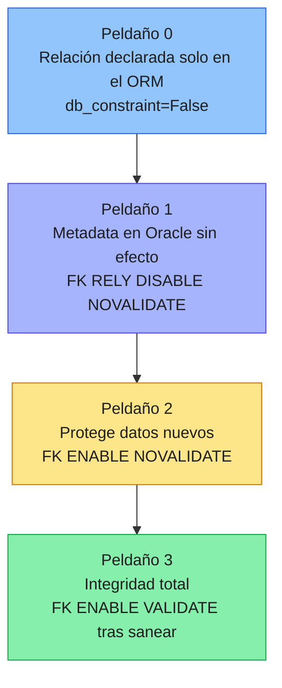
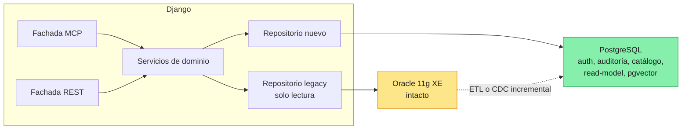
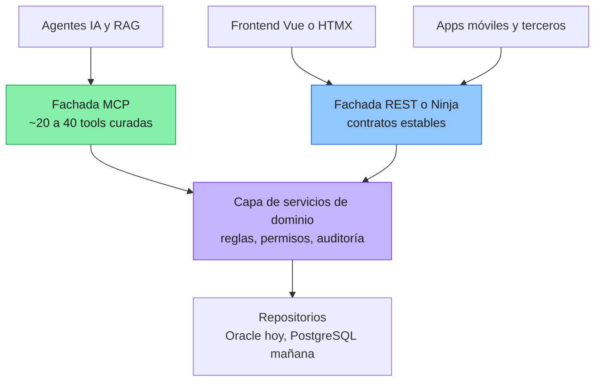
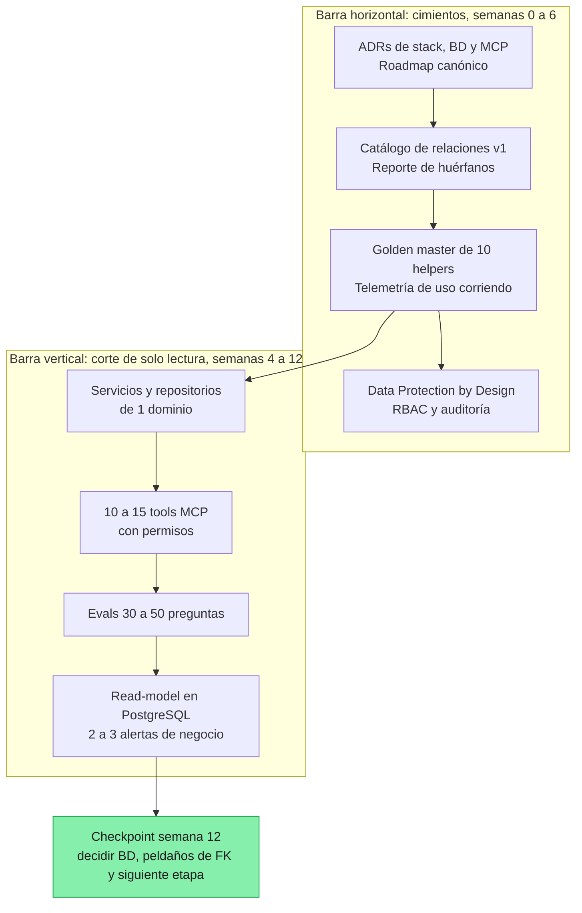

# DREAMS Explorer — Cómo veo tu documento, la brecha con la estrategia ideal y por dónde empezar

> **Alcance de este análisis.** Leí `dreams_explorer.md` completo (Parte I: 39 pasos, Parte II: estado del assessment, Parte III: estrategias, tormenta de ideas, recomendación y ejemplos de código REST/ORM/MCP). Donde afirmo algo técnico externo (MCP, python-oracledb, Ley 21.719) lo verifiqué hoy; lo que es juicio mío lo marco como tal. Las puntuaciones son **opinión razonada**, no una medición.

---

## Índice

1. [Veredicto en 60 segundos](#1-veredicto-en-60-segundos)
2. [Lo que tu documento ya hace muy bien](#2-lo-que-tu-documento-ya-hace-muy-bien)
3. [Lo que el documento todavía no es (problemas de forma)](#3-lo-que-el-documento-todavía-no-es-problemas-de-forma)
4. [Brecha: estrategia ideal vs. lo que tienes documentado](#4-brecha-estrategia-ideal-vs-lo-que-tienes-documentado)
5. [Seis hallazgos que pueden cambiar decisiones](#5-seis-hallazgos-que-pueden-cambiar-decisiones)
6. [Tu idea de BD: Oracle intacto + ORM con relaciones declaradas](#6-tu-idea-de-bd-oracle-intacto--orm-con-relaciones-declaradas)
7. [MCP sobre Django: lo que sí, lo que ajustaría](#7-mcp-sobre-django-lo-que-sí-lo-que-ajustaría)
8. [¿Dónde empiezo? Doce puntos de partida alternativos](#8-dónde-empiezo-doce-puntos-de-partida-alternativos)
9. [Matriz de decisión para tu contexto](#9-matriz-de-decisión-para-tu-contexto)
10. [Mi recomendación: el «camino en T» a 90 días](#10-mi-recomendación-el-camino-en-t-a-90-días)
11. [Spikes de 2 días para decidir la BD con evidencia](#11-spikes-de-2-días-para-decidir-la-bd-con-evidencia)
12. [Qué agregar al documento y cómo reestructurarlo](#12-qué-agregar-al-documento-y-cómo-reestructurarlo)
13. [Preguntas abiertas que solo tú o el cliente pueden responder](#13-preguntas-abiertas-que-solo-tú-o-el-cliente-pueden-responder)
14. [Fuentes verificadas](#14-fuentes-verificadas)

---

## 1. Veredicto en 60 segundos

**¿Vas por buen camino? Sí, y bastante más adelantado que la mayoría de proyectos legacy.** Tienes lo más difícil de conseguir: un diagnóstico honesto, un inventario con código incrustado (689 archivos RICH), un reencuadre estratégico potente (el legacy no es el enemigo; el dolor es la explotación del conocimiento) y principios sanos (una dimensión por vez, gates con evidencia, characterization testing).

**¿Falta mucho? Depende de para qué.** Mi lectura:

| Para qué | ¿Estás listo? | Comentario |
|---|---|---|
| Empezar **experimentos** (spikes, un corte vertical, un MCP de solo lectura) | **Sí, ya** | No necesitas más análisis para arrancar. |
| **Decidir** stack y orden con evidencia | **~70 %** | Faltan 3–4 experimentos baratos (sección 11). |
| **Ejecutar con seguridad** una migración real | **~40–45 %** | Faltan coexistencia, seguridad/privacidad, operación y equipo. |
| **Financiar / vender** al CEO | **~60 %** | El argumento está, faltan baselines y KPIs medibles. |

**Las cinco cosas que más pesan** (detalle en secciones 3–7):

1. **El documento se contradice a sí mismo**: Parte I y II hablan de Spring Boot + Vue; Parte III ya trae código Python/FastAPI/SQLAlchemy/MCP; tú hoy vas hacia Django. Hay además **tres secuencias de fases distintas** con letras superpuestas. Sin un «documento canónico», tú y tu RAG van a tener respuestas inconsistentes.
2. **Seguridad, privacidad y cumplimiento casi no existen** en el texto (cero menciones a Ley 19.628/21.719, PII, anonimización, auditoría, autenticación de MCP). En datos clínicos eso es la brecha #1, y **la Ley 21.719 entra en vigencia el 1 de diciembre de 2026** (en ~10 semanas).
3. **Falta la mecánica de coexistencia**: quién escribe qué mientras conviven legacy y nuevo, cómo se comparte sesión/autenticación, cómo se hace rollback. Es donde se rompen las migraciones reales.
4. **Oracle 11g XE tiene consecuencias que el documento no saca**: está fuera de soporte, tiene límites duros (11 GB / 1 GB RAM / 1 CPU), y **el ORM de Django probablemente no lo soporte oficialmente**. Además, si producción corre XE, el argumento de «Oracle cobra licencias» cae y hay que reemplazarlo por uno más fuerte (riesgo de continuidad).
5. **MCP es buena apuesta, pero «239 helpers = 239 tools» y «MCP en vez de API» necesitan matiz**, y el código de ejemplo tiene errores concretos (sección 7.3).

**Mi respuesta corta a «¿por dónde empiezo?»**: ni por la BD, ni por la app, ni por «los datos» como bloque. Empieza por **contratos y evidencia**: (a) tu JSON de relaciones convertido en un *catálogo ejecutable*, (b) captura del comportamiento actual (golden master + telemetría de uso), y (c) **un corte vertical de solo lectura** expuesto por una capa de servicios con fachada MCP. Eso es reversible, barato, demuestra valor y te da datos para decidir todo lo demás.

> **Analogía.** Estás remodelando una casa donde la familia sigue viviendo. Antes de mover paredes hay que *mapear cañerías y cableado* (catálogo de relaciones), *fotografiar cómo funciona todo hoy* (golden master), y armar *una cocina provisoria* (corte vertical de solo lectura) para comprobar que puedes cocinar sin quemar la casa. La BD nueva es «mover la pared maestra»: se decide al final y con planos.

---

## 2. Lo que tu documento ya hace muy bien

Reconocerlo importa, porque hay cosas que **no debes tocar**:

- **Diagnóstico sin dramatismo** (§1, §30): «no modernicemos porque sea viejo, modernicemos donde lo viejo impida evolucionar». Es la frase más valiosa del documento.
- **Separar tres problemas** (§31): legacy tecnológico (A), modelo de información (B), explotación del conocimiento (C). Es el reencuadre correcto, y la observación de que **C se puede atacar sin resolver A y B** es lo que desbloquea todo.
- **Costo de la inacción** (§2) bien argumentado.
- **Riesgo real identificado** (§9–10): el riesgo no es la tecnología, es *no saber dónde viven las reglas de negocio*. Hidden Logic Inventory con severidades es la herramienta adecuada.
- **Honestidad epistemológica** (§11, §14): admites que las estimaciones son hipótesis y propones un piloto para calibrarlas. Poco común.
- **Disciplina metodológica** (§21–22): una dimensión por vez, seis gates con evidencia reproducible, «no se avanza por opinión».
- **Separar dominio de modelo físico** (§18): el patrón Repository/adapters es exactamente lo que te salva si cambias de motor.
- **La tabla de automatización vs. esfuerzo humano vs. riesgo** (§14) es sensata: la IA acelera lo mecánico; la validación funcional sigue siendo humana.
- **La lista de «qué falta» de la Parte II** (repo original, config de Payara, métricas de uso, historial SVN, equipo) está bien identificada. Solo que la dejaste como prioridades 3–5 y yo subiría dos (métricas de uso y equipo).
- **La idea 9 (exponer helpers vía MCP) y la 8 (agente de conocimiento como primer entregable)** son de lo mejor de la tormenta de ideas. Lo que sigue son ajustes, no correcciones de rumbo.

---

## 3. Lo que el documento todavía no es (problemas de forma)

Es un documento que **creció por capas de razonamiento**. Eso es natural, pero hoy mezcla tres cosas distintas y arrastra contradicciones.

### 3.1 Tres documentos en uno

| Capa | Dónde | Naturaleza |
|---|---|---|
| Bitácora de razonamiento | Parte I §1–29 | Cómo llegaste a las hipótesis (Spring/Vue, orden Front→Modelo→PG) |
| Reencuadre estratégico | §30–39 | La tesis vigente (inteligencia primero) |
| Prototipo técnico | Parte III | Código de ejemplo y recomendaciones nuevas (Python, MCP) |

Un lector nuevo (o un LLM) no sabe **qué es vigente y qué está superado**.

### 3.2 Contradicciones internas

| Tema | Versión A | Versión B | Riesgo |
|---|---|---|---|
| Stack destino | Spring Boot + Vue (§7, §20, §28 #7, §37 fase D) | Django/FastAPI/SQLAlchemy + MCP (Parte III) y tu decisión actual: Django | Nadie sabe cuál rige |
| Secuencia de fases | 10 pasos de §28 | Fases A–F de §37 (A=Understand… F=Retire) | Las letras significan cosas distintas |
| | | Fases A'–G de la Parte III (A'=validación de fuentes… G=Oracle→PG) | Tres cronologías compitiendo |
| Principio «una dimensión por vez» (§21) | Cambiar solo una variable crítica | Pasar de Java a Django cambia lenguaje + framework + arquitectura a la vez | Hay que **decirlo explícitamente** y compensarlo con gates más duros |
| Argumento de PostgreSQL | «Oracle cobra recurrente» (§4) | El sistema corre **Oracle 11g XE** (gratis pero sin soporte) | El argumento de licencias puede ser falso en producción |
| Estado de Fase A' / B | «Pendiente» en Parte III (validación de fuentes, RAG) | En la práctica ya avanzaste mucho: documentación con código, RAG híbrido, Dosier en Django | El documento quedó **atrasado respecto a la realidad** |
| Cifras del inventario | 239 helpers, 94 tablas en diccionario, 51 jasper, 35 relaciones | Las cifras con las que trabajas hoy (≈150 métodos en `helper.md`, 59 jrxml, un modelo de 177 tablas) | Reconciliar antes de usar como línea base |

### 3.3 Por qué esto es más grave de lo que parece: tu RAG lo va a heredar

Vas a ingerir este documento en tu RAG. Si el mismo archivo dice «backend = Spring Boot» y «backend = Django», el recuperador traerá ambos fragmentos y **el LLM responderá con la mezcla**. La solución barata: frontmatter `status: vigente | superseded | hipótesis` por sección (o mejor, por archivo) y ADRs (sección 12).

### 3.4 Un punto sutil: contenido de IA como fuente de verdad

Gran parte del dossier lo generó IA. Está bien, pero para usarlo como **especificación** (para generar código, tools o tests) necesitas saber *qué tan exacto es*. Falta una **auditoría por muestreo**: elegir, digamos, 30 archivos RICH al azar, que un humano verifique contra el código (líneas de SQL, tablas tocadas, reglas) y calcular una tasa de error. Con esa cifra sabes cuánto confiar. Sin ella, el «grounding» es una creencia.

---

## 4. Brecha: estrategia ideal vs. lo que tienes documentado

Modelo de comparación: una estrategia de modernización de un sistema clínico crítico debería cubrir ~12 dimensiones. Madurez = qué tanto está *documentado y decidido* (no qué tanto has trabajado; en varias has hecho más de lo que está escrito).

| # | Dimensión | Madurez | Qué tienes | Qué falta (lo esencial) |
|---|---|---|---|---|
| 1 | Diagnóstico y narrativa | **90 %** | Ferrari del 89, 3 problemas, costo de inacción | Baselines cuantitativos (tiempos, incidentes, costo actual) |
| 2 | Inventario y conocimiento del sistema | **80 %** | 689 RICH con código, helpers, jasper, diccionario | **Métricas de uso reales** (qué JSP/tabla se usa), auditoría de exactitud del dossier |
| 3 | Estrategia de secuenciación | **70 %** | Strangler + módulos + gates; hipótesis de orden | **Un solo roadmap canónico**; criterios numéricos por gate |
| 4 | Arquitectura destino | **40 %** | Capas, Repository/adapters, MCP | ADRs, *bounded contexts*, integraciones (Jasper, jobs, scripts hacia ERP), estrategia de reportes |
| 5 | Datos y BD | **55 %** | Profiling→FK, EAV identificado, PG como destino | Reglas de calidad medibles, identidad de paciente (ficha vs RUT), plan de EAV, replicación/CDC, qué hacer con PL/SQL |
| 6 | Coexistencia y migración | **25 %** | «Strangler», «shadow mode» como idea | **Dueño de escritura por tabla**, sesión/auth compartida, ruteo, rollback, reconciliación, plan de cutover |
| 7 | Validación y testing | **45 %** | Characterization testing como principio | Datos de prueba anonimizados, definición de «equivalente» (redondeos, orden, zona horaria), no funcionales, UAT con usuarios reales |
| 8 | IA y MCP | **50 %** | Semantic layer, RAG, MCP, ejemplos de negocio | Catálogo curado de tools, **evals**, modelo (local/nube), observabilidad, defensa contra prompt injection, límites de escritura |
| 9 | Seguridad, privacidad, cumplimiento | **10 %** | Mención a riesgo SQL injection en helpers | Ley 21.719 / 19.628 / 20.584, clasificación de datos, PII hacia LLM, auditoría, AuthN/AuthZ, retención, notificación de brechas |
| 10 | Gobierno, equipo, costos | **25 %** | Piloto para calibrar esfuerzo | Quién ejecuta y valida, expertos de negocio, RACI, modelo de costos (humano + tokens + infra), registro de decisiones |
| 11 | Operación y DevOps | **20 %** | Repo SVN, Payara identificados como faltantes | Git + CI/CD, ambientes, observabilidad, RPO/RTO de Oracle XE, despliegue del nuevo stack |
| 12 | Riesgos y contingencia | **50 %** | Hidden Logic Inventory con severidades | Registro de riesgos con dueño/mitigación/trigger; plan B por fase |

**Lectura honesta:** el documento es **fuerte donde es intelectual** (diagnóstico, estrategia, conocimiento) y **débil donde es operacional** (coexistencia, seguridad, DevOps, gobierno). Es la típica asimetría de quien ha pasado meses entendiendo un sistema: el «qué y por qué» está; el «cómo lo hacemos sin que nada se caiga un martes a las 10 am» está por escribir.

**Brecha total (juicio mío):** la parte que falta no es «más análisis del legacy». Es (a) **decidir y registrar** (ADRs), (b) **coexistencia**, y (c) **seguridad/compliance**. Con esas tres cerradas, el documento pasa de «estrategia» a «plan ejecutable».

---

## 5. Seis hallazgos que pueden cambiar decisiones

### 5.1 Oracle 11g XE: no es solo «viejo», es un problema de continuidad

- **Sin soporte ni parches.** 11g está fuera de soporte estándar hace años. Es lo contrario de lo que quieres para el corazón de un sistema clínico.
- **Límites duros de XE** (según mi conocimiento de la edición 11g: ~11 GB de datos de usuario, 1 GB de RAM, 1 CPU). Verifica en tu instancia, pero implica algo importante: **cualquier carga analítica, ETL agresivo o consulta de un agente compite con la operación de la clínica** en una máquina muy justa.
- **El argumento de licencias podría ser falso.** El documento dice que Oracle «cobra de forma recurrente y escala con el uso» (§4). XE es gratuito. Si producción corre XE, ese argumento no aplica y **el CEO lo va a notar**. Verifica la edición de producción (el assessment se hizo sobre QA). El argumento verdadero y más fuerte es: *plataforma sin soporte, sin parches, con techo de capacidad, y con talento cada vez más escaso*.
- **Consecuencia estratégica:** no puedes dejar Oracle XE «intacto» *y a la vez expuesto a IA/analytics* indefinidamente. Refuerza la idea de **una réplica/read-model fuera de Oracle desde temprano** (sección 8, punto B).

### 5.2 Django y Oracle 11g: probable incompatibilidad oficial

- Según el sitio del driver `python-oracledb`, el **modo *thin* requiere Oracle Database 12.1 o superior**; para 11.2 hay que usar **modo *thick*** con librerías de Oracle Client (por ejemplo, un cliente 19c puede conectarse a 11.2).
- Hasta donde sé, las versiones recientes de **Django solo soportan oficialmente Oracle 19c o superior** (además del backend usa sintaxis de paginación de 12c+). **Verifícalo en las notas de la versión que vayas a usar.**
- Traducción práctica: *«Django ORM contra Oracle 11g XE en producción»* puede no funcionar o funcionar a medias. **No lo asumas: pruébalo en el spike S1** (sección 11). Si falla, tus opciones son SQL directo con `oracledb` (thick) en repositorios, SQLAlchemy Core (verificar soporte de la versión de Oracle), o subir Oracle a una versión soportada como paso previo (que ya es un proyecto en sí mismo).
- Esto **no invalida Django**: puedes usar Django con **PostgreSQL como BD propia** (usuarios, permisos, auditoría, catálogo, read-model) y hablar con Oracle por una capa de repositorios. Ver sección 6.5.

### 5.3 Ley 21.719: 10 semanas y datos de salud hacia un LLM

- La **Ley 21.719 (protección de datos personales) entra en vigencia el 1 de diciembre de 2026**, y crea una Agencia fiscalizadora. Guías de cumplimiento mencionan notificación de brechas en 72 horas y multas de hasta 20.000 UTM; **valida los detalles con tu asesor legal**.
- Los **datos de salud son datos sensibles**. Tu MCP de ejemplo devuelve nombre, email, teléfono y comuna al contexto de un LLM. Preguntas que el documento no responde:
  - ¿Qué modelo procesa esos datos: **local** (Ollama, control total) o **nube** (transferencia a terceros, posible transferencia internacional)?
  - ¿Hay **minimización** (¿el LLM necesita el email para responder una pregunta de agenda?), **pseudonimización** y **enmascarado por rol**?
  - ¿Existe **registro de auditoría** de quién preguntó qué y qué datos salieron?
  - ¿Quién es el **responsable del tratamiento** (la clínica) y quién el **encargado** (tú/la consultora)? Los contratos importan.
- **Propuesta:** una hoja «Data Protection by Design» de 2 páginas antes de exponer una sola tool (sección 12). Y una regla simple para el piloto: *las primeras tools devuelven datos agregados o pseudonimizados; los identificables solo con permiso explícito por rol.*
- Ojo también con las **fichas clínicas** (regulación sectorial de derechos y deberes de los pacientes, Ley 20.584): confidencialidad y trazabilidad de acceso. Consúltalo con legal.

### 5.4 Coexistencia: «un solo escritor por tabla»

Es el punto que más migraciones rompe y el documento no lo toca. Mientras legacy y nuevo conviven sobre la **misma Oracle**:

- Si **ambos escriben** en la misma tabla, el nuevo sistema no conoce las reglas escondidas en JSP/Java/triggers (§9–10). Resultado: datos corruptos que nadie detecta durante semanas.
- **Regla propuesta:** para cada tabla (o agregado), un **dueño de escritura** declarado: `legacy` hasta el cutover de ese módulo; recién ahí `nuevo`. Mientras tanto, el nuevo stack es **solo lectura** sobre esas tablas. Esto simplifica MCP (solo lectura primero) y hace verificable el shadow mode.
- Cuando llegue el momento de escribir desde el nuevo sistema: primero **una tabla/flujo pequeño**, con reconciliación automática (conteos, sumas de control) y un **interruptor de vuelta atrás**.

### 5.5 Sesión y autenticación compartidas

Si vas a hacer *strangler* (ruteo por URL: unas pantallas en JSP, otras en Django), el usuario **no puede volver a iniciar sesión** al pasar de una a otra. ¿Cómo se comparte identidad? ¿Cómo se comparten permisos por rol (recepción / doctor / administración)? Opciones típicas: un reverse proxy que valide una cookie común, un token emitido por el login legacy y validado por Django, o un proveedor de identidad. El documento no menciona sesión ni autenticación (grep: 0 menciones relevantes). **Esto suele ser el primer obstáculo real** de un strangler.

### 5.6 IA como *constructor* vs. IA como *producto*

Tu documento usa «IA» para dos cosas distintas y las mezcla:

| | IA como **constructor** | IA como **producto** |
|---|---|---|
| Qué es | Codex/OpenCode/Claude que documentan, generan código y tests | RAG, MCP, analytics predictivo que usa el negocio |
| Quién la usa | Tú y el equipo técnico | Recepción, doctores, gerencia |
| Cómo se mide | Horas ahorradas, tasa de error del código generado | Decisiones mejoradas, alertas útiles, precisión de respuestas |
| Riesgo principal | Código plausible pero incorrecto | Alucinación, fuga de datos, decisiones erradas |
| Gobierno | Revisión humana + tests | Evals, permisos, auditoría, cumplimiento |

Sepáralas en el documento y en el roadmap: tienen métricas, riesgos y audiencias distintos. Tu argumento al CEO se apoya en la segunda; tu productividad se apoya en la primera.

---

## 6. Tu idea de BD: Oracle intacto + ORM con relaciones declaradas

### 6.1 Veredicto

**Es una buena idea como *puente*, no como destino.** Tiene una propiedad muy valiosa: es una **decisión reversible** («puerta de dos sentidos»): declarar relaciones en el ORM no toca ni un byte de Oracle. Migrar a PostgreSQL es lo contrario: costoso de revertir. La regla de oro es **decidir primero lo reversible y dejar lo irreversible para cuando tengas evidencia**.

Condiciones para que funcione (las 6 que yo exigiría):

1. **Verificar compatibilidad** Django/driver con tu versión de Oracle (5.2).
2. **Solo lectura** hacia Oracle desde el nuevo stack mientras dure la coexistencia (5.4).
3. **Relaciones con estado y evidencia** (catálogo, 6.3), no dispersas en `models.py`.
4. **Tests de equivalencia** contra los helpers actuales (golden master).
5. **Tolerancia a huérfanos** (6.4): el ORM no debe «perder» filas por un JOIN interno.
6. **Fecha de caducidad**: el puente se documenta como transitorio, con un gate que dispare la migración (p. ej. ir a PostgreSQL antes del fin de año o cuando Oracle XE se acerque a sus límites).

### 6.2 La escalera de formalización (no es «FK sí / FK no»)

En vez de binario, piensa en peldaños. Cada peldaño da valor y sube el riesgo un poco:



| Peldaño | Qué haces | Efecto en la app legacy | Valor | Riesgo |
|---|---|---|---|---|
| **0** | `ForeignKey(..., db_constraint=False)` en Django | Ninguno | Navegación de relaciones, admin, codegen, grafo | Muy bajo |
| **1** | `ALTER TABLE hijo ADD CONSTRAINT fk ... RELY DISABLE NOVALIDATE` | Ninguno (no se aplica) | La relación **aparece en el diccionario de Oracle**: la ven DBeaver, herramientas ER, Text-to-SQL, catálogos, y `inspectdb`-like | Bajo (es DDL, probar en QA; el padre necesita PK/UNIQUE o Oracle da ORA-02270) |
| **2** | `... ENABLE NOVALIDATE` | **Sí**: rechaza DML nuevo que viole la FK (deja los huérfanos viejos) | Deja de crecer el problema | **Medio**: si el legacy inserta hijo antes que padre o depende de huérfanos, aparecerán ORA-02291/02292 en producción |
| **3** | Sanear huérfanos y `ENABLE VALIDATE` | Sí | Integridad completa | Alto si no hubo profiling y validación con negocio |

El **peldaño 1** es el más subestimado: te da relaciones «oficiales» en el catálogo de Oracle **sin cambiar el comportamiento**. Es la forma más barata de que un LLM, un data catalog o una herramienta de ER *entiendan* tu esquema. Pruébalo en QA con los dos o tres pares de tablas más claros.

Como planeas FK solo para un subconjunto de tablas, la escalera te dice **qué subconjunto va a qué peldaño**: p. ej., relaciones «confirmadas con 0 % huérfanos» → peldaño 2/3; «candidatas» → peldaño 0/1; «dudosas» → solo catálogo.

### 6.3 Tu JSON de relaciones como *fuente única de verdad* (una idea que multiplica valor)

Ya tienes un JSON que relaciona el modelo (el de los desarrolladores del cliente). **Es probablemente tu activo más subestimado.** Conviértelo en un **catálogo versionado y ejecutable** con un registro por relación:

```yaml
- id: rel_ficha_telefono
  hijo: TELEFONOS.COD_PERSONA
  padre: FICHAS.NUM_FICHA
  cardinalidad: "1:N"
  significado_negocio: "Teléfonos vigentes de un paciente (por ficha)"
  estado: candidata            # confirmada | candidata | dudosa | rechazada
  fuente: [json_devs_cliente, helper.DatosPaciente, sql_helper_line_123]
  evidencia:
    huerfanos_pct: null        # lo rellena el PL/SQL de profiling
    muestra_revisada_por: null
  peldano_objetivo: 1          # 0..3 de la escalera
  notas: "Ojo: COD_PERSONA en FICHAS es RUT; en TELEFONOS parece ser ficha"
```

De **un** archivo salen **cinco** consumidores:

1. **Generador de `models.py`** (Django, `managed=False`, FKs con `db_constraint=False`).
2. **Reporte de huérfanos** (tu procedimiento PL/SQL que anticipa violaciones por FK candidata) → rellena `evidencia`.
3. **Capa semántica / glosario** (qué significa cada campo y relación).
4. **Aristas del grafo del RAG híbrido** (relaciones confirmadas como conocimiento estructurado).
5. **Schema/descripciones de tools MCP** (las tools heredan los nombres de negocio, no los de columnas).

> **Ejemplo real dentro de tu propio documento:** en los SQL de `DatosPaciente`, `FICHAS.COD_PERSONA` guarda el **RUT** (`WHERE COD_PERSONA = '<rut>'`) mientras que `TELEFONOS.COD_PERSONA` se filtra con la **ficha** (`WHERE COD_PERSONA='<ficha>'`). Mismo nombre de columna, significado distinto (o clave polimórfica). Esto es exactamente lo que confunde a un LLM en Text-to-SQL y a un desarrollador nuevo. El catálogo es el lugar donde ese conocimiento *deja de vivir en la cabeza de alguien*.

### 6.4 Trampas del ORM cuando la BD no tiene FK

1. **JOINs internos que «pierden» filas.** Con FK no nulas, `select_related` genera INNER JOIN y los registros con padre inexistente **desaparecen del resultado** sin error. Diferirías del legacy sin darte cuenta. Mitigación: declarar la FK como `null=True` (LEFT JOIN en `select_related`) y ejecutar el reporte de huérfanos.
2. **Llaves primarias imposibles.** Django exige una PK simple por modelo. Si una tabla no tiene PK o es compuesta, hay que recurrir a soporte de PK compuesta (reciente; verifica su alcance, sobre todo para FK hacia ellas) o a trucos de solo lectura (p. ej. mapear `ROWID` como PK; **pruébalo en el spike**). En el ejemplo SQLAlchemy de tu documento, `Telefono` tiene `COD_PERSONA` como PK: si un paciente tiene varios teléfonos, el *identity map* del ORM **colapsa filas**. Es un bug clásico.
3. **Homónimos** (6.3): el ORM no sabe que dos columnas con el mismo nombre significan cosas distintas.
4. **Funciones PL/SQL** (`get_edad`, `get_comuna_pcte`) llaman a Oracle desde el ORM con `func.` y **no se migran solas**. Son reglas de negocio ocultas: candidatas al Hidden Logic Inventory y a reimplementarse en el dominio.
5. **Semántica Oracle**: `''` = `NULL`, identificadores en mayúsculas, `DATE` con hora, `NUMBER` sin tipo, `DECODE`, `ROWNUM`, secuencias + triggers para IDs. Al pasar a PostgreSQL esto cambia.
6. **La promesa «cambiar de Oracle a PostgreSQL = cambiar la URL de conexión»** que aparece en el ejemplo ORM del documento **no es cierta** mientras uses funciones/SQL específicos de Oracle. Contradice, además, tu propio principio (§4): *no migrar «Oracle legacy → PostgreSQL legacy»*.
7. **Escritura por ORM sobre tablas con triggers y secuencias**: los triggers dispararán y tú no lo sabrás. Refuerza la regla de solo lectura (5.4).
8. **Rendimiento:** un ORM haciendo N+1 sobre una Oracle XE de 1 CPU puede ser peor que el JSP original. Mide.

### 6.5 Arquitectura Django que te deja todas las puertas abiertas: dos bases, un router



- `default` = **PostgreSQL** (nace ya en el destino: usuarios, permisos, auditoría de MCP, catálogo de relaciones, read-model, `pgvector` si quieres embeddings en el mismo motor).
- `legacy` = **Oracle**, con un *database router* que **prohíbe migraciones y escrituras** (`allow_migrate → False`, `db_for_write` → error).
- Los servicios de dominio **no conocen** de dónde vienen los datos: hablan con repositorios. Hoy el repositorio lee Oracle; mañana lee PostgreSQL; **el MCP y el REST no cambian**. Es tu §18 llevado a código.
- Con esto, el destino PostgreSQL deja de ser «el gran día»: es **un cambio de adaptador módulo por módulo**.

```python
# settings.py (esquema)
DATABASES = {
    "default": {"ENGINE": "django.db.backends.postgresql", "NAME": "dosier"},
    "legacy":  {"ENGINE": "django.db.backends.oracle", "NAME": "XE", "USER": "ro_dent"},  # usuario SOLO LECTURA
}
DATABASE_ROUTERS = ["core.routers.LegacyReadOnlyRouter"]

# models generados desde el catálogo
class Ficha(models.Model):
    num_ficha = models.CharField(primary_key=True, max_length=20, db_column="NUM_FICHA")
    cod_persona = models.CharField(max_length=15, db_column="COD_PERSONA")  # RUT en FICHAS
    class Meta:
        managed = False
        db_table = "FICHAS"

class Telefono(models.Model):
    rowid = models.CharField(max_length=18, primary_key=True, db_column="ROWID")  # truco solo lectura: validar en spike
    ficha = models.ForeignKey(Ficha, db_column="COD_PERSONA", db_constraint=False,
                              on_delete=models.DO_NOTHING, null=True, related_name="telefonos")
    class Meta:
        managed = False
        db_table = "TELEFONOS"
```

*(Ilustrativo: sujeto a lo que muestre el spike S1 con tu versión de Oracle. Crea el usuario `ro_dent` con permisos `SELECT` solamente: es tu primer control de seguridad, y gratis.)*

### 6.6 ¿ORM, SQL directo o ambos?

| Enfoque | Pros | Contras | Cuándo |
|---|---|---|---|
| **SQL directo** en repositorios (`oracledb`) | Fidelidad total con los helpers ya documentados; funciona con Oracle viejo (thick); cero magia | Más código; acopla a Oracle | Primera etapa de lectura y golden master |
| **Django ORM** (`managed=False`) | Relaciones, admin, codegen desde el catálogo, migración futura más fácil | Puede no soportar tu Oracle; trampas de 6.4 | Módulos donde las relaciones importan y el spike lo valide |
| **SQLAlchemy** (Core/ORM) | Flexible, buen manejo de esquemas legacy | Otro ORM en un proyecto Django; verificar soporte de versión Oracle | Si Django ORM falla y quieres ORM |
| **Vistas/materializadas en Oracle** | Encapsulan EAV/DECODE en la BD | Toca Oracle (aunque sea DDL aditivo); carga en XE | Solo si un caso lo exige |

**Mi sugerencia:** empieza con **SQL directo en repositorios** para los helpers (equivalencia exacta con lo que ya documentaste), y **usa el ORM donde el catálogo de relaciones agrega valor real**. No te cases con uno hasta el spike S1.

---

## 7. MCP sobre Django: lo que sí, lo que ajustaría

### 7.1 Por qué tu apuesta es buena (y llegó en buen momento)

- Un servidor MCP expone *tools* con nombre, descripción y schema que un LLM descubre y usa sin adaptadores. Encaja exactamente con tu tesis «inteligencia primero».
- **Novedad relevante:** la revisión **2026-07-28 de la especificación MCP hizo el protocolo *stateless***: eliminó el handshake `initialize` y el header `Mcp-Session-Id`; cada petición lleva versión de protocolo y capacidades en `_meta`. Eso hace mucho más natural montar MCP **dentro de Django (incluso WSGI)** detrás de un balanceador, como cualquier servicio HTTP. Es una buena noticia para tu plan.
- Hay librerías que lo integran con Django (p. ej. `django-mcp-server`, que declara soporte de Streamable HTTP *stateless* y funcionar en WSGI y ASGI, con herramientas para exponer modelos y hasta convertir vistas DRF en tools). **Verifica que la versión que elijas esté alineada con la revisión 2026-07-28** o fija explícitamente la revisión que soporta.

### 7.2 Un matiz importante: «MCP *en vez de* API» → «un core, dos fachadas»

Tu planteamiento actual («no API tradicional sino JSON-RPC/MCP») lo compartiría **para el consumo por agentes**. Para el resto, ajustaría:

- **MCP está diseñado para que un modelo descubra y llame capacidades.** Para un **frontend web o una app móvil** sigues queriendo lo que HTTP/REST te da gratis: códigos de estado, caché, paginación estándar, versionado, OpenAPI → generación de clientes, tooling de pruebas, gateways, etc. El «un solo código para todos los consumidores» del documento es cierto a nivel de *transporte*, pero no elimina esas necesidades.
- **Lo que compartes no es el protocolo, es la capa de servicios.**



Así **MCP-first** sigue siendo verdad para IA (lo construyes primero), sin cerrarte la puerta a una UI moderna. Si aun así quieres JSON-RPC como protocolo interno también para la UI, es una decisión legítima, pero asume el costo: menos tooling estándar, más código propio de caché/errores/paginación.

### 7.3 «239 helpers = 239 tools» es un anti-patrón

- Los LLM **eligen peor** entre muchas herramientas parecidas y **cada definición consume contexto**. Con 200+ tools la selección se degrada y el costo sube.
- Los helpers son **la API interna del legacy** (bien granular, orientada a implementación). Las tools deben ser **orientadas a tarea** (lo que un humano pediría).

| En vez de… (granular) | Piensa en… (orientada a tarea) |
|---|---|
| `getDatosPaciente`, `getTelefono`, `getComuna`, `getEdad` | `resumen_paciente(ficha_o_rut)` |
| `getCitas`, `getEstadoCita`, `getAgendaDia` | `agenda_del_dia(fecha, profesional)` |
| 15 helpers de cobros y saldos | `estado_cartera(filtro)`, `pagos_pendientes(paciente)` |
| Consultas SQL libres | `consulta_analitica(modelo_semantico, filtros)` sobre el **read-model**, no sobre tablas |

Reglas prácticas: **20–40 tools por dominio y rol**, nombres y descripciones en lenguaje de negocio, **respuestas acotadas y paginadas**, solo lectura marcada explícitamente, y **conjuntos de tools por rol** (recepción no ve odontograma). Los 239 helpers siguen existiendo **detrás**, como métodos del servicio o repositorio.

### 7.4 Errores concretos en el ejemplo de código (vale la pena corregirlos en el documento)

1. **Bug de lógica en `get_datos_paciente`** (MCP): cuando el input es una **ficha** (sin guion), la consulta selecciona `COD_PERSONA` (el RUT) y luego hace `ficha = row[0]`. A partir de ahí usa el **RUT como si fuera la ficha** en las consultas siguientes. Solo funciona bien cuando el input es un RUT. Es exactamente el tipo de error que **un golden master atraparía en minutos**.
2. **Errores como «éxito».** Cuando no encuentra al paciente devuelve un objeto válido con `ficha="ERROR"` y `nombres="Paciente no encontrado"`. Un LLM puede tratarlo como dato real. En MCP debes **devolver error de herramienta** (`isError`/excepción de tool) para que el modelo lo razone. Igual con `get_edad_paciente` que devuelve `0` si no encuentra: **0 parece una edad válida**.
3. **Sin autenticación, autorización ni auditoría** (ver 7.6).
4. **Devuelve PII completa siempre** (nombre, email, teléfono). Minimización primero.
5. **Sin anotaciones de solo lectura** ni límites de tasa.
6. **En el ORM:** PK de `Telefono` en `COD_PERSONA` (6.4) y la promesa de portabilidad por cambio de URL (6.4-6).
7. **El `curl` del documento** (`tools/call` directo) omite detalles de protocolo. Bajo la revisión 2026-07-28 la petición debe llevar `MCP-Protocol-Version`, `Mcp-Method`, `Accept: application/json, text/event-stream` y los metadatos en `_meta`; bajo las revisiones anteriores necesitabas antes el handshake `initialize` y el `Mcp-Session-Id`. Conclusión práctica: **fija la revisión de spec que vas a soportar y usa un SDK/librería**, no armes JSON-RPC a mano.

### 7.5 Seguridad del MCP en un contexto clínico (mínimo viable)

- **AuthN:** cada llamada asociada a un usuario o cuenta de servicio (tokens; para servidores remotos la especificación define un modelo basado en OAuth).
- **AuthZ en el servidor** (Django), nunca «confiando en el prompt»: permisos por rol/sucursal/paciente. Un LLM **no es un control de acceso**.
- **Auditoría:** quién, qué tool, con qué argumentos, cuántos registros, cuándo (te servirá para cumplimiento y para depurar).
- **Solo lectura al inicio**; si hay tools de escritura: confirmación humana, idempotencia y lista blanca.
- **Prompt injection vía datos:** campos de texto libre de la BD (observaciones, notas) pueden contener instrucciones. Trata todo dato devuelto como *no confiable*; recorta y etiqueta.
- **Límite de volumen** por llamada y por usuario (evitar exfiltración masiva vía agente).
- **Gotcha de `django-mcp-server`:** según su documentación, al montar un **segundo endpoint MCP** con la vista de Streamable HTTP, la configuración global de clases de autenticación **se ignora** y debes pasar `authentication_classes`/`permission_classes` a mano. Fácil dejar un endpoint abierto por error.

### 7.6 Evals: la pieza que falta para que «no alucine»

Tu objetivo explícito con el RAG es que no alucine y que no diga «no tengo información» cuando sí la tiene. La forma de **demostrarlo** es un **set de evaluación**:

- 30–50 preguntas reales de negocio con **respuesta esperada y tool/consulta esperada**.
- Métricas: ¿eligió la tool correcta?, ¿argumentos correctos?, ¿la respuesta coincide con la verdad (SQL directo)?, ¿respetó permisos?, ¿cuánto costó/tardó?
- Se corre en cada cambio de prompts, tools o modelo. Es el equivalente a tu characterization testing, **pero para la capa de IA**.

---

## 8. ¿Dónde empiezo? Doce puntos de partida alternativos

Tu pregunta («¿en la BD, en la app, en los datos?») supone que hay tres puertas. En realidad hay más, y varias **no son ni BD ni app ni datos «a secas»**: son *contratos, evidencia y controles*. Aquí van doce, ordenados por familias.

### Familia 1 — Contratos y evidencia (bajo riesgo, informan todo lo demás)

| # | Punto de partida | Qué haces | Qué obtienes | Reversible |
|---|---|---|---|---|
| **A** | **Catálogo de relaciones ejecutable** | Conviertes tu JSON en un catálogo versionado con estado/evidencia (6.3), más el PL/SQL de huérfanos | Fuente única para modelos, FKs, capa semántica, grafo RAG y schema MCP | Sí, 100 % |
| **D** | **Captura de comportamiento (golden master)** | Para 10–20 helpers/pantallas críticas, guardas *entrada → salida* en QA (SQL, respuestas JSON, HTML relevante) | La vara con la que medir *toda* reimplementación; atrapa bugs como el de 7.4-1 | Sí |
| **E** | **Telemetría de uso y poda de alcance** | Analizas los *access logs* de Payara (qué JSP/servlet se usa, por qué rol, con qué frecuencia) y, si puedes, `V$SQL` periódico. **Empieza cuanto antes: necesita semanas de datos** | Sabes qué de los 689 programas **realmente importa**; probablemente un 20–30 % concentra la mayor parte del uso. Reduce alcance y estimaciones | Sí |
| **J** | **Reglas ocultas ejecutables** | Cada regla del Hidden Logic Inventory (PL/SQL, triggers, funciones como `get_edad`) se transforma en un **test** (dado X → Y) | El inventario deja de ser un documento y pasa a ser una red de seguridad | Sí |
| **K** | **Contract-first / spec-driven** | Defines el *schema de tools* y las specs (con tu flujo OpenCode/SDD) antes de codificar; el dossier alimenta las specs | Código generado más consistente; contratos revisables por humanos | Sí |

### Familia 2 — Valor visible para el negocio (financian el proyecto)

| # | Punto de partida | Qué haces | Qué obtienes | Reversible |
|---|---|---|---|---|
| **C** | **Fachada de servicios + MCP de solo lectura sobre Oracle** | 10–30 tools orientadas a tarea sobre helpers curados (7.3), con RBAC y auditoría | Demo funcional con IA en semanas, sin tocar la app | Sí |
| **B** | **Read-model en PostgreSQL** | ETL/CDC incremental de un dominio a PostgreSQL con modelo analítico limpio (paciente, atención, pago, stock…) y MCP/BI encima | Analytics/IA **sin cargar la Oracle XE**; primer paso real hacia PG *sin migrar la operación* | Sí (es una copia) |
| **F** | **Corte vertical de una pantalla en Django, lado a lado** | Una vista de solo lectura (p. ej. «ficha resumida» o «agenda del día»), misma data, comparada con la JSP | Prueba de todo el stack nuevo (auth, repos, servicios, UI) en pequeño | Sí |

### Familia 3 — Habilitadores (los que nadie quiere hacer pero deciden si sobrevives)

| # | Punto de partida | Qué haces | Qué obtienes | Reversible |
|---|---|---|---|---|
| **I** | **Seguridad y privacidad primero** | Hoja de «Data Protection by Design», clasificación de datos, RBAC, auditoría, política de LLM (local/nube), usuario de BD solo lectura | Cumplimiento (Ley 21.719 desde el 1-dic-2026) y confianza del cliente | Sí |
| **H** | **Estabilizar la BD sin cambiar comportamiento** | Backups verificados y RPO/RTO medidos; usuario `ro_`; FKs en **peldaño 1** para pares claros; inventario de jobs/triggers | Menos riesgo operativo **hoy**; mejor metadata para todo lo demás | Casi (DDL aditivo) |
| **G** | **Strangler en el borde** | Reverse proxy delante de Payara + identidad/sesión compartida (5.5) | Habilita ruteo por URL para migrar pantalla a pantalla | Medio |

### Familia 4 — Para después (no empezar por aquí)

| # | Punto de partida | Por qué esperar |
|---|---|---|
| **L** | **Shadow mode en un flujo de escritura pequeño** | Requiere golden master (D), reglas ocultas (J) y dueño de escritura claro (5.4). Es el paso *posterior* al corte de solo lectura. |

**Una sola frase para elegir:** empieza por lo que **reduce incertidumbre y es reversible** (A, D, E, I), y **en paralelo** por lo que **demuestra valor** (C, B, F). Deja para después lo que **cambia el sistema operacional** (G, L, la BD destino).

---

## 9. Matriz de decisión para tu contexto

Criterios pensados para tu situación: **un equipo pequeño (tú + IA), Django + MCP, Oracle XE, datos clínicos, un CEO que quiere ver valor**. Puntaje 1–5 (5 = mejor; en *Riesgo* y *Esfuerzo*, 5 = menos riesgo / menos esfuerzo). **Es mi juicio; ajusta los pesos a tu realidad.**

| Punto | Valor temprano | Riesgo bajo | Reversible | Informa decisiones | Encaje Django + MCP | Esfuerzo bajo | **Total /30** |
|---|:-:|:-:|:-:|:-:|:-:|:-:|:-:|
| **A** Catálogo ejecutable | 3 | 5 | 5 | 5 | 5 | 4 | **27** |
| **C** MCP lectura sobre Oracle | 5 | 4 | 5 | 3 | 5 | 3 | **25** |
| **D** Golden master | 3 | 5 | 5 | 5 | 4 | 3 | **25** |
| **E** Telemetría de uso | 3 | 5 | 5 | 5 | 3 | 4 | **25** |
| **I** Seguridad/privacidad | 3 | 5 | 5 | 3 | 5 | 3 | **24** |
| **K** Contract-first | 3 | 5 | 5 | 3 | 5 | 3 | **24** |
| **B** Read-model PostgreSQL | 5 | 4 | 4 | 4 | 4 | 2 | **23** |
| **F** Corte vertical en Django | 4 | 4 | 4 | 4 | 4 | 2 | **22** |
| **J** Reglas ocultas ejecutables | 3 | 5 | 5 | 4 | 3 | 2 | **22** |
| **H** Estabilizar BD | 2 | 4 | 4 | 3 | 3 | 4 | **20** |
| **G** Strangler en el borde | 3 | 3 | 3 | 3 | 3 | 2 | **17** |
| **L** Shadow mode escritura | 2 | 2 | 3 | 3 | 3 | 1 | **14** |

Lectura: **A, C, D, E** lideran; **I** y **K** son casi obligatorios; **B y F** son el segundo movimiento; **G y L** esperan.

---

## 10. Mi recomendación: el «camino en T» a 90 días

**Idea:** una barra horizontal **ancha y delgada** de cimientos (decisiones, contratos, evidencia, seguridad) y una barra vertical **estrecha y profunda** (un corte de solo lectura de punta a punta, con MCP). La horizontal reduce incertidumbre; la vertical demuestra valor y valida el stack.



### Semanas 0–2 · Decidir y desbloquear
- **Arranca la telemetría de uso ya** (logs de acceso de Payara): es lo único que necesita *tiempo transcurrido*.
- ADR-001 *stack* (Django, con sus consecuencias sobre «una dimensión por vez»), ADR-002 *BD como puente*, ADR-003 *un core, dos fachadas*.
- Usuario Oracle **solo lectura**; repo Git; PostgreSQL para la BD propia de Django.
- Hoja *Data Protection by Design* (2 páginas) y decisión de política de LLM (local vs nube) con el cliente.
- Reconciliar cifras del inventario (helpers, jasper, tablas).
- **Spikes S1 y S2** (sección 11).

### Semanas 2–6 · Construir evidencia
- **Catálogo de relaciones v1** (las ~40 relaciones más usadas primero) + **reporte de huérfanos**.
- **Golden master** de 10 helpers/pantallas (incluye `DatosPaciente`, que atraparía el bug de 7.4-1).
- **Auditoría por muestreo** de 30 RICH contra el código (mide la exactitud del dossier).
- Primeros FKs en **peldaño 1** en QA para 2–3 pares claros.

### Semanas 4–10 · Corte vertical de solo lectura
- Elige **un dominio** con criterios explícitos: alto uso (telemetría), bajo acoplamiento, datos razonablemente limpios (reporte de huérfanos), valor visible para el CEO. Candidatos de tu propio documento: *Cobros/cartera*, *Agenda*, *Laboratorio*, *Stock*. Mi inclinación: **Cobros/cartera en lectura** si los datos están limpios (es el ejemplo de valor más tangible), y **Agenda** como plan B por ser más simple técnicamente.
- Servicios + repositorios (SQL directo primero), **10–15 tools MCP** orientadas a tarea, RBAC, auditoría, set de **evals**.
- Comparación contra el golden master.

### Semanas 8–12 · Read-model y demo
- ETL/CDC incremental del dominio a PostgreSQL; medir carga sobre Oracle XE.
- 2–3 **alertas de negocio** concretas (cartera vencida concentrada, stock que no alcanza, retrasos de laboratorio).
- **Demo al CEO con números**: preguntas respondidas, exactitud medida, tiempo ahorrado, alertas generadas.

### Semana 12 · Checkpoint (el gate real)
Criterios **propuestos** (calíbralos con el cliente):

| Área | Criterio de salida propuesto |
|---|---|
| Equivalencia | ≥ 98 % de casos del golden master idénticos; **100 %** en cifras monetarias |
| Datos | Reporte de huérfanos para el 100 % de FKs candidatas; clasificación confirmada/candidata/dudosa |
| IA | ≥ 90 % de tool correcta y ≥ 95 % de respuestas exactas en preguntas cerradas; **0** fugas de PII en pruebas de permisos |
| Rendimiento | p95 por tool dentro de un umbral acordado; impacto en Oracle XE medido y aceptable |
| Cumplimiento | Hoja de protección de datos aprobada; auditoría de accesos funcionando |
| Decisión | ADR-002 actualizada: ruta de BD (¿PG en 6 meses? ¿peldaño 2 en qué FKs?) y re-estimación con datos reales |

### Frase de trabajo v2 (actualizada a tu rumbo actual)

> «No reemplazamos la aplicación: **recuperamos su conocimiento en un catálogo ejecutable, medimos lo que hace hoy, y la rodeamos de una capa de servicios (con MCP para la IA y REST para las interfaces) que empieza en solo lectura.** La base de datos destino se decide con evidencia, no por fe. Una dimensión crítica a la vez; donde cambiamos varias, subimos la vara de las pruebas.»

---

## 11. Spikes de 2 días para decidir la BD con evidencia

Cada spike responde **una pregunta**, con criterio de salida claro. Son baratos y evitan meses de suposiciones.

| Spike | Pregunta | Cómo | Criterio de salida |
|---|---|---|---|
| **S1** | ¿Django (o SQLAlchemy) puede leer Oracle 11g XE de forma fiable? | Cliente Oracle en modo *thick*, conexión desde Django a QA, `inspectdb` sobre 10 tablas, consultas ORM con filtros, paginación, joins y el truco `ROWID` como PK | «Funciona / funciona con parches / no funciona» + lista de qué falla. Si no funciona → SQL directo o subir versión de Oracle |
| **S2** | ¿Cuán sucios están los datos para las FKs candidatas? | Tu procedimiento PL/SQL de huérfanos sobre 15 FKs; probar **peldaño 1** en QA con 3 pares | % de huérfanos por FK, clasificación, y confirmación de que el peldaño 1 no altera el comportamiento del legacy |
| **S3** | ¿Sabemos capturar el comportamiento actual? | Golden master de 10 helpers con 20–50 entradas cada uno, guardado como JSON | Pipeline repetible que compara legacy vs nuevo; bug de 7.4-1 detectado |
| **S4** | ¿Podemos sacar un dominio de Oracle a PostgreSQL sin dañar la operación? | ETL incremental por timestamp/clave (o evaluar si LogMiner/CDC está disponible en tu XE) de un dominio; conteos y sumas de control | Carga sobre Oracle medida; latencia de réplica; reconciliación al 100 % |
| **S5** | ¿Qué tan bien responde el MCP y con qué modelo? | 8 tools + 30 preguntas de eval; **mismo set** con modelo local y con nube | Tabla de exactitud/latencia/costo por modelo; decisión de política de LLM |
| **S6** | ¿Cómo compartimos sesión entre JSP y Django? | Reverse proxy + cookie/token de prueba entre una JSP y una vista Django | Usuario que pasa de una a otra sin volver a iniciar sesión; permisos coherentes |
| **S7** | ¿Qué tan confiable es el dossier como especificación? | 30 RICH al azar verificados por humano contra el código | Tasa de error por categoría (SQL, tablas, reglas); define cuánta validación humana necesitas |

---

## 12. Qué agregar al documento y cómo reestructurarlo

### 12.1 Estructura sugerida para tu vault

```
00-README-canon.md            ← 1 página: la tesis vigente y el roadmap canónico
01-diagnostico/               ← §1–6 y §30–32 (limpios)
02-decisiones/                ← ADR-001 stack, ADR-002 BD puente, ADR-003 MCP+REST, ...
03-roadmap/roadmap-canonico.md
04-datos/                     ← catalogo-relaciones.yaml, reportes de huérfanos, glosario del dominio
05-mcp/                       ← catalogo-tools.md, política de permisos, evals/
06-seguridad-privacidad/      ← data-protection-by-design.md, política de LLM
07-riesgos/registro-riesgos.md
08-bitacora/                  ← Parte I original con status: superseded
```

Y en **cada archivo** un frontmatter mínimo (te ayuda también al RAG):

```yaml
---
status: vigente | hipotesis | superseded
decision: ADR-001            # si aplica
ultima_revision: 2026-09-21
depende_de: [ADR-002]
---
```

### 12.2 ADRs mínimos (una página cada uno)

`Contexto → Decisión → Alternativas descartadas → Consecuencias → Cómo sabremos que estamos equivocados`. La última línea es la más valiosa: define el **gatillo de reversión**.

### 12.3 Artefactos que faltan (checklist)

- [ ] Roadmap canónico único (reemplaza las tres secuencias).
- [ ] ADR-001 (Django), ADR-002 (BD como puente, con fecha de caducidad), ADR-003 (core con dos fachadas).
- [ ] Catálogo de relaciones v1 + reporte de huérfanos.
- [ ] Registro del Hidden Logic Inventory *real* (hoy es un marco, no un registro).
- [ ] Plan de golden master (qué helpers, cuántas entradas, cómo se compara: ¿redondeos, orden, zona horaria?).
- [ ] Catálogo de tools MCP (nombre, descripción, rol autorizado, datos devueltos, límites).
- [ ] Set de evals (30–50 preguntas).
- [ ] Data Protection by Design + política de LLM.
- [ ] Plan de coexistencia: dueño de escritura por tabla, sesión compartida, rollback.
- [ ] Registro de riesgos (riesgo, probabilidad, impacto, dueño, mitigación, gatillo).
- [ ] Modelo de costos (horas humanas + tokens + infra) y **quién** hace qué.
- [ ] Runbook de cutover y vuelta atrás (por módulo).
- [ ] Glosario del dominio odontológico (homónimos como `COD_PERSONA`).

---

## 13. Preguntas abiertas que solo tú o el cliente pueden responder

1. **¿Qué edición y versión de Oracle corre en producción?** (¿XE también?). Cambia el argumento económico y la compatibilidad de drivers.
2. **¿Quién ejecuta y quién valida?** ¿Solo tú + IA? ¿Con cuántas horas? ¿Quién del cliente es el **experto de negocio** que valida reglas? ¿Los desarrolladores internos que armaron el JSON pueden ser tus *SME*?
3. **¿Cuántos usuarios y qué roles** (recepción, doctores, administración)? ¿Concurrencia pico?
4. **Integraciones externas reales:** scripts que hablan con el ERP on-prem, reportes Jasper, documentos tributarios, pasarelas de pago, correo/SMS. ¿Cuáles son críticas y cuáles se pueden dejar?
5. **Backups y continuidad de Oracle XE:** ¿RPO/RTO reales? ¿Se probó restaurar?
6. **Política de LLM aceptada por el cliente:** ¿solo modelos locales? ¿nube con qué garantías? ¿Qué datos pueden salir?
7. **Hosting y restricciones de red** del entorno de producción (para MCP, ETL y proxy).
8. **Fecha o evento que fuerza el calendario** (además del 1-dic-2026 legal): renovación, auditoría, cambio de proveedor.
9. **¿Qué significa «éxito» para el CEO** en 3 y 12 meses? (una métrica: cartera recuperada, retraso de laboratorio, horas de recepción…).
10. **Acceso al código original y a datos de prueba anonimizados:** repo SVN/Git, historial, y un dataset de QA representativo.
11. **Propiedad intelectual y contrato:** ¿quién es dueño del catálogo, de las tools y de los prompts generados?

---

## 14. Fuentes verificadas

Verificadas el 2026-09-21 (lo demás en este documento es juicio propio o conocimiento general que conviene validar en los spikes):

- **MCP 2026-07-28, cambios clave (sin sesiones, sin handshake `initialize`, metadatos en `_meta`):** https://modelcontextprotocol.io/specification/2026-07-28/changelog
- **Resumen y consecuencias de MCP 2026-07-28 (stateless, headers de ruteo, Roots/Sampling/Logging deprecados):** https://www.noze.it/en/insights/mcp-2026-07-28-stateless/
- **Checklist de cliente stateless (headers `MCP-Protocol-Version`, `Mcp-Method`, `Accept`):** https://www.arcade.dev/blog/supporting-stateless-mcp-client-checklist
- **django-mcp-server (Streamable HTTP stateless, WSGI/ASGI, DRF → tools, aviso de autenticación en endpoints secundarios):** https://pypi.org/project/django-mcp-server/ · https://github.com/omarbenhamid/django-mcp-server
- **python-oracledb, versiones soportadas (thin ≥ 12.1; thick con cliente 19c puede conectar a 11.2):** https://python-oracledb.readthedocs.io/en/latest/user_guide/installation.html
- **Ley 21.719, vigencia 1-dic-2026:** https://academiajudicial.cl/recursos/actualizaciones-normativas/ley-21-719-que-regula-la-proteccion-y-el-tratamiento-de-los-datos-personales-y-crea-la-agencia-de-proteccion-de-datos-personales/ · guía de cumplimiento (72 h, multas): https://preyproject.com/es/blog/ley-de-proteccion-de-datos-en-chile

**No verificado hoy (validar):** versiones de Oracle soportadas por cada versión de Django; límites exactos de Oracle 11g XE; alcance actual de PK compuesta en Django; comportamiento exacto de `RELY DISABLE NOVALIDATE` / `ENABLE NOVALIDATE` en tu 11g XE; disponibilidad de LogMiner/CDC en XE; alineación de `django-mcp-server` con la revisión 2026-07-28.

---

> **Cierre.** Tu documento ya contestó la pregunta más difícil: *por qué* y *con qué principios*. Lo que sigue no es pensar más: es **convertir el conocimiento en artefactos que se pueden ejecutar y medir** (catálogo, golden master, tools, evals). Cuando eso exista, la discusión Django vs Spring, Oracle vs PostgreSQL, deja de ser una opinión y pasa a ser una lectura de resultados.
