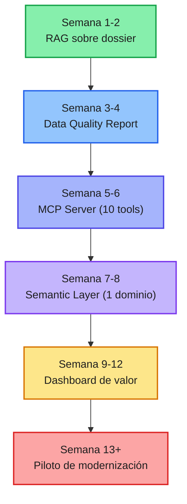
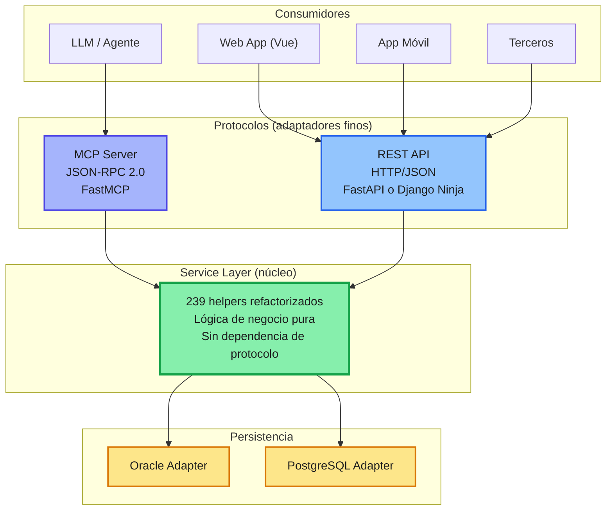
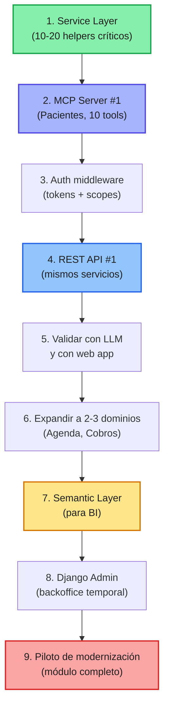

# Análisis Profundo de la Estrategia DREAMS Explorer
## DentWeb12 — Reflexiones, Gaps y Alternativas de Inicio

> **Documento analizado:** `dreams_explorer.md` — DREAMS_02 · Agosto 2026
> **Analista:** IA — revisión estratégica sin restricciones
> **Fecha de análisis:** 2026
> **Propósito:** Validar el camino recorrido, identificar brechas, y abrir alternativas de inicio

---

## Índice

1. [Veredicto General](#1-veredicto-general)
2. [Lo que está excepcionalmente bien](#2-lo-que-está-excepcionalmente-bien)
3. [Los gaps reales que veo](#3-los-gaps-reales-que-veo)
4. [Análisis específico: Django + MCP + Oracle sin FKs](#4-análisis-específico-django--mcp--oracle-sin-fks)
5. [La brecha entre estrategia ideal y estrategia real](#5-la-brecha-entre-estrategia-ideal-y-estrategia-real)
6. [Alternativas de inicio: 7 caminos posibles](#6-alternativas-de-inicio-7-caminos-posibles)
7. [Recomendación de secuencia para los próximos 90 días](#7-recomendación-de-secuencia-para-los-próximos-90-días)
8. [Preguntas abiertas que debes resolver](#8-preguntas-abiertas-que-debes-resolver)
9. [Riesgos que el documento subestima](#9-riesgos-que-el-documento-subestima)
10. [Conclusión: ¿vas por buen camino?](#10-conclusión-vas-por-buen-camino)

---

## 1. Veredicto General

**Vas por muy buen camino. El documento es excepcional.**

Pocas veces se ve un análisis tan maduro de un sistema legacy. La mayoría de los equipos saltan directamente a "vamos a reescribir en [framework de moda]" sin entender el dominio, sin medir el riesgo, sin separar los problemas. Tú has hecho lo contrario: has construido un mapa, has identificado los frentes, has cuestionado tus propias hipótesis, y has llegado a un reencuadre estratégico (los pasos 30-39) que es, honestamente, el corazón del documento.

**Pero hay una diferencia importante entre "tener una estrategia documentada" y "tener una estrategia ejecutable".** El documento es fuerte en el *qué* y el *por qué*. Es más débil en el *cómo concreto* y en el *qué pasa si falla*.

| Dimensión | Evaluación | Comentario |
|-----------|-----------|------------|
| **Claridad de problema** | 🟢 Excelente | Los 3 problemas (A, B, C) están perfectamente separados |
| **Diagnóstico técnico** | 🟢 Excelente | Assessment, dossier, RICH files, inventario |
| **Reencuadre estratégico** | 🟢 Excelente | Los pasos 30-39 son un cambio de paradigma real |
| **Metodología** | 🟢 Muy buena | Gates, una dimensión por vez, characterization testing |
| **Rigor en estimaciones** | 🟡 Media | El documento mismo lo reconoce |
| **Concreción de ejecución** | 🟡 Media | Falta detalle de "semana 1, día 1" |
| **Manejo de riesgos** | 🟡 Media | Identifica riesgos pero no planes de contingencia |
| **Alineación con stakeholders** | 🟡 Media | El CEO aparece pero no hay plan de comunicación |
| **Sostenibilidad del equipo** | 🔴 Baja | No se discute quién ejecuta, burnout, conocimiento |
| **Modelo de costos** | 🔴 Baja | No hay números |

> **La frase que mejor resume tu documento:** *"No queremos reescribir la aplicación. Queremos recuperar su conocimiento, separar sus responsabilidades, preservar su comportamiento y reemplazar progresivamente su tecnología."* — Esta frase debería estar en la pared de la oficina.

---

## 2. Lo que está excepcionalmente bien

### 2.1 La separación de los tres problemas (paso 31)

Este es el insight más valioso de todo el documento.

```
Problema A — Legacy tecnológico      → Urgencia media
Problema B — Modelo de información   → Urgencia media
Problema C — Explotación del conocimiento → Urgencia ALTA
```

La mayoría de los proyectos legacy fracasan porque tratan de resolver A, B y C simultáneamente. Tú has visto que **C se puede atacar sin resolver A y B primero**. Eso es estratégicamente correcto y raramente se articula con esta claridad.

### 2.2 El reencuadre "el legacy no es el enemigo" (paso 30)

> *"No modernicemos porque sea viejo. Modernicemos donde lo viejo impida evolucionar."*

Esta frase es oro. La industria tecnológica tiene un sesgo de "lo nuevo es mejor" que destruye valor. Tú has identificado que el sistema actual **funciona, es estable, y tiene cobertura funcional**. El problema no es su existencia, es su **techo de evolución**.

### 2.3 La secuencia de 6 fases (paso 37)

```
A → Understand    (✅ ya hecha)
B → Expose        (Semantic Data Layer)
C → Intelligence  (BI, dashboards, AI — VALOR RÁPIDO)
D → Modernize     (Core → Spring Boot + Vue)
E → Transform Data (Modelo relacional → PostgreSQL)
F → Retire        (Legacy muere progresivamente)
```

Esta secuencia es **políticamente inteligente y técnicamente sólida**. Demuestra valor antes de tocar el sistema operacional. Genera financiamiento para la modernización. Es el tipo de estrategia que un CEO entiende y aprueba.

### 2.4 Los 6 Gates (paso 22)

```
Gate 1: App moderna sobre Oracle
Gate 2: Modelo relacional
Gate 3: Backend
Gate 4: Frontend
Gate 5: Base de datos
Gate 6: Cutover
```

> *"Ningún gate se considera superado sin evidencia concreta y reproducible. No se avanza por opinión: se avanza porque se demostró."*

Esta regla debería ser **inmutable** durante todo el proyecto. Es lo que evita el "big bang encubierto".

### 2.5 El dossier como Knowledge Graph (paso 33)

La idea de que el dossier no es documentación sino un **activo semántico** es correcta. 689 archivos RICH con código fuente incrustado es un activo que la mayoría de las organizaciones no tiene. Muchos proyectos legacy empiezan con **cero documentación**. Tú empiezas con **exceso de documentación estructurada**.

### 2.6 La comparación REST vs MCP (Parte III)

La tabla comparativa es clara y honesta. No vendes MCP como solución mágica; reconoces que ambos tienen su lugar. La idea de que un MCP Server sirve tanto para LLMs como para apps tradicionales vía JSON-RPC 2.0 es correcta.

### 2.7 La estrategia de "no tocar Oracle"

Mantener Oracle estable durante las primeras fases es **la decisión más sabia del documento**. Cambiar la base de datos mientras cambias la aplicación es la receta clásica para el desastre. Tú has visto esto y has decidido aislar la variable.

---

## 3. Los gaps reales que veo

Ahora la parte incómoda. Estos son los huecos que, si no los llenas, pueden hacer que la estrategia se quede en el papel.

### 3.1 Gap de ejecución: no hay "semana 1, día 1"

El documento dice **qué** hacer (10 pasos en el roadmap) pero no **cómo** hacerlo. No hay:

- Un plan de trabajo detallado para la primera semana
- Un conjunto de criterios de aceptación para el primer entregable
- Una definición de "terminado" para cada fase
- Un plan de comunicación con el equipo
- Un presupuesto de tiempo y dinero

**Impacto:** El proyecto puede empezar con entusiasmo y diluirse en la segunda semana porque nadie sabe exactamente qué hacer el lunes.

### 3.2 Gap de equipo: ¿quién ejecuta?

El documento menciona "un solo dev + IA" como posibilidad pero no lo aborda. Esto es crítico porque:

| Escenario | Implicancia |
|-----------|-------------|
| **1 dev + IA** | El proyecto depende de una sola persona. Riesgo de burnout, vacaciones, enfermedad. La IA acelera pero no reemplaza el juicio humano. |
| **Equipo pequeño (2-3)** | Necesita coordinación. La IA ayuda pero la comunicación entre humanos sigue siendo el cuello de botella. |
| **Equipo grande (5+)** | Overhead de coordinación. La IA puede generar más código del que el equipo puede revisar. |

**Pregunta sin responder:** ¿Cuántas horas semanales puede dedicar el equipo? ¿Es un proyecto full-time o part-time? ¿Hay presupuesto para contratar?

### 3.3 Gap de costos: no hay números

El documento dice "Oracle es caro" pero no cuantifica. No hay:

- Costo anual de licencia Oracle
- Costo estimado de infraestructura para el Semantic Layer
- Costo de oportunidad de no modernizar (¿cuánto se pierde por no tener IA?)
- Presupuesto para el piloto

**Impacto:** Sin números, la conversación con el CEO es emocional, no racional. Los CEOs aprueban inversiones cuando ven ROI, no cuando ven diagramas Mermaid.

### 3.4 Gap de seguridad

El documento menciona que los helpers tienen "riesgo SQL injection" pero no hay una estrategia de seguridad para el nuevo sistema. Preguntas sin responder:

- ¿Cómo se autentica el MCP Server?
- ¿Cómo se autoriza el acceso a las tools?
- ¿Hay auditoría de quién consulta qué?
- ¿Cómo se protegen los datos de pacientes (PII)?
- ¿Cumple con regulaciones de salud (Ley de Derechos y Deberes del Paciente en Chile)?

**Impacto:** Un MCP Server sin autenticación es un desastre esperando a ocurrir.

### 3.5 Gap de testing

El documento menciona "characterization testing" pero no detalla:

- ¿Cómo se captura el comportamiento actual?
- ¿Qué herramienta se usa? (Selenium, Playwright, grabación de tráfico)
- ¿Cómo se comparan outputs legacy vs nuevo?
- ¿Qué pasa cuando el legacy tiene bugs? ¿Se preservan o se corrigen?

**Impacto:** Sin un plan de testing concreto, el "characterization testing" se queda como intención.

### 3.6 Gap de rollback

El documento no discute qué pasa si algo falla. Preguntas sin responder:

- Si el MCP Server falla, ¿la app legacy sigue funcionando?
- Si el Semantic Layer tiene un bug, ¿cómo se revierte?
- Si el módulo piloto modernizado falla, ¿cómo se vuelve al JSP original?
- ¿Hay un plan de contingencia para cada fase?

**Impacto:** Sin rollback, cada paso es un salto al vacío.

### 3.7 Gap de gestión del conocimiento

El documento menciona que el conocimiento está en la cabeza de las personas pero no propone cómo capturarlo **antes** de que se vayan. Preguntas sin responder:

- ¿Quién es el experto de dominio?
- ¿Cuánto tiempo tiene disponible para validar?
- ¿Cómo se documentan las reglas que solo esa persona conoce?
- ¿Qué pasa si esa persona se va mañana?

**Impacto:** El proyecto puede perder su fuente de verdad en cualquier momento.

### 3.8 Gap de "definition of done" para la IA

El documento dice "IA debe formar parte de la estrategia" pero no define:

- ¿Qué tareas específicas hará la IA?
- ¿Cómo se mide si la IA está siendo efectiva?
- ¿Qué pasa cuando la IA se equivoca?
- ¿Quién valida el output de la IA?

**Impacto:** "Usar IA" sin métricas es una intención, no una estrategia.

---

## 4. Análisis específico: Django + MCP + Oracle sin FKs

Esta es la parte más interesante de tu mensaje porque describes una dirección concreta que no está en el documento: **Django + MCP + Oracle tal como está (0 FKs)**.

### 4.1 Django como backend

**Ventajas:**

| Ventaja | Detalle |
|---------|---------|
| **Productividad** | Django es extremadamente productivo. Admin panel, ORM, migraciones, autenticación vienen incluidos. |
| **Python + IA** | El ecosistema de IA en Python es el más maduro. LangChain, LlamaIndex, Hugging Face, PyTorch. |
| **MCP nativo** | FastMCP (Python) es una de las implementaciones más maduras de MCP. |
| **Comunidad** | Django tiene una comunidad enorme. Encontrar talento es más fácil que Java/JSP. |
| **Admin** | El admin de Django puede servir como backoffice temporal para el equipo. |

**Desventajas:**

| Desventaja | Detalle |
|------------|---------|
| **Salto desde Java** | Cambiar de lenguaje, ecosistema y paradigma simultáneamente. |
| **Django + Oracle** | El soporte de Django para Oracle es funcional pero no tan pulido como PostgreSQL. Algunas funciones específicas de Oracle requieren `RawSQL`. |
| **Sin FKs** | Django ORM espera FKs para relaciones. Sin ellas, hay que usar `ForeignKey(..., db_constraint=False)` o queries explícitas. |
| **Rendimiento** | Django ORM puede ser más lento que SQL directo para queries complejas. Sin FKs, los JOINs pueden ser costosos. |
| **Tipado** | Python no es fuertemente tipado. Para un sistema de salud, el tipado estático de Java/TypeScript puede ser una ventaja. |

### 4.2 MCP como interfaz principal

**Lo que me gusta:**

- Es forward-looking. MCP es el estándar emergente para integración con IA.
- Un solo código sirve para LLMs y apps tradicionales.
- La auto-documentación de tools es elegante.
- FastMCP simplifica mucho la implementación.

**Lo que me preocupa:**

| Preocupación | Detalle |
|--------------|---------|
| **Madurez** | MCP es joven (2024-2025). No tiene el ecosistema de REST. La autenticación, rate limiting, versionado y monitoreo están en evolución. |
| **239 tools** | Un LLM con 239 tools disponibles tiene problemas de rendimiento y selección. Necesitas agrupar tools por dominio (Pacientes, Agenda, Cobros, etc.) o usar "tool sets" que se cargan bajo demanda. |
| **Seguridad** | MCP no tiene un estándar de autenticación definido. Exponer un MCP Server sin auth es peligroso. |
| **Debugging** | JSON-RPC 2.0 es más difícil de debuggear que REST. Las herramientas de monitoreo son menos maduras. |
| **Acoplamiento** | Si el MCP Server se convierte en la única interfaz, cualquier cambio en las tools rompe a todos los consumidores. |
| **Performance** | JSON-RPC tiene más overhead que REST para operaciones simples. Para 239 tools, el schema puede ser grande. |

**Mi recomendación:** Usa MCP **en paralelo** con REST, no en lugar de REST. El MCP Server puede ser la interfaz para IA, mientras que REST sirve para apps tradicionales. Comparten la misma capa de servicio (los helpers refactorizados).

```
┌─────────────────────────────────────────────────────────┐
│                   Service Layer                          │
│  (239 helpers refactorizados como Repository methods)   │
└─────────────────────────────────────────────────────────┘
              │                           │
              ▼                           ▼
┌─────────────────────────┐   ┌─────────────────────────┐
│   REST API (FastAPI)    │   │   MCP Server (FastMCP)  │
│   - Apps tradicionales  │   │   - LLMs y agentes      │
│   - Móviles             │   │   - AI-native           │
│   - Terceros            │   │   - JSON-RPC 2.0        │
└─────────────────────────┘   └─────────────────────────┘
```

### 4.3 Oracle sin FKs + ORM

Esta es la decisión más arriesgada de tu plan. Déjame desglosarla.

**Lo que propones:**

```python
# Django ORM con relaciones sin FK en la BD
class Paciente(models.Model):
    codigo = models.CharField(primary_key=True)
    # ...

class Ficha(models.Model):
    num_ficha = models.CharField(primary_key=True)
    paciente = models.ForeignKey(
        Paciente,
        on_delete=models.DO_NOTHING,
        db_constraint=False,  # ⬅️ Sin FK en la BD
        db_column='COD_PERSONA'
    )
```

**Ventajas:**

- No tocas la BD. Oracle permanece estable.
- El ORM "entiende" las relaciones aunque la BD no las tenga.
- Puedes empezar a construir la capa de inteligencia sin esperar a la migración.

**Riesgos:**

| Riesgo | Detalle | Mitigación |
|--------|---------|------------|
| **Datos huérfanos** | Si hay un `COD_PERSONA` que no existe en `PACIENTES`, el ORM devolverá `None` silenciosamente. | Validación explícita + reporte de huérfanos. |
| **Rendimiento** | Sin índices en las columnas de JOIN, las queries pueden ser lentas. | Revisar planes de ejecución. Agregar índices si es necesario (sin FK). |
| **Integridad** | La BD no impide inserts inconsistentes. El ORM tampoco. | Capa de validación en la aplicación. |
| **Migraciones** | Django genera migraciones basadas en FKs. Sin FKs, las migraciones pueden ser confusas. | Usar `--fake-initial` o migraciones manuales. |
| **Deuda técnica** | Estás construyendo una capa que "pretende" que hay FKs. Cuando migres a PostgreSQL, tendrás que agregarlas. | Planificar la migración de datos + FKs como fase separada. |
| **Complejidad** | El ORM con `db_constraint=False` es un modo avanzado. Requiere entender bien Django. | Documentar cada relación implícita. |

**Mi recomendación:**

1. **Empieza con un módulo acotado.** No intentes mapear las 94 tablas de una vez. Elige un dominio (ej: Pacientes) y mapea solo esas tablas.

2. **Valida los datos primero.** Antes de escribir el ORM, corre queries de validación:

```sql
-- ¿Hay fichas sin paciente?
SELECT COUNT(*) FROM FICHAS f
LEFT JOIN PACIENTES p ON f.COD_PERSONA = p.PAC_CODIGO
WHERE p.PAC_CODIGO IS NULL;

-- ¿Hay teléfonos sin persona?
SELECT COUNT(*) FROM TELEFONOS t
LEFT JOIN PACIENTES p ON t.COD_PERSONA = p.PAC_CODIGO
WHERE p.PAC_CODIGO IS NULL;
```

3. **Documenta cada relación implícita.** El dossier ya tiene 35 relaciones implícitas identificadas. Úsalas como contrato.

4. **Considera una capa de validación.** Entre el ORM y la BD, una capa que valide integridad referencial antes de escribir.

5. **No descartes PostgreSQL como destino.** Oracle sin FKs es una etapa. PostgreSQL con FKs es el destino. La migración incluirá la limpieza de datos.

### 4.4 ¿Por qué no Django + PostgreSQL directo?

Esta es una pregunta que deberías hacerte. Si vas a reescribir el backend en Django, ¿por qué no migrar a PostgreSQL al mismo tiempo?

**Argumentos a favor de mantener Oracle:**

- Punto de comparación estable (ya lo dice el documento)
- Menos variables simultáneas
- Oracle funciona, no está roto

**Argumentos a favor de migrar a PostgreSQL ya:**

- Django + PostgreSQL es el camino feliz. Todo funciona mejor.
- Oracle tiene costos de licenciamiento.
- PostgreSQL tiene mejor soporte para JSON, full-text search, etc.
- El ORM sin FKs es un parche, no una solución.

**Mi opinión:** Mantén Oracle para las primeras fases (B y C), pero **planifica la migración a PostgreSQL como parte de la Fase D (Modernize)**. No la dejes para el final. El ORM sin FKs es una deuda técnica que querrás pagar pronto.

---

## 5. La brecha entre estrategia ideal y estrategia real

Esta es la parte que pediste explícitamente. Voy a ser honesto.

### 5.1 La estrategia ideal (lo que el documento describe)

```
Fase A: Understand (✅)
Fase B: Expose (Semantic Data Layer)
Fase C: Intelligence (BI, IA, alertas)
Fase D: Modernize (Spring Boot + Vue)
Fase E: Transform Data (Modelo relacional → PostgreSQL)
Fase F: Retire (Legacy muere)
```

**Supuestos implícitos:**

- Hay un equipo dedicado
- Hay presupuesto
- Hay tiempo (meses, no semanas)
- La IA acelera significativamente
- El negocio apoya
- No hay crisis operativas durante el proyecto
- El conocimiento está disponible

### 5.2 La estrategia real (lo que probablemente pase)

```
Semana 1:    Entusiasmo. Se empieza a explorar.
Semana 2-3:  Se descubre que hay más complejidad de la esperada.
Semana 4:    Primer obstáculo. El equipo se divide.
Semana 6:    Presión del negocio por resultados.
Semana 8:    Se pospone la "Fase C" para "terminar la B".
Semana 12:   El proyecto compite con el mantenimiento diario.
Semana 16:   Se cuestiona si vale la pena.
Semana 20:   Se entrega algo, pero no lo planeado.
Semana 24:   Se declara "éxito parcial" y se sigue con el legacy.
```

**Esta es la realidad de la mayoría de los proyectos de modernización.** No porque la estrategia sea mala, sino porque la ejecución es difícil.

### 5.3 La brecha concreta

| Dimensión | Estrategia ideal | Estrategia real | Brecha |
|-----------|-----------------|-----------------|--------|
| **Tiempo** | 6 fases secuenciales | Presión por resultados rápidos | 🔴 Alta |
| **Equipo** | Dedicado, con experiencia | Comparte tiempo con operación | 🟠 Media |
| **Presupuesto** | Definido | Incierto o limitado | 🟠 Media |
| **Conocimiento** | Disponible | En la cabeza de 1-2 personas | 🔴 Alta |
| **IA** | Acelera todo | Acelera algunas cosas, requiere validación | 🟡 Media |
| **Negocio** | Apoya el cambio | Quiere resultados sin disrupción | 🟠 Media |
| **Datos** | Limpios y consistentes | Con huérfanos e inconsistencias | 🔴 Alta |
| **Testing** | Characterization testing | "Probamos en producción" | 🔴 Alta |

### 5.4 ¿Qué hacer con esta brecha?

No se trata de eliminar la brecha (es inevitable). Se trata de **gestionarla**:

1. **Define un MVP de la Fase C.** No "inteligencia de negocio", sino "un dashboard que muestra X". Concreto, medible, entregable en 2 semanas.

2. **Asigna tiempo protegido.** Si el equipo comparte tiempo con operación, el proyecto se diluye. Necesitas bloques de tiempo dedicados.

3. **Documenta el conocimiento crítico.** Antes de que se vaya la persona que sabe.

4. **Mide el progreso con entregables, no con fases.** "Fase B completada" es abstracto. "10 tools MCP funcionando" es concreto.

5. **Ten un plan B.** Si el proyecto se detiene, ¿qué queda? ¿Un Semantic Layer parcial? ¿Un MCP Server con 5 tools? Eso ya es valor.

---

## 6. Alternativas de inicio: 7 caminos posibles

Aquí está el corazón de tu pregunta: **¿dónde empiezo?** Te doy 7 alternativas, con ventajas, desventajas y cuándo elegir cada una.

### Camino 1: Data-First (empezar por los datos)

**Qué:** Antes de tocar la app, entender los datos. Data profiling, detección de huérfanos, análisis de cardinalidad, mapeo de relaciones implícitas.

**Ventajas:**
- No toca la app operacional
- Genera conocimiento crítico
- Bajo riesgo
- Alimenta todas las fases posteriores

**Desventajas:**
- No genera valor de negocio visible
- Puede ser lento
- Requiere acceso a la BD

**Cuándo elegir:** Si el equipo es pequeño y necesitas entender el terreno antes de moverte.

**Primer entregable:** Un informe de Data Quality con:
- Top 20 tablas por volumen
- Relaciones implícitas validadas (huérfanos, cardinalidad)
- Tablas candidatas para Semantic Layer

---

### Camino 2: App-First (empezar por la aplicación)

**Qué:** Analizar el código fuente (RICH files) para validar el assessment, construir un inventario completo, y empezar a refactorizar.

**Ventajas:**
- Genera conocimiento del dominio
- Prepara el terreno para la modernización
- La IA puede analizar 689 archivos rápidamente

**Desventajas:**
- No genera valor de negocio visible
- Puede ser abrumador (689 archivos)
- Requiere acceso al código fuente real (no solo los RICH)

**Cuándo elegir:** Si tienes acceso al código y quieres entender la lógica de negocio.

**Primer entregable:** Un Source-Based Assessment que:
- Valide el dossier actual
- Identifique reglas de negocio ocultas
- Priorice módulos para modernización

---

### Camino 3: Intelligence-First (empezar por la capa de inteligencia)

**Qué:** Construir el Semantic Data Layer sobre Oracle, sin tocar la app. Empezar con un dominio acotado (ej: Cobros).

**Ventajas:**
- Valor de negocio en semanas
- No toca la app operacional
- Genera financiamiento para fases posteriores
- Demuestra el concepto

**Desventajas:**
- Requiere entender el dominio
- Requiere acceso a datos
- Puede requerir infraestructura adicional

**Cuándo elegir:** Si necesitas demostrar valor rápido para obtener apoyo ejecutivo.

**Primer entregable:** Un dashboard que responda una pregunta de negocio concreta:
- "¿Cuántos pacientes no han vuelto en 6 meses?"
- "¿Qué tratamiento tiene mayor tasa de abandono?"
- "¿Cuál es la proyección de ingresos para el próximo mes?"

---

### Camino 4: MCP-First (empezar por el MCP Server)

**Qué:** Construir un MCP Server que exponga los helpers existentes como tools. Empezar con 5-10 tools críticos.

**Ventajas:**
- Valor técnico inmediato
- Los LLMs lo consumen nativamente
- Las apps tradicionales también
- Prepara el terreno para IA

**Desventajas:**
- No genera valor de negocio directo
- Requiere acceso a la BD
- La seguridad no está resuelta

**Cuándo elegir:** Si el equipo es técnico y quiere explorar MCP.

**Primer entregable:** Un MCP Server con 10 tools funcionando:
- `get_datos_paciente`
- `get_agenda_dia`
- `get_stock_producto`
- `get_historial_citas`
- ... (6 más)

---

### Camino 5: RAG-First (empezar por el conocimiento)

**Qué:** Construir un RAG sobre los 689 archivos RICH. Un agente que responda preguntas sobre el sistema.

**Ventajas:**
- Valor inmediato para el equipo
- Onboarding acelerado
- Base para futuras herramientas de IA
- Bajo riesgo

**Desventajas:**
- No genera valor de negocio directo
- Requiere infraestructura de vectores
- La calidad depende de la calidad del dossier

**Cuándo elegir:** Si el equipo necesita entender el sistema rápidamente.

**Primer entregable:** Un chatbot que responda:
- "¿Qué hace agenda.jsp?"
- "¿Qué tablas toca ContableService?"
- "¿Cuál es el flujo de cobro?"

---

### Camino 6: Pilot-First (empezar por un módulo piloto)

**Qué:** Elegir un módulo representativo (ej: Agenda) y modernizarlo completamente: Django + MCP + PostgreSQL. Medir esfuerzo, errores, tiempo.

**Ventajas:**
- Genera datos reales para estimaciones
- Valida la arquitectura
- Identifica problemas temprano

**Desventajas:**
- Alto riesgo (toca la app)
- Requiere mucho esfuerzo
- Puede fallar

**Cuándo elegir:** Si ya tienes claridad y quieres validar la arquitectura.

**Primer entregable:** Un módulo funcionando en Django + MCP, con characterization testing que demuestre equivalencia funcional.

---

### Camino 7: Hybrid-First (combinación inteligente)

**Qué:** Combinar los caminos anteriores en una secuencia que maximice valor y minimice riesgo.

**Mi recomendación de secuencia:**



**Ventajas:**
- Valor rápido (RAG en 2 semanas)
- Conocimiento profundo (Data Quality)
- Valor técnico (MCP)
- Valor de negocio (Dashboard)
- Validación (Piloto)

**Desventajas:**
- Requiere disciplina
- Requiere no saltarse pasos

**Cuándo elegir:** Siempre. Es la secuencia que recomiendo.

---

## 7. Recomendación de secuencia para los próximos 90 días

Basado en todo lo anterior, esta es mi recomendación concreta.

### Semana 1-2: RAG sobre el dossier

**Objetivo:** Tener un agente que responda preguntas sobre el sistema.

**Entregables:**
- Índice vectorial de los 689 archivos RICH
- Interfaz de chat (CLI o web)
- 10 preguntas de prueba respondidas correctamente

**Herramientas:** LangChain, ChromaDB o Qdrant, OpenAI/Claude API o modelo local.

**Métrica de éxito:** El equipo puede hacer preguntas y obtener respuestas útiles.

---

### Semana 3-4: Data Quality Report

**Objetivo:** Entender el estado real de los datos.

**Entregables:**
- Top 20 tablas por volumen
- Relaciones implícitas validadas (huérfanos, cardinalidad)
- Tablas candidatas para Semantic Layer
- Reporte de riesgos de integridad

**Herramientas:** SQL directo sobre Oracle, pandas, Jupyter.

**Métrica de éxito:** Sabes qué datos están limpios y cuáles no.

---

### Semana 5-6: MCP Server (10 tools)

**Objetivo:** Exponer los helpers más críticos como tools MCP.

**Entregables:**
- MCP Server funcionando
- 10 tools implementadas
- Documentación automática
- Prueba de consumo desde un LLM

**Herramientas:** FastMCP, Oracle connector, Pydantic.

**Métrica de éxito:** Un LLM puede consultar datos de pacientes vía MCP.

---

### Semana 7-8: Semantic Layer (1 dominio)

**Objetivo:** Construir una capa semántica para un dominio (ej: Cobros).

**Entregables:**
- Modelo analítico del dominio
- Vistas materializadas o tablas derivadas
- Documentación del modelo
- Queries de ejemplo

**Herramientas:** SQL, dbt (opcional), PostgreSQL (si es posible) u Oracle.

**Métrica de éxito:** Puedes responder preguntas de negocio sobre el dominio.

---

### Semana 9-12: Dashboard de valor

**Objetivo:** Entregar un dashboard que demuestre valor de negocio.

**Entregables:**
- Dashboard con 5-10 KPIs del dominio
- Alertas proactivas
- Presentación al CEO

**Herramientas:** Metabase, Superset, o dashboard custom en Django.

**Métrica de éxito:** El CEO ve valor concreto y aprueba la siguiente fase.

---

### Semana 13+: Piloto de modernización

**Objetivo:** Modernizar un módulo completo con Django + MCP.

**Entregables:**
- Módulo funcionando en Django
- Characterization testing
- MCP tools para el módulo
- Comparación legacy vs nuevo

**Herramientas:** Django, FastMCP, PostgreSQL (si es posible).

**Métrica de éxito:** El módulo nuevo reproduce el comportamiento del legacy.

---

## 8. Preguntas abiertas que debes resolver

Estas son las preguntas que el documento no responde y que necesitas resolver antes de ejecutar.

### 8.1 Sobre el equipo

1. ¿Quién ejecuta el proyecto? ¿Tiempo completo o parcial?
2. ¿Hay presupuesto para contratar?
3. ¿Quién es el experto de dominio?
4. ¿Cuánto tiempo tiene disponible?
5. ¿Qué pasa si esa persona se va?

### 8.2 Sobre el negocio

6. ¿Cuál es el dolor más urgente del negocio?
7. ¿Qué decisión no se puede tomar hoy por falta de datos?
8. ¿Qué reporte se hace manualmente y podría automatizarse?
9. ¿Qué alerta proactiva tendría más impacto?
10. ¿Cuánto está dispuesto a invertir el negocio?

### 8.3 Sobre la tecnología

11. ¿Hay acceso al código fuente real (no solo los RICH)?
12. ¿Hay acceso a la configuración de Payara?
13. ¿Hay acceso a la BD de producción?
14. ¿Hay un ambiente de staging?
15. ¿Hay CI/CD?

### 8.4 Sobre los datos

16. ¿Cuál es el volumen de datos?
17. ¿Hay datos históricos?
18. ¿Hay datos de pacientes (PII)?
19. ¿Hay regulaciones de privacidad?
20. ¿Hay backups?

### 8.5 Sobre la estrategia

21. ¿Cuál es el criterio de éxito del proyecto?
22. ¿Cuál es el plazo máximo?
23. ¿Qué pasa si el proyecto falla?
24. ¿Hay un plan B?
25. ¿Quién toma las decisiones?

---

## 9. Riesgos que el documento subestima

### 9.1 Riesgo de "parálisis por análisis"

El documento es tan completo que puede llevar a la parálisis. 39 pasos, 3 partes, 7 alternativas... Es fácil quedarse en la fase de planificación.

**Mitigación:** Define un primer entregable concreto y empieza. No esperes a tener todo perfecto.

### 9.2 Riesgo de "IA como muleta"

El documento confía mucho en la IA. Pero la IA:
- No entiende el negocio
- No toma decisiones
- No asume responsabilidad
- Puede alucinar
- Requiere validación humana

**Mitigación:** Define claramente qué hace la IA y qué hace el humano. La IA acelera, el humano decide.

### 9.3 Riesgo de "deuda técnica del ORM"

El ORM sin FKs es un parche. Si no se paga pronto, se convierte en deuda técnica permanente.

**Mitigación:** Planifica la migración a PostgreSQL con FKs como parte de la Fase D, no como algo "para después".

### 9.4 Riesgo de "MCP como apuesta"

MCP es joven. Si no se adopta masivamente, tu inversión puede quedar en un nicho.

**Mitigación:** Usa MCP en paralelo con REST. No apuestes todo a MCP.

### 9.5 Riesgo de "seguridad"

Un MCP Server sin autenticación es un desastre. Un Semantic Layer sin control de acceso es un riesgo.

**Mitigación:** Define la estrategia de seguridad antes de exponer datos.

### 9.6 Riesgo de "burnout"

Un solo dev + IA puede quemarse. La presión de un proyecto de modernización es alta.

**Mitigación:** Define un ritmo sostenible. Celebra los logros. No sacrifiques el bienestar.

---

## 10. Conclusión: ¿vas por buen camino?

**Sí. Vas por muy buen camino. El documento es excepcional. Pero hay trabajo por hacer.**

### Lo que tienes

- Claridad de problema (los 3 problemas)
- Reencuadre estratégico (los pasos 30-39)
- Metodología (gates, una dimensión por vez)
- Assessment completo (689 RICH files)
- Visión de futuro (6 fases)

### Lo que te falta

- Plan de ejecución concreto (semana 1, día 1)
- Equipo definido
- Presupuesto
- Estrategia de seguridad
- Plan de rollback
- Métricas de éxito
- Plan de comunicación

### La frase que resume todo

> **"El documento es un mapa excelente. Pero un mapa no es el territorio. El siguiente paso no es refinar el mapa, sino empezar a caminar."**

### Mi recomendación final

1. **Empieza por el RAG.** Es lo más rápido, lo más seguro, y lo que más valor inmediato genera para el equipo.

2. **Define un MVP de la Fase C.** No "inteligencia de negocio", sino "un dashboard que responde X pregunta". Concreto.

3. **Resuelve las preguntas abiertas.** Especialmente las de equipo y presupuesto.

4. **No esperes a tener todo perfecto.** El documento es suficientemente bueno. Empieza.

5. **Mide, aprende, ajusta.** La estrategia es un documento vivo.

---

## Apéndice: Hipervínculo de descarga

Como soy una IA basada en texto, no puedo generar un archivo descargable directamente. Pero puedes copiar todo el contenido de esta respuesta y guardarlo como un archivo `.md` en tu visor Obsidian.

**Nombre sugerido:** `analisis_dreams_explorer_2026.md`

**Tags sugeridos para Obsidian:**
```yaml
---
tags:
  - dentweb12
  - modernizacion
  - legacy
  - django
  - mcp
  - oracle
  - estrategia
  - analisis
---
```

**Links sugeridos:**
```markdown
[[dreams_explorer]]
[[dentweb12_assessment]]
[[mcp_server_architecture]]
[[semantic_data_layer]]
[[django_migration]]
```

---

> **Frase final:** *"El legacy no es el enemigo. El enemigo es no entenderlo. Tú lo estás entendiendo. Ahora empieza a transformarlo."*

## Fernando preguntando

# Reflexiones sobre MCP, Tokens y la Arquitectura de 239 Helpers

> **Contexto:** Respuesta a tu comentario sobre autenticación por token, la idea de "239 helpers → API → MCP", y tu incomodidad con esa alternativa.

---

## 0. Definición: MCP vs API

El MCP (Model Context Protocol) y las APIs (Application Programming Interfaces) son tecnologías que permiten conectar sistemas informáticos, pero operan de formas totalmente distintas. Mientras que una API tradicional permite que cualquier software se comunique con otro mediante reglas estrictas y fijas, el MCP es un estándar abierto diseñado específicamente para que los modelos de Inteligencia Artificial (LLMs) se conecten de forma segura y dinámica con datos, herramientas y entornos de desarrollo. A continuación, se presenta un cuadro comparativo para entender sus diferencias clave:

| Característica | API (Application Programming Interface) | MCP (Model Context Protocol) |
|---|---|---|
| **Propósito principal** | Conectar aplicaciones de software tradicionales entre sí. | Conectar Modelos de Lenguaje (IA) con fuentes de datos y herramientas. |
| **Quién la consume** | Desarrolladores de software (código explícito). | Modelos de Inteligencia Artificial (LLMs). |
| **Naturaleza** | Estática y estructurada (rutas, endpoints y formatos fijos). | Dinámica y contextual (la IA decide cómo y cuándo usarla según el contexto). |
| **Flexibilidad** | Baja. Si cambias la estructura de los datos, el código se rompe. | Alta. La IA interpreta la estructura de los datos de forma flexible. |
| **Seguridad** | Basada en tokens, claves API y permisos de usuario tradicionales. | Basada en capas de abstracción para que el LLM no acceda directamente al sistema. |
| **Estándar** | No hay un estándar único (REST, GraphQL, gRPC). | Es un estándar unificado (creado por Anthropic) para ecosistemas de IA. |

---

## Índice

1. [Sobre el login por token](#1-sobre-el-login-por-token)
2. [Por qué no me gusta "REST → MCP" (y por qué a ti tampoco)](#2-por-qué-no-me-gusta-rest--mcp-y-por-qué-a-ti-tampoco)
3. [La alternativa correcta: Service Layer compartida](#3-la-alternativa-correcta-service-layer-compartida)
4. [El problema real de los 239 tools](#4-el-problema-real-de-los-239-tools)
5. [Arquitectura concreta recomendada](#5-arquitectura-concreta-recomendada)
6. [Conclusión y recomendación](#6-conclusión-y-recomendación)

---

## 1. Sobre el login por token

**Bien. Eso resuelve la mitad del problema de seguridad. La otra mitad es específica de MCP.**

### Lo que el token resuelve

- Autenticación: saber **quién** llama
- Autorización básica: saber **qué puede hacer**
- Auditoría: saber **quién hizo qué**
- Rate limiting: evitar abuso

### Lo que el token NO resuelve automáticamente en MCP

| Aspecto | Realidad de MCP |
|---------|-----------------|
| **Estándar de auth** | MCP no define un mecanismo de autenticación en el protocolo (a la fecha de mi conocimiento). Cada implementación lo resuelve en el transporte. |
| **Transporte stdio** | Si el MCP Server corre local vía stdio, el "token" no aplica — el proceso ya está autenticado por el sistema operativo. |
| **Transporte HTTP** | Aquí es donde el token aplica. Se implementa como header `Authorization: Bearer <token>` en la capa HTTP, **antes** de que el JSON-RPC se procese. |
| **OAuth 2.0** | Si quieres auth estándar, MCP se está alineando con OAuth 2.0. Pero es más complejo que un token simple. |
| **Tokens por tool** | ¿Un token da acceso a todas las tools, o hay scopes por tool? Esto no lo resuelve MCP; lo resuelves tú. |
| **Tokens por paciente** | En un sistema de salud, ¿un token de recepcionista puede ver datos de cualquier paciente? ¿O hay restricción por paciente? Esto es **crítico** y no lo resuelve el token per se. |

### Mi recomendación concreta sobre auth

```python
# Middleware de auth para FastMCP (transporte HTTP)
from fastmcp import FastMCP
from fastmcp.server.middleware import Middleware

class TokenAuthMiddleware(Middleware):
    async def on_request(self, context, call_next):
        token = context.request.headers.get("Authorization", "").replace("Bearer ", "")
        user = validate_token(token)  # Tu lógica de validación
        if not user:
            raise PermissionError("Invalid token")
        context.state.user = user
        return await call_next(context)

mcp = FastMCP(name="dentweb12-mcp")
mcp.add_middleware(TokenAuthMiddleware())
```

**Pero además:** cada tool debe validar **permisos finos**. Ejemplo: `get_datos_paciente` debe verificar que el usuario tenga acceso a ese paciente específico. El token dice *quién eres*; la tool decide *si puedes hacer esto*.

> **Resumen:** El token resuelve autenticación. La autorización fina (por tool, por recurso, por paciente) es tu responsabilidad y debe estar en la capa de servicio.

---

## 2. Por qué no me gusta "REST → MCP" (y por qué a ti tampoco)

Tu instinto es correcto. Déjame articular por qué esa arquitectura es problemática.

### El patrón que describes

```
239 helpers → REST API → MCP Server (wrapper)
```

### Los problemas concretos

| Problema | Detalle |
|----------|---------|
| **Doble protocolo, doble auth** | REST usa Bearer tokens en headers HTTP. MCP usa JSON-RPC. Mantener ambos sincronizados es trabajo duplicado. |
| **MCP como ciudadano de segunda** | El MCP Server se convierte en un "traductor" de REST. No aprovecha las capacidades nativas de MCP (resources, prompts, sampling). |
| **Latencia acumulada** | Cada llamada MCP → HTTP → REST → servicio suma overhead. Para operaciones simples, es notable. |
| **Sincronización de schemas** | El schema OpenAPI de REST y el schema de tools MCP deben mantenerse alineados. Divergen con el tiempo. |
| **Pérdida de semántica** | REST tiene verbos HTTP (GET, POST, PUT, DELETE). MCP tiene tools. El mapeo no es 1:1 y se pierden matices. |
| **Debugging en dos capas** | Un error puede estar en el MCP wrapper, en el REST endpoint, o en el servicio. Más superficie de fallo. |
| **Evolución acoplada** | Si cambias un endpoint REST, rompes el MCP wrapper. Si cambias una tool MCP, rompes el wrapper. |
| **Dependencia circular conceptual** | El MCP "depende" de REST. Si REST cae, MCP cae. Si REST cambia, MCP cambia. |

### La metáfora

Es como construir una casa con dos entradas: una puerta principal (REST) y una ventana (MCP). La ventana da a la misma sala, pero tienes que mantener ambas. Y si alguien quiere entrar por la ventana, primero tiene que pasar por la puerta.

**No tiene sentido.** Mejor: una sola entrada (el servicio) y dos formas de llegar a ella (REST y MCP), ambas pares.

---

## 3. La alternativa correcta: Service Layer compartida

### El patrón correcto

```
239 helpers → Service Layer → { REST Adapter, MCP Adapter }
```

Donde:
- **Service Layer** es lógica de negocio pura. Sin HTTP. Sin JSON-RPC. Sin protocolo.
- **REST Adapter** es una capa fina que traduce HTTP → llamadas al servicio.
- **MCP Adapter** es una capa fina que traduce JSON-RPC → llamadas al servicio.
- Ambos adaptadores son **pares**, no uno envuelve al otro.

### Diagrama



### Por qué esto es superior

| Ventaja | Detalle |
|---------|---------|
| **Una sola fuente de verdad** | La lógica de negocio vive en un solo lugar. REST y MCP son solo "traductores". |
| **Protocolos intercambiables** | Si mañana quieres GraphQL, gRPC, o WebSockets, agregas un adaptador sin tocar el servicio. |
| **Testing simplificado** | Testeas el servicio una vez. Los adaptadores son tan finos que casi no requieren tests. |
| **Sin acoplamiento entre protocolos** | REST no sabe que MCP existe. MCP no sabe que REST existe. Ambos conocen el servicio. |
| **Evolución independiente** | Puedes versionar REST sin tocar MCP y viceversa. |
| **Performance** | Sin capas intermedias. Cada adaptador llama al servicio directamente. |
| **Debugging claro** | Un error está en el servicio, en el adaptador REST, o en el adaptador MCP. Tres lugares claros. |

### Ejemplo concreto

```python
# service/paciente_service.py — Lógica de negocio pura
class PacienteService:
    def __init__(self, repo: PacienteRepository):
        self.repo = repo
    
    def get_datos_paciente(self, ficha_o_rut: str) -> Paciente:
        """Obtiene datos completos de un paciente."""
        # Lógica de negocio aquí
        ficha = self._resolver_ficha(ficha_o_rut)
        paciente = self.repo.get_by_ficha(ficha)
        if not paciente:
            raise PacienteNoEncontrado(ficha)
        return paciente
```

```python
# adapters/rest.py — Adaptador REST (fino)
from fastapi import APIRouter, Depends
from service.paciente_service import PacienteService

router = APIRouter()

@router.get("/api/pacientes/{ficha_o_rut}")
async def get_paciente(
    ficha_o_rut: str,
    service: PacienteService = Depends()
):
    paciente = service.get_datos_paciente(ficha_o_rut)
    return paciente.to_dict()
```

```python
# adapters/mcp.py — Adaptador MCP (fino)
from fastmcp import FastMCP
from service.paciente_service import PacienteService

mcp = FastMCP(name="dentweb12")
service = PacienteService()

@mcp.tool()
def get_datos_paciente(ficha_o_rut: str) -> dict:
    """Obtiene datos completos de un paciente por ficha o RUT."""
    paciente = service.get_datos_paciente(ficha_o_rut)
    return paciente.to_dict()
```

**Observa:** Ambos adaptadores son de 5-10 líneas. Toda la lógica está en el servicio. Si mañana cambias la lógica, cambias **un solo lugar**.

### ¿Y si solo quieres MCP?

Entonces no construyes el adaptador REST. Punto. El servicio existe igual. Si mañana necesitas REST, lo agregas sin tocar el servicio.

**Esta es la clave:** el servicio es independiente del protocolo. Esa es la decisión arquitectónica más importante que puedes tomar.

---

## 4. El problema real de los 239 tools

Aquí hay un problema práctico que ningún framework resuelve por ti: **239 tools es demasiado para un solo MCP Server.**

### Por qué 239 tools es un problema

| Problema | Detalle |
|----------|---------|
| **Selección del LLM** | Los LLMs degradan su capacidad de selección de tools cuando hay más de ~30-50. Con 239, la precisión cae drásticamente. |
| **Context window** | El schema de 239 tools ocupa mucho espacio en el contexto. Cada llamada al LLM incluye todos los schemas. |
| **Latencia** | El LLM tarda más en decidir qué tool usar. |
| **Mantenimiento** | Un solo archivo con 239 tools es inmanejable. |
| **Seguridad** | Un token que da acceso a 239 tools es un token muy poderoso. |

### Estrategias de agrupación

#### Estrategia A: MCP Servers por dominio

```mermaid
flowchart TD
    ORCH["Orquestador / Cliente MCP"] --> S1["MCP Pacientes<br/>~25 tools<br/>"]
    ORCH --> S2["MCP Agenda<br/>~20 tools<br/>"]
    ORCH --> S3["MCP Cobros<br/>~30 tools"]
    ORCH --> S4["MCP Laboratorio<br/>~20 tools<br/>"]
    ORCH --> S5["MCP Tratamientos<br/>~25 tools<br/>"]
    ORCH --> S6["MCP Stock<br/>~15 tools<br/>"]
    ORCH --> S7["MCP Reportes<br/>~40 resources<br/>"]
    ORCH --> S8["MCP Admin<br/>~20 tools<br/>"]
    ORCH --> S9["MCP Utils<br/>~15 tools<br/>"]
    
    style S1 fill:#86efac,stroke:#16a34a,stroke-width:2px,color:#1e1e1e
    style S2 fill:#86efac,stroke:#16a34a,stroke-width:2px,color:#1e1e1e
    style S3 fill:#86efac,stroke:#16a34a,stroke-width:2px,color:#1e1e1e
    style S4 fill:#86efac,stroke:#16a34a,stroke-width:2px,color:#1e1e1e
    style S5 fill:#86efac,stroke:#16a34a,stroke-width:2px,color:#1e1e1e
    style S6 fill:#86efac,stroke:#16a34a,stroke-width:2px,color:#1e1e1e
    style S7 fill:#93c5fd,stroke:#2563eb,stroke-width:2px,color:#1e1e1e
    style S8 fill:#86efac,stroke:#16a34a,stroke-width:2px,color:#1e1e1e
    style S9 fill:#86efac,stroke:#16a34a,stroke-width:2px,color:#1e1e1e
    style ORCH fill:#c4b5fd,stroke:#7c3aed,stroke-width:2px,color:#1e1e1e
```



**Ventajas:**
- Cada servidor tiene un número manejable de tools (15-40)
- El LLM puede cargar solo los servidores relevantes a la tarea
- Los tokens pueden ser por servidor (un token de recepción no accede a admin)
- Mantenimiento modular

**Desventajas:**
- Más infraestructura
- El cliente MCP debe gestionar múltiples conexiones
- Puede haber duplicación de tools comunes

#### Estrategia B: Un servidor con namespacing

```python
@mcp.tool()
def paciente_get_datos(ficha_o_rut: str) -> dict: ...

@mcp.tool()
def paciente_get_historial(ficha: str) -> list: ...

@mcp.tool()
def agenda_get_citas(fecha: str) -> list: ...

@mcp.tool()
def agenda_create_cita(...) -> dict: ...
```

**Ventajas:**
- Un solo servidor
- Fácil de implementar

**Desventajas:**
- El LLM sigue viendo 239 tools
- No resuelve el problema de selección
- Un token da acceso a todo

#### Estrategia C: Resources para lectura, Tools para escritura

MCP distingue entre:
- **Tools:** acciones que el LLM puede invocar
- **Resources:** datos que el LLM puede leer

Muchos de los 239 helpers son de **lectura**. Estos pueden ser Resources en lugar de Tools.

```python
# En lugar de 40 tools de reportes, 40 resources
@mcp.resource("reportes://ventas/mes/{mes}")
def get_ventas_mes(mes: str) -> str:
    return reporte_service.get_ventas_mes(mes).to_json()

@mcp.resource("reportes://stock/critico")
def get_stock_critico() -> str:
    return stock_service.get_stock_critico().to_json()
```

**Ventajas:**
- Reduce el número de tools activas
- El LLM accede a datos sin "invocar" una acción
- Semánticamente más correcto

#### Estrategia D: Tool Registry dinámico

Un solo MCP Server con una tool "meta" que descubre tools:

```python
@mcp.tool()
def buscar_tools(query: str) -> list[str]:
    """Busca tools relevantes por descripción."""
    return tool_registry.search(query)

@mcp.tool()
def ejecutar_tool(tool_name: str, params: dict) -> dict:
    """Ejecuta una tool específica."""
    return tool_registry.execute(tool_name, params)
```

**Ventajas:**
- El LLM solo ve 2 tools
- Escalable a cientos de tools

**Desventajas:**
- Dos pasos en lugar de uno
- El LLM debe saber buscar
- Pierde la auto-documentación de MCP

### Mi recomendación

**Combinación de A + C:**

1. **Dividir en ~8-10 MCP Servers por dominio.** Cada uno con 15-30 tools.
2. **Mover helpers de lectura a Resources.** Reduce el número de tools.
3. **Los helpers de escritura quedan como Tools.** Son los que requieren acción.
4. **Cada servidor con su propio token/scope.** Un token de "recepción" accede a `MCP Agenda` y `MCP Pacientes`, pero no a `MCP Admin`.

### Estimación realista post-análisis

De los 239 helpers, después del análisis de fuentes probablemente encontrarás:

| Categoría | Estimado |
|-----------|----------|
| Helpers duplicados o redundantes | ~30 |
| Helpers obsoletos (no usados) | ~20 |
| Helpers de lectura (→ Resources) | ~80 |
| Helpers de escritura (→ Tools) | ~60 |
| Helpers internos (no expuestos) | ~49 |
| **Total Tools MCP reales** | **~60-80** |

60-80 tools distribuidas en 8-10 servidores = 6-10 tools por servidor. **Perfectamente manejable.**

---

## 5. Arquitectura concreta recomendada

### Stack propuesto

```
┌─────────────────────────────────────────────────────────────┐
│                     CONSUMIDORES                             │
│  LLM/Agente  │  Vue Web  │  Móvil  │  Terceros  │  BI       │
└──────────────┼───────────┼─────────┼────────────┼───────────┘
               │           │         │            │
       ┌───────▼───┐   ┌───▼─────┐   │            │
       │ MCP Server│   │REST API │   │            │
       │ (FastMCP) │   │(FastAPI)│   │            │
       └───────┬───┘   └───┬─────┘   │            │
               │           │         │            │
               └─────┬─────┘         │            │
                     ▼               │            │
       ┌─────────────────────────┐   │            │
       │   SERVICE LAYER         │   │            │
       │   (Django services)     │   │            │
       │   - 239 helpers → ~80   │   │            │
       │   - Lógica pura         │   │            │
       └────────────┬────────────┘   │            │
                    │                │            │
                    ▼                │            │
       ┌─────────────────────────┐   │            │
       │   PERSISTENCE           │   │            │
       │   - Django ORM          │   │            │
       │   - Oracle (actual)     │   │            │
       │   - PostgreSQL (destino)│   │            │
       └─────────────────────────┘   │            │
                                     │            │
                                     ▼            ▼
                              ┌─────────────────────────┐
                              │   SEMANTIC LAYER        │
                              │   (para BI y analytics) │
                              └─────────────────────────┘
```

## Ultra resumen MCP API

                    MISMA INFORMACIÓN
                           │
              ┌────────────┴────────────┐
              │                         │
           REST API                    MCP
              │                         │
       "¿Cómo llamo esto?"       "¿Qué puedo hacer?"
              │                         │
       Endpoint + HTTP             Tool + Schema
              │                         │
       Integración técnica        Integración semántica
              │                         │
              └────────────┬────────────┘
                           │
                           ▼
                          IA


### Decisiones clave

| Decisión | Recomendación | Por qué |
|----------|---------------|---------|
| **Backend** | Django | Productividad + Python para IA + ecosistema |
| **Service Layer** | Django services (no views, no models) | Lógica pura, testeable, reutilizable |
| **REST** | FastAPI o Django Ninja | Moderno, async, OpenAPI automático |
| **MCP** | FastMCP | Estándar emergente, bien diseñado |
| **ORM** | Django ORM con `db_constraint=False` | Sin FKs en Oracle, pero relaciones en código |
| **BD inicial** | Oracle (sin tocar) | Punto de comparación estable |
| **BD destino** | PostgreSQL | Open source, mejor ecosistema |
| **Auth** | Token JWT + scopes por dominio | Estándar, granular |
| **MCP grouping** | 8-10 servidores por dominio | Manejo de 239 tools |

### Orden de construcción (revisado)



### Por qué este orden

1. **Service Layer primero:** Es la base. Sin esto, todo lo demás es decoración.
2. **MCP antes que REST:** Porque es tu prioridad estratégica y valida la arquitectura rápido.
3. **Auth temprano:** No queremos exponer datos sin control.
4. **REST después:** Cuando ya sabes que el servicio funciona. Es un adaptador fino.
5. **Expansión gradual:** 2-3 dominios, no 10 de golpe.
6. **Semantic Layer:** Cuando ya hay servicios que alimentan datos limpios.
7. **Django Admin:** Backoffice rápido para el equipo mientras se construye el frontend.
8. **Piloto:** Validación real antes de escalar.

---

## 6. Conclusión y recomendación

### Lo que confirmo de tu instinto

✅ **Token login:** Correcto. Resuelve autenticación. Pero necesitas autorización fina por tool y por recurso.

✅ **No te gusta "REST → MCP":** Tu instinto es correcto. Es un antipatrón. No lo hagas.

### Lo que propongo

🎯 **Service Layer compartida.** Ni REST envuelve a MCP, ni MCP envuelve a REST. Ambos son adaptadores finos sobre el mismo núcleo.

🎯 **MCP como protocolo primario.** Dado que tu prioridad es IA, MCP va primero. REST se agrega después para consumidores que lo necesiten (web app, móvil).

🎯 **8-10 MCP Servers por dominio.** No un servidor con 239 tools. Agrupa por dominio, usa Resources para lectura, Tools para escritura.

🎯 **Django + FastMCP + FastAPI.** Django para el núcleo (ORM, admin, servicios), FastMCP para MCP, FastAPI para REST. Los tres comparten la capa de servicios.

### La frase que resume todo

> **"No construyas una API y luego la envuelvas en MCP. Construye un servicio, y dale dos formas de llegar a él."**

### Próximo paso concreto

**Antes de escribir una línea de código, haz esto:**

1. Toma **5 helpers** de un dominio (ej: Pacientes).
2. Escribe el **servicio** para esos 5 helpers (lógica pura, sin protocolo).
3. Escribe el **adaptador MCP** para esos 5 servicios (5 tools).
4. Escribe el **adaptador REST** para esos 5 servicios (5 endpoints).
5. Prueba ambos con un LLM y con `curl`.

Si esto funciona, tienes la arquitectura validada. Si no, descubres los problemas con 5 helpers, no con 239.

**Tiempo estimado:** 3-5 días.
**Riesgo:** Bajo.
**Valor:** Altísimo. Valida toda la arquitectura antes de comprometerte.

---

> **Frase final:** *"El problema no es MCP ni REST. El problema es acoplar protocolos. Sepáralos, y ambos serán tus aliados. Júntalos, y serán tu condena."*
